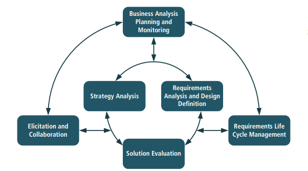

目次

> Macro (toc)

# 概要

BABOK (Business Analysis Body of Knowledge) は、国際ビジネスアナリスト協会 (IIBA) が提供するビジネスアナリストの専門知識とベストプラクティスのコレクションです。BABOKは、ビジネスプロセス改善、要件分析、プロジェクトマネジメント、ソリューション設計など、ビジネスアナリストの役割に関連する幅広いスキルとコンセプトをカバーしています。

# 6つの領域

## 1. ビジネスアナリシスの計画とモニタリング

プロジェクトを成功させるために計画を立て、進捗をモニタリングし、必要に応じて調整することが不可欠です。ステークホルダーとのコミュニケーション戦略を確立し、リソースを効果的に割り当て、リスクを管理しましょう。

| **活動** | プロジェクトのビジネスアナリシスアプローチの計画、リソースの割り当て、進捗のモニタリング、課題のトラッキング、プロジェクト計画の調整など |
| --- | --- |
| **ツール** | [プロジェクト管理ソフトウェア](https://ja.wikipedia.org/wiki/%E3%83%97%E3%83%AD%E3%82%B8%E3%82%A7%E3%82%AF%E3%83%88%E7%AE%A1%E7%90%86%E3%82%BD%E3%83%95%E3%83%88%E3%82%A6%E3%82%A7%E3%82%A2)、リソース管理ツール、スケジューリングツールなど |
| **技法** | プロジェクト計画の策定、[リスク評価](https://ja.wikipedia.org/wiki/%E3%83%AA%E3%82%B9%E3%82%AF%E3%82%A2%E3%82%BB%E3%82%B9%E3%83%A1%E3%83%B3%E3%83%88)、スコープ定義、優先順位付け、モニタリングと報告のためのダッシュボードなど |
| **導入** | ビジネスアナリストの役割と責任の定義、プロジェクトのビジョンとゴールの明確化、ステークホルダーのコミュニケーション戦略の策定など |

## 2. コラボレーション

ステークホルダーとの協力とコミュニケーションは、要件の正確性と共感性を確保するために重要です。適切なワークショップやインタビューを実施し、情報を収集し、要件を明確にしましょう。

| **活動** | ステークホルダーとのコミュニケーション、要件の収集、情報の収集と分析、ワークショップやインタビューの実施など |
| --- | --- |
| **ツール** | フロー図、[ユースケース図](https://ja.wikipedia.org/wiki/%E7%B5%B1%E4%B8%80%E3%83%A2%E3%83%87%E3%83%AA%E3%83%B3%E3%82%B0%E8%A8%80%E8%AA%9E)、ワークショップ用のテンプレートなど |
| **技法** | [ステークホルダー分析](https://ja.wikipedia.org/wiki/%E3%82%B9%E3%83%86%E3%83%BC%E3%82%AF%E3%83%9B%E3%83%AB%E3%83%80%E3%83%BC%E5%88%86%E6%9E%90)、[ユースケースモデリング](https://ja.wikipedia.org/wiki/%E7%B5%B1%E4%B8%80%E3%83%A2%E3%83%87%E3%83%AA%E3%83%B3%E3%82%B0%E8%A8%80%E8%AA%9E)、ワークショップファシリテーション、インタビュー技法など |
| **導入** | ステークホルダーの選定、コミュニケーション計画の策定、要件の文書化と検証プロセスの設計など |

## 3. 要求のライフサイクル・マネジメント

要件の変更や進展に対応し、要件の正確な管理と文書化を行うことが重要です。要件のトレーサビリティを維持し、変更に対する影響を評価し、プロセスを統制しましょう。

| **活動** | 要件の識別、文書化、変更管理、トレーサビリティの確保、要件のバージョン管理など |
| --- | --- |
| **ツール** | [要件管理ツール](https://ja.wikipedia.org/wiki/%E8%A6%81%E6%B1%82%E7%AE%A1%E7%90%86)、トレーシビリティツール、変更管理ツールなど |
| **技法** | 要件の分析と優先順位付け、要件の詳細化、変更要求の評価など |
| **導入** | 要件の優先順位付けの基準の設定、変更管理プロセスの策定、トレーサビリティマトリックスの作成など |

## 4. 戦略アナリシス

プロジェクトがビジネス目標に合致していることを確保するために、戦略アナリシスは不可欠です。競合分析と市場調査を通じて戦略的な意思決定をサポートし、プロジェクトの成功に向けた方向を示しましょう。

| **活動** | ビジネス戦略の評価、[SWOT分析](https://ja.wikipedia.org/wiki/SWOT%E5%88%86%E6%9E%90)、競合分析、市場調査、ビジネスケースの作成など |
| --- | --- |
| **ツール** | [戦略マップ](https://ja.wikipedia.org/wiki/%E3%83%90%E3%83%A9%E3%83%B3%E3%82%B9%E3%83%88%E3%83%BB%E3%82%B9%E3%82%B3%E3%82%A2%E3%82%AB%E3%83%BC%E3%83%89)、[SWOT分析ツール](https://ja.wikipedia.org/wiki/SWOT%E5%88%86%E6%9E%90)、市場調査データベースなど |
| **技法** | [PESTEL分析](https://ja.wikipedia.org/wiki/PEST%E5%88%86%E6%9E%90)、競争分析、経済分析、ビジネスモデルキャンバスなど |
| **導入** | 戦略分析のためのデータ収集方法の確立、ビジネスケースの作成ガイドライン、戦略の選択と優先順位付けの方法など |

## 5. 要求アナリシスとデザイン定義

要件の詳細な分析と設計は、システムの成功に不可欠です。要件を明確にし、ユーザーのニーズを満たす設計を作成し、ステークホルダーと協力して要件をブループリントに落とし込みましょう。

| **活動** | 要件の分析、ユースケースの設計、データモデリング、プロトタイピングなど |
| --- | --- |
| **ツール** | [ユースケース図](https://ja.wikipedia.org/wiki/%E7%B5%B1%E4%B8%80%E3%83%A2%E3%83%87%E3%83%AA%E3%83%B3%E3%82%B0%E8%A8%80%E8%AA%9E)、クラス図、プロトタイピングツールなど |
| **技法** | 要件の分析技法、[ユースケースモデリング](https://ja.wikipedia.org/wiki/%E7%B5%B1%E4%B8%80%E3%83%A2%E3%83%87%E3%83%AA%E3%83%B3%E3%82%B0%E8%A8%80%E8%AA%9E)、[ドメインモデリング](https://ja.wikipedia.org/wiki/%E3%83%89%E3%83%A1%E3%82%A4%E3%83%B3%E5%9B%BA%E6%9C%89%E3%83%A2%E3%83%87%E3%83%AA%E3%83%B3%E3%82%B0)など |
| **導入** | 要件の詳細化と検証プロセスの定義、デザインドキュメントの作成ガイドライン、ステークホルダーとの設計レビューの方法など |

## 6. ソリューション評価

完成したシステムをテストし、ユーザーからのフィードバックを収集し、品質を確保しましょう。ソリューションがビジネス目標を達成するかどうかを確認し、必要に応じて改善を行います。

| **活動** | [システムテスト](https://ja.wikipedia.org/wiki/%E3%82%B7%E3%82%B9%E3%83%86%E3%83%A0%E3%83%86%E3%82%B9%E3%83%88)、ユーザー評価、[品質管理](https://ja.wikipedia.org/wiki/%E5%93%81%E8%B3%AA%E7%AE%A1%E7%90%86)、適正性評価、フィードバック収集など |
| --- | --- |
| **ツール** | [テスト管理ツール](https://ja.wikipedia.org/wiki/%E3%82%BD%E3%83%95%E3%83%88%E3%82%A6%E3%82%A7%E3%82%A2%E3%83%86%E3%82%B9%E3%83%88)、[品質管理ツール](https://ja.wikipedia.org/wiki/%E5%93%81%E8%B3%AA%E7%AE%A1%E7%90%86)、アンケートツールなど |
| **技法** | ユーザーインタビュー、テストケース設計、適正性評価技法など |
| **導入** | テスト計画の策定、ユーザーフィードバックの収集方法、ソリューションの品質評価基準の設定など |

# ビジネスアナリシスにおける技法

| **技法** | **説明** | **適用領域** |
| --- | --- | --- |
| 受け入れ基準および評価基準 | プロジェクトや製品の成果物がどのように受け入れられ、評価されるかを明確にする基準を設定する | ビジネスアナリシスの計画とモニタリング、要求のライフサイクル・マネジメント、ソリューション評価 |
| バックログ管理 | アジャイル開発プロジェクトで、要件やタスクを優先順位付けし、管理するプロセス | 要求のライフサイクル・マネジメント |
| バランスド・スコアカード | 組織の戦略目標を定量的に測定し、ビジョンと戦略の実行をサポートするパフォーマンス測定フレームワーク | 戦略アナリシス |
| ベンチマーキングおよび市場分析 | 他の組織や競合他社との比較を通じて、パフォーマンスを評価し、市場動向を分析するプロセス | 戦略アナリシス |
| ブレストストーミング | チームメンバーがアイデアを自由に出し合い、創造的な解決策を見つけるためのグループセッション | コラボレーション |
| ビジネス能力分析 | 組織のビジネス機能やプロセスを評価し、改善の機会を特定するプロセス | 戦略アナリシス、要求アナリシスとデザイン定義 |
| ビジネスケース | プロジェクトや提案の経済的な正当性やリターンオンインベストメント（ROI）を評価するための文書 | 戦略アナリシス、ソリューション評価 |
| ビジネスモデルキャンバス | 新しいビジネスモデルを視覚的に表現し、理解するためのツール | 戦略アナリシス |
| ビジネスルール分析 | 組織のビジネスルールやポリシーを文書化し、理解し、改善するプロセス | 要求アナリシスとデザイン定義 |
| 協力的なゲーム | チームメンバーが協力して問題を解決し、アイデアを生成するためのゲームを使用する方法 | コラボレーション |
| コンセプトモデリング | 概念やアイデアを視覚的に表現し、理解するためのモデリング手法 | 要求アナリシスとデザイン定義 |
| データ辞書 | データ要素とその定義を文書化し、データの一貫性と理解を促進するツール | 要求アナリシスとデザイン定義 |
| データフローダイアグラム | プロセスとデータのフローを視覚的に表現し、システムの概要を示すモデリング手法 | 要求アナリシスとデザイン定義 |
| データマイニング | データから有用な情報やパターンを抽出し、意思決定をサポートするプロセス | 要求アナリシスとデザイン定義 |
| データモデリング | データの構造や関係をモデル化し、データベース設計や情報管理に使用する方法 | 要求アナリシスとデザイン定義 |
| 意思決定分析 | 複雑な意思決定を支援するためにデータや情報を分析し、最適な選択肢を特定するプロセス | 戦略アナリシス、要求アナリシスとデザイン定義、ソリューション評価 |
| 意思決定モデリング | 意思決定プロセスをモデル化し、意思決定に関する理解を深めるための手法 | 要求アナリシスとデザイン定義、ソリューション評価 |
| 文書分析 | ドキュメントを詳細に調査し、要件やプロセスを理解し、情報を抽出するプロセス | コラボレーション、要求アナリシスとデザイン定義 |
| 見積もり | プロジェクトのリソース、スケジュール、コストなどを予測するプロセス | ビジネスアナリシスの計画とモニタリング、要求のライフサイクル・マネジメント、ソリューション評価 |
| 財務分析 | プロジェクトや提案の財務的な側面を評価し、投資の魅力を判断するプロセス | 戦略アナリシス、ソリューション評価 |
| フォーカスグループ | 顧客や利害関係者との対話を通じて、洞察を得るためのフォーカスグループセッション | コラボレーション、要求アナリシスとデザイン定義 |
| 機能分解 | 大きなシステムやプロセスを小さな機能やタスクに分割する方法 | 要求アナリシスとデザイン定義 |
| 用語集 | 専門用語や略語の定義を提供し、コミュニケーションを助ける文書 | コラボレーション、要求アナリシスとデザイン定義 |
| インターフェース分析 | システムやプロセスのインターフェースを評価し、連携やデータの流れを理解するプロセス | 要求アナリシスとデザイン定義 |
| インタビュー | 利害関係者やエキスパートから情報を収集するための対話型インタビュー | コラボレーション、要求アナリシスとデザイン定義、ソリューション評価 |
| アイテムトラッキング | タスクや要件の進捗を追跡し、管理するためのツール | ビジネスアナリシスの計画とモニタリング、要求のライフサイクル・マネジメント、ソリューション評価 |
| 教訓の収集 | プロジェクトの実施から得られた教訓や経験を文書化し、将来のプロジェクトに活用するプロセス | ビジネスアナリシスの計画とモニタリング、ソリューション評価 |
| メトリクスおよび重要業績評価指標 | プロジェクトや業務のパフォーマンスを測定し、評価するための指標とメトリクス | ビジネスアナリシスの計画とモニタリング、戦略アナリシス、要求アナリシスとデザイン定義、ソリューション評価 |
| マインドマップ | アイデアや情報を視覚的に整理し、関連性を示すツール | コラボレーション、要求アナリシスとデザイン定義、戦略アナリシス、ソリューション評価 |
| 非機能要件分析 | システムの性能、セキュリティ、可用性などの非機能要件を評価するプロセス | 要求アナリシスとデザイン定義 |
| 観察 | ユーザーの行動やプロセスを観察し、洞察を得るための方法 | コラボレーション、要求アナリシスとデザイン定義、ソリューション評価 |
| 組織モデリング | 組織の構造やプロセスをモデル化し、理解するための手法 | 戦略アナリシス、要求アナリシスとデザイン定義 |
| 優先順位付け | 要件やタスクの重要性や緊急性を評価し、優先順位を付けるプロセス | 要求のライフサイクル・マネジメント、要求アナリシスとデザイン定義、ソリューション評価 |
| プロセス分析 | ビジネスプロセスを評価し、効率性や改善の機会を特定するプロセス | 要求アナリシスとデザイン定義 |
| プロセスモデリング | プロセスのフローとステップを視覚的に表現する手法 | 要求アナリシスとデザイン定義 |
| プロトタイピング | システムや製品のプロトタイプを作成し、要件を明確にし、ユーザーフィードバックを収集する。 | 要求アナリシスとデザイン定義、ソリューション評価 |
| レビュー | 文書、設計、コードなどを対象とするレビューを実施し、品質を向上させる。 | 要求アナリシスとデザイン定義、ソリューション評価 |
| リスク分析とリスク管理 | プロジェクトや業務に関連するリスクを評価し、適切な対策を計画する。 | ビジネスアナリシスの計画とモニタリング、戦略アナリシス、要求アナリシスとデザイン定義 |
| 役割と権限マトリックス | 役割と権限を文書化し、組織内での役割分担を明確にするツール。 | コラボレーション、要求のライフサイクル・マネジメント |
| 原因の特定 | 問題の根本原因を特定し、再発を防ぐためのプロセス。 | 要求アナリシスとデザイン定義、ソリューション評価 |
| スコープモデリング | プロジェクトのスコープを視覚的にモデル化し、理解する手法。 | 要求アナリシスとデザイン定義、ソリューション評価 |
| シーケンスダイアグラム | システム内のオブジェクト間の相互作用を視覚的に表現するモデリング手法。 | 要求アナリシスとデザイン定義、ソリューション評価 |
| 利害関係者リスト、マップ、またはペルソナ | 利害関係者を識別し、特性や関与度を文書化するツール。 | コラボレーション、戦略アナリシス、要求アナリシスとデザイン定義 |
| ステートモデリング | システムやプロセスの状態と状態遷移をモデル化する手法。 | 要求アナリシスとデザイン定義、ソリューション評価 |
| アンケートや質問紙 | 利害関係者から情報を収集するための質問形式の調査。 | コラボレーション、要求のライフサイクル・マネジメント |
| SWOT分析 | 組織の強み、弱み、機会、脅威を評価する戦略分析ツール。 | 戦略アナリシス |
| ユースケースとシナリオ | システムの振る舞いを説明するための使用ケースとシナリオの文書化。 | 要求アナリシスとデザイン定義 |
| ユーザーストーリー | アジャイルプロジェクトで要件を説明する簡潔なストーリー形式の文書。 | 要求アナリシスとデザイン定義 |
| ベンダー評価 | ベンダーまたはサプライヤーの選定と評価プロセス。 | 戦略アナリシス |
| ワークショップ | 利害関係者やチームメンバーが集まり、問題解決や要件定義を行うセッション。 | コラボレーション、要求アナリシスとデザイン定義、ソリューション評価 |

# Reference
