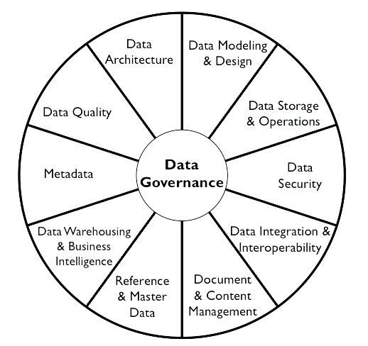

[TOC]

# 概要

DMBOK (Data Management Body of Knowledge) は、データ管理に関連するさまざまな側面を包括的にカバーしており、データのライフサイクル全体にわたるプロセスや活動を理解し、最適なデータ管理プラクティスを実施するためのガイダンスを提供します。

# 10の領域

## 1.  データアーキテクチャ

ビジネス要件に合わせた適切なデータアーキテクチャを設計し、維持。データフローとデータプロセスを文書化し、可視化します。

| **活動** | データアーキテクチャの設計と維持 |
| --- | --- |
| **ツール** | アーキテクチャ設計ツール、[エンタープライズアーキテクチャフレームワーク](https://ja.wikipedia.org/wiki/%E3%82%A8%E3%83%B3%E3%82%BF%E3%83%BC%E3%83%97%E3%83%A9%E3%82%A4%E3%82%BA%E3%82%A2%E3%83%BC%E3%82%AD%E3%83%86%E3%82%AF%E3%83%81%E3%83%A3%E3%83%95%E3%83%AC%E3%83%BC%E3%83%A0%E3%83%AF%E3%83%BC%E3%82%AF) ([ザックマンフレームワーク](https://ja.wikipedia.org/wiki/Zachman%E3%83%95%E3%83%AC%E3%83%BC%E3%83%A0%E3%83%AF%E3%83%BC%E3%82%AF))、エンタープライズ・データモデル、対象領域モデル、マトリックス表現のデータフロー |
| **技法** | アーキテクチャパターンの適用、データフロー図の作成 |
| **導入** | アーキテクチャスタンダード、データアーキテクチャポリシーの策定 |
| **ガバナンス** | アーキテクチャの合意形成と遵守の監視 |

## 2.  データモデリングとデザイン

データモデルを標準化し、データの一貫性と整合性を確保。データモデルとビジネスプロセスの間のマッピングを確立し、変更を追跡します。

| **活動** | データモデルの作成、変更、評価 |
| --- | --- |
| **ツール** | データモデリングツール、ER図、UML |
| **技法** | 正規化、デノーマライゼーション、モデル検証 |
| **導入** | データモデル設計のベストプラクティス、標準モデルの利用 |
| **ガバナンス** | データモデルの承認プロセス、変更管理 |

## 3.  データストレージとオペレーション

適切なデータストレージ技術を選択し、スケーラビリティとパフォーマンスを最適化。バックアップ、リカバリ、データの保護策を実施し、データの可用性を確保します。

| **活動** | データの保存、バックアップ、リカバリ |
| --- | --- |
| **ツール** | データベース管理システム、ストレージ管理ツール |
| **技法** | データの圧縮、暗号化、ストレージ最適化 |
| **導入** | データのストレージポリシー、バックアップ戦略 |
| **ガバナンス** | データアクセスコントロール、データの保存期間管理 |

## 4.  データ統合と相互運用性

異なるデータソースとシステムを統合するためのデータ統合戦略を策定し、実行。データ形式やプロトコルに関する標準を確立し、データの相互運用性を確保します。

| **活動** | システム間のデータ統合、データの変換 |
| --- | --- |
| **ツール** | [ETLツール](https://ja.wikipedia.org/wiki/Extract/Transform/Load)、データ統合プラットフォーム |
| **技法** | データマッピング、変換ルールの設計 |
| **導入** | 統合パターン、データマッピングドキュメンテーション |
| **ガバナンス** | データ統合プロセスの監視、データ品質の確保 |

## 5.  データウェアハウジングとビジネスインテリジェンス

データウェアハウジング環境を構築し、効果的なデータ分析とレポートをサポート。ビジネスインテリジェンスツールを活用してデータを可視化し、意思決定をサポートします。

| **活動** | データウェアハウスの設計、ビジネスインテリジェンスの開発 |
| --- | --- |
| **ツール** | データウェアハウスプラットフォーム、BIツール |
| **技法** | スター型スキーマ、ETLプロセスの最適化 |
| **導入** | データウェアハウス設計原則、BIダッシュボード設計ガイド |
| **ガバナンス** | データウェアハウスアクセス制御、BIレポートの品質管理 |

## 6.  ドキュメントとコンテンツ管理

データ関連のドキュメントやコンテンツを適切に整理し、文書化。ドキュメントのバージョン管理とアクセス制御を確立し、情報の信頼性を保ちます。

| **活動** | データドキュメントの作成、管理 |
| --- | --- |
| **ツール** | ドキュメント管理システム、コラボレーションツール |
| **技法** | メタデータの記録、データカタログの構築 |
| **導入** | ドキュメンテーションポリシー、データアクセス権限の文書化 |
| **ガバナンス** | ドキュメントのセキュリティ、アクセス制御 |

## 7.  参照データとマスターデータ

参照データとマスターデータを定義し、組織全体で一貫性を維持。データの変更と更新に対するプロセスと責任を確立します。

| **活動** | 参照データとマスターデータの管理、整合性の確保 |
| --- | --- |
| **ツール** | マスターデータ管理ツール、データ辞書 |
| **技法** | データ整合性ルールの設定、マスターデータの品質管理 |
| **導入** | 参照データ管理戦略、マスターデータポリシー |
| **ガバナンス** | マスターデータアクセス制御、変更管理プロセス |

## 8.  メタデータ管理

メタデータを収集、管理し、データの意味と関連性を文書化。メタデータカタログを作成し、データの検索性と可視性を向上させます。

| **活動** | メタデータの収集、管理、利用 |
| --- | --- |
| **ツール** | メタデータ管理ツール、データカタログ |
| **技法** | メタデータタグ付け、メタデータスキーマの設計 |
| **導入** | メタデータ管理ポリシー、メタデータ利用ガイド |
| **ガバナンス** | メタデータの品質監視、アクセスコントロール |

## 9.  データ品質

データ品質の基準を設定し、データ品質のモニタリングと改善プロセスを確立。データ品質の問題を特定し、修正するためのタスクと責任を割り当てます。

| **活動** | データ品質の監視、改善、品質ルールの設定 |
| --- | --- |
| **ツール** | データ品質ツール、データプロファイリングツール |
| **技法** | データ品質の評価方法、データ品質ダッシュボードの作成 |
| **導入** | データ品質ポリシー、データ品質の基準 |
| **ガバナンス** | データ品質のモニタリング、品質問題の対応 |

## 10.  データセキュリティ

データへのアクセス制御を強化し、データの機密性と完全性を保護。セキュリティポリシーと監査プロセスを実行し、データセキュリティリスクを最小限に抑えます。

| **活動** | データセキュリティの評価、セキュリティポリシーの実施 |
| --- | --- |
| **ツール** | アクセス制御ツール、セキュリティ監査ツール |
| **技法** | データ暗号化、アクセス管理の実施 |
| **導入** | セキュリティポリシー、セキュリティトレーニング |
| **ガバナンス** | セキュリティ監査、セキュリティインシデント対応プロセス |

# その他 領域

## A. ビッグデータとデータサイエンス

データ戦略の確立が鍵です。ビジネス目標とデータの関連性を明確にし、データ品質の確保を重視しましょう。専門知識とスキルの向上、適切なテクノロジーの選定も必要です。

| **活動** | ビッグデータおよびデータサイエンスプロジェクトの計画、実行、監視、評価、最適化 |
| --- | --- |
| **ツール** | ビッグデータストレージ、処理、分析ツール、データサイエンスプラットフォーム |
| **技法** | ビッグデータの収集、変換、クレンジング、モデリング、可視化、機械学習アルゴリズム |
| **導入** | ビッグデータ戦略の策定、データサイエンスのチーム構築、プロジェクト管理のベストプラクティス |
| **ガバナンス** | ビッグデータアクセス制御、データ品質管理、データセキュリティ、コンプライアンスの確保 |

## B. データマネジメント成熟度アセスメント

組織のデータ能力を評価し、改善の道筋を示します。評価フレームワークの選定、データ領域の評価、アクションプランの策定、モニタリングと改善が重要です。継続的な評価と改善を通じて、データマネジメントの成熟度を高めましょう。

| **活動** | 現在のデータマネジメントプラクティスの評価、成熟度の評価、改善プランの策定 |
| --- | --- |
| **ツール** | 成熟度モデル評価ツール、成熟度評価結果の可視化ツール |
| **技法** | データマネジメントのベンチマーク、成熟度評価基準の定義、評価結果の解釈 |
| **導入** | 成熟度アセスメントの計画、データマネジメント改善プロジェクトの設計 |
| **ガバナンス** | 成熟度アセスメントプロセスの透明性、評価結果の報告、改善プランの実行へのガバナンスの適用 |

## C. データマネジメント組織と役割期待

データマネジメント組織を確立し、重要な成功要因やデータマネジメントの役割を明確にし、異なる部門との連携を促進します。

- **データマネジメント組織の特定**： 組織内でデータマネジメントを担当する部門や役割を明確に特定しましょう。データマネジメントの重要性を組織内で共有し、その組織の役割と責任を明確にします。
- **重要な成功要因**： データマネジメントの成功に必要な要因を評価し、それを実現するための計画を立てましょう。データ品質、データセキュリティ、データガバナンスなどの重要な要因に焦点を当てます。
- **データマネジメント組織の構成**： 適切なスキルと専門知識を持つ人材を採用・育成し、データマネジメント組織を強化します。組織内での協力とコミュニケーションを促進し、異なる部門との連携を強化します。
- **DMOと他のデータ指向体制の相互作用：** データマネジメント組織（DMO）と他のデータ関連の部門やプロジェクトとの協力を促進します。一元化されたデータガバナンスプロセスを確立し、異なる部門間でのデータ共有と連携を支援します。
- **データマネジメントの役割**： データマネジメントの役割と責任を明確にし、それを組織内で浸透させます。データストラテジーの策定、データガバナンスの実行、データ品質の維持など、具体的な役割を定義します。

## D. データマネジメントと組織の変革

変革の法則を理解し、変化を管理し、コッターの過ちを避けるよう心がけ、段階的な変革プロセスを通じて組織を変革します。変革の成功を伝え、維持するために継続的な改善と成果の伝達が重要です。

- **変革の法則**： 変革プロセスにおいて変化は不可避であることを理解し、変革の法則を受け入れます。変化を受け入れる柔軟性を持つ組織文化を育成します。
- **変革を管理するのではなく、そこに至る変異を管理する**： 変革を積極的に推進するのではなく、変化を促す要因やプロセスを管理し、変革を可能にします。変革を予測し、それに適切に対応する能力を開発します。
- **コッターのチェンジマネジメントが犯す8つの過ち**： コッターのチェンジマネジメントモデルの8つの過ちを避けるように注意します。これにはコミュニケーション不足やリーダーシップの不在などが含まれます。
- **コッターによる大規模変革の推進に要する8段階プロセス**： コッターの8段階プロセスを遵守し、変革を段階的に推進します。これにはビジョンの共有や成果の確認が含まれます。
- **変革の公式**： 変革の成功に向けて具体的な目標と計画を策定し、それを組織内で共有します。変革の進捗を定期的に評価し、必要に応じて調整します。
- **革新の普及と変革の維持**： 変革後も革新的な文化を維持し、組織の成長と適応力を高めます。変革プロセスが終わった後も継続的な改善と学習を促進します。
- **データマネジメントがもたらす価値の伝達**： データマネジメントの成果と付加価値を組織内外に伝え、関係者の支持を得ます。成果をデータに基づいて示し、データマネジメントの重要性を認識させます。

### D.1 [コッターの変革管理](https://en.wikipedia.org/wiki/Change_management#Change_models) 8ステップ

| **ステップ** | **説明** |
| --- | --- |
| 緊急性を創出する | 変革の必要性と緊急性を明確にし、組織内での危機感を醸成します。これにより、変革への参加と支持を促進します。 |
| ガイダンス・コアリションの結成 | 強力なリーダーシップチームを結成し、変革の方向性を示します。このチームは組織内での支持基盤を構築する役割を果たします。 |
| ビジョンと戦略の開発 | 共有されたビジョンを策定し、変革の方向性と目標を明確にします。ビジョンは変革を指導し、組織を目標に向かわせる重要な要素です。 |
| ビジョンの共有 | ビジョンを組織内外に積極的に伝え、共有します。明確で説得力のあるコミュニケーションは、変革への参加と理解を促進します。 |
| 広範な行動の奨励 | 変革に向けて行動を起こすための構造と環境を整備し、行動を奨励します。障壁や階層構造を減少させ、自発的な行動を促進します。 |
| 短期的勝利の達成 | 早期の成功体験を生み出し、変革のプログレスを示します。これにより、組織内での信頼とモチベーションが高まります。 |
| 持続可能な変革の構築 | 成果を持続可能なものにするために、変革の文化を確立し、新しい方法を維持します。 |
| 新しい文化の確立 | 新しい文化を組織に定着させ、変革を継続的なプロセスとして組み込みます。 |

### D.2 [コッターの変革管理](https://en.wikipedia.org/wiki/Change_management#Change_models) 8つの誤り

| **ステップ** | **説明** |
| --- | --- |
| 変革の緊急性を認識させない | 変革の必要性と緊急性を従業員に伝えず、変革への動機づけを欠如させる。 |
| 強力なリーダーシップを形成しない | 強力なリーダーシップチームを組織せず、変革の指導を不十分にし、支持基盤を築けない。 |
| ビジョンを明確にしない | 共有されたビジョンが不明確であるため、変革の方向性と目標が不透明である。 |
| ビジョンを十分に伝えない | ビジョンを十分に伝えず、変革に対する理解と支持を得られない。 |
| 行動を奨励しない | 変革に向けた行動を奨励せず、障壁や階層構造が変革の障害となる。 |
| 短期的な成功を生み出さない | 短期的な成功体験が不足し、変革への信頼とモチベーションが低下する。 |
| 成果を持続させない | 成果を持続可能なものにせず、変革が一時的なものとみなされ、元の状態に戻りやすくなる。 |
| 新しい文化を確立しない | 新しい文化を確立せず、変革を継続的なプロセスとして組織に根付かせない。 |

# Reference
