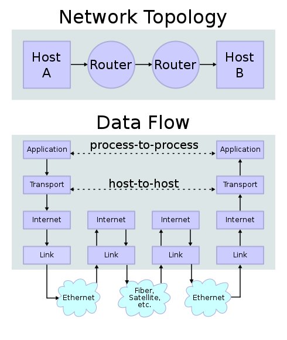
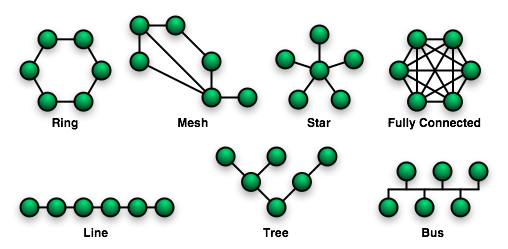
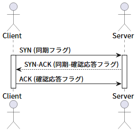
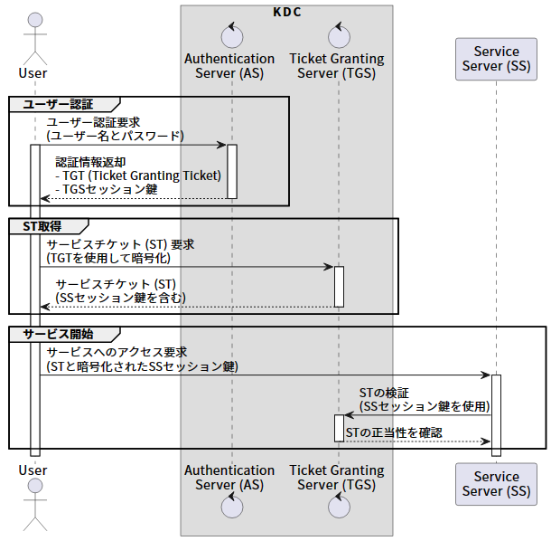
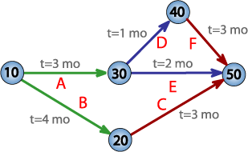

[TOC]

# 概要

CISSP (Certified Information Systems Security Professional)は、情報セキュリティ分野での専門知識とスキルを持つプロフェッショナル向けの国際的な資格です。CISSPは、情報セキュリティポリシー、リスク管理、セキュリティアーキテクチャ、アクセスコントロール、ソフトウェア開発セキュリティ、通信およびネットワークセキュリティ、セキュリティ操作、セキュリティ監査、セキュリティ法律と倫理など、さまざまな情報セキュリティ領域をカバーしています。また、CISSPは人材の認証に関する国際規格であるISO/IEC 17024標準に準拠しています。

# 8つの領域

## 1. 概念

### 1.1 セキュリティ概念

#### 1.1.1 [CIAトライアド](https://ja.wikipedia.org/wiki/%E6%83%85%E5%A0%B1%E3%82%BB%E3%82%AD%E3%83%A5%E3%83%AA%E3%83%86%E3%82%A3)

CIAは「機密性 (Confidentiality)」「完全性 (Integrity)」「可用性 (Availability)」の頭文字を表し、情報セキュリティの三要素を示します。機密性は情報への不正アクセスを防ぎ、情報の秘密性を保護します。完全性は情報の改ざんや破壊を防ぎ、情報の信頼性を確保します。可用性は情報にアクセスできる状態を

維持し、情報の利用可能性を確保します。

#### 1.1.2 [セーフガード](https://ja.wikipedia.org/wiki/%E5%AE%89%E5%85%A8%E8%A3%85%E7%BD%AE)

セーフガードは情報資産を保護するための対策や仕組みを指します。セーフガードには物理的なセキュリティ対策、技術的なセキュリティ対策、組織的なセキュリティ対策などが含まれます。

#### 1.1.3 [多層防御](https://ja.wikipedia.org/wiki/%E5%A4%9A%E5%B1%A4%E9%98%B2%E5%BE%A1_(%E3%82%BB%E3%82%AD%E3%83%A5%E3%83%AA%E3%83%86%E3%82%A3))

多層防御は複数のセキュリティ対策を組み合わせて、システムやネットワークを守るアプローチです。単一のセキュリティ対策に依存せず、複数の障壁を設けて攻撃から守ることを目指します。

#### 1.1.4 保護メカニズム

保護メカニズムは情報セキュリティを実現するための技術や手法を指します。例えば、ファイアウォール、暗号化、アクセス制御、脆弱性スキャンなどが保護メカニズムの一部です。

#### 1.1.5 要塞強化 (Hardening)

要塞強化はシステムやネットワークのセキュリティを向上させるために、不要なサービスや機能を無効化し、セキュリティ設定を強化するプロセスです。

#### 1.1.6 [AAAプロトコル (IAAA)](https://ja.wikipedia.org/wiki/AAA_%E3%83%97%E3%83%AD%E3%83%88%E3%82%B3%E3%83%AB)

AAAは「認証 (Authentication)」「認可 (Authorization)」「会計 (Accounting)」の頭文字を表し、ユーザーアクセスの管理に関連するプロトコルやプロセスを指します。IAAAは「Identification」「Authentication」「Authorization」「Auditing」の頭文字を表し、セキュリティ管理の要素を強調します。

#### 1.1.7 主体と対象

主体はシステムにアクセスしようとする個人やプロセスを指し、対象はアクセスを受ける情報資産やリソースを指します。セキュリティは主体と対象の関係を管理します。

#### 1.1.8 [否認不可](https://ja.wikipedia.org/wiki/%E5%90%A6%E8%AA%8D%E4%B8%8D%E5%8F%AF)

否認不可は、システムへのアクションやトランザクションを行った主体が、その行動を後で否認できないようにするセキュリティ原則です。

#### 1.1.9 [最小権限の原則](https://ja.wikipedia.org/wiki/%E6%9C%80%E5%B0%8F%E6%A8%A9%E9%99%90%E3%81%AE%E5%8E%9F%E5%89%87)

最小権限の原則は、ユーザーやプロセスに付与される権限やアクセス権を最小限に制限し、必要な最低限の権限のみを付与する原則です。以下メリット：

1. **セキュリティの強化**：最小権限の原則を適用することで、システムやネットワーク内で権限を必要最小限に限定します。これにより、潜在的な攻撃者がアクセスできるリソースやデータが制限され、セキュリティ侵害のリスクが低減されます。
2. **エラーの影響を最小限に抑える**：ユーザーやシステム管理者が誤ってシステムに害を与える可能性が低くなります。権限が限定されているため、誤操作による大きな被害が発生するリスクが減少します。
3. **管理の容易さ**：各ユーザーに必要最小限の権限のみを与えることで、システムの管理が簡素化されます。権限のレベルが低いほど、その権限を持つユーザーの監視と管理が容易になります。
4. **コンプライアンスと監査**：多くの規制や標準では、データアクセスを最小限に保つことが要求されます。最小権限の原則を採用することで、これらの規制要件を満たしやすくなり、監査やコンプライアンスのプロセスが簡略化されます。
5. **データ漏洩のリスクの削減**：限定された権限を持つユーザーは、機密データにアクセスする機会が少なくなるため、データ漏洩のリスクが減少します。

#### 1.1.10 アクセスコントロールタイプ

アクセスコントロールは、認証された主体が情報資産にアクセスする際の制御を指します。アクセスコントロールタイプにはDAC (Discretionary Access Control), MAC (Mandatory Access Control), RBAC (Role-Based Access Control) などがあります。

#### 1.1.11 セキュリティドキュメント

セキュリティドキュメントはセキュリティポリシーや手順、ガイドライン、セキュリティ意識向上トレーニング資料など、セキュリティに関する文書や資料を指します。

#### 1.1.12 スコーピングとテーラリング

スコーピング (Scoping) とテーラリング (Tailoring) は、プロジェクト管理やソフトウェア開発などの分野でよく使われる用語です。それぞれの意味と役割について説明します。

- スコーピング (Scoping): スコーピングはプロジェクトの範囲を定義し、明確にするプロセスです。プロジェクトのスコープは、何を達成するか、何を含み、何を含まないかを明確にすることを指します。スコーピングの主な目的は、プロジェクトの成功基準を確立し、予算、リソース、スケジュールを管理するためにプロジェクトの範囲を限定することです。スコーピングを行うことで、プロジェクトが進行中にスコープクリープ（範囲の拡大）を防ぐことができます。スコーピングプロセスには、プロジェクトのゴールの明確化、要件の収集、スコープ文書の作成、ステークホルダーの合意の確立などが含まれます。
- テーラリング (Tailoring): テーラリングは、プロジェクト管理方法論やプロセスを特定のプロジェクトに合わせて調整するプロセスを指します。つまり、ある方法論やフレームワークを柔軟に適用し、プロジェクトのニーズや特性に合わせてカスタマイズすることです。テーラリングの目的は、プロジェクトが最適な方法で成功するために、プロジェクトの要件や制約に合わせてプロセスを調整することです。異なるプロジェクトは異なるニーズを持つため、同じアプローチが常に適切ではありません。テーラリングは、プロジェクトの複雑性、規模、リスク、利害関係者、目標などを考慮に入れて行われます。例えば、小規模なプロジェクトと大規模なプロジェクトでは、プロジェクト管理のアプローチが異なることがあります。

### 1.2 倫理

#### 1.2.1 (ISC)2倫理規約

- 社会、一般大衆の<u>福利およびインフラを保護</u>する
- 法に違わず、<u>公正かつ誠実</u>に責任を持って行動する
- 当事者に対して、<u>十分かつ適切なサービスを提供</u>する
- セキュリティ専門家としての<u>知識を向上し、保護</u>する

#### 1.2.2 インターネット倫理

#### 1.2.3 [コンピュータ倫理の十戒 (Ten Commandments of Computer Ethics)](https://en.wikipedia.org/wiki/Ten_Commandments_of_Computer_Ethics)

- コンピュータを使って他人に危害を加えてはならない。
  - ハックバック (Hackback) の禁止： ハックバックは、組織や個人が自身のシステムやデータを保護するために、攻撃者に対して反撃する手段を採る試みを指します。この試みは(ISC)2では推奨されていません。
- 他人のコンピュータ作業を妨害してはならない。
- 他人のコンピュータファイルを覗き見してはならない。
- 盗みにコンピュータを使ってはならない。
- あなたは、偽りの証言をするためにコンピュータを使ってはならない。
- あなたは、あなたが(許可なく)お金を払っていないプロプライエタリなソフトウェアをコピーまたは使用してはなりません。
- 他人のコンピュータリソースを無断で使用してはならない。
- 汝は他人の知的成果を横領してはならない。
- 汝は、自分が書いているプログラムや、自分が設計しているシステムの社会的影響について考えなければならない。
- 汝は、常に他の人間への配慮と敬意を確保する方法でコンピュータを使用しなければならない。

### 1.3 ガバナンス

ガバナンスは、組織内で情報セキュリティを管理し、コントロールするための枠組みとプロセスを指します。これにはポリシー、手順、責任分担、および組織全体の指針が含まれます。

#### 1.3.1 ガバメントとマネジメント

ガバメントは情報セキュリティポリシーの策定と監督を担当し、マネジメントは実際のポリシーの実施と維持を管理します。ガバメントとマネジメントの協力は情報セキュリティの成功に不可欠です。

#### 1.3.2 [デューディリジェンス (Due Diligence)](https://ja.wikipedia.org/wiki/%E3%83%87%E3%83%A5%E3%83%BC%E3%83%87%E3%82%A3%E3%83%AA%E3%82%B8%E3%82%A7%E3%83%B3%E3%82%B9)

> ⚠️ <u>デューディリジェンス</u>は新しい関係やプロジェクトを評価し、リスクを評価するプロセスであり、<u>デューケア</u>は組織が日常業務で情報セキュリティに対する適切な注意と努力を払うことを指します。両方の要素は情報セキュリティの強化に重要であり、組織がリスクを管理し、セキュリティを向上させるのに役立ちます。

デューディリジェンスは、組織が新しいビジネスパートナーを評価し、情報セキュリティリスクを評価するプロセスです。これには調査、評価、および適切な措置の取り決めが含まれます。そこでは<u>適切な注意</u>を払うことが求められます。

#### 1.3.3 デューケア (Due Care)

デューケアは、組織が情報セキュリティに対して<u>合理的、あるいは、妥当な注意</u>を払うことを指します。組織はセキュリティポリシーと手順を遵守し、セキュリティリスクを最小限に抑えるための措置を講じる必要があります。

#### 1.3.4 職務分離 (Separation of Duty)

職務分離は、情報セキュリティを向上させるための原則で、特定のタスクやアクセス権限を異なる人々に分け与え、権限の乱用を防ぎます。

#### 1.3.5 外部監査

外部監査は、独立した第三者が組織の情報セキュリティプラクティスを評価し、適切性を確認するプロセスです。これは信頼性を高めるために重要です。

#### 1.3.6 [監査報告書18 (SSAE-18)](https://en.wikipedia.org/wiki/SSAE_No._18)

SSAE-18 (Statements on Standards for Attestation Engagements No. 18) は、アメリカ合衆国の公認会計士（CPA）および監査業界で広く使用される監査基準の一つです。SSAE-18は、アメリカの監査基準の一環として、アメリカ合衆国での企業の財務報告や情報システムのセキュリティに関する監査および報告に関するガイドラインを提供します。SSAE-18は、以下の2つの主要な部分で構成されています。

1. セクション301：AT-Cセクション（AT-C stands for "Attestation Standards – Clarified"）- このセクションは、監査人が特定のサービス（例：レポート提供サービス、コンプライアンス監査、情報システム監査など）に関する報告を提供する際の一般的な基準を規定しています。このセクションでは、監査人の責任、報告形式、監査手続きなどが詳細に説明されています。
2. セクション501～1013：AT-Cセクション（サービス固有のガイダンス）- このセクションは、特定のサービスに関連する具体的な監査および報告の要件を提供します。たとえば、セクション501では、金融機関向けの監査（SOC 1レポート）に関する要件が説明されており、セクション1001では、情報セキュリティサービスに関する監査（SOC 2レポート）に関する要件が説明されています。

SSAE-18は、従来のSSAE-16（SAS 70）から進化したもので、監査報告の透明性と信頼性を向上させるために改訂されました。特に、サービス提供者のコントロール環境に対する監査人の評価が強化され、レポートの内容が改善されました。

SSAE-18のガイドラインは、監査人、監査対象組織、および利用者にとって重要であり、信頼性のある監査報告の提供と受け入れに役立ちます。ただし、具体的な要件や詳細については、公認会計士や監査専門家と協力して理解することが重要です。また、SSAE-18は時折改訂されるため、最新のバージョンやガイダンスを確認することも重要です。

#### 1.3.7 [業務受託会社監査 (SOC)](https://en.wikipedia.org/wiki/System_and_Organization_Controls)

SOC (Service Organization Control) レポートは、サービス提供者が情報セキュリティを適切に管理していることを証明するために提供される報告書です。

#### 1.3.8 [連邦量刑ガイドライン](https://en.wikipedia.org/wiki/United_States_Federal_Sentencing_Guidelines)

連邦量刑ガイドラインは、連邦法廷における刑罰の量刑に関する指針で、情報セキュリティ違反に関連する罰則を示すために使用されます。

#### 1.3.9 [サプライチェーンマネジメント](https://ja.wikipedia.org/wiki/%E3%82%B5%E3%83%97%E3%83%A9%E3%82%A4%E3%83%81%E3%82%A7%E3%83%BC%E3%83%B3%E3%83%BB%E3%83%9E%E3%83%8D%E3%82%B8%E3%83%A1%E3%83%B3%E3%83%88)

サプライチェーンマネジメントは、情報セキュリティを維持し、サプライヤーやベンダーがリスクを最小限に抑えるためのプロセスです。

#### 1.3.10 [サービス品質保証 (SLA)](https://ja.wikipedia.org/wiki/%E3%82%B5%E3%83%BC%E3%83%93%E3%82%B9%E6%B0%B4%E6%BA%96%E5%90%88%E6%84%8F)

サービス品質保証は、契約において情報セキュリティ要件やサービス提供者の責任を明確にし、サービス品質を確保するための文書です。

### 1.4 コンプライアンス及び法整備

#### 1.4.1 法律の種類

情報セキュリティに関連する法律には、個人情報保護法、サイバーセキュリティ法、著作権法、通信法、監視法、および国際的な規制などが含まれます。

#### 1.4.2 法律の体制

法律の体制は国によって異なりますが、一般的には立法府（議会など）、行政府（政府機関）、司法府（裁判所）から成り立っており、情報セキュリティに関する法律の制定、施行、違反の審査が行われます。

#### 1.4.3 [法的証拠](https://ja.wikipedia.org/wiki/%E8%A8%BC%E6%8B%A0)の種類

法的証拠には書類、電子メール、デジタルデータ、証人証言などが含まれます。これらは事件や訴訟において重要な役割を果たします。

#### 1.4.4 証拠能力

証拠能力は、証拠の信頼性や妥当性を評価する能力を指します。不正確な証拠は法廷で受け入れられない可能性が高いです。

#### 1.4.5 [証拠保全 (Chain of Custody)](https://ja.wikipedia.org/wiki/%E8%A8%BC%E6%8B%A0%E4%BF%9D%E5%85%A8)

証拠の連鎖管理は、証拠の保全と調査過程での証拠の安全な取り扱いを確保するための手続きです。証拠の改ざんや紛失を防ぎます。

#### 1.4.6 [電子的証拠開示 (e-discovery)](https://ja.wikipedia.org/wiki/%E9%9B%BB%E5%AD%90%E6%83%85%E5%A0%B1%E9%96%8B%E7%A4%BA)

電子的証拠開示は、電子情報（電子メール、データベース、文書など）を法廷で提出および管理するプロセスを指します。

#### 1.4.7 [伝聞証拠禁止の原則 (Hearsay Rule)](https://ja.wikipedia.org/wiki/%E4%BC%9D%E8%81%9E%E8%A8%BC%E6%8B%A0%E7%A6%81%E6%AD%A2%E3%81%AE%E5%8E%9F%E5%89%87)

伝聞証拠禁止の原則は、証言者が自分の目撃した出来事について直接証言する必要があるという法的原則です。

#### 1.4.8 最良証拠の原則 (Best Evidence Rule)

最良証拠の原則、あるいは、最良証拠ルール (Best Evidence Rule) は、法的訴訟において特定の文書または証拠物件の証拠を提出する際の原則です。このルールに従うと、原本や最も信頼性の高いコピーを提出しなければならないという規則です。具体的な要点は次の通りです。

- 原本の提出が求められ、原本が利用可能な場合、コピーではなく原本を提出する必要がある。
- もし原本が失われたり破壊された場合、コピーは証拠として受け入れられるが、そのコピーが最も信頼性の高いものであることを証明しなければならない。

最良証拠ルールの目的は、訴訟において証拠の正確性と信頼性を確保することであり、訴訟において情報の適切な評価を促進します。特に文書に関連する訴訟において重要です。

#### 1.4.9 口頭証拠排除の原則 (Parol Evidence Rule)

口頭証拠排除の原則、あるいは、口頭証拠ルールは、契約法に関連する法律原則の一つです。このルールは、契約書や文書に明確に記載されている契約条件や条項について、口頭の証拠がそれを変更または補完できないという原則を指します。具体的には、次のような場合に適用されます。

- 契約書が完全かつ一貫しており、書面に記載されていない条件や約束は証拠として提出できない。
- 契約書に明確な修正がない限り、口頭での合意は契約書の条件を変更しない。

口頭証拠ルールの目的は、契約の安定性と確実性を確保し、口頭での主張や取引における約束が契約書に明示的に記載されていない限り法的効力を持たないことを保護することです。

#### 1.4.10 [プライバシー情報](https://ja.wikipedia.org/wiki/%E3%83%97%E3%83%A9%E3%82%A4%E3%83%90%E3%82%B7%E3%83%BC)

プライバシー情報は個人の識別可能な情報であり、個人情報保護法などで保護されています。なお、経営者は[プルーデントマンルール (Prudent man rule)](https://en.wikipedia.org/wiki/Prudent_man_rule#:~:text=Amory%20The%20prudent%20man%20rule,considering%20the%20probable%20income%2C%20as) に従い、情報セキュリティに関連するリスクを適切に管理し、合理的な判断と行動を取ることを求められています。以下はプライバシーに関わる情報：

- **PII (Personal Identifiable Information：個人識別情報)**: PIIは、個人を識別、連絡、または特定するのに使用できる任意の情報です。これには、氏名、住所、電話番号、メールアドレス、生年月日、社会保障番号などが含まれます。PIIは、個人が特定されるリスクがあるため、適切に管理・保護する必要があります。以下、アメリカの多くの州において個人識別情報 (PII) と見なされない情報の例：
  - **公開情報**：公共の記録に含まれる情報（例えば、電話帳に載っている名前や住所）は、通常PIIとはみなされません。
  - **職業関連情報**：職業、職位、職場の住所や電話番号など、職業に関連する情報も一般的にはPIIとは考えられません。
  - **一般的な名前や住所**：個人を特定できないレベルの一般的な名前や住所もPIIには含まれません。
  - **年齢や性別**：単独で提供される年齢や性別は、通常PIIとは見なされません。ただし、他の識別情報と組み合わされる場合は、状況によって異なる場合があります。
  - **IPアドレスやデバイス識別子**：いくつかの州では、これらはPIIとはみなされませんが、他の州ではオンライン活動を通じて個人を特定するために使用されるため、PIIに含まれる場合があります。
  - **公開された写真やビデオ**：これらは状況によって異なりますが、通常はPIIとは見なされません。
  - **学籍番号**：一部の州では個人識別情報として扱われますが、これは必ずしも普遍的ではありません。他の識別情報と組み合わせられた場合にのみ、PIIとして扱われることがあります。
- **PHI (Protected Health Information：保護された健康情報)**: PHIは、米国のヘルスケアプライバシー法（HIPAA）によって定義され、個人の健康状態、医療サービスの提供、または医療サービスに関連する支払いに関する情報を含みます。この情報は、個人の氏名、地理的データ、連絡先情報、保険情報、医療記録、その他の識別可能な情報を含むことがあります。

#### 1.4.11 [OECDプライバシーガイドライン](https://ja.wikipedia.org/wiki/%E3%83%97%E3%83%A9%E3%82%A4%E3%83%90%E3%82%B7%E3%83%BC%E4%BF%9D%E8%AD%B7%E3%81%A8%E5%80%8B%E4%BA%BA%E3%83%87%E3%83%BC%E3%82%BF%E3%81%AE%E5%9B%BD%E9%9A%9B%E6%B5%81%E9%80%9A%E3%81%AB%E3%81%A4%E3%81%84%E3%81%A6%E3%81%AE%E3%82%AC%E3%82%A4%E3%83%89%E3%83%A9%E3%82%A4%E3%83%B3)

経済協力開発機構（OECD）によって発表されたプライバシーガイドラインは、国際的なプライバシー保護の基準を提供しています。

#### 1.4.12 [データ保護指令 (EU DPD)](https://en.wikipedia.org/wiki/Data_Protection_Directive) および[一般データ保護規則 (EU GDPR)](https://ja.wikipedia.org/wiki/EU%E4%B8%80%E8%88%AC%E3%83%87%E3%83%BC%E3%82%BF%E4%BF%9D%E8%AD%B7%E8%A6%8F%E5%89%87)

EU DPDおよびGDPRは、欧州連合で個人データの保護と処理に関する法律的枠組みを提供しています。

なお、EUと米国の間で結ばれたプライバシー・シールド協定の条項の管理は、米国側が<u>商務省</u>、EU側では各加盟国の<u>データ保護機関（Data Protection Authorities, DPAs）</u>と、<u>欧州データ保護委員会（European Data Protection Board, EDPB）</u>が担当しています。この協定は、GDPRの下で、EUから米国への個人データの移転を調整するために設けられたものです。

GDPRの主な目的：

1. **個人の権利の強化**：GDPRは、個人が自分の個人データに関する権利を持っていることを保証します。これには、データへのアクセス権、修正権、削除権（「忘れられる権利」）、データの処理に対する異議権などが含まれます。
2. **データ保護の向上**：企業や組織は、個人データをより安全に取り扱う必要があり、データ漏洩や不正アクセスから保護するための適切なセキュリティ対策を講じる必要があります。
3. **透明性の強化**：GDPRは、個人データの収集、使用、共有に関して、企業や組織がより透明であることを要求します。データ主体に対して、どのようなデータが収集され、どのように使用されるかを明確に伝える必要があります。
4. **国境を越えたデータの流れの調整**：GDPRは、EU加盟国間、またはEU外部の国との間でのデータの流れを調整し、国際的なデータ交換の基準を提供します。
5. **法的責任と罰則の明確化**：GDPRは、データ保護違反が発生した場合の責任を明確にし、重大な違反に対して厳しい罰則を科すことができます。これにより、データ保護の重要性が強調されます。
6. **消費者の信頼の向上**：適切なデータ保護対策を講じることで、企業は顧客の信頼を獲得しやすくなります。これは、デジタル経済において特に重要です。

GDPRにおける登場人物：

- **データプロセッサー（Data Processor）**: データプロセッサーは個人データの処理を行う組織または個人です。彼らはデータコントローラーの指示に従ってデータを処理し、GDPRの下で特定の法的責任を負います。
- **データコントローラー（Data Controller）**: データコントローラーは、個人データの処理目的と手段を決定する組織または個人です。彼らはデータの収集、使用、処理に関する主要な責任者であり、GDPRの要件に準拠することが求められます。
- **データ保護責任者（Data Protection Officer, DPO）**: DPOは、組織内のデータ保護プラクティスの専門家であり、GDPRの遵守を監督する責任を持っています。公共機関や特定のデータ処理を行う組織ではDPOの指名が必須です。
- **データ主体（Data Subject）**: データ主体は、個人データが収集され、処理される個人を指します。GDPRでは、データ主体は個人データに関する特定の権利を持っています。

#### 1.4.13 [セーフハーバー (EU-US Safe Harbor)](https://en.wikipedia.org/wiki/Safe_harbor_(law))

セーフハーバーは、EUと米国の間でデータ転送のルールを確立するための枠組みでしたが、後にEUの判断で無効とされました。

#### 1.4.14 [プライバシー法 (US Privacy Act)](https://en.wikipedia.org/wiki/Privacy_laws_of_the_United_States)

アメリカ合衆国プライバシー法は、個人情報の収集と処理に関する規制を提供しています。下記は関連法令です：

- [合衆国修正第4条 (Amendment 4)](https://ja.wikipedia.org/wiki/%E3%82%A2%E3%83%A1%E3%83%AA%E3%82%AB%E5%90%88%E8%A1%86%E5%9B%BD%E6%86%B2%E6%B3%95%E4%BF%AE%E6%AD%A3%E7%AC%AC4%E6%9D%A1) ： 修正第4条は、<u>不当な捜査</u>や押収から市民を保護するアメリカ合衆国憲法修正条文であり、情報セキュリティにおいて<u>プライバシー権</u>を重視します。
- [GLBA (Gramm-Leach-Bliley Act, グラム・リーチ・ブライリー法)](https://ja.wikipedia.org/wiki/%E3%82%B0%E3%83%A9%E3%83%A0%E3%83%BB%E3%83%AA%E3%83%BC%E3%83%81%E3%83%BB%E3%83%96%E3%83%A9%E3%82%A4%E3%83%AA%E3%83%BC%E6%B3%95) : この米国の連邦法は、<u>金融機関</u>に対して、<u>顧客情報共有</u>の慣行を説明し、機密データを保護することを求めています。
- [FERPA (Family Educational Rights and Privacy Act, 家族教育権利およびプライバシー法)](https://en.wikipedia.org/wiki/Family_Educational_Rights_and_Privacy_Act): FERPAは教育機関に適用され、学生の教育記録のプライバシーに関係しています。金融機関の責任者であるヨランダの役割とは関連性がありません。
- COPPA (Children's Online Privacy Protection Act、児童オンラインプライバシー保護法)： アメリカ合衆国の法律で、<u>13歳未満</u>の子どもたちの個人情報をオンラインで保護することを目的としています。この法律は1998年に成立し、連邦取引委員会（FTC）によって施行されています。
- カリフォルニア州オンラインプライバシー保護法 (California Online Privacy Protection Act, CalOPPA) ：オンラインで個人情報を収集するウェブサイトやオンライン
- サービスに対して、<u>プライバシーポリシー</u>など特定の情報を公開することを義務付ける法律です。この法律は、2003年に制定され、カリフォルニア州の居住者を対象にしていますが、カリフォルニア州外の企業にも影響を及ぼす可能性があります。
- [電気通信プライバシー法](https://ja.wikipedia.org/wiki/%E9%80%9A%E4%BF%A1%E3%81%AE%E7%A7%98%E5%AF%86) ([ECPA, Electronic Communications Privacy Act](https://en.wikipedia.org/wiki/Electronic_Communications_Privacy_Act)) ： 通信データのプライバシー保護に関する法律です。
- [プロバイダー責任制限法](https://ja.wikipedia.org/wiki/%E7%89%B9%E5%AE%9A%E9%9B%BB%E6%B0%97%E9%80%9A%E4%BF%A1%E5%BD%B9%E5%8B%99%E6%8F%90%E4%BE%9B%E8%80%85%E3%81%AE%E6%90%8D%E5%AE%B3%E8%B3%A0%E5%84%9F%E8%B2%AC%E4%BB%BB%E3%81%AE%E5%88%B6%E9%99%90%E5%8F%8A%E3%81%B3%E7%99%BA%E4%BF%A1%E8%80%85%E6%83%85%E5%A0%B1%E3%81%AE%E9%96%8B%E7%A4%BA%E3%81%AB%E9%96%A2%E3%81%99%E3%82%8B%E6%B3%95%E5%BE%8B) ([CALEA, Communications Assistance for Law Enforcement Act](https://en.wikipedia.org/wiki/Communications_Assistance_for_Law_Enforcement_Act)) ： 法執行機関が合法的な監視を行う際に、通信キャリアがその監視を容易にするための技術的な協力を提供することを要求する法律です。
- [米国愛国者法 (USA PATRIOT Act)](https://ja.wikipedia.org/wiki/%E7%B1%B3%E5%9B%BD%E6%84%9B%E5%9B%BD%E8%80%85%E6%B3%95) ： アメリカ合衆国におけるテロ対策と国内の情報収集を拡大するための法律です。
- [FISMA (連邦情報セキュリティ管理法](https://en.wikipedia.org/wiki/Federal_Information_Security_Modernization_Act_of_2014))：この法律は、連邦政府機関が運用する情報システムのセキュリティを確保するために制定されました。なお、FISMAの前進は、GISRA (政府情報セキュリティ改革法) で、連邦政府の情報システムのセキュリティ管理を強化することを目的としていました。
- [HITECH法 (Health Information Technology for Economic and Clinical Health Act)](https://en.wikipedia.org/wiki/Health_Information_Technology_for_Economic_and_Clinical_Health_Act) ： 主に健康情報技術の普及とそれに関連するプライバシーとセキュリティの問題に焦点を当てています。
- [HIPAA (Health Insurance Portability and Accountability Act)](https://en.wikipedia.org/wiki/Health_Insurance_Portability_and_Accountability_Act) ： 1996年にアメリカ合衆国で制定された連邦法です。この法律は、医療保険の携行性、医療情報のセキュリティ、および患者のプライバシー保護に関する規制を設けています。HIPAAの主な目的は、患者の健康情報の保護と、電子取引の安全性および効率性の向上です。下記はHIPAAの対象者の例です：
  - 医療従事者 - 通常、医療従事者は患者の健康情報を扱う。
  - 健康情報クリアリングハウス - これらの組織は、医療情報の処理を行う。
  - 健康保険制度 - 健康保険会社は、患者の医療情報を扱う。
  - <u>健康とフィットネスアプリケーション開発者</u> - これらの開発者が直接医療情報を扱うかどうかによります。多くの場合、彼らはHIPAAの対象外ですが、医療提供者との関連性や提供されるサービスの性質によっては対象となることもあります。

#### 1.4.15 [デジタルミレニアム著作権法 (Digital Millennium Copyright Act - DMCA)](https://ja.wikipedia.org/wiki/%E3%83%87%E3%82%B8%E3%82%BF%E3%83%AB%E3%83%9F%E3%83%AC%E3%83%8B%E3%82%A2%E3%83%A0%E8%91%97%E4%BD%9C%E6%A8%A9%E6%B3%95)

DMCAは、アメリカ合衆国の著作権法に関する法律であり、1998年に制定されました。DMCAには、インターネットサービスプロバイダー（ISP）やウェブサイト運営者に対する<u>セーフハーバー保護規定</u>が含まれており、特定の条件を満たす場合に、ISPやウェブサイト運営者がユーザーがアップロードしたコンテンツに関する<u>著作権侵害</u>から免除される保護を提供しています。以下は、DMCAのセーフハーバー保護の主要な要点です：

- 情報提供および削除プロセス：ISPやウェブサイト運営者は、著作権侵害通知を受け取った場合、迅速に通知を処理し、侵害したコンテンツを削除またはアクセスを無効にする必要があります。これにより、違法なコンテンツへのアクセスを制限し、侵害者を排除するための仕組みが提供されます。
- サービス提供者の知識：ISPやウェブサイト運営者は、明白な著作権侵害に関する知識を持っていない限り、セーフハーバーの保護を受けることができます。彼らは通知を受けるまで侵害に気付かないことがあります。
- ポリシーの掲示：ISPやウェブサイト運営者は、DMCAポリシーを公表し、侵害通知を受け付けるプロセスを明確に示す必要があります。
- 反訴権：侵害通知を受けたユーザーは、侵害されたコンテンツが合法であると信じる場合、ISPに対して反訴権を行使することができます。ISPは通知者とユーザーの間の法的訴訟から免れることができます。

セーフハーバー保護は、ISPやウェブサイト運営者に対する著作権侵害に関する法的責任を制限するための重要な法的仕組みであり、多くのオンラインプラットフォームにとって不可欠なものです。ただし、条件を遵守しない場合、セーフハーバーの保護が失われる可能性があるため、注意が必要です。DMCAの詳細については、法的アドバイスを専門とする弁護士に相談することをお勧めします。

#### 1.4.16 [ステガノグラフィー (Steganography)](https://ja.wikipedia.org/wiki/%E3%82%B9%E3%83%86%E3%82%AC%E3%83%8E%E3%82%B0%E3%83%A9%E3%83%95%E3%82%A3%E3%83%BC) および[電子透かし (デジタルウォーターマーク)](https://ja.wikipedia.org/wiki/%E9%9B%BB%E5%AD%90%E9%80%8F%E3%81%8B%E3%81%97)

ステガノグラフィーは、データを他のデータに隠す技術であり、電子透かしはデジタルコンテンツに情報を埋め込む技術です。

#### 1.4.17 法執行のための通信援助法 (CALEA)

CALEAは、通信事業者に対して、法執行機関に通信データへのアクセスを提供する要件を課す法律です。

#### 1.4.18 コンピュータ詐欺と濫用に関する法律

この種の法律は、コンピュータを使用した詐欺行為や濫用行為に対する刑事罰を規定しています。

#### 1.4.19 連邦情報セキュリティマネジメント法

連邦情報セキュリティマネジメント法は、アメリカ合衆国政府機関に対する情報セキュリティの要件を定めています。

#### 1.4.20 情報セキュリティに関する組織

- [対共産圏輸出統制委員会 (COCOM)](https://ja.wikipedia.org/wiki/%E5%AF%BE%E5%85%B1%E7%94%A3%E5%9C%8F%E8%BC%B8%E5%87%BA%E7%B5%B1%E5%88%B6%E5%A7%94%E5%93%A1%E4%BC%9A) ： COCOMは冷戦時代に設立され、共産主義国への軍事技術の輸出を制御するための国際的な組織でした。情報セキュリティに関連する規制も含まれていました。
- 国家安全保障局（NSA）: アメリカ合衆国の情報機関で、外国の通信や外国情報の収集および分析、およびアメリカの通信システムの保護を任務としています。暗号化技術やサイバーセキュリティの分野でも高い技術を持っています。
- 連邦通信委員会（FCC）: アメリカ合衆国の独立機関で、国内の通信に関連する規制を行う責任を持っています。無線、テレビ、衛星、ケーブル、インターネット通信など、広範な通信分野を管轄しています。
- 国防総省（DoD）: アメリカ合衆国の政府機関で、国の軍事政策を統括します。アメリカ陸軍、海軍、空軍、海兵隊など、複数の軍事組織を含む広範な組織です。セキュリティや防衛技術に関しても、多くの研究開発を行っています。
- 国立標準技術研究所（NIST）: アメリカ合衆国商務省の一機関で、科学および技術標準に関する研究を行う国立研究所です。測定標準、標準技術、科学的研究において重要な役割を果たしており、特に計量学、物理学、工学、情報技術の分野で活動しています。
- CIS (Center for Internet Security) ： サイバーセキュリティの向上を目指す非営利団体です。その主な目的は、公共部門、民間部門、教育機関を含むさまざまな組織に対して、セキュリティ関連のベストプラクティス、ツール、ガイドラインを提供することです。
  - CISベンチマーク (Center for Internet Security Benchmarks) ： システムやソフトウェアのセキュリティ設定に関する一連の推奨事項です。これらのベンチマークは、情報セキュリティの専門家によって作成され、さまざまなオペレーティングシステム、ミドルウェア、ソフトウェアアプリケーション、ネットワークデバイスに適用されます。

#### 1.4.21 知的財産 (Intellectual Property - IP)

特許 (patent) と営業秘密 (trade secret) は、知的財産権（IP）の二つの主要な形態です。それぞれ異なる方法で知的財産を保護するために使用されます。以下にそれぞれの特徴と保護方法について説明します。

- **特許 (patent)**: 特許は、新規で非自明な発明を保護するための法的権利です。発明とは、新しいプロダクト、プロセス、装置、または方法のことです。特許を取得するためには、特許庁に特許出願を行う必要があり、審査を経て特許が認められると一定期間（通常20年）にわたって独占的な権利が付与されます。特許は他の人や会社から同じ発明を商業的に使用することを制限し、特許権者に対して他の人が許可なくその技術を使用することを防ぎます。特許は公開され、技術の進歩を促進する一方、特許権者に一時的なモノポリーを提供します。
- **営業秘密 (trade secret)**: 営業秘密は、企業が特定の情報やデータを秘匿し、他の人や競合他社から保護するための方法です。これには製品のレシピ、製造プロセス、カスタマーリスト、マーケティング戦略などが含まれます。営業秘密は法的手続きを必要とせずに保護できますが、適切な措置を講じることが重要です。これには、社内のアクセス制限、機密保持契約、情報の物理的な保護、データセキュリティなどが含まれます。営業秘密は永久的な保護を提供できますが、情報が漏洩したり盗まれたりすると保護が危険にさらされます。そのため、営業秘密の管理と保護は重要です。

### 1.5 リスク分析

リスク分析は情報セキュリティの重要なプロセスであり、潜在的な脅威や脆弱性、資産の価値を評価し、リスクの程度を特定するための手法とツールを含む。

#### 1.5.1 [リスク](https://ja.wikipedia.org/wiki/%E3%83%AA%E3%82%B9%E3%82%AF)

リスクは、情報セキュリティで損失や被害の可能性がある出来事や要因を指す。これらのリスクを管理することは重要である。以下、リスク管理の流れになります：

1. リスク選定： 特定のリスクに対処するかどうかを決定するプロセスで、リソースの最適な割り当てを支援する。
2. 意志決定プロセスを文書化する：  将来的なリスク管理や監査のために非常に価値があります。また、このプロセスの透明性を保ち、関係者全員が理解しやすくなります。
3. リスク管理戦略の更新： 受容したリスクを考慮に入れ、既存のリスク管理戦略を更新します。
4. 災害復旧計画の策定または更新： 受容したリスクに基づいて、災害復旧計画（DRP）を策定または見直します。
5. 事業影響分析（BIA）の再評価： 新たに受容したリスクが事業へ与える影響を再評価します。まず資産をリスト化し、各資産の価値を計算することで影響を数値化します。
6. 訓練と意識向上： 従業員やステークホルダーに対し、更新されたBCPとDRPに関する訓練を実施します。<u>重要レコードプログラム</u>などで、重要な業務記録やデータを保護し、災害発生時に迅速に回復できるようにします。
7. 定期的なレビューとテスト： BCPとDRPを定期的にレビューし、必要に応じて更新します。

#### 1.5.3 投資利益率 (ROI)

ROIは、セキュリティ対策への投資がどれだけ効果的かを評価する指標で、コストとリスク削減、および潜在的な損失防止を考慮する。

#### 1.5.4 [リスク分析プロセス](https://ja.wikipedia.org/wiki/%E3%83%AA%E3%82%B9%E3%82%AF%E3%82%A2%E3%82%BB%E3%82%B9%E3%83%A1%E3%83%B3%E3%83%88)

リスク分析プロセスは、脅威評価、脆弱性評価、リスク評価、リスク対策の計画、および実施を含む一連のステップで構成される。以下 分析で使われるツールになる：

- リスク分析マトリックス： リスクの影響度と発生頻度を評価し、リスクの優先順位を設定するためのツールである。
- 年間予想損失額 (Annual Loss Exposure - ALO) ： 特定のリスクによる年間の損失の合計額を示す指標で、リスク評価の一部として使用される。
- 残留リスク (Residual Risk) ： 残留リスクは、セキュリティ対策を実施した後に残るリスクのことであり、それを最小限に抑えることが目標とされる。
- [重要リスク指標 (KRI)](https://ja.wikipedia.org/wiki/%E3%83%AA%E3%82%B9%E3%82%AF%E6%8C%87%E6%A8%99) ： この指標は、組織が特定のリスクを追跡し、評価するための指標で、セキュリティの状況をモニタリングするのに役立つ。
- [デルファイ法](https://ja.wikipedia.org/wiki/%E3%83%87%E3%83%AB%E3%83%95%E3%82%A1%E3%82%A4%E6%B3%95)： 専門家の意見を収集し、コンセンサスを形成するための手法で、リスク分析に利用される。
- [DREAD評価システム](https://en.wikipedia.org/wiki/DREAD_(risk_assessment_model))： DREADは、脆弱性の深刻度を評価するためのシステムで、Damage、Reproducibility、Exploitability、Affected users、Discoverabilityの5つの要素から成る。
- リスクイベント発生回数 (Annual Rate of Occurrence - ARO) ： リスク管理や情報セキュリティの文脈で使用される用語で、1年間に特定のリスクイベントが発生する予想回数を指します。簡単に言うと、1年間にある特定のイベントが起こる確率です。公式は「ARO = 1 / N」。
- リスク係数 (Exposure Factor) ： リスクが顕在化した場合に対象が損害を受ける割合。公式は「リスク係数 = 損害額 / 対象資産」。

#### 1.5.5 脅威モデル

- [STRIDE](https://en.wikipedia.org/wiki/STRIDE_(security))： セキュリティ脅威の分類を行うための方法で、Spoofing (なりすまし), Tampering (改ざん), Repudiation (否認), Information disclosure (情報漏えい), Denial of service (サービス拒否), Elevation of privilege (権限昇格) の頭文字を表す。特に<u>ソフトウェア</u>セキュリティに関連する脅威を特定するのに有用。
- [PASTA](https://en.wikipedia.org/wiki/Threat_model)： PASTA (Process for Attack Simulation and Threat Analysis, 攻撃のシミュレーションと脅威分析のプロセス) は、脅威の特定、列挙、スコア付けを7段階のプロセスで行います。特に<u>資産</u>に対する広範な視点を提供する。
- [Trike](https://en.wikipedia.org/wiki/Threat_model)： セキュリティ評価のためのツールで、システムの脆弱性、リスク、影響の評価に使用される。特に<u>攻撃者</u>に着目する。
- [VAST](https://en.wikipedia.org/wiki/Threat_model)： 脅威分析のためのフレームワークで、Vulnerability、Adversary、Security controls、Tacticsの4つの要素を考慮する。
- 低減分析： リスク管理や品質管理において使用される手法で、システムやプロセスをその構成要素に分解し、それぞれの要素に潜在するリスクや問題を特定し、評価するプロセスです。この分析を通じて、システムやプロセスにおける弱点や脆弱性を明らかにし、それらを改善または軽減する方法を特定します。

#### 1.5.6 [共通脆弱性評価システム (CVSS)](https://en.wikipedia.org/wiki/Common_Vulnerability_Scoring_System)

CVSSは、脆弱性の深刻度を評価するための標準的なメトリクスで、基本的な評価要素やスコアを提供することで、脆弱性の重大性を数値化し、異なる脆弱性を比較し、適切な対応策を決定するのに役立ちます。CVSSは、脆弱性の評価を標準化するために広く使用されており、セキュリティエンジニア、情報セキュリティアナリスト、システム管理者などがセキュリティの脆弱性に対処する際に便利です。CVSSは、脆弱性の評価に対して以下のような要素を使用します：

1. 基本スコア（Base Score）: CVSSの基本スコアは、脆弱性の技術的な詳細に基づいて計算され、脆弱性の重大性を評価します。基本スコアは、0から10の範囲で表され、10が最も重大な脆弱性を示します。
2. 基本ベクトル（Base Vector）: 基本ベクトルは、脆弱性の特性に関する情報を提供します。これには、脆弱性の攻撃ベクトル、影響範囲、複雑さなどが含まれます。
3. 基本スコアに影響を与える要因（Temporal and Environmental Scores）: これらの要因は、脆弱性の状況に応じて基本スコアを調整します。Temporal Scoreは、脆弱性の発見性、利用可能な対策、攻撃の成熟度などを考慮します。Environmental Scoreは、特定の組織や環境における脆弱性の影響を評価します。

#### 1.5.7 重要業績評価指標 (KPI)

重要業績評価指標は、組織の情報セキュリティプログラムの効果を測定するための指標で、目標の達成度を評価するのに役立つ。

#### 1.5.8 重要目標達成指標 (KGI)

重要目標達成指標は、情報セキュリティ戦略の成功を評価するための指標で、戦略的な目標の達成度を示す。

#### 1.5.9 [EOS/EOL (End of Support/End of Life](https://ja.wikipedia.org/wiki/%E4%BF%9D%E5%AE%88%E7%B5%82%E4%BA%86%E8%A3%BD%E5%93%81))

EOS/EOLは、ソフトウェアやハードウェアのサポートが終了したり、製品の寿命が終了したりする時点を示す。これらの製品はセキュリティリスクを持つ可能性が高いため、管理が重要である。

### 1.6 マルウェア

マルウェア（Malware）は、悪意のあるソフトウェアの総称です。以下に、異なる種類のマルウェアを説明します。

#### 1.6.1 [ロジックボム](https://ja.wikipedia.org/wiki/%E3%82%B3%E3%83%B3%E3%83%94%E3%83%A5%E3%83%BC%E3%82%BF%E3%82%A6%E3%82%A4%E3%83%AB%E3%82%B9)

ロジックボムは、特定の条件が満たされたときに悪意のあるアクションを起動するコードの断片です。一般的には、システムに埋め込まれたバックドアの形で存在し、攻撃者によって操作されることがあります。

#### 1.6.2 検出がむずかしいウィルス

- パッカー： パッカーは、実行可能ファイルやスクリプトを圧縮・暗号化して、検出を困難にするツールです。攻撃者はパッカーを使用してマルウェアを隠すことがあります。
- マルチパータイト型ウイルス (Multi-Partite Virus) ： コンピュータウイルスの一種です。このタイプのウイルスは、感染したコンピュータに異なる部分から成る複数のコンポーネントを持っており、通常はそれぞれが異なるファイルに格納されています。これらのコンポーネントは協力して動作し、ウイルスの完全な機能を発揮します。

#### 1.6.3 [アドウェア](https://ja.wikipedia.org/wiki/%E3%82%A2%E3%83%89%E3%82%A6%E3%82%A7%E3%82%A2)

アドウェアは、広告を表示するためにユーザーのデバイスにインストールされるソフトウェアです。しかし、しばしばユーザーの許可なしにプライバシーを侵害する広告を表示します。

#### 1.6.4 [ランサムウェア](https://ja.wikipedia.org/wiki/%E3%83%A9%E3%83%B3%E3%82%B5%E3%83%A0%E3%82%A6%E3%82%A7%E3%82%A2)

ランサムウェアは、データやファイルを暗号化し、被害者に復号化キーを提供する代わりに身代金を要求するマルウェアです。重要なデータへのアクセスを制限する手法として使用されます。

- [WannaCry](https://ja.wikipedia.org/wiki/WannaCry) ： WannaCryは、2017年に世界中のコンピュータに影響を与えたランサムウェアで、古いWindowsシステムに対する攻撃を行いました。
- [CryptoLocker](https://ja.wikipedia.org/wiki/CryptoLocker) ： CryptoLockerは、ファイルを暗号化し、身代金を要求するランサムウェアの一種です。

#### 1.6.5 [データディドラー](https://en.wikipedia.org/wiki/Data_diddling)

データディドラーは、機密情報の改ざんや個人データを盗むために設計されたマルウェアです。盗まれた情報は通常、攻撃者によって不正利用されます。

#### 1.6.6 [ルートキット](https://ja.wikipedia.org/wiki/%E3%83%AB%E3%83%BC%E3%83%88%E3%82%AD%E3%83%83%E3%83%88)

ルートキットは、システムの深層に潜むマルウェアで、通常はOSのカーネルにアクセスします。このため、検出や除去が非常に困難です。

#### 1.6.7 [ILOVEYOU](https://ja.wikipedia.org/wiki/LOVELETTER)

ILOVEYOUは、2000年に拡散したコンピュータウイルスで、Eメールの添付ファイルとして広まり、大規模な被害を引き起こしました。

#### 1.6.8 [Stuxnet](https://ja.wikipedia.org/wiki/%E3%82%B9%E3%82%BF%E3%83%83%E3%82%AF%E3%82%B9%E3%83%8D%E3%83%83%E3%83%88)

Stuxnetは、産業制御システムを標的にした高度なマルウェアで、イランの核施設を攻撃するために使用されたとされています。

#### 1.6.9 ワーム

- [Code Red](https://ja.wikipedia.org/wiki/Code_Red) ： Code Redは、2001年に発生したインターネットワームで、Webサーバーに対する攻撃を行いました。
- [Storm Worm](https://en.wikipedia.org/wiki/Storm_Worm) ： Storm Wormは、Eメールのスパムキャンペーンを通じて広まり、バックドアを開いて感染マシンを制御しました。
- [Sasser](https://ja.wikipedia.org/wiki/Sasser) & [Netsky](https://en.wikipedia.org/wiki/Netsky_(computer_worm)) ： SasserとNetskyは、2004年に発生したワームの一部で、ネットワーク内で感染を広げました。
- [MyDoom](https://ja.wikipedia.org/wiki/MyDoom) ： MyDoomは、2004年に発生したワームで、Eメールの拡散を通じて感染を広め、DDoS攻撃を実行しました。

#### 1.6.10 [SQL Slammer](https://ja.wikipedia.org/wiki/SQL_Slammer)

SQL Slammerは、2003年に発生したSQL ServerまたはMSDEに含まれるバッファオーバーフローの脆弱性をついて拡散し、インターネットの一部を麻痺させました。

#### 1.6.11 Mirai

Miraiは、2016年に発見された悪意のあるソフトウェア（マルウェア）で、インターネットに接続されたデバイスを標的にしています。Miraiの特徴的な側面は、攻撃者が<u>IoT（Internet of Things）デバイス</u>を対象としていることです。これには、セキュリティの脆弱性が存在するデバイスが含まれます。Miraiマルウェアは、感染したデバイスをボットネットに組み込み、そのボットネットを用いて様々なサイバー攻撃を行います。

#### 1.6.12 マクロウィルス (Macro virus)

マクロウィルスは、コンピューターウィルスの一種です。通常、マクロウィルスはワードプロセッサーやスプレッドシートプログラムなどのオフィスソフトウェアのマクロ言語を利用して感染し、悪意のあるコードを実行することでコンピューターシステムに影響を与えます。マクロウィルスは、マクロ言語のスクリプトを含む文書ファイルに感染し、その文書を開いたときにマクロを自動的に実行して感染を広げます。一般的なオフィスソフトウェアで使用されるマクロ言語には、Microsoft WordのVBA（Visual Basic for Applications）やMicrosoft Excelのマクロ言語などがあります。

#### 1.6.13 マルウェアに関わる人々

- [ハッカー](https://ja.wikipedia.org/wiki/%E3%83%8F%E3%83%83%E3%82%AB%E3%83%BC)は、情報セキュリティに関するスキルを持つ人々を指します。彼らは合法的なセキュリティテストや研究を行うこともありますが、悪意のある行為も行うことがあります。
- [クラッカー](https://ja.wikipedia.org/wiki/%E3%82%AF%E3%83%A9%E3%83%83%E3%82%AB%E3%83%BC_(%E3%82%B3%E3%83%B3%E3%83%94%E3%83%A5%E3%83%BC%E3%82%BF%E3%82%BB%E3%82%AD%E3%83%A5%E3%83%AA%E3%83%86%E3%82%A3))は、悪意のあるハッキング活動を行う個人やグループを指します。彼らはシステムに不正アクセスを試みたり、セキュリティを侵害したりします。
- [ハクティビスト](https://ja.wikipedia.org/wiki/%E3%83%8F%E3%82%AF%E3%83%86%E3%82%A3%E3%83%93%E3%82%BA%E3%83%A0)は、政治的な信念や社会的な目的のためにハッキングを行う個人やグループです。彼らはしばしばウェブサイトの改ざんやデータの盗難を行います。
- [スクリプトキディ](https://ja.wikipedia.org/wiki/%E3%82%B9%E3%82%AF%E3%83%AA%E3%83%97%E3%83%88%E3%82%AD%E3%83%87%E3%82%A3)は、技術的なスキルが限られており、主に既存のツールやスクリプトを使用して攻撃を試みる個人を指します。

## 2. 資産

### 2.1 情報資産の整備

#### 2.1.1 情報資産の整備

情報セキュリティの要件を達成するために、組織内での情報資産の整備が必要です。情報資産は組織の重要な情報やデータを指します。整備には、適切な分類、保護、監視、および管理が含まれます。

#### 2.1.2 データ分類

データ分類は、情報資産を重要度や機密性に基づいて分類するプロセスです。データの分類はセキュリティポリシーの策定やリスク評価に役立ちます。

民間のデータ分類：

1. **公開 (Public)**: このカテゴリーに含まれる情報は、一般的に公共の場で共有され、誰でもアクセスできる情報です。例えば、会社のウェブサイトに掲載されるプレスリリースや製品情報などがこれに該当します。
2. **重要 (Important)**: 「重要」と分類される情報は、通常、特定の人々やグループにとって大切なものですが、それが公開されてもセキュリティやプライバシーに大きな影響はありません。たとえば、社内の会議のスケジュールや業務上の優先順位のリストなどが含まれます。
3. **プライベート (Private)**: プライベートな情報は個人的な性質のもので、通常は特定の個人に限定されます。個人の連絡先情報、個人的なメモ、あるいは個人的な写真などがこれに該当します。
4. **社外秘 (Confidential)**: 社外秘の情報は、外部に漏れると会社に損害を与える可能性のある情報です。これには、未公開の製品情報、ビジネス戦略、財務情報、法的文書などが含まれます。この種の情報は厳重に管理され、限定された人々のみがアクセスできるようにする必要があります。

政府のデータ分類：

1. **公開 (Public)**: 一般公開されている情報で、誰でもアクセスできるもの。政府の報告書や統計データなどが含まれます。
2. **未分類 (Unclassified)**: 国家のセキュリティには直接関係しないが、一般には公開されない情報。内部使用のための情報などがこれに該当します。
3. **部外秘 (Restricted, Confidential)**: このレベルの情報は限定された人々のみに提供されるもので、不適切に取り扱われると軽度の損害をもたらす可能性がある情報です。部外秘の情報は一般公開はされていませんが、最も低いレベルの分類情報となります。
4. **機密 (Secret)**: 機密情報は、漏洩した場合に国家の安全や利益に損害をもたらす可能性がある情報です。このレベルの情報はより厳格な管理が必要とされ、アクセスするためには特定のクリアランスが必要です。
5. **最高機密 (Top Secret)**: 最高機密は、最も高いレベルのセキュリティ分類であり、この情報の漏洩は国家の安全保障に非常に深刻な影響を与える可能性があるものです。このレベルの情報にアクセスするためには最も高いクリアランスレベルが必要であり、アクセスできる人は非常に限られています。

政府・民間のデータ分類比較表

| **民間** | **政府** |
| --- | --- |
| 公開 (Public) | 公開 (Public), 未分類 (Unclassified) |
| 重要 (Important, Sensitive) | 部外秘 (Restricted, Confidential) |
| プライベート (Private) | 機密 (Secret) |
| 社外秘 (Confidential), 専有 (Proprietary) | 最高機密 (Top Secret) |

#### 2.1.3 オブジェクト・ラベリング

ラベリングは、データ分類を物理的またはデジタル的なレベルで示すために使用される。例えば、機密情報が含まれるファイルや文書には、適切なラベルが付けられ、アクセス制御のために使用されます。

#### 2.1.4 [サブジェクト・クリアランス](https://ja.wikipedia.org/wiki/%E3%82%A2%E3%83%A1%E3%83%AA%E3%82%AB%E5%90%88%E8%A1%86%E5%9B%BD%E6%83%85%E5%A0%B1%E5%AE%89%E5%85%A8%E4%BF%9D%E9%9A%9C%E7%9B%A3%E7%9D%A3%E5%B1%80)

クリアランスは、情報資産へのアクセス権限を示すもので、特定のユーザーや役割に与えられるアクセス権を制御します。これにより、機密情報へのアクセスが制限され、情報セキュリティが維持されます。

#### 2.1.5 情報資産に関わるフレームワーク

- [ISO/IEC 27000シリーズ](https://ja.wikipedia.org/wiki/ISO/IEC_27000_%E3%82%B7%E3%83%AA%E3%83%BC%E3%82%BA)： ISO/IEC 27000シリーズは、情報セキュリティマネジメントシステム（ISMS）に関する国際的な規格の一連です。ISO 27001はISMSの要件を定義し、情報セキュリティに関連するプロセスとコントロールを確立します。
- [PCI DSS (Payment Card Industry Data Security Standard)](https://ja.wikipedia.org/wiki/PCI_DSS) ： PCI DSSは、クレジットカードデータの保護に関する業界標準です。クレジットカード情報の取り扱いに関わる事業者は、これらの基準を遵守する必要があります。
- [OCTAVE (Operationally Critical Threat, Asset, and Vulnerability Evaluation)](https://fr.wikipedia.org/wiki/Operationally_critical_threat,_asset,_and_vulnerability_evaluation) ： 組織の情報セキュリティリスクを評価するためのプロセスと手法です。リスク評価とリスク管理に使用されます。
- [COBIT (Control Objectives for Information and Related Technologies)](https://ja.wikipedia.org/wiki/COBIT) ： COBITは、情報技術（IT）ガバナンスとマネジメントのためのフレームワークで、ITプロセスとコントロールに関するガイダンスを提供します。COBITは、情報システムを効果的にガバナンスし、リスクを管理し、価値を最大化するためのベストプラクティスを提供します。COBITの主要な原則には次のようなものがあります：
  - ビジネスオリエンテーション（Business Orientation）: ITはビジネス目標をサポートし、価値を提供するためのツールとして捉えられるべきである。IT戦略とビジネス戦略は一致している必要があり、ITはビジネス要件に合致するように運用されるべきである。
  - プロセス指向（Process-Driven）: COBITは、ITプロセスを設計、実装、監視、改善するためのフレームワークである。プロセス指向のアプローチにより、効率性、効果性、透明性が向上し、リスクが最小化される。
  - アセット最適化（Asset Optimization）: COBITは、ITアセット（情報、アプリケーション、インフラストラクチャなど）の最適な管理を強調する。アセットの最適な活用は、コストの最適化と価値の最大化につながる。
  - リスク管理（Risk Management）: COBITは、リスク管理を重要視し、情報セキュリティやコンプライアンスなどのリスクに対処するための枠組みを提供する。リスク評価、モニタリング、制御が重要であり、リスクを最小限に抑えるための手段を提供する。
  - パフォーマンス最適化（Performance Optimization）: COBITは、プロセスとコントロールの持続的な改善を奨励し、パフォーマンスの最適化を支援する。データとメトリクスの収集、ベンチマークの設定、改善アクションの実施が含まれる。
- [ITIL (Information Technology Infrastructure Library)](https://ja.wikipedia.org/wiki/Information_Technology_Infrastructure_Library) ： ITILは、ITサービス管理に関するベストプラクティスを提供するフレームワークであり、情報セキュリティとの関連があります。ITサービスの効率と効果を向上させるために使用されます。
- [トレッドウェイ委員会組織委員会 (COSO)](https://ja.wikipedia.org/wiki/%E3%83%88%E3%83%AC%E3%83%83%E3%83%89%E3%82%A6%E3%82%A7%E3%82%A4%E5%A7%94%E5%93%A1%E4%BC%9A%E6%94%AF%E6%8F%B4%E7%B5%84%E7%B9%94%E5%A7%94%E5%93%A1%E4%BC%9A) ：COSOは、組織の内部統制に関する統一されたフレームワークを提供する非営利団体です。情報セキュリティとリスク管理に関連する原則とガイダンスを提供しています。
- NIST SP 800-37のセキュリティライフサイクル： 情報セキュリティを管理するための一連のプロセスとガイドラインです。これは主にNISTの特別出版物（SP）800シリーズに基づいており、組織がリスクを評価し、適切なセキュリティ対策を実施するのを助けることを目的としています。セキュリティライフサイクルは以下のステージで構成されています。
  - **準備（Prepare）**: この段階では、組織はセキュリティプロセスを計画し、実施するための基盤を築きます。ポリシーの作成、リスク管理戦略の策定、およびセキュリティに関する全員の意識向上が含まれます。担当者：CISO・IT管理者・人事部
  - **カテゴライズ（Categorize）**: 情報システムおよびその情報を重要度や感度に基づいて分類します。これにより、どの情報が最も保護を必要とするかを識別できます。担当者：データオーナー・セキュリティアナリスト
  - **セレクト（Select）**: 適切なセキュリティコントロールを選択します。これは、分類されたリスクに基づいて行われ、NIST SP 800-53で推奨されるコントロールがしばしば参照されます。PCI DSS等、その他のセキュリティフレームワークも同様に活用されます。担当者：セキュリティアーキテクト・コンプライアンスチーム・システムオーナー
  - **実装（Implement）**: 選択されたセキュリティコントロールを実際に導入します。これには、技術的、物理的、管理的な措置の実施が含まれます。担当者：IT部門・データ管理者・施設管理者
  - **アセスメント（Assess）**: 実装されたセキュリティコントロールが予定通りに機能しているか評価します。これは、コントロールの有効性を検証し、必要に応じて改善策を講じるために行われます。担当者：内部監査・外部監査
  - **承認（Authorize）**: システムのリスクを受け入れるかどうかを決定します。リスクが許容範囲内である場合、システムは運用の承認を受けることができます。担当者：CEO・CISO
  - **モニター（Monitor）**: 定期的にシステムのセキュリティ状態を監視し、新たな脅威や弱点に対応します。これには、継続的なリスク評価とコントロールの調整が含まれます。担当者：データ管理者・SOC・リスク管理者
- SOC 2 (System and Organization Controls 2) ： <u>アメリカ公認会計士協会 (AICPA)</u> によって策定された、サービス組織の情報セキュリティとプライバシーに関する評価基準の一つです。SOC 2レポートは、サービス組織が情報セキュリティに関する一定の基準を遵守していることを外部の利害関係者に示すために使用されます。SOC 2は、AICPAによって策定された監査基準セット<u>SSAE-18</u>に従って監査が実施されます。以下は、SOC 2に関する重要な情報です。
  - SOC 2の背景: SOC 2は、サービス組織（データセンター、クラウドプロバイダ、SaaS企業など）が顧客のデータを適切に保護し、情報セキュリティに関するコントロールを実装しているかどうかを評価するための基準です。SOC 2は、SOC 1（旧称：SSAE 16またはSAS 70）とは異なり、財務報告に関連する内部統制ではなく、情報セキュリティとプライバシーに焦点を当てています。
  - SOC 2の5つの評価基準:
    - セキュリティ（Security）：情報セキュリティを確保し、データを適切に保護するためのコントロール。
    - 可用性（Availability）：サービスが適切に利用可能であることを確保するコントロール。
    - 処理の正確性（Processing Integrity）：処理されるデータの正確性、完全性、およびタイムリネスを確保するコントロール。
    - 機密性（Confidentiality）：データの機密性を保護するコントロール。
    - プライバシー（Privacy）：個人情報の収集、使用、保管に関するコントロール。
  - SOC 2レポートの種類:
    - Type 1：特定の期間における情報セキュリティコントロールの<u>設計</u>を評価します。組織独自の立証のみ。
    - Type 2：特定の期間における情報セキュリティコントロールの設計と<u>実際の運用</u>効果を評価します。コントロールの運用上の有効性に関する<u>監査人</u>の意見も含みます。
  - SOC 2レポートの利用: SOC 2レポートは、サービス組織が情報セキュリティとプライバシーに関するコントロールを評価し、改善するための貴重なツールです。顧客、パートナー、監査人などの利害関係者に提供され、サービス組織の信頼性と信頼性を確立します。SOC 2レポートは、契約交渉、RFP（提案要求書）の回答、新規ビジネス獲得、法的要件の遵守など、さまざまなビジネス上のニーズに対応します。

### 2.2 オーナーシップ

#### 2.2.1 最高情報セキュリティ責任者 (CISO - Chief Information Security Officer)

CISOは情報セキュリティを管理し、組織内で情報セキュリティ方針を策定し実施する責任者です。データの機密性、完全性、可用性を確保し、セキュリティリスクを最小限に抑えるための措置を講じます。

#### 2.2.2 上級管理職 (シニアマネージャ)

#### 2.2.3 セキュリティ専門家

#### 2.2.4 ビジネスオーナー

#### 2.2.5 データオーナー (Data Owner)

データオーナーは、特定のデータセットや情報リソースの最終的な責任者です。データのセキュリティ、品質、アクセス権の管理を監督し、データの価値や利用方法を理解しています。例として、分類レベルへの情報の割当責任があります。データオーナーはデータへのアクセス権限を承認し、データの保護と適切な使用を確保します。

#### 2.2.6 データスチュワード (Data Steward)

データスチュワードは、データ管理の中間的な役割を果たします。データオーナーやデータ管理者の指示に従い、データの品質、整合性、適合性を監視し、メタデータの維持、データ分類、アクセス権の付与などを行います。

#### 2.2.7 システムオーナー (System Owner)

システムオーナーは、特定の情報システムまたはテクノロジーシステムの所有権および管理責任を持つ個人または組織です。システムオーナーは、情報システムの設計、運用、保守、セキュリティの確保、データの管理に関与します。システムオーナーは、システム内で処理されるデータのプライバシーとセキュリティを確保するための対策を講じる責任があります。

#### 2.2.8 データ管理者 (Data Custodian)

データ管理者は、データの収集、整理、保存、更新、削除などのデータライフサイクル全体を管理します。データベース管理、データバックアップ、データアーカイブなどのタスクを担当し、データの整合性と可用性を確保します。

#### 2.2.9 監査人

#### 2.2.10 データプロセッサー (Data Processor)

データプロセッサーは、データコントローラーの指示に従って、データを処理する個人または組織です。データプロセッサーは、データを収集、保存、編集、転送、または他の方法で処理しますが、処理はデータコントローラーの目的に基づいて行われます。データプロセッサーは、データセキュリティとプライバシーの保護を確保するために適切なセキュリティ対策を講じなければなりません。

#### 2.2.11 データコントローラ (Data Controller)

データコントローラーは、データの処理に関する最終的な意思決定を行う個人または組織です。データコントローラーは、データ収集の目的と方法を定義し、データプロセッサーに対して指示を提供します。データコントローラーはデータの適切な使用、法的コンプライアンス、データ主体の権利の保護に責任を負います。

#### 2.2.12 製品セキュリティ認証

#### 2.2.13 認証 (certification) と認定 (accreditation)

「認証」は主体が誰であるかを確認し、「認可」は主体が何を行えるかを制御し、「認定」は特定の基準に準拠していることを確認するものです。

1. **認証 (Authentication): **認証は、ユーザーやシステムが提供された識別情報を使用して、自分が主張するものであることを確認するプロセスです。
2. **認可 (Authorization): **認可は、ユーザーまたはシステムに対してアクセス権や権限を与え、どのリソースにアクセスできるか、どのアクションを実行できるかを管理するプロセスです。
3. **認定 (Accreditation): **認定は、情報セキュリティやコンプライアンスの文脈で使われ、特定のシステムやプロセスが特定のセキュリティ標準や要件に準拠していることを確認するプロセスです。これは一般に組織や機関によって行われ、その対象となるシステムやプロセスが信頼できるとみなされるかどうかを評価します。

### 2.3 保存データの取扱

#### 2.3.1 データの状態

データは異なる状態で存在する可能性があります。主要なデータの状態には以下のものがあります。

- **RA (ランダムアクセスメモリ)** 主記憶装置で、コンピュータが実行中のプログラムやデータを一時的に保持するための領域です。データは電源を切ると消失するため、セキュリティ上のリスクが低いとされています。
- **RO (読み取り専用メモリ)** 読み取り専用のメモリで、データを書き込むことができません。システムの基本的なソフトウェアや設定情報が格納されており、改ざんのリスクが低いです。
- **ディスク** ハードディスクドライブやソリッドステートドライブなどの永続的なストレージメディアにデータが格納されます。データのセキュリティに特に注意が必要です。

#### 2.3.2 データの記録保持ポリシー (Retention Policy)

記録保持ポリシーは、特定の種類の記録や文書をどのようにして、どれくらいの期間保持するかを定めたガイドラインや規則のことを指します。記録保持ポリシーの目的は、必要な情報を適切な時間内に保持し、それ以外の情報は安全かつ効率的に破棄することにあります。記録保持ポリシーは、以下のような要素を含むことが一般的です：

1. **記録の種類**: どの種類の文書やデータが保持される必要があるかを定義します。
2. **保持期間**: 各種類の記録をどれくらいの期間保持するかを指定します。
3. **保持の方法**: 記録が物理的に保持されるか、デジタルで保持されるか、または両方の方法で保持されるかを決定します。
4. **破棄のプロセス**: 保持期間が終了した記録をどのように安全に破棄するかについての手順を定めます。
5. **法的遵守**: 法的要件や業界基準に準拠していることを確保します。
6. **監査とレビュー**: 定期的にポリシーを見直し、必要に応じて更新するためのプロセス。

#### 2.3.3 データ消去の種類

- **[パージング (purging)](https://en.wikipedia.org/wiki/Data_remanence)**： パージングは主に<u>古いデータを定期的に削除</u>するために使われますが、このプロセスはしばしば完全なデータ破壊を意味するものではありません。パージされたデータは、特定の技術を用いることで回復可能な場合があります。特に、データベースやシステムのバックアップが存在する場合、パージされたデータは引き続きアクセス可能です。
  - [ディスクサニタイジング](https://ja.wikipedia.org/wiki/%E3%83%87%E3%83%BC%E3%82%BF%E3%81%AE%E5%AE%8C%E5%85%A8%E6%B6%88%E5%8E%BB)： ディスクサニタイジングは、ディスク上の<u>データを安全に消去</u>するプロセスです。これにより、不要なデータが復元されないようになります。セキュリティの観点からは、情報漏洩を防ぐためにディスクサニタイジングが重要です。
  - **[消磁 (degaussing)](https://ja.wikipedia.org/wiki/%E6%B6%88%E7%A3%81)**： 消磁は磁気メディアからのデータ削除においては比較的効果的ですが、完全ではありません。高度な技術を使えば、消磁されたドライブからデータを部分的に回復することが理論的には可能です。しかし、このプロセスは複雑でコストが高いため、一般的には効果的な削除方法と見なされています。
  - [ATAセキュア消去](https://wiki.archlinux.jp/index.php/%E3%82%BD%E3%83%AA%E3%83%83%E3%83%89%E3%82%B9%E3%83%86%E3%83%BC%E3%83%88%E3%83%89%E3%83%A9%E3%82%A4%E3%83%96/%E3%83%A1%E3%83%A2%E3%83%AA%E3%82%BB%E3%83%AB%E3%81%AE%E6%B6%88%E5%8E%BB)： ATAセキュア消去は、ハードディスクドライブ上のデータを完全に消去するための方法です。これにより、データの復元を防ぎ、セキュリティを強化できます。
- **[クリアリング (clearing)](https://en.wikipedia.org/wiki/Data_remanence)****： **クリアリングは媒体を再利用できるようにするプロセス。通常、一時的なデータやキャッシュに適用されるため、<u>削除効果は限定的</u>です。このプロセスは、データの永久的な削除を保証するものではなく、クリアリングされたデータは復元ソフトウェアを使用して回復可能なことがあります。また、システムの安定性やパフォーマンスを目的としているため、セキュリティ面での削除としては弱いと考えられます。

#### 2.3.4 SSDのデータ消去

SSD（Solid State Drive）のデータ消去において物理的な破壊が推奨される主な理由は次の通りです：

- データの完全な消去: SSDは従来のハードディスクドライブ（HDD）と異なり、データを物理的な磁気メディアに書き込むのではなく、フラッシュメモリセルに電荷の状態を変化させることでデータを保存します。これは従来の方法よりも効率的で高速ですが、データの消去が難しくなります。データの部分的な<u>残留</u>が発生する可能性があり、セキュリティ上のリスクを引き起こすことがあります。
- TRIMコマンドの使用: SSDは、トリム（TRIM）コマンドと呼ばれる機能を使用して、不要なデータを物理的に消去し、セルを再利用します。これはデータを完全に削除することではなく、効率的なデータ管理を行うもので、セキュリティ目的でデータを消去するには不十分です。
- データの回復の難しさ: SSDのデータはデータセルに電荷の変化として保存されるため、通常の方法でのデータ回復が難しくなります。しかし、一部の専門的なツールやテクニックによって、一部のデータが回復可能である場合があります。物理的な破壊を行うことで、このようなリスクを最小限に抑えることができます。
- セキュリティとプライバシー: データを完全に消去しない場合、セキュリティ侵害やプライバシー侵害のリスクが存在します。特に機密性の高いデータや個人情報を含む場合、物理的な破壊は最も安全な方法とされています。

#### 2.3.5 データ削除に関するガイドライン

- NIST SP 800-88： NISTによって発行された特別出版物で、「メディアの消去、清掃、および破壊のためのガイドライン」と題されています。この文書は、機密情報を含むデジタルメディアを安全に処理するための実践的な指針を提供しています。主な目的は、データ漏洩のリスクを最小限に抑えることにあります。

#### 2.3.6 [ダンプスターダイビング (ゴミ漁り)](https://ja.wikipedia.org/wiki/%E3%82%B4%E3%83%9F%E6%BC%81%E3%82%8A)

ダンプスターダイビングは、廃棄物や不要な文書などの廃棄物から機密情報を収集しようとする攻撃の一形態です。情報セキュリティ上、廃棄物の処理にも注意が必要です。

#### 2.3.7 仮名化と匿名化

> ℹ️ <u>仮名化</u>は元のデータを一時的に変更し、関連付けられた情報を持っている限り元のデータに戻すことができます。一方、<u>匿名化</u>は元のデータを不可逆的に変更し、元のデータを復元することができなくなります。どちらの手法もデータプライバシーとセキュリティの向上に役立ちますが、使用ケースや要件に応じて適切な方法を選択する必要があります。

- 仮名化： データの個人情報や機密情報を保護するための手法です。データを別の識別子やコードに変換することで、個人を特定できなくなります。
- [匿名化](https://ja.wikipedia.org/wiki/K-%E5%8C%BF%E5%90%8D%E6%80%A7)： 匿名化は、データを収集する際に個人の特定を難しくする手法です。個人情報を取り除いたり、データを集約したりして、個人を特定できないようにします。

#### 2.3.8 推論攻撃と集約攻撃

推論攻撃（Inference Attack）と集約攻撃（Aggregation Attack）は、情報セキュリティやプライバシーに関連する概念です。

- 推論攻撃（Inference Attack）： 推論攻撃は、一般に機密性を保護するために採用されているデータセキュリティ対策やプライバシー保護の仕組みを回避して、機密情報を取得しようとする攻撃手法です。具体的には、攻撃者は公開された情報や一部の情報を用いて、システムやデータベース内の機密データを特定したり、復元したりしようとします。例えば、推論攻撃の一つの形態は、機密データへのクエリを通じて情報を取得することです。攻撃者はシステムに対して質問を投げ、システムの応答から機密情報を推測しようとします。この攻撃は、データベースから個別のレコードを取得せずに、一般的な情報を使用して情報を収集しようとする場合に発生します。
- 集約攻撃（Aggregation Attack）： 集約攻撃は、複数の情報源から取得した情報を組み合わせて、個人や組織に関する詳細な情報を生成する攻撃手法です。攻撃者は、単一の情報源から得られる情報が個別には機密情報とは見なされない場合でも、それを他の情報源から得られる情報と組み合わせることで機密情報を特定しようとします。例えば、ある情報源からはユーザーの名前、別の情報源からは住所、別の情報源からは電話番号が取得されたとします。個別の情報は機密情報ではないかもしれませんが、これらの情報を組み合わせることで特定の個人を特定できる可能性が高まります。このような攻撃は、データの収集と統合が進んでいる現代の情報環境で特に重要です。防御策として、ポリインスタンス化を下記に示します。
  - ポリインスタンス化（Poly-Instance）は、集約攻撃に対抗するための一つのアプローチです。このアプローチでは、同じカテゴリのデータを異なる分類レベルで複数のインスタンスに分割し、データベースに保存します。これにより、攻撃者が特定のデータポイントを正確に識別することが難しくなります。
    例を挙げて説明しましょう。あるオンラインストアのデータベースには、商品情報が含まれています。通常、商品はカテゴリ（例：洋服、靴、アクセサリー）で分類されます。ポリインスタンス化を使用する場合、同じ商品情報を異なるカテゴリで複数のインスタンスに分けて保存します。例えば、赤いTシャツは「洋服」カテゴリと「赤色商品」カテゴリの両方にリストされることがあります。攻撃者が赤いTシャツを特定しようとする場合、どのカテゴリからの情報を元にしても、特定のTシャツが何であるかを正確に把握するのが難しくなります。
    ポリインスタンス化は、個々のデータポイントを保護し、集約攻撃に対抗するための有効な方法の一つですが、データベースの設計や実装には注意が必要です。分類レベルやインスタンスの数を選ぶ際に、データベースの効率性やクエリの複雑さに影響を与える可能性があるため、バランスを取る必要があります。また、セキュリティポリシーやアクセス制御を設定することも重要です。

### 2.4 モノのインターネット

情報セキュリティの観点から、モノのインターネット（IoT）および関連するテクノロジーについて以下にまとめます。

#### 2.4.1 [IoT (Internet of Things)](https://ja.wikipedia.org/wiki/%E3%83%A2%E3%83%8E%E3%81%AE%E3%82%A4%E3%83%B3%E3%82%BF%E3%83%BC%E3%83%8D%E3%83%83%E3%83%88)

IoTは、物理的なデバイスやセンサーがインターネットに接続し、データを収集、送信、処理、制御する技術です。セキュリティ上の懸念事項は、<u>IoTデバイスの脆弱性、デバイスの認証、データの暗号化、リモートアクセス制御、ファームウェアの更新など</u>があります。IoTデバイスが不適切に設定されたり、セキュリティの対策が不足していると、サイバー攻撃の標的になる可能性が高まります。

#### 2.4.2 [産業用制御システム (ICS)](https://en.wikipedia.org/wiki/Industrial_control_system)

産業用制御システム (Industrial control system, ICS) は、産業プロセスや施設を制御および監視するために使用されるさまざまなシステムを指します。以下は、一般的な産業用制御システムの例になります。

- [監視制御システム (Supervisory Control And Data Acquisition, SCADA)](https://ja.wikipedia.org/wiki/SCADA) は、産業プロセスを監視、制御するためのシステムで、<u>エネルギー、水道、交通、製造など</u>多くの分野で使用されています。セキュリティの脆弱性は、SCADAシステムを攻撃者に対して脆弱にし、重大な事故やインフラの停止を引き起こす可能性があります。
- [プログラム可能論理制御装置 (Programmable logic controller, PLC)](https://ja.wikipedia.org/wiki/%E3%83%97%E3%83%AD%E3%82%B0%E3%83%A9%E3%83%9E%E3%83%96%E3%83%AB%E3%83%AD%E3%82%B8%E3%83%83%E3%82%AF%E3%82%B3%E3%83%B3%E3%83%88%E3%83%AD%E3%83%BC%E3%83%A9) は、産業プロセスの<u>自動化</u>に使用されるデバイスで、適切なセキュリティ対策がないと、攻撃者によって制御が乗っ取られる可能性があります。
- [分散制御システム (Distributed control system, DCS)](https://ja.wikipedia.org/wiki/%E5%88%86%E6%95%A3%E5%88%B6%E5%BE%A1%E3%82%B7%E3%82%B9%E3%83%86%E3%83%A0) は、産業プロセスを監視し制御するためのシステムで、セキュリティ対策が不足していると、外部からの攻撃に対して脆弱になります。
- [DNP3](https://en.wikipedia.org/wiki/DNP3)は、産業制御システムで使用される<u>通信プロトコル</u>の一つで、データ通信のセキュリティに関連する懸念があります。セキュリティを向上させるために、<u>DNP3通信の暗号化や認証</u>が必要です。

#### 2.4.3 [BYOD (Bring Your Own Device)](https://ja.wikipedia.org/wiki/BYOD)

BYODは、従業員が自身のデバイスを職場で使用することを許可するポリシーです。セキュリティ上の課題は、個人のデバイスが組織のネットワークに接続する際のセキュアな手段の確立、デバイスの管理、データの保護などがあります。

## 3. [セキュリティモデル](https://en.wikipedia.org/wiki/Computer_security_model)

### 3.1 セキュリティモデル

- [グラハムデニングモデル](https://en.wikipedia.org/wiki/Graham%E2%80%93Denning_model) (ディレクトリ型)
  - このモデルは、アクセス制御行列 (Access Control Matrix) を用いて、主体 (subjects) と対象 (objects) の権限を管理するための手法を提供します。以下、基本構成：
    - **オブジェクト所有権 (Object Ownership):** 各オブジェクトは、特定の主体によって所有されます。オブジェクト所有者は、そのオブジェクトに対する権限を持っています。
    - **オブジェクトクリエーション権限 (Object Creation Rights):** 主体は新しいオブジェクトを生成するための権限を持っています。これは新しいオブジェクトを作成し、それに対する権限を設定するための権限です。
    - **オブジェクト権限変更権限 (Object Permission Modification Rights):** オブジェクト所有者は、自身が所有するオブジェクトに対して権限を変更する権限を持っています。
    - **オブジェクト権限付与権限 (Object Grant Rights):** 主体は、他の主体に対して自身が所有するオブジェクトへの権限を付与することができます。
  - 8つの主要な保護ルール：
    - **Create (C) ルール: **主体は、自分が所有するオブジェクトを作成できる。
    - **Delete (D) ルール: **主体は、自分が所有するオブジェクトを削除できる。
    - **Control (Co) ルール: **主体は、自分が所有するオブジェクトに対して権限を変更できる。他の主体に対してオブジェクトのアクセス権を変更することができる。
    - **Read (R) ルール: **主体は、自分が所有するオブジェクトに対して読み取りアクセス権を持つ。
    - **Write (W) ルール: **主体は、自分が所有するオブジェクトに対して書き込みアクセス権を持つ。
    - **Grant (G) ルール: **主体は、他の主体に対して自分が所有するオブジェクトへの権限を付与できる。
    - **Revoke (Re) ルール: **主体は、他の主体に対して以前に付与した権限を取り消すことができる。
    - **Take Ownership (T) ルール: **主体は、他の主体が所有するオブジェクトを取得し、それを自分が所有するオブジェクトとすることができる。
  - Pros: 簡潔なアクセス制御ポリシーが提供される
  - Cons: 現実的な複雑なアクセス制御には適していない
  - ユースケース: ファイルシステムのアクセス制御
- [ハリソンルゾウルマンモデル](https://en.wikipedia.org/wiki/HRU_(security)) (オブジェクトのカテゴリ, グラハムデニングモデル拡張版)
  - Pros: グループベースのアクセス制御をサポート
  - Cons: 柔軟性が制限される
  - ユースケース： 組織内のファイル共有
- [Bell-LaPadulaモデル](https://ja.wikipedia.org/wiki/%E3%83%99%E3%83%AB%E3%83%BB%E3%83%A9%E3%83%91%E3%83%89%E3%82%A5%E3%83%A9%E3%83%A2%E3%83%87%E3%83%AB) (保守機密性)
  - このセキュリティモデルは、データの*機密性*を重視しており、フレーズ「<u>読み下ろし、書き上げる</u>」あるいは「 No Read Up, No Write Down (NUR, NWD) 」が特徴です。これは、「読み上げて書き留める」というフレーズを特徴とするBibaモデルとは対照的です。Bell-LaPadulaモデルの主な原則は以下の通り：
    - シンプルセキュリティプロパティは、特定のセキュリティレベルのサブジェクトがより高いセキュリティレベルのオブジェクトを読み取れないことを示している。
    - *（スター）プロパティは、特定のセキュリティレベルのサブジェクトが、より低いセキュリティレベルのオブジェクトに書き込みできないことを示す。
    - 任意セキュリティプロパティは、アクセスマトリックスを使用して、任意アクセス制御を指定する。
  - Pros: 機密性を強化する
  - Cons: 柔軟性に欠ける
  - ユースケース: 政府、軍事機関などの機密情報の保護
- クォーラム認証 (m of n アクセスコントロール, 高機密性)
  - Pros: 強化されたセキュリティ、災害復旧、チェックとバランス、責任分散<br>
Cons: 複雑性の増加、遅延、協調の必要性、内部の脅威<br>
ユースケース: 金融機関、軍事施設、企業の意思決定、ITシステム管理、法執行機関
- リブナーモデル (オブジェクトの関連性)
  - Pros: アクセス権の厳密な管理
  - Cons: 非現実的な状況では適用が難しい
  - ユースケース: 企業内の機密情報へのアクセス制御
- [Bibaモデル](https://en.wikipedia.org/wiki/Biba_Model) (データの完全性を保護)
  - このモデルは、情報の整合性を保護することを目的としており、不正確または不適切なデータによるシステムへの悪影響を防ぐために設計されています。このセキュリティモデルは、(*機密性*ではなく) データの*整合性*を重視しており、「<u>読み上げて書き留める</u>」というフレーズが特徴です。これは、「読み下ろし、書き上げる」というフレーズを特徴とするBell-LaPadulaモデルとは対照的です。<u>強制アクセス制御 (MAC)</u> により管理されています。Bibaモデルの主な原則は以下の通り：
    - 単純完全性属性 (Simple Integrity Property) ：特定の完全性レベルのサブジェクトが、完全性レベルが低いデータを読み取ってはならない (*リードダウンなし*) ことを示します。
    - * (スター) 完全性プロパティ： 特定の完全性レベルのサブジェクトが、より高いレベルの完全性のデータに書き込んではならないことを示します。
    - 呼び出しプロパティ： 下からのプロセスがより高いアクセスを要求できないことを示します。同等またはそれ以下のレベルのオブジェクトのみ要求できます。
  - Pros: アクセス権の厳密な管理
  - Cons: 非現実的な状況では適用が難しい
  - ユースケース: ヘルスケア、金融機関のデータ管理
- [クラークウィルソン (Clark-Wilson) モデル](https://en.wikipedia.org/wiki/Clark%E2%80%93Wilson_model) (ファイルとデータの整合性を保護)
  - Clark-Wilsonモデルは、整合性規則という形で表現される一連の規則に基づいています。このモデルは、データ整合性の確保を重視しており、主にビジネスプロセスのセキュアな実行を支援するために利用されます。また、<u>セキュリティラベル</u>を使用して、変換手順と制限されたインターフェイス モデルを介してオブジェクトへのアクセスを許可します。Clark-Wilsonモデルの主な特徴と原則は以下の通りです：
    - **整合性規則（Integrity Rules）: **データが整合性を保つための規則が設定されています。これにより、不正な変更やデータの破損を防ぐことができます。
    - **互換性制約（Well-formed Transaction Constraint）: **各トランザクションは整合性規則に準拠する必要があります。この制約により、整合性が損なわれるような不正確なデータ変更を防ぎます。
    - **セパレーション・オブ・ダティ（Separation of Duty）: **一連のタスクやプロセスに関与する役割や権限を分離し、複数の人物やシステムが協力して操作する必要があります。これにより、権限の乱用や不正が防がれます。
    - **特権プログラムの認証（Certification of Privileged Programs）: **特権を持つプログラムは、信頼性のある方法で認証される必要があります。これにより、不正な特権の濫用や悪意のあるプログラムの実行を防ぎます。
  - Pros: データ整合性を強化
  - Cons: アクセス制御ポリシーの設定が煩雑
  - ユースケース: 医療記録、製造プロセスの監視
- [Brewer-Nashモデル](https://en.wikipedia.org/wiki/Brewer_and_Nash_model) (分散システム)
  - Pros: 分散環境でのセキュリティを考慮
  - Cons: 高度な複雑さがあり、運用が難しい
  - ユースケース: クラウドコンピューティング、分散データベース、コンサルタントの異なるクライアントへのアクセス制御
- [格子ベースアクセス制御](https://en.wikipedia.org/wiki/Lattice-based_access_control) (アクセス権を格子のような構造で表現)
  - Pros: 複雑なアクセス制御要件をサポート
  - Cons: 設定と管理が複雑化する
  - ユースケース: 多層セキュリティ要件のある組織
- [ザックマンフレームワーク](https://ja.wikipedia.org/wiki/Zachman%E3%83%95%E3%83%AC%E3%83%BC%E3%83%A0%E3%83%AF%E3%83%BC%E3%82%AF) ([エンタープライズアーキテクチャー](https://ja.wikipedia.org/wiki/%E3%82%A8%E3%83%B3%E3%82%BF%E3%83%BC%E3%83%97%E3%83%A9%E3%82%A4%E3%82%BA%E3%82%A2%E3%83%BC%E3%82%AD%E3%83%86%E3%82%AF%E3%83%81%E3%83%A3%E3%83%95%E3%83%AC%E3%83%BC%E3%83%A0%E3%83%AF%E3%83%BC%E3%82%AF))
  - Pros: カスタマイズ可能で柔軟性がある
  - Cons: 具体的なモデルの実装が必要
  - ユースケース: カスタムセキュリティ要件を持つ組織

。このモデルは、セキュリティ ラベルを使用して、変換手順と制限されたインターフェイス モデルを介してオブジェクトへのアクセスを許可します。

## コンテンツ

目的別セキュリティモデル表

| **目的** | **セキュリティモデル** |
| --- | --- |
| 組織内ファイル共有 | - [グラハムデニングモデル](https://en.wikipedia.org/wiki/Graham%E2%80%93Denning_model)
- [ハリソンルゾウルマンモデル](https://en.wikipedia.org/wiki/HRU_(security)) |
| 機密性重視 | - [Bell-LaPadulaモデル](https://ja.wikipedia.org/wiki/%E3%83%99%E3%83%AB%E3%83%BB%E3%83%A9%E3%83%91%E3%83%89%E3%82%A5%E3%83%A9%E3%83%A2%E3%83%87%E3%83%AB)
- クォーラム認証
- リブナーモデル |
| 完全性重視 | - [Bibaモデル](https://en.wikipedia.org/wiki/Biba_Model)
- [クラークウィルソン (Clark-Wilson) モデル](https://en.wikipedia.org/wiki/Clark%E2%80%93Wilson_model) |
| 複雑なアクセス制御 | - [Brewer-Nashモデル](https://en.wikipedia.org/wiki/Brewer_and_Nash_model)
- [格子ベースアクセス制御](https://en.wikipedia.org/wiki/Lattice-based_access_control)
- [ザックマンフレームワーク](https://ja.wikipedia.org/wiki/Zachman%E3%83%95%E3%83%AC%E3%83%BC%E3%83%A0%E3%83%AF%E3%83%BC%E3%82%AF) |

### 3.2 暗号化技術

#### 3.2.1 暗号の基本

##### 3.2.1.1 [量子暗号 (Quantum Cryptography)](https://ja.wikipedia.org/wiki/%E9%87%8F%E5%AD%90%E6%9A%97%E5%8F%B7)

量子力学の原理を活用して通信を安全に暗号化する技術です。量子ビット（qubit）という量子情報の特性を利用して、通信の盗聴や傍受を防ぐことができます。

##### 3.2.1.2 [コードブック (Codebook)](https://en.wikipedia.org/wiki/Codebook)

暗号文と平文の対応を記録した表やリストのことを指します。暗号解読においてコードブックが漏れるとセキュリティが脆弱になります。

##### 3.2.1.3 対称暗号

- [DES (Data Encryption Standard)](https://ja.wikipedia.org/wiki/Data_Encryption_Standard) ： DESは、1977年にアメリカ国立標準技術研究所（NIST）によって制定された初めての標準暗号アルゴリズムであり、データの暗号化に使用されました。現在では古典的な暗号アルゴリズムとしては安全性が低いとされています。なお、DESは64ビットのキーを使用しますが、そのうち8ビットはパリティビット（誤り検出のためのビット）として使用されるため、実質的な鍵の長さは<u>56ビット</u>となっています。以下、利用モードになります：
  - DES (Data Encryption Standard) は、古典的なブロック暗号アルゴリズムであり、データの暗号化に使用されます。DESはブロック暗号であり、特定のサイズのデータブロックを入力として受け取り、同じサイズのデータブロックを出力します。DESの利用モードは、異なる方法でデータをブロック単位で暗号化・復号化するための規則のセットです。以下にいくつか一般的なDESの利用モードを説明します。
    - ECB (Electronic Codebook Mode): ECBモードでは、メッセージを固定サイズのブロックに分割し、各ブロックを独立して暗号化します。同じ平文ブロックが同じ暗号文ブロックに変換されるため、平文内で同じデータブロックが複数回現れる場合、暗号文も同じパターンを持ちます。これはセキュリティ上の問題を引き起こす可能性があるため、ECBは非推奨の利用モードです。
    - CBC (Cipher Block Chaining Mode): CBCモードでは、前のブロックの暗号文が次のブロックの平文にXOR演算で結びつけられ、それに初期化ベクトル（IV）が使用されます。IVは暗号文の初期化に使用され、各ブロックの暗号文は前のブロックの暗号文に依存します。この方法により、同じ平文でも異なる暗号文が生成され、ECBモードの問題を解決します。
    - CFB (Cipher Feedback Mode) および OFB (Output Feedback Mode): CFBモードとOFBモードは、ブロック暗号をストリーム暗号のように使用することを可能にします。これらのモードでは、前の暗号文ブロックまたは前の暗号文ビットが次のブロックの平文ビットに対してXOR演算で使用されます。これにより、ストリーム暗号のようなランダムな出力が生成されます。
    - CTR (Counter Mode): CTRモードでは、カウンターと呼ばれる値を使用して、平文ブロックを暗号文ブロックに変換します。カウンターは初期化ベクトル（IV）とキーと結合され、カウンター値はインクリメントされて使用されます。CTRモードは並列処理が容易であり、ストリーム暗号としても使用できます。
- 3DES (Triple Data Encryption Standard) ： 3DESは、データの暗号化に使用される対称鍵暗号アルゴリズムの一種です。元々はDES（Data Encryption Standard）という暗号アルゴリズムの改良版で、より強力なセキュリティを提供するために設計されました。DESは1970年代に開発され、当初は強力であると考えられていましたが、現代の計算能力を持つコンピュータに対しては脆弱であることが明らかになりました。そのため、3DESはDESの代替として採用されました。しかし、3DESは現代の暗号規格と比較して効率が低く、鍵の長さが短いため、より安全性が高い暗号化方式（例：AES）が一般的に推奨されています。3DESの主な特徴は次のとおりです：
  - 鍵の長さ: DESは56ビットの鍵を使用していましたが、3DESは鍵の長さを3倍に拡張し、168ビットの鍵を使用します。これにより、より高いセキュリティレベルが実現できます。2つ、または3つの暗号鍵を使用
  - して機能します。
  - 操作モード: 3DESはさまざまな操作モードを使用できます。最も一般的なのはECB（Electronic Codebook）モード、CBC（Cipher Block Chaining）モード、およびCTR（Counter）モードです。これらのモードは、異なる暗号化アプリケーションに適しています。
  - 互換性: 3DESはDESとの互換性を保っており、既存のDES暗号化システムを3DESにアップグレードするのが比較的容易です。そのため、過去のシステムやデータとの互換性を考慮する場合に便利です。
- IDEA (International Data Encryption Algorithm) ： IDEAは、1991年にスイスのXuejia LaiとJames Masseyによって開発されました。このアルゴリズムは、以前広く使われていたDESの代替として設計されました。ただ、技術の進歩と新しい暗号化標準の台頭により、現在ではより新しいアルゴリズムに置き換わりつつあります。
- Blowfishは、ブルース・シュナイアー（Bruce Schneier）によって設計された対称鍵暗号アルゴリズムで、1993年に発表されました。Blowfishは、高速で効率的なブロック暗号として知られています。Blowfishの主な特徴は、64ビット（8バイト）のブロック暗号に加え、長さが<u>32ビットから448ビットまでの可変長鍵</u>、Feistel構造があげられます。
- [AES (Advanced Encryption Standard)](https://ja.wikipedia.org/wiki/Advanced_Encryption_Standard) ： AESは、DESの後継として開発された暗号アルゴリズムで、現在広く使用されています。AESは<u>Rijndael</u>をはじめ高いセキュリティ性能を持ち、様々な暗号化アプリケーションで利用されています。なお、AESは、複数の鍵長をサポートしています。具体的には、<u>128ビット、192ビット、および256ビット</u>の鍵長が利用可能です。

##### 3.2.1.4 [ハイブリッド暗号化システム (Hybrid Cryptosystem)](https://ja.wikipedia.org/wiki/%E3%83%8F%E3%82%A4%E3%83%96%E3%83%AA%E3%83%83%E3%83%89%E6%9A%97%E5%8F%B7)

対称暗号（AESなど）と非対称暗号（RSAなど）を組み合わせた暗号システムです。高速な対称暗号でデータを暗号化し、非対称暗号で対称暗号の鍵を安全に送信するのに使われます。

##### 3.2.1.5 [ファイステル構造 (Feistel cipher)](https://ja.wikipedia.org/wiki/Feistel%E6%A7%8B%E9%80%A0)

ブロック暗号のデザインに使用される構造の一つで、データを複数のラウンド（ラウンド数）に分割して暗号化する方法です。DESなどで使用されました。

##### 3.2.1.6 [SPN構造 (Substitution-Permutation Network)](https://ja.wikipedia.org/wiki/SPN%E6%A7%8B%E9%80%A0)

ブロック暗号の構造の一つで、ブロック内のデータに対して置換と置換後のデータに対する置換の2つの操作を繰り返し適用する方式です。AESなどで使用されています。

##### 3.2.1.7 [ケルクホフスの原理 (Kerckhoffs' Principle)](https://ja.wikipedia.org/wiki/%E3%82%B1%E3%83%AB%E3%82%AF%E3%83%9B%E3%83%95%E3%82%B9%E3%81%AE%E5%8E%9F%E7%90%86)

暗号学の基本的な原則で、暗号システムの安全性は鍵だけでなく、アルゴリズムが公開されていても安全でなければならないという考え方を指します。

##### 3.2.1.8 [雪崩効果 (アバランシェ効果, Avalanche Effect)](https://en.wikipedia.org/wiki/Avalanche_effect)

暗号学において、少しの入力データの変化が出力データに大きな変化をもたらす性質を指します。良い暗号アルゴリズムは、雪崩効果を持つことが求められます。

##### 3.2.1.9 [ハッシュ化 (Salting)](https://ja.wikipedia.org/wiki/%E6%9A%97%E5%8F%B7%E5%AD%A6%E7%9A%84%E3%83%8F%E3%83%83%E3%82%B7%E3%83%A5%E9%96%A2%E6%95%B0)

パスワードなどの機密情報をハッシュ化する際に、ランダムなデータ（ソルトと呼ばれる）を加えてハッシュの安全性を向上させる手法です。ソルトを使用することで、同じ入力データから生成されるハッシュが異なるため、辞書攻撃などの攻撃を難しくします。ポイントをいくつか紹介します：

- **固定長の出力**: ハッシュ関数は、どんな長さのデータも固定長のハッシュ値に変換します。例えば、SHA-256ハッシュ関数は常に256ビットのハッシュ値を生成します。
- **一意性**: 理想的なハッシュ関数は、異なるデータから同じハッシュ値が生成される「衝突」を最小限に抑えます。
- **高速性**: ハッシュ化は通常、非常に高速に行われます。
- **不可逆性**: ハッシュ値から元のデータを復元することは理論的に不可能です。
- **データ整合性のチェック**: ファイルのハッシュ値を比較することで、ファイルが変更されていないかチェックすることができます。
- **セキュリティ用途**: パスワードの保存など、セキュリティに関わる用途でよく使用されます。ただし、セキュリティ用途では、単純なハッシュ化に加えてソルト（ランダムなデータ）の使用や、ストレッチング（ハッシュ化の繰り返し）が推奨されます。

ハッシュ化ツールの例としては、コマンドラインツール（例：`md5sum`、`sha256sum`など）、プログラミング言語のライブラリ（Pythonの`hashlib`など）、ウェブベースのハッシュジェネレーターなどがあります。

##### 3.2.1.10 ディフィー＝ヘルマン鍵交換 (Diffie-Hellman key exchange)

インターネット上で安全に鍵を交換するための方法の一つです。この方式は、1976年にホイットフィールド・ディフィーとマーティン・ヘルマンによって開発されました。その主な目的は、通信の双方が秘密鍵を共有することなく、安全な通信路を確立することです。ディフィー＝ヘルマン鍵交換のプロセスは以下のように進行します。プロセスの安全性は、数学的な問題である「離散対数問題」の困難さに依存しています：

1. **共通のパラメータの選択**：まず、双方が共通のパラメータ（基底となる数と素数モジュラス）を公開します。
2. **秘密の数の選択**：それぞれの通信者は秘密の数（秘密鍵）をランダムに選びます。
3. **公開鍵の計算と交換**：各通信者は自分の秘密の数と共通のパラメータを使って計算を行い、その結果（公開鍵）を相手に送ります。
4. **共有秘密鍵の生成**：受け取った相手の公開鍵と自分の秘密の数から、共有の秘密鍵を計算します。この鍵は両者で同じになります。

脆弱性： ディフィー＝ヘルマン鍵交換は、中間者攻撃に対して脆弱であることが知られています。つまり、通信の途中で第三者が介入し、両者の間に自分を挟むことで情報を傍受・改ざんする可能性があります。そのため、現代のセキュリティシステムでは、ディフィー＝ヘルマン鍵交換を他のセキュリティ手段と組み合わせて使用することが一般的です。

##### 3.2.1.11 [シーザー暗号 (Caesar cipher)](https://ja.wikipedia.org/wiki/%E3%82%B7%E3%83%BC%E3%82%B6%E3%83%BC%E6%9A%97%E5%8F%B7)

シーザー暗号は、古代ローマの軍事指導者ユリウス・シーザーにちなんで名付けられた、単純な置換暗号の一種です。この暗号の基本的な原理は、アルファベットを一定の数だけシフト（ずらす）ことにより、メッセージを暗号化することです。

基本原理

- **アルファベットのシフト**: シーザー暗号では、アルファベットを固定された数だけシフトします。たとえば、3文字分シフトする場合、'A'は'D'に、'B'は'E'に、'C'は'F'になります。これを全てのアルファベットに適用します。
- **ラップアラウンド**: アルファベットの末尾に達した場合、再びアルファベットの始まりに戻ります。例えば、3文字シフトで'Z'は'C'になります。

暗号化と復号化

- **暗号化**: 送りたいメッセージの各文字を、事前に決められた数だけアルファベット順にシフトします。
- **復号化**: 暗号化されたメッセージを、逆にシフトして元のメッセージを取り戻します。

例

- シフト数3の場合、"HELLO"は暗号化されて"KHOOR"になります。
- 同じく、"KHOOR"を復号化すると、3文字分逆にシフトして"HELLO"に戻ります。

セキュリティと限界

シーザー暗号は非常に基本的であり、現代の観点から見るとセキュリティは非常に弱いです。暗号文の頻度分析（特定の文字がどれだけ頻繁に現れるかを分析する手法）により、容易に解読されてしまいます。また、シフト可能な数がアルファベットの数（英語の場合は26）に限られているため、試行錯誤による解読も容易です。それにもかかわらず、シーザー暗号は暗号理論の教育や歴史的な研究において重要な役割を果たし、暗号学の基本的な概念を理解するための良い例です。

#### 3.2.2 暗号のセキュリティ攻撃

##### 3.2.2.1 アルゴリズムの脆弱性をついた攻撃

- [選択平文攻撃 (Chosen Plaintext Attack)](https://en.wikipedia.org/wiki/Chosen-plaintext_attack) は、攻撃者が暗号システムに対して特定の平文を選択し、それに対応する暗号文を取得する攻撃。攻撃者は平文と対応する暗号文の関係を分析し、暗号鍵を推測することを試みる。なお、<u>既知平文攻撃 (Known Plaintext Attack)</u> との違いは下記の通り：
  - **既知平文攻撃**は、攻撃者が偶然に得た既知の平文と暗号文を用いて暗号解析を行います。攻撃の範囲に制限があります。
  - **選択平文攻撃**では、攻撃者が任意の平文を選択し、その暗号化結果を分析することで暗号解析を行います。攻撃の自由度があり暗号をより深く解析することが可能です。
- [POODLE攻撃 (Padding Oracle On Downgraded Legacy Encryption)](https://ja.wikipedia.org/wiki/Transport_Layer_Security#POODLE%E6%94%BB%E6%92%83) ： インターネットのセキュリティに関する脆弱性の一つです。この攻撃は、古い暗号化プロトコルであるSSL 3.0を利用して、暗号化されたメッセージの内容を盗み出すことが可能です。
  具体的には、攻撃者がネットワーク上で通信を傍受し、セキュアな接続が故意に失敗するように仕組むことで、サーバーとクライアントがセキュリティが低いSSL 3.0プロトコルを使用するように強制します。その後、特定の種類のエラー応答を利用して、暗号化されたデータから情報を復元することができるのです。
  この攻撃は2014年に発見され、それ以来、ウェブブラウザやサーバーはSSL 3.0のサポートを段階的に廃止しています。TLSプロトコルのようなより安全な代替手段が普及しているため、この脆弱性によるリスクは減少しています。しかし、古いシステムや非対応のデバイスでは依然としてリスクが存在する可能性があります。
- [Browser Exploit Against SSL/TLS (BEAST) 攻撃](https://ja.wikipedia.org/wiki/Transport_Layer_Security)は、<u>SSL/TLSプロトコル</u>の脆弱性を悪用した攻撃で、特に古いTLSバージョンに影響を与える。攻撃者は暗号通信を解読し、セッションクッキーなどの情報を取得することができる
- [Compression Ratio Info-leak Made Easy (CRIME) 攻撃](https://ja.wikipedia.org/wiki/Transport_Layer_Security)は、<u>HTTPS通信</u>における圧縮を利用して情報漏洩を行う攻撃。攻撃者は圧縮アルゴリズムの動作を解析し、秘密情報を取得する。

##### 3.2.2.2 総当たり攻撃

- [推測攻撃 (Brute Force Attack)](https://ja.wikipedia.org/wiki/%E7%B7%8F%E5%BD%93%E3%81%9F%E3%82%8A%E6%94%BB%E6%92%83) は、すべての可能な鍵の組み合わせを試みて、正しい暗号鍵を見つける攻撃手法。強力なパスワードや鍵を持つことが推測攻撃からの防御に役立つ。
- [集約攻撃 (Birthday Attack)](https://ja.wikipedia.org/wiki/%E8%AA%95%E7%94%9F%E6%97%A5%E6%94%BB%E6%92%83) は、ハッシュ関数の衝突攻撃の一形態で、異なる入力値で同じハッシュ値を生成する攻撃。ハッシュ関数の衝突が起きると、セキュリティが脆弱になる可能性がある。
- [中間一致攻撃 (Meet-in-the-middle attack, Known-Plaintext Attack)](https://ja.wikipedia.org/wiki/%E4%B8%AD%E9%96%93%E4%B8%80%E8%87%B4%E6%94%BB%E6%92%83) は、攻撃者が<u>特定の平文とその対応する暗号文の組</u>を知っている場合に、暗号鍵を推測する攻撃手法。この攻撃は、部分的な情報を利用して暗号鍵を特定しようとするものである。
- ツール
  - [THC-Hydra](https://en.wikipedia.org/wiki/Hydra_(software)): THC-Hydraは、パスワードクラッキングツールとして使用されるユーティリティです。THC-Hydraはさまざまなプロトコル（SSH、FTP、HTTP、Telnetなど）をサポートし、ユーザー名とパスワードの組み合わせを総当たり攻撃または辞書攻撃を使用して試行することができます。このツールは、セキュリティ専門家が自分のシステムやネットワークの弱点をテストするために使用する場合や、忘れたパスワードの回復など、合法的な用途で使用されます。ただし、THC-Hydraを不正な目的で使用することは違法であり、他人のシステムやネットワークにアクセスしようとすることは犯罪です。セキュリティテストを行う際には、対象システムの所有者の明確な許可を取得し、適切な法的および倫理的ガイドラインに従うことが重要です。

##### 3.2.2.3 [サイドチャネル攻撃 (Side-Channel Attack)](https://ja.wikipedia.org/wiki/%E3%82%B5%E3%82%A4%E3%83%89%E3%83%81%E3%83%A3%E3%83%8D%E3%83%AB%E6%94%BB%E6%92%83)

サイドチャネル攻撃は、暗号化装置の物理的な実装に関連する情報（電力消費、電磁波放射など）を利用して暗号鍵を特定する攻撃。物理的な情報を分析することで、暗号鍵を漏洩させる危険性がある。

- 実装攻撃 (Implementation Attack) は、特定の暗号実装に対する脆弱性を悪用した攻撃。実装のバグや誤りが攻撃者に利用される可能性がある。
- フォールト攻撃 (Fault Attack) は、暗号装置やセキュリティシステムに物理的な故障を引き起こすことによって、鍵情報を取得する攻撃。例として、電源の一時的な切断や電圧変動が挙げられる。
- [リバースエンジニアリング (Reverse Engineering)](https://ja.wikipedia.org/wiki/%E3%83%AA%E3%83%90%E3%83%BC%E3%82%B9%E3%82%A8%E3%83%B3%E3%82%B8%E3%83%8B%E3%82%A2%E3%83%AA%E3%83%B3%E3%82%B0) は、ソフトウェアやハードウェア製品を解析して、その動作や設計を理解するプロセス。攻撃者はリバースエンジニアリングを使用して、暗号化アルゴリズムやプロトコルを逆コンパイルし、脆弱性を特定することがある。
- Van Eck 放射現象による遠隔読取り攻撃 (Van Eck Phreaking) ： 電磁放射を利用して電子機器から情報を盗み取る手法です。この攻撃は、ディスプレイやキーボード、その他のデバイスから発せられる微弱な電磁波を検出し、それを解析して情報を取得することに基づいています。この手法は、特に高セキュリティが必要な環境でのリスクとして認識されています。以下 対策：
  - TEMPEST： 電子機器からのコンプロマイズド・エミッション（漏洩電磁波）を利用した盗聴を防ぐための標準や技術のことです。これは、特に軍事や政府の機密情報を扱う場所で重要視されています。TEMPESTの対策は、機器からの電磁波の漏洩を防ぐために、さまざまな技術的、物理的な手法を取り入れています。
  - ファラデーケージ (Faraday cage) ： 電磁波を遮蔽するための装置や構造物です。これは、静電場や電磁場からの外部の電磁干渉を防ぐのに使用されます。ファラデーケージは、導電性の素材で作られ、通常は金属で覆われた部屋や箱の形状をしています。
  - ホワイトノイズ：
    - **電磁波の混信**: ホワイトノイズは広範囲の周波数をカバーしており、それによってデバイスが発する電磁波の特定の情報を隠すことができます。攻撃者が特定の周波数範囲から情報を収集しにくくなります。
    - **情報のマスキング**: ホワイトノイズはランダムで均等なエネルギーを持つため、電磁波に含まれる情報を歪めることができます。これにより、情報を含む電磁波が外部に漏れ出しにくくなります。
    - **セキュリティの向上**: デバイスが発する電磁波をホワイトノイズで覆うことで、Van Eck Phreaking攻撃を難しくすることが期待されます。情報漏洩のリスクを低減し、セキュリティを向上させる効果があります。
- 隠れタイミングチャンネル（Covert Timing Channel）： これは、システム内の二つのプロセスやコンポーネントが通信を行うための非公式な手段を指します。通信は、通常、タイミングの違いやリソースの使用状況など、公式の通信経路ではなく、副次的な方法で行われます。具体的には、コンピュータシステムにおいて、あるプロセスが情報を送信するために、例えば計算時間やリソースの利用などで微妙な差異を利用して、それを受け取るプロセスがその差異を検知して情報を得るといった形があります。

#### 3.2.3 暗号の応用

##### 3.2.3.1 [鍵供託方式 (キーエスクローシステム)](https://ja.wikipedia.org/wiki/%E3%82%AD%E3%83%BC%E3%82%A8%E3%82%B9%E3%82%AF%E3%83%AD%E3%83%BC)

鍵供託方式は、暗号化の鍵管理に関する重要な概念です。これは、秘密鍵や暗号鍵を信頼性のある第三者に委託する方法を指します。鍵供託サービスは、鍵の紛失や悪用を防ぎ、鍵の管理を改善します。例えば、電子署名やデータの暗号化において、鍵供託方式は信頼性とセキュリティを向上させます。

##### 3.2.3.2 [キークラスタリング](https://en.wikipedia.org/wiki/Key_clustering)

キークラスタリングは、似たような機能を持つ複数の鍵を単一の鍵で管理する手法です。これにより、鍵の管理が簡素化され、セキュリティが向上します。例えば、異なる暗号化アルゴリズムに対応する代替鍵をクラスタリングして、柔軟性を持たせることができます。

##### 3.2.3.3 [キー暗号化キー (KEK)](https://en.wikipedia.org/wiki/Hybrid_cryptosystem#Envelope_encryption)

キー暗号化キー (KEK) は、データの暗号化鍵を保護するための鍵です。データの暗号化には通常データ鍵が使用され、このデータ鍵を保護するためにKEKが使用されます。KEKを使用することで、データ鍵が漏洩しても、暗号化されたデータは安全に保たれます。

##### 3.2.3.4 [デジタル署名](https://ja.wikipedia.org/wiki/%E3%83%87%E3%82%B8%E3%82%BF%E3%83%AB%E7%BD%B2%E5%90%8D)

> ℹ️ <u>デジタル署名</u>は特定のセキュリティ要件を満たす高度な署名方法であり、法的な認知を受けています。一方、<u>電子署名</u>はより幅広い概念であり、デジタル署名以外の方法も含むことができます。

デジタル署名は、電子文書やデータの信頼性と真正性を確保するための手法です。デジタル署名には、データを署名者に関連付けるための暗号技術が使用され、文書が改ざんされていないこと（<u>改ざん防止</u>）、また、特定の個人によってデジタルアクションやトランザクションが実行されたこと（<u>否認防止</u>）を証明します。これは電子取引や認証プロセスで広く使用されます。

デジタル署名に使用される暗号技術：

1. **RSA (Rivest-Shamir-Adleman)**: RSAは最も広く使用されている公開鍵暗号方式の一つで、デジタル署名にも使用されます。この方式は大きな素数を使用し、それらの数の乗算が容易であるが、因数分解が困難であるという性質に基づいています。
2. **DSA (Digital Signature Algorithm)**: DSAは、特にデジタル署名のために設計されたアメリカ国立標準技術研究所（NIST）による暗号方式です。この方式は離散対数問題に基づいています。
3. **ECDSA (Elliptic Curve Digital Signature Algorithm)**: ECDSAは楕円曲線暗号を用いたデジタル署名アルゴリズムです。小さい鍵サイズで高いセキュリティを提供するため、効率的であるとされています。
4. **EdDSA (Edwards-curve Digital Signature Algorithm)**: これは楕円曲線を使用した比較的新しいデジタル署名方式で、高速かつ高セキュリティな署名と検証プロセスを提供します。

##### 3.2.3.5 [メッセージ認証コード](https://ja.wikipedia.org/wiki/%E3%83%A1%E3%83%83%E3%82%BB%E3%83%BC%E3%82%B8%E8%AA%8D%E8%A8%BC%E7%AC%A6%E5%8F%B7)

メッセージ認証コード (Message Authentication Code, MAC) は、メッセージの整合性と真正性を確認するための暗号技術です。メッセージに対するMACを生成するために、秘密鍵や共有鍵が使用され、受信者がメッセージの改ざんを検出できます。

##### 3.2.3.6 非対称暗号

非対称暗号（アサメトリック暗号）は、一方向のキーペア（公開キーと秘密キー）を使用してメッセージを暗号化および復号する暗号方式です。この方式の特徴は、公開キーで暗号化されたメッセージは、それに対応する秘密キーでのみ復号できる点にあります。

メッセージのやりとり：

1. メッセージの暗号化：送信者は、受信者の公開キーを使ってメッセージを暗号化します。この暗号化されたメッセージは、その公開キーに対応する秘密キーを持つ人にしか復号できません。
2. メッセージの復号：受信者は自分の秘密キーを使用して、暗号化されたメッセージを復号します。

デジタル署名の方法：

1. **メッセージのハッシュを作成**: 最初に、署名するメッセージ（文書やデータなど）のハッシュ値を生成します。ハッシュ関数（例えば、SHA-256）は、メッセージを固定長のユニークな値（ハッシュ）に変換します。
2. **ハッシュの署名**: 次に、メッセージのハッシュに、送信者のプライベートキーを使用して署名します。
3. **署名付きメッセージの送信**:
4. **署名の検証**: 受信者は、送信者の公開キーを使用して署名を検証します。受信者はまず、公開キーを使用して署名を復号化し、元のハッシュ値を取得します。次に、受信者は同じハッシュ関数を使用してメッセージのハッシュを生成し、このハッシュが復号化されたハッシュと一致するかを確認します。

ユースケース：

- [公開鍵基盤 (PKI)](https://ja.wikipedia.org/wiki/%E5%85%AC%E9%96%8B%E9%8D%B5%E5%9F%BA%E7%9B%A4)： PKIは公開鍵暗号方式を使用してセキュリティ認証と鍵管理を提供するインフラストラクチャです。PKIは、証明書の発行、鍵の管理、デジタル署名、認証など多くのセキュリティ関連タスクに使用されます。以下、PKIを構成している要素を説明します：
  - 証明書失効リスト（Certificate Revocation List、略称：CRL）は、公開鍵基盤（PKI）やセキュリティインフラストラクチャで使用される重要な要素の一つです。CRLは、特定の証明書が信頼性を失い、失効したことを示すリストです。これにより、信頼された認証局（CA）から発行された証明書が、その有効性を維持しているかどうかが確認できます。CRLには、失効した証明書の情報（<u>証明書のシリアル番号</u>や<u>失効日</u>など）が含まれており、クライアントアプリケーションやデバイスはこれを使用して失効した証明書を検出し、信頼性のある通信を確保します。以下は、CRLの基本的な機能と概要です：
    - **発行者（CA）による署名：** CRLは通常、発行者である認証局によって署名されます。これにより、CRLが改ざんされていないことが確認されます。
    - **証明書の失効情報：** CRLには、失効した証明書に関する情報が含まれています。これには、失効した証明書のシリアル番号、失効日、および他の関連情報が含まれます。
    - **定期的な更新：** CRLは通常、定期的に更新されます。クライアントは最新のCRLを入手し、それに基づいて失効した証明書を検出します。
    - **オンラインおよびオフラインモード：** クライアントはCRLをオンラインで取得する場合と、事前にダウンロードしてオフラインで使用する場合があります。
- **セキュアなデータ通信**：インターネット上でのセキュアなデータ転送に非常に重要です。例えば、HTTPSプロトコルは非対称暗号を使用して、ウェブサイトとユーザー間の通信を暗号化します。
- **電子メールのセキュリティ**：電子メールのセキュリティプロトコル（例：PGP、GPG）は非対称暗号を用いて、メールの内容を安全に暗号化し、プライバシーを保護します。
- **デジタル署名**：デジタル署名は、文書やメッセージの発信元の真正性と改ざんされていないことを保証するために使用されます。非対称暗号を使用して、送信者は秘密キーで署名を生成し、受信者は公開キーを使用してその署名を検証します。
- **ブロックチェーンと暗号通貨**：ビットコインを含む多くの暗号通貨は、トランザクションの安全性を確保するために非対称暗号を使用します。各ユーザーは公開キー（アドレス）と秘密キー（サイン用キー）を持ち、トランザクションの認証に使用します。

##### 3.2.3.7 [フィンガープリント](https://ja.wikipedia.org/wiki/%E6%8C%87%E7%B4%8B_(%E5%85%AC%E9%96%8B%E9%8D%B5%E6%9A%97%E5%8F%B7))

フィンガープリントは、デジタルデータや文書の一意の識別子です。デジタル署名やセキュア通信において、フィンガープリントはデータが改ざんされていないことを確認するために使用されます。

##### 3.2.3.8 [ロカールの交換原理](https://ja.wikipedia.org/wiki/%E3%83%AD%E3%82%AB%E3%83%BC%E3%83%AB%E3%81%AE%E4%BA%A4%E6%8F%9B%E5%8E%9F%E7%90%86)

ロカールの交換原理（Locard's Exchange Principle）は、デジタルフォレンジクスにおいて重要な概念です。この原理は、物理的な犯罪現場における証拠の収集と同様に、デジタル環境にも適用されます。以下は暗号化の応用になります。

1. **不正アクセスの追跡**: 暗号技術は、データの完全性と機密性を保護するために使用されます。ロカールの原理によれば、不正アクセスを試みた者はシステムに痕跡を残すため、これらの痕跡を追跡し、暗号化された通信の中から不正アクセスの証拠を探すことができます。
2. **データの暗号化と証拠の保存**: 暗号化は、デジタルフォレンジクスにおいて収集された証拠の安全な保存にも用いられます。これにより、証拠の信頼性が保たれ、後の法的手続きでの利用が可能となります。

##### 3.2.3.9 [ゼロ知識証明](https://ja.wikipedia.org/wiki/%E3%82%BC%E3%83%AD%E7%9F%A5%E8%AD%98%E8%A8%BC%E6%98%8E)

ゼロ知識証明は、情報を証明する際に証明内容以外の情報を漏洩しない方法です。これはセキュリティ認証やプライバシー保護に使用され、相手に対して特定の情報を開示せずに真実を証明することができます。例えば、次のような状況で利用されます：

- **認証プロセス**: パスワードや秘密鍵を持っていることを確認するために、実際のパスワードや秘密鍵を明かさずに証明することができます。
- **電子取引のプライバシー**: 金融取引などで、支払いを行うことを確認する必要があるが、具体的な金額や取引の詳細を相手に知らせずに証明できます。
- **身元証明**: 自分が特定の属性や条件を満たしていることを示す際に、それらの情報を漏らさずに証明できます。

##### 3.2.3.10 [ステガノグラフィー (Steganography)](https://ja.wikipedia.org/wiki/%E3%82%B9%E3%83%86%E3%82%AC%E3%83%8E%E3%82%B0%E3%83%A9%E3%83%95%E3%82%A3%E3%83%BC)

ステガノグラフィーは、データを隠す技術で、通常は画像や音声などのメディアファイルに秘密情報を埋め込むことがあります。ステガノグラフィーは、秘密通信や隠し情報の保護に使用されることがあります。

##### 3.2.3.11 Fair Cryptosystems

「Fair Cryptosystems」は、暗号学の一分野であり、鍵の預託（Key Escrow）に関連するアプローチの一つです。鍵の預託は、通信の秘密性やセキュリティに関与する鍵（暗号鍵）を第三者（通常は政府機関など）に保管・管理させることを指します。これは法執行機関や国家安全保障の目的で行われることがありますが、一般的にはプライバシーとセキュリティのバランスが難しい問題とされています。「Fair Cryptosystems」のアプローチは、鍵の預託を実現する際に、ユーザーのプライバシー権利やセキュリティを保護するための方法を提供しようとするものです。以下は、Fair Cryptosystemsの主なアイデアと考えられるアプローチです：

- **分散鍵の預託（Distributed Key Escrow）**：鍵を預託するのではなく、鍵を分割し、<u>2つ以上</u>の信頼できるエンティティに分散して預託します。これにより、一つの中央機関が全ての鍵を管理するリスクを軽減できます。
- **マルチステークホルダーシステム**：鍵の預託に関与するエンティティを、異なるステークホルダーから選定します。これにより、単一の権力機関が濫用するリスクを減らすことができます。
- **透明性と監査**：鍵の預託プロセスを透明かつ監査可能にし、不正行為や権力乱用を検出しやすくします。
- **法的枠組み**：法的規制やプライバシー保護の枠組みを整備し、鍵の預託プロセスに適切な法的制約を設けます。
- **ユーザーコントロール**：ユーザーには、自身の鍵やデータへのアクセス権限を維持し、鍵の預託に関して意思決定に参加できるようにする重要性が強調されます。

### 3.3 セキュリティ基盤

#### 3.3.1 階層化 (Layering)

システムやネットワークの設計で使用されるセキュリティ原則。セキュリティ機能を複数の層に分け、一つの層が攻撃されても他の層で保護されるようにします。

#### 3.3.2 リングモデル

システムアクセス制御のモデルで、権限のリングが設定され、高い権限のプロセスが低い権限のプロセスにアクセスできないようにします。

#### 3.3.3 [TCB (Trusted Computing Base)](https://en.wikipedia.org/wiki/Trusted_computing_base)

システム内で信頼されるコンポーネントのセット。セキュリティの基盤となり、信頼性が保たれる必要があります。例としてセキュリティカーネルがあります。

- [セキュリティカーネル](https://en.wikipedia.org/wiki/Security_kernel)は、セキュリティに焦点を当てたカーネル。セキュリティ関連の機能を強化したオペレーティングシステムの一部です。下記 3つの要件をもっており、参照モニターを実装します。
  - 完全性 : 情報へのアクセスはすべてカーネルを経由しなければならない
  - 隔離性 : カーネル自体があらゆる種類の不正アクセスから保護されなければならない
  - 検証可能性 : カーネルは設計仕様への適合を証明されなければならない
- [参照モニタ (Reference monitor)](https://en.wikipedia.org/wiki/Reference_monitor) はシステムのアクセス制御を監視し、適切な権限を確認するセキュリティ機構です。

#### 3.3.4 [TPM (Trusted Platform Module)](https://ja.wikipedia.org/wiki/Trusted_Platform_Module)

コンピューターに組み込まれたセキュアなハードウェアモジュールで、鍵管理やデバイス認証などのセキュリティ機能を提供します。

#### 3.3.5 [カーネル](https://ja.wikipedia.org/wiki/%E3%82%AB%E3%83%BC%E3%83%8D%E3%83%AB)

オペレーティングシステムの中核となる部分。セキュリティの要点であり、特権モードで実行されます。参照モニタとTCB (Trusted Computing Base) から構成されます。

#### 3.3.6 [クリッパーチップ (clipper chip)](https://ja.wikipedia.org/wiki/%E3%82%AF%E3%83%AA%E3%83%83%E3%83%91%E3%83%BC%E3%83%81%E3%83%83%E3%83%97)

暗号化通信を妨害するために設計されたハードウェアチップ。セキュアな通信を保護するために対抗策が必要です。

#### 3.3.7 [高信頼経路 (Trusted Path)](https://en.wikipedia.org/wiki/Trusted_path)

Trusted Pathは、<u>ユーザーとシステムの間</u>で情報やコマンドのやり取りが安全で信頼性のある方法で行われることを保証するためのセキュリティメカニズムです。一般的に、ユーザーがコンピュータやアプリケーションに対して重要な操作（例: パスワードの変更、プライバシー設定の変更、資金の移動など）を行う際に、ユーザーとシステム間で信頼された通信経路を確立することが求められます。これにより、攻撃者がユーザーとシステム間の通信を傍受や操作することを防ぎます。Trusted Pathの具体的な実装は、セキュアなユーザー認証方法、暗号化、物理的なセキュリティ、およびセキュリティポリシーに依存します。例えば、多要素認証（ユーザー名とパスワードに加えて、ワンタイムパスワードや生体認証など）が信頼された経路を確立するための手段として利用されることがあります。

関連のある手段： リンク暗号化

リンク暗号化は、通信路上でデータを保護するための暗号化技術です。通信路上におけるデータの送信や受信の際に、データが暗号化され、解読されないようにすることを目的としています。これにより、データがネットワーク上を伝送する際に、<u>中間</u>のノードや攻撃者によって傍受されても、そのデータは読み取りにくくなります。一般的なリンク暗号化の実装には、プロトコルやアルゴリズムに基づいた暗号化方法が含まれます。例えば、HTTPS（ハイパーテキスト・トランスファー・プロトコル・セキュリティ）は、ウェブブラウジングの際にデータを保護するために広く使用されているリンク暗号化の一例です。HTTPSは、ウェブサイトとユーザーのブラウザ間の通信を暗号化し、データの機密性と完全性を保護します。リンク暗号化は、データがネットワーク上を移動する際にセキュリティを強化する重要なセキュリティメカニズムの一部であり、情報漏洩やデータの改ざんを防ぐのに役立ちます。

#### 3.3.8 [BIOS (Basic Input/Output System)](https://ja.wikipedia.org/wiki/Basic_Input/Output_System)

コンピューターの起動時に実行されるソフトウェア。セキュリティに影響を与える可能性があるため、セキュアな更新が重要です。なお、後継の[UEFI (Unified Extensible Firmware Interface)](https://ja.wikipedia.org/wiki/Unified_Extensible_Firmware_Interface) ではセキュアブートと呼ばれる機能を提供します。セキュアブートは、ブートプロセス中に署名されたコードのみを実行することを確認し、ブートプロセスの信頼性を向上させます。UEFI Secure Bootは、証明書を使用して署名されたブートローダーやカーネルのみを許可し、マルウェアやブートキットの実行を防ぎます。

#### 3.3.9 [ALU (Arithmetic Logic Unit)](https://ja.wikipedia.org/wiki/%E6%BC%94%E7%AE%97%E8%A3%85%E7%BD%AE)

プロセッサ内の部品で、演算と論理操作を実行します。セキュリティ攻撃の対象となることがあるため、保護が必要です。

#### 3.3.10 [セキュアOS (Secure Operating System)](https://en.wikipedia.org/wiki/Secure_operating_system)

セキュリティに特化した機能を提供するオペレーティングシステム。機密情報やプロセスを保護します。

#### 3.3.11 [仮想化](https://ja.wikipedia.org/wiki/%E4%BB%AE%E6%83%B3%E5%8C%96)

物理リソースを仮想的に複数の仮想環境に分割する技術。セキュリティ隔離を実現し、仮想マシンやコンテナ間でのセキュリティを強化します。

#### 3.3.12 [ハイパーバイザー](https://ja.wikipedia.org/wiki/%E3%83%8F%E3%82%A4%E3%83%91%E3%83%BC%E3%83%90%E3%82%A4%E3%82%B6)

仮想化環境を管理し、仮想マシンの作成と制御を行うソフトウェア。セキュリティの重要な要素です。仮想リソースと物理リソース間の仲介役として機能します。

#### 3.3.13 [クラウド (cloud computing)](https://ja.wikipedia.org/wiki/%E3%82%AF%E3%83%A9%E3%82%A6%E3%83%89%E3%82%B3%E3%83%B3%E3%83%94%E3%83%A5%E3%83%BC%E3%83%86%E3%82%A3%E3%83%B3%E3%82%B0)

インターネット経由でリソースを提供するサービス。セキュリティはデータの保護やアクセス制御に関する重要な課題です。

#### 3.3.14 [コンテナ (OSレベルの仮想化, OS-level virtualization)](https://ja.wikipedia.org/wiki/OS%E3%83%AC%E3%83%99%E3%83%AB%E3%81%AE%E4%BB%AE%E6%83%B3%E5%8C%96)

軽量な仮想化環境で、アプリケーションとその依存関係を隔離します。セキュリティに配慮が必要です。

#### 3.3.15 [VMエスケープ](https://en.wikipedia.org/wiki/Virtual_machine_escape)

VMエスケープエクスプロイトは、仮想マシン (VM) 環境内で実行されている仮想マシンモニタ (VMM) やハイパーバイザから、攻撃者が仮想マシンの制御を奪うための攻撃手法です。通常、仮想化技術を使用して複数の仮想マシンが同じ物理ホスト上で実行される場合、各仮想マシンは隔離されているはずです。しかし、VMエスケープエクスプロイトは、この隔離を回避し、攻撃者がホストシステム全体にアクセスできるようにすることを目的としています。

VMエスケープエクスプロイトは、ハイパーバイザやVMM自体の脆弱性を利用することで実現されることが多いです。攻撃者は、仮想マシン内で実行されているプロセスやデータから逃れ、ホストシステムのレベルで権限を持つことができます。これにより、攻撃者はホストシステム上で他の仮想マシンやホスト自体に対する攻撃を実行できる可能性があります。

VMエスケープエクスプロイトは非常に危険で、クラウドコンピューティング環境などでのセキュリティを脅かす可能性があります。したがって、ハイパーバイザやVMMのセキュリティを強化し、定期的なアップデートと監視を行うことが重要です。また、仮想マシン内のセキュリティも強化するために、最新のセキュリティパッチを適用し、セキュリティベストプラクティスを遵守することも重要です。

#### 3.3.16 [グリッドコンピューティング](https://ja.wikipedia.org/wiki/%E3%82%B0%E3%83%AA%E3%83%83%E3%83%89%E3%83%BB%E3%82%B3%E3%83%B3%E3%83%94%E3%83%A5%E3%83%BC%E3%83%86%E3%82%A3%E3%83%B3%E3%82%B0)

分散コンピューティングリソースを効率的に利用する技術。セキュリティとアクセス制御が重要です。

#### 3.3.17 [シンクライアント](https://ja.wikipedia.org/wiki/%E3%82%B7%E3%83%B3%E3%82%AF%E3%83%A9%E3%82%A4%E3%82%A2%E3%83%B3%E3%83%88)

ネットワーク上でアプリケーションを実行するクライアントデバイス。セキュリティはデータ転送とアクセスに関与します。

#### 3.3.18 [ピアツーピア](https://ja.wikipedia.org/wiki/Peer_to_Peer)

分散ネットワークモデルで、中央のサーバーがない。セキュリティはデータの信頼性とプライバシーに影響します。

#### 3.3.19 [フラッシング攻撃 (Phlashing)](https://en.wikipedia.org/wiki/Phlashing)

フラッシングは、攻撃者がターゲットデバイス（通常はネットワークデバイスや組み込みシステム）のファームウェアやソフトウェアを破壊し、そのデバイスを機能停止させる攻撃手法です。これにより、デバイスの正規な操作を妨害し、サービスを提供できなくします。

#### 3.3.20 [オペレーティングシステム](https://ja.wikipedia.org/wiki/%E3%82%AA%E3%83%9A%E3%83%AC%E3%83%BC%E3%83%86%E3%82%A3%E3%83%B3%E3%82%B0%E3%82%B7%E3%82%B9%E3%83%86%E3%83%A0)

コンピューターハードウェアを制御し、ソフトウェアとユーザー間のインターフェースを提供するソフトウェア。セキュリティはその基盤で、リングプロテクションモデルやプロセス分離が使われています。

<u>[リングプロテクション](https://ja.wikipedia.org/wiki/%E3%83%AA%E3%83%B3%E3%82%B0%E3%83%97%E3%83%AD%E3%83%86%E3%82%AF%E3%82%B7%E3%83%A7%E3%83%B3)</u>[ (または保護リング)](https://ja.wikipedia.org/wiki/%E3%83%AA%E3%83%B3%E3%82%B0%E3%83%97%E3%83%AD%E3%83%86%E3%82%AF%E3%82%B7%E3%83%A7%E3%83%B3) ： リングプロテクションでは、システムのリソースや操作を異なる「リング」と呼ばれる保護レベルに分けます。これらのリングは通常、内側から外側に向かって番号付けされ、内側のリングほど権限が高く、外側のリングほど権限が低くなります。

- **リング0（最も内側）**: このレベルには、オペレーティングシステムの<u>カーネル</u>や最も基本的なシステム機能が含まれます。ここでは、ハードウェアへの直接的なアクセスが許可され、システム全体に影響を与える操作が可能です。
- **リング1とリング2**: これらの中間レベルのリングは、通常、特定の重要な<u>システムタスク</u>や<u>ドライバ</u>に使用されます。これらのリングは、カーネルほどの権限はありませんが、一般的なアプリケーションよりも高い権限を持ちます。
- **リング3（最も外側）**: このレベルには、一般的な<u>ユーザーアプリケーション</u>が含まれます。リング3のアプリケーションは、システムの他の部分へのアクセスが限定され、より制限された環境で動作します。

プロセス分離 (Process Isolation) ： コンピューターのセキュリティと効率を高めるための技術の一つです。この概念は、オペレーティングシステムが異なるプロセス（実行中のプログラム）を互いに独立させる方法を指します。プロセス分離の主な目的と特徴は以下の通りです。

- **セキュリティの向上**: 異なるプロセスが他のプロセスのリソースやデータにアクセスできないようにすることで、システムの安全性が高まります。例えば、一つのプロセスがクラッシュしても他のプロセスに影響を与えにくくなります。
- **安定性の確保**: プロセスが独立していると、一つのプロセスがメモリリークや他の問題を引き起こしても、他のプロセスは影響を受けません。これによりシステム全体の安定性が保たれます。
- **リソースの管理**: 各プロセスは<u>独自のメモリ領域</u>を持ち、CPU時間やその他のシステムリソースを独立して使用します。これにより、リソースの効率的な分配が可能になります。
- **データの隔離**: プロセス分離により、一つのプロセス内で処理されるデータは他のプロセスから隔離されます。これはプライバシー保護やデータ保護の観点からも重要です。
- **マルチタスキングの効率化**: 異なるプロセスが同時に実行される際に、プロセス分離により各プロセスが互いに干渉せず、効率的にマルチタスキングを行うことができます。

#### 3.3.21 [クロック](https://ja.wikipedia.org/wiki/%E3%82%AF%E3%83%AD%E3%83%83%E3%82%AF)

プロセッサのタイミング制御を行う要素。ターゲットとなるシステムの動作クロックに対する情報を収集し、それを利用して暗号鍵や秘密情報を推測することを試みる[タイミング攻撃](https://ja.wikipedia.org/wiki/%E3%82%BF%E3%82%A4%E3%83%9F%E3%83%B3%E3%82%B0%E6%94%BB%E6%92%83#:~:text=%E3%82%BF%E3%82%A4%E3%83%9F%E3%83%B3%E3%82%B0%E6%94%BB%E6%92%83%EF%BC%88%E3%82%BF%E3%82%A4%E3%83%9F%E3%83%B3%E3%82%B0%E3%81%93%E3%81%86%E3%81%92%E3%81%8D,%E9%8D%B5%E3%82%92%E6%8E%A8%E5%AE%9A%E3%81%99%E3%82%8B%E6%89%8B%E6%B3%95%E3%80%82)に対する対策が必要です。対策としては、ランダムなタイミングや一定の応答時間を維持するようなカウンターメジャーの実装、または暗号アルゴリズムの実装においてタイミング攻撃への耐性を向上させる工夫が含まれます。

#### 3.3.22 [マイクロプログラム](https://ja.wikipedia.org/wiki/%E3%83%9E%E3%82%A4%E3%82%AF%E3%83%AD%E3%83%97%E3%83%AD%E3%82%B0%E3%83%A9%E3%83%A0%E6%96%B9%E5%BC%8F)

プロセッサ内部で命令を実行するための低レベルプログラム。不正なアクセス、バッファオーバーフロー、ファームウェア更新などを介してセキュリティに影響を与える可能性があります。

#### 3.3.23 [ゼロトラスト](https://ja.wikipedia.org/wiki/%E3%82%BC%E3%83%AD%E3%83%88%E3%83%A9%E3%82%B9%E3%83%88%E3%83%BB%E3%82%BB%E3%82%AD%E3%83%A5%E3%83%AA%E3%83%86%E3%82%A3%E3%83%A2%E3%83%87%E3%83%AB)

ネットワークセキュリティのアプローチで、全てのトラフィックを信頼しないとし、厳格なアクセス制御を実施します。

#### 3.3.24 [命令パイプライン](https://ja.wikipedia.org/wiki/%E5%91%BD%E4%BB%A4%E3%83%91%E3%82%A4%E3%83%97%E3%83%A9%E3%82%A4%E3%83%B3)

プロセッサで命令を逐次実行するための仕組み。インターフェイスセキュリティ、トラストゾーン、モニタリングなどの適用とパフォーマンスはトレードオフの関係にあります。

#### 3.3.25 [マルチプログラミング](https://ja.wikipedia.org/wiki/%E3%83%9E%E3%83%AB%E3%83%81%E3%83%97%E3%83%AD%E3%82%BB%E3%83%83%E3%82%B7%E3%83%B3%E3%82%B0)

複数のプログラムが同時に実行されるオペレーティングシステムの機能。セキュリティ隔離が必要です。

マルチタスクとの違い

マルチプログラミングはコンピュータのリソース利用率を高めるための手法であり、マルチタスクはユーザーやアプリケーションが同時に複数の作業を実行できるようにするための機能です。両者は異なる目的を持つが、マルチプログラミングはマルチタスクの実現に役立つ技術の1つと言えます。

- マルチプログラミング（Multiprogramming）： マルチプログラミングは、複数のプログラムが同時に実行されることを可能にするコンピュータの実行モデルです。主な目的は、CPUの利用率を高め、待機時間を最小限に抑えることです。マルチプログラミングでは、1つのプロセスがI/O待機中である間に、別のプロセスがCPUを利用できるようになります。これにより、システム全体のスループットが向上し、効率的な資源利用が可能となります。ただし、個々のプロセスは並行実行されるわけではなく、CPUスケジューラがプロセスを切り替えて実行します。
- マルチタスク（Multitasking）： マルチタスクは、コンピュータが複数のタスクを同時に実行する能力を指します。ここでの「タスク」は、通常はユーザーやプログラムによって実行される個々の作業単位を指します。マルチタスクの目的は、ユーザーエクスペリエンスを向上させるために、異なるアプリケーションやプロセスを同時に実行できるようにすることです。マルチタスクシステムでは、各タスクが独立して実行され、ユーザーはそれらのタスク間を切り替えることができます。例えば、ウェブブラウジング中に電子メールをチェックするなどの同時の操作が可能です。

#### 3.3.26 [マイクロサービスアーキテクチャ](https://ja.wikipedia.org/wiki/%E3%83%9E%E3%82%A4%E3%82%AF%E3%83%AD%E3%82%B5%E3%83%BC%E3%83%93%E3%82%B9)

アプリケーションを小さな独立したサービスに分割するアーキテクチャ。セキュリティは各サービスの保護に関与します。

#### 3.3.27 マルチスレッド (multithreading)

マルチスレッドは、コンピュータプログラミングのコンセプトであり、複数のスレッドが同時に動作することを指します。スレッドは、プログラムの実行単位であり、複数のスレッドが同じプロセス内で同時に実行されることがあります。各スレッドは、個別の実行フローを持ち、独自のスタックを持っていますが、他のスレッドとメモリ空間を共有することができます。以下は、マルチスレッドの基本的な要素と概念です。

- **スレッド：** プログラム内で独立して実行される最小の単位。各スレッドは個別のコード実行フローを持ちます。
- **プロセス：** プログラム全体の実行単位。複数のスレッドが同じプロセス内で実行されることがあります。プロセスは独自のメモリ空間を持ちますが、スレッドは同じプロセス内でメモリを共有できます。
- **同期：** 複数のスレッドが協調して動作する必要がある場合、同期が必要です。これにより、データ競合や競合状態を防ぎ、プログラムの安定性が向上します。
- **データ競合：** 複数のスレッドが同時に共有されたデータにアクセスし、そのデータを変更しようとすると、競合状態が発生する可能性があります。
- **スレッドプール：** スレッドの再利用を促進するために、スレッドプールが使用されることがあります。これにより、スレッドの生成と破棄にかかるオーバーヘッドが減少します。

#### 3.3.28 OSへの攻撃

[MBR (Master Boot Record)](https://ja.wikipedia.org/wiki/%E3%83%9E%E3%82%B9%E3%82%BF%E3%83%BC%E3%83%96%E3%83%BC%E3%83%88%E3%83%AC%E3%82%B3%E3%83%BC%E3%83%89) ： コンピュータのハードディスクドライブに存在する特定のセクターで、コンピュータの起動プロセスを開始するために重要な情報を保持しています。MBRには、ブートローダーと呼ばれるプログラムが格納されており、コンピュータの電源を入れたときに最初に読み込まれます。ブートローダーは、オペレーティングシステム（OS）を起動するために必要な情報を読み込み、OSのカーネルをメモリにロードします。MBRには、ブートローダーのコード、パーティションテーブル、およびディスクの基本的な構造情報が含まれています。

[サービスインジェクション](https://ja.wikipedia.org/wiki/%E3%82%A4%E3%83%B3%E3%82%B8%E3%82%A7%E3%82%AF%E3%82%B7%E3%83%A7%E3%83%B3%E6%94%BB%E6%92%83) ： コンピュータセキュリティの文脈で使われる用語です。サービスインジェクションは、悪意のあるソフトウェアが、コンピュータのメモリ内にある実行中のプロセスやサービスにコードやデータを挿入することを指します。これは通常、コンピュータのセキュリティを侵害し、不正アクセスやマルウェアの実行を可能にするために使用されます。サービスインジェクションの一般的な形態には以下のようなものがあります：

- プロセスインジェクション：実行中のプロセスに外部のコードやデータを挿入することで、プロセスの挙動を変更します。これにより、悪意のあるコードがプロセス内で実行され、セキュリティを侵害する可能性があります。
- DLLインジェクション：Dynamic Link Library（DLL）と呼ばれる外部のライブラリを実行中のプロセスに挿入し、プロセスの挙動を変更することができます。これは、悪意のあるDLLがコンピュータのリソースにアクセスし、不正行為を行うために使用されることがあります。
- カーネルインジェクション：カーネルモードで実行されるカーネルモードドライバにコードやデータを挿入することで、オペレーティングシステム自体に影響を与えることができます。これは非常に危険で、コンピュータ全体のセキュリティに深刻な脅威をもたらすことがあります。

#### 3.3.29 ファイアウォール

各ファイアウォールのユースケース：

- スタティックパケットフィルタリングファイアウォール (SPF): SPFは、第1世代のファイアウォールで、単純なパケットの属性（送信元IPアドレス、宛先IPアドレス、ポート番号など）に基づいてトラフィックを許可またはブロックします。主にネットワークレベルのフィルタリングに使用され、特定のIPアドレスからのトラフィックを制御したり、ポートを閉じて不要なトラフィックをブロックしたりするために利用されます。
- [ステートフルパケットインスペクションファイアウォール (ダイナミックパケットフィルタリングファイアーウォール, Stateful firewall)](https://en.wikipedia.org/wiki/Stateful_firewall): ステートフルファイアウォールは、ネットワークトラフィックを監視し、<u>TCPやUDP接続の状態を追跡</u>します。有効なセッションのみを許可し、不正なパケットや接続をブロックすることができます。通信の状態を把握できるため、アプリケーションのトラフィック制御やセキュリティポリシーの設定に適しています。
- [アプリケーションレベルゲートウェイファイアウォール (ALG)](https://en.wikipedia.org/wiki/Application-level_gateway): ALGは、アプリケーション層のデータを監視し、アプリケーションプロトコルに基づいてトラフィックを制御します。具体的なアプリケーションの制御やセキュリティポリシーの適用に優れており、不正なアプリケーションや違法なコンテンツへのアクセスを制限するのに役立ちます。ウェブフィルタリングやアプリケーション制御が含まれます。ALGは、各サービスに対して複数の<u>プロキシー</u>を使用する。
- [サーキットレベルゲートウェイファイアーウォール (CLG)](https://en.wikipedia.org/wiki/Circuit-level_gateway): CLGは、ネットワークトラフィックの物理的な接続を管理します。通信の信頼性やパフォーマンスを向上させるために使用され、特に古い通信プロトコルや特殊なネットワーク要件に対応します。<u>VPN接続やリモートアクセス制御</u>に適しています。

### 3.4 物理的防御

物理セキュリティ環境の目標

目標は施設や資産を潜在的な脅威から守ることです。その中でも、抑止が重要な要素の一つとされています。以下に、物理セキュリティ環境の主要な目標について説明します。

1. 抑止 (Deterrence): 物理セキュリティの主要な目標は、悪意を持つ者に対して攻撃や不正行為を思いとどまらせることです。抑止効果を高めるために、警告サイン、閉じられた回路テレビカメラ (CCTV)、セキュリティガード、バリケード、鍵やアクセス制御などの要素が使用されます。これらの要素は侵入者に対してリスクを高め、犯罪行為を防ぐ助けになります。
2. 検出 (Detection): 物理セキュリティ環境は、侵入や不正アクセスが試みられた場合に、それを早期に検出することを目指します。センサー、モーション検出装置、監視カメラ、不審な活動を自動的に通知するセキュリティシステムなどが使用され、不正行為を早期に識別し対応するための情報を提供します。
3. 防御 (Defense): 物理セキュリティの目標は、侵入や攻撃を効果的に阻止することです。このため、堅牢な建造物、強化されたドアや窓、セキュリティシステム、アクセス制御装置、防犯ガラスなどが使用されます。防御策は、不正行為が発生した場合に対処するための最終的なバックアップとして機能します。
4. 対応 (Response): 万一侵入や攻撃が発生した場合、物理セキュリティ環境は速やかに対応するための計画やプロセスを備えている必要があります。セキュリティポスト、セキュリティパトロール、警報システム、緊急連絡手段など、対応策が整備されていることが重要です。

#### 3.4.1 物理的検知

- [監視カメラ (CCTV camera)](https://ja.wikipedia.org/wiki/%E7%9B%A3%E8%A6%96%E3%82%AB%E3%83%A1%E3%83%A9) は施設内外の監視を可能にし、不正アクセスや侵入を検知するために重要。適切な位置に配置し、映像データの保管と適切なアクセス制限を実施することが必要。
- [照明](https://ja.wikipedia.org/wiki/%E7%85%A7%E6%98%8E)は施設やエリアを明るく照らす役割を果たします。これにより、不正アクセスや侵入を<u>抑止</u>し、監視カメラの映像品質向上、エネルギー効率の確保、緊急時の安全確保が可能となります。主に次の4種類の照明を設置します。
  - 連続照明は一般の明るさを提供し、安全感を高めます。
  - トリップ照明は動きを感知し、不審者の存在を検出します。
  - 予備照明は停電時に備え、緊急照明を提供します。
  - 非常用照明は避難時に安全な経路を示し、生命を守ります。
- [アンテナ](https://ja.wikipedia.org/wiki/%E3%82%A2%E3%83%B3%E3%83%86%E3%83%8A)は通信システムの一部であり、不正な通信を防ぐために、物理侵入、[シグナルジャミング](https://ja.wikipedia.org/wiki/%E9%80%9A%E4%BF%A1%E5%A6%A8%E5%AE%B3)、[シギント](https://ja.wikipedia.org/wiki/%E3%82%B7%E3%82%AE%E3%83%B3%E3%83%88)などを考慮したセキュアな配置と運用が必要です。
- モーション検知器は、監視対象のエリアで発生する物体の動きを検知するためのセンサー装置です。電磁場の変化を感知するモーション検知器は、一般的に以下のいくつかの技術を利用しています。
  - **静電容量センシング**: 静電容量センシングは、物体とセンサーの間の静電容量の変化を検知します。物体に触れなくても感知でき、非接触操作や近接検知に向いています。電磁場の変化としては、物体の静電容量の変動を検知することが中心です。
  - **赤外線（IR）センサー**: 人体などの物体は、赤外線を放射または反射します。モーション検知器は、これらの赤外線の変化を感知して動きを検知します。この方式は一般的に、人感センサーや赤外線センサーとして知られています。
  - **マイクロ波センサー**: マイクロ波センサーは、マイクロ波を放射してその反射を検知することで物体の動きを感知します。赤外線センサーよりも広い範囲をカバーできますが、一般的には消費電力が多いことがあります。
  - **超音波センサー**: 超音波センサーは、超音波を使って物体の位置や距離を測定し、動きを検知します。一般的には、屋内の狭い空間で使用されます。
  - **マイクセンサー**: 環境中の音の変化を検知するマイクセンサーを使用して、物体の移動を検知することがあります。この方式は音波に依存するため、静かな環境で有効です。

#### 3.4.2 物理的防御

- [ドア](https://ja.wikipedia.org/wiki/%E6%89%89)は主要なアクセスポイントであり、強固なロックとアクセス制御が必要。
- [鍵](https://ja.wikipedia.org/wiki/%E9%8D%B5)はドアやゲートのセキュリティを提供するが、鍵の保管と交換が重要。
- [ゲート](https://ja.wikipedia.org/wiki/%E9%96%80)は物理的なアクセスポイントを制御し、不正侵入を防ぐ。適切なアクセス制御と監視が必要。
- [ガラス](https://ja.wikipedia.org/wiki/%E3%82%AC%E3%83%A9%E3%82%B9)は区域をわけながら透過性を高める一方、侵入のリスクを増加させる場合があるため、強化ガラスやセキュアな取り付けが必要です。
- [フェンス](https://ja.wikipedia.org/wiki/%E6%9F%B5)は施設の境界を定義し、不正侵入を防ぐが、高さと耐久性が重要になります。フェンスの適切な高さは、様々な要因に依存します。以下は、一般的な考慮事項です。
  - **プライバシー確保: **プライバシー確保や視覚的な隔離が主な目的の場合、通常は<u>6フィート（約1.8メートル）以上</u>の高さが推奨されます。セキュリティを重視する場合は、それ以上の高さが必要となることがあります。
  - **よりセキュアな要件: **セキュリティが主要な懸念事項の場合、高いフェンスが必要となります。一般的な適切な高さは<u>8フィート（約2.4メートル）</u>から始まり、それ以上が必要な場合もあります。防犯の観点からも、フェンスが簡単に乗り越えられないような高さが求められます。
- [ボラード (bollard)](https://ja.wikipedia.org/wiki/%E3%83%9C%E3%83%A9%E3%83%BC%E3%83%89) は車両の不正侵入を防ぐために使用され、適切な配置と強度が必要です。

#### 3.4.3 物理的防御：入館設備

- IDカード
  - [スマートカード (ICカード, smart card)](https://ja.wikipedia.org/wiki/IC%E3%82%AB%E3%83%BC%E3%83%89) ： スマートカードは、小さなプラスチックカードに情報を保存できる技術的に高度なカードです。通常、<u>ICカード（Integrated Circuit Card）</u>とも呼ばれます。カード内にマイクロプロセッサ（CPU）やメモリが組み込まれており、データの保管と処理が可能です。スマートカードはセキュアな情報の保存や電子署名、認証、支払いなど多くの用途に使用されます。
  - 近接型カード（Proximity Card）: 近接型カードは、近距離での無線通信技術を利用してアクセスコントロールや識別を行うためのカードです。一般的な種類として、<u>RFID（Radio-Frequency Identification）カード</u>があります。近接型カードはカードをリーダーに近づけるだけで情報を読み取ることができ、非接触で使用されます。セキュリティアクセス、公共交通機関の乗車券、倉庫管理などに使用されます。
  - 磁気ストライプカード（Magnetic Stripe Card）: 磁気ストライプカードは、カードの裏面に<u>磁気ストライプ</u>を持っており、情報が磁気ストライプに記録されています。一般的には磁気ストライプカードリーダーで読み取ります。クレジットカードやATMカードなどでよく使用され、カードに関連する情報を読み取るために磁気ストライプリーダーが必要です。
- [テールゲート/ビギーバック (共連れ, piggybacking)](https://ja.wikipedia.org/wiki/%E5%85%B1%E9%80%A3%E3%82%8C) は不正侵入を可能にするリスクであり、教育と防止策が必要です。
- [マントラップ (mantrap)](https://en.wikipedia.org/wiki/Mantrap_(access_control)) は不正侵入者を捕捉するための仕掛けであり、重要なエリアにアクセスする際に使用される物理的なセキュリティシステムの一種です。構成はエアロックに似ています。主な目的は、不正なアクセスを防ぎ、権限のない者が特定のエリアに侵入できないようにすることです。
- [ケーブルロック/ワイヤーロック](https://ja.wikipedia.org/wiki/%E3%82%B1%E3%83%B3%E3%82%B8%E3%83%B3%E3%83%88%E3%83%B3%E3%83%AD%E3%83%83%E3%82%AF)は機器の盗難防止に使用され、適切な鍵管理が必要です。
- **[ターンスタイル (Turnstile)](https://ja.wikipedia.org/wiki/%E3%82%BF%E3%83%BC%E3%83%B3%E3%82%B9%E3%82%BF%E3%82%A4%E3%83%AB)** は、入場や出場を制御するために使用される機械的なゲートです。これらは通常、交通機関、スタジアム、オフィスビル、工場などの場所で見られます。ターンスタイルは、一度に一人しか通過できないように設計されており、不正アクセスや混雑を防ぐのに役立ちます。高度なモデルには、カードリーダーや生体認証システムが組み込まれていることもあります。
- **侵入防止システム (Intrusion Prevention System)** は、不正アクセスや侵入を検出し、防止するためのセキュリティシステムです。これには、ドアや窓のセキュリティセンサー、動きを検知するモーションセンサー、ビデオ監視システムなどが含まれることがあります。侵入が検知されると、アラームが鳴ったり、セキュリティチームに通知されたりします。これらのシステムは、商業施設、住宅、政府機関などで一般的に使用されています。
- **ポータル (Portal)** という言葉は、物理的防御の文脈では、入口や出口の管理を指すことが多いです。これは、人や物が施設内に入る際にチェックされる特定の場所を指します。ポータルは、セキュリティチェックポイントとして機能し、身分証明書の確認、金属探知機の使用、荷物の検査などが行われます。空港のセキュリティチェックポイントや政府施設の入口などが例です。

#### 3.4.4 物理的防御：環境保護

- [HVAC](https://ja.wikipedia.org/wiki/%E7%A9%BA%E6%B0%97%E8%AA%BF%E5%92%8C%E5%B7%A5%E5%AD%A6)（暖房、換気、空調）システムは施設内の環境制御に影響し、セキュアなリモートアクセスが必要です。
- [静電気放電](https://ja.wikipedia.org/wiki/%E9%9D%99%E9%9B%BB%E6%B0%97%E6%94%BE%E9%9B%BB)は機器の故障を引き起こす可能性があるため、防止策と教育が必要。
- 電気系障害に備え、UPS（無停電電源装置）などの設備が必要です。
- [ABCDファイヤー (Fire class)](https://en.wikipedia.org/wiki/Fire_class) は以下のクラスに分けられます。
  - **クラスA火災**: <u>木材、紙、布</u>などの普通の可燃物が原因の火災。これらは主に水や泡消火剤で消火され、冷却効果が重要です。日常的な環境で最も一般的な火災の一つです。
  - **クラスB火災**: 油、ガソリン、塗料などの<u>可燃性液体やガス</u>による火災。消火には泡消火剤、乾燥化学物質、二酸化炭素が使用され、燃料源の隔離が重要です。
  - **クラスC火災**: <u>電気機器</u>から発生する火災。非導電性の消火剤（二酸化炭素や乾燥化学物質）を使用し、まず電源を切断することが必須です。
  - **クラスD火災**: <u>特定の金属</u>（マグネシウム、アルミニウムなど）の燃焼が原因。特別な消火剤が必要で、一般的な消火方法は効果がありません。
  - **クラスK（またはF）火災**: <u>調理油や脂肪</u>による火災。キッチンやレストランで発生しやすく、特殊な化学物質による消火が必要です。
- 燃焼の3要素と消火剤
  - 燃焼の3要素は通常、酸素、燃料、そして発火源 (熱) です。これらの要素が揃うことで燃焼が発生します。ただし、消火剤はこれらの要素のうちのいくつかを制御して燃焼を防ぐために使用されます。消火剤は、固体、液体、または気体の形態で提供され、燃料、酸素、または反応の連鎖を遮断する働きがあります。以下は、各要素を制御する一般的な消火剤の例です：
    - **酸素を制御する消火剤**： 液体消火剤（例：<u>水</u>）は、酸素供給を遮断する効果があります。水が燃焼物質にかかることで、酸素が遮断され、火災を鎮めることができます。
    - **燃料を制御する消火剤**： 泡消火器に使われる泡状の消火剤は、燃料の表面を覆って酸素との接触を遮断し、燃焼を防ぎます。また、<u>粉末状の消火剤</u>も燃料との反応を抑制する役割があります。
    - **発火源 (熱) を制御する消火剤**： [ハロン](https://ja.wikipedia.org/wiki/%E6%B6%88%E7%81%AB%E5%99%A8)や<u>二酸化炭素（CO2）</u>などの気体状の消火剤は、酸素供給を遮断するだけでなく、発火源を冷却して燃焼を防ぐ効果もあります。
- 消化システム
  - 閉鎖型ヘッド（Closed-Head）: 閉鎖型ヘッドは、消化器具の一部であり、消化プロセスを制御するために使用されます。このヘッドは通常、プレッシャーの管理やガスの排出などの目的で使用されます。閉鎖型ヘッドは消化システム内部でのガスや液体の流れを調整し、システムの安全性と効率を向上させる役割を果たします。<u>事前に液体が充填</u>されたパイプを利用しているため、パイプの損傷により機器に影響がないよう注意を払う必要があります。
  - 乾式（Dry System）: 乾式消化システムは、消火剤が液体ではなく、固体または粉末の形態で保管されているシステムです。消火剤は火災が発生した場合、システム内で解放され、火災を鎮圧するために使用されます。乾式システムは、電気設備や敏感な機器が存在する場所で使用されることが一般的です。
  - 放水式（Wet System）: 放水式消化システムは、消火剤が水と共にパイプ内に保管され、火災発生時に水と共に放出されるシステムです。このシステムは、一般的に一般的な建物や商業施設で使用され、火災を消火するために水を使用します。火災が検出されると、システムは水を放出し、火災を消火しようとします。
  - 予作動式（Pre-Action System）: 予作動式消火システムは、火災を検出する前に消火剤を放出しないように設計されています。システムは通常、2つの段階で作動します。最初に火災が検出され、次に火災が確認された場合に消火剤が放出されます。この方法は、誤作動を防ぐために使用され、特に<u>データセンター</u>など高価な設備や敏感な環境で使用されることがあります。
- [スプリンクラー](https://ja.wikipedia.org/wiki/%E3%82%B9%E3%83%97%E3%83%AA%E3%83%B3%E3%82%AF%E3%83%A9%E3%83%BC)は火災に対する防御手段。一般的な予作動式スプリンクラーの機序は以下の通りです：
  - **温度感知要素**：予作動式スプリンクラーは、温度感知要素（通常はガラス製の小さなバルブ）を使用しています。この要素は、設定された温度（通常は火災の温度）に達すると破裂します。
  - **水の解放**：温度感知要素が破裂すると、スプリンクラーヘッドにあるシール（栓）が解放されます。このシールが外れると、水がスプリンクラーシステムから放出されます。
  - **水の分配**：スプリンクラーヘッドは水を均等に分配するように設計されており、火災が発生したエリアに効果的に水を散布します。
  - **個別の作動**：予作動式スプリンクラーは、火災の高温にさらされたときのみ作動します。これにより、必要な場所でのみ水が放出され、不要な水損を防ぎます。
- [バルブ](https://ja.wikipedia.org/wiki/%E3%83%90%E3%83%AB%E3%83%96)は施設内の水やガス供給を制御。

#### 3.4.5 [CPTED (犯罪環境設計, Crime Prevention Through Environmental Design)](https://ja.wikipedia.org/wiki/%E9%98%B2%E7%8A%AF%E7%92%B0%E5%A2%83%E8%A8%AD%E8%A8%88)

CPTEDは施設の設計において犯罪防止を考慮し、セキュリティを組み込むアプローチ。自然な監視、アクセス制限、環境デザインの工夫が含まれます。

- 自然監視: 環境設計で視認性を高め、不正行為の隠蔽を難しくし、犯罪抑止を促進
- 自然なアクセス制御: アクセスポイントを調整し、不正侵入を防ぎ、訪問者をコントロール
- 環境デザインと犯罪抑止力: 領域を明確にし、所有感を強化して不正侵入を防ぎ、地域意識を高める
- 環境の美化: 環境の美化と維持管理により、荒廃を減少させ、犯罪抑止効果を高める

### 3.5 人的資源

- 意識向上
- トレーニング
- 啓発と教育 (Awareness & Training)
- 秘密保持契約 (NDA)
- 競業避止義務 (NCA)
- 出口面接
- クロストレーニング
- ジョブローテーション
- 強制休暇
- 経歴確認

## 4. ネットワークモデル

### 4.1 ネットワークモデル

#### 4.1.1 [ARPANET](https://ja.wikipedia.org/wiki/ARPANET)

ARPAnetは初期のコンピュータネットワークであり、セキュリティにおいて歴史的な重要性があります。ARPAnetではセキュリティがあまり考慮されておらず、その結果、ネットワークへの攻撃や情報漏洩のリスクが高まりました。この経験から、後のネットワーク設計ではセキュリティが重要視されるようになりました。

#### 4.1.2 [ARCNET](https://ja.wikipedia.org/wiki/%E3%82%A2%E3%83%BC%E3%82%AF%E3%83%8D%E3%83%83%E3%83%88)

ARCNETはイーサネットと並ぶローカルエリアネットワーク（LAN）技術の一つで、比較的小規模なネットワーク向けに使用されました。セキュリティ面では、ARCNETは物理的なアクセス制御が中心であり、ネットワーク内への不正アクセスや盗聴を防ぐために物理的な制約が重要でした。

#### 4.1.3 [回線交換ネットワーク (Circuit switching)](https://ja.wikipedia.org/wiki/%E5%9B%9E%E7%B7%9A%E4%BA%A4%E6%8F%9B)

回線交換ネットワークは、通信が確立された回線を介してデータを送受信する方式です。セキュリティの観点からは、通信経路が物理的に確保されているため、他のネットワークモデルに比べて比較的セキュアです。ただし、回線自体が攻撃対象となる可能性があるため、適切な物理的な保護が必要です。

#### 4.1.4 [パケット交換ネットワーク (Packet switching)](https://ja.wikipedia.org/wiki/%E3%83%91%E3%82%B1%E3%83%83%E3%83%88%E9%80%9A%E4%BF%A1)

パケット交換ネットワークは、データをパケットと呼ばれる小さな単位に分割し、それを個別に転送する方式です。セキュリティの観点からは、パケットがネットワーク上を流れる際に保護される必要があります。これには暗号化やアクセス制御などが含まれます。

#### 4.1.5 [サービス品質（QoS）](https://ja.wikipedia.org/wiki/Quality_of_Service)

QoS (Quality of Service) ポリシーは、ネットワークトラフィックの優先順位を管理し、帯域幅の割り当てを制御するためのルールや設定の集合です。QoSポリシーは、ネットワーク上の異なる種類のトラフィックに異なるサービス品質を提供するために使用されます。以下は、ルーターのQoSポリシーに関する基本的な情報です。

- 優先度設定: QoSポリシーは通常、トラフィックの種類や重要度に基づいて優先度を設定します。高優先度のトラフィックは、低優先度のトラフィックよりも帯域幅を優先的に使用できるようになります。一般的な優先度レベルには、高、中、低などがあります。
- 帯域幅の制御: QoSポリシーは、異なるトラフィッククラスに対して特定の帯域幅を割り当てることができます。これにより、重要なトラフィックに対して十分な帯域幅を確保し、他のトラフィックがネットワークを過度に使用しないようにできます。
- キューイングとスケジューリング: ルーターは、キューイングとスケジューリングアルゴリズムを使用して、トラフィックを適切に管理します。これにより、高優先度のトラフィックが優先的に処理され、遅延やパケットのドロップが最小限に抑えられます。
- ポートベースやアプリケーションベースのQoS: ルーターは、ポートベースやアプリケーションベースのQoSを設定できます。特定のポートやアプリケーションに対して優先度や帯域幅の制御を適用することができます。
- サービスレベル契約（SLA）のサポート: ビジネス環境では、サービスプロバイダーとのSLAに基づいてQoSポリシーを設定することが一般的です。SLAに従って、トラフィックの品質を確保するためのQoSルールを実施します。

#### 4.1.6 [OSI参照モデル](https://ja.wikipedia.org/wiki/OSI%E5%8F%82%E7%85%A7%E3%83%A2%E3%83%87%E3%83%AB)

OCI（Open Systems Interconnection）モデルは、コンピューターネットワークの通信を理解し、分類するための一般的な参照モデルです。このモデルは7つの層から成り立っており、各層が特定の役割を果たしています。下りと上りの通信において、データの種類が変換する状況は、このモデル内でどの層に関与しているかによって異なります。以下にOCIモデル内でのデータ変換の一般的な状況を示します。

- **物理層（Physical Layer）**
  - **メッセージ**: <u>ビット</u>と呼ばれます。
  - **アクセス制御**: データセンターやサーバールームへの物理的なアクセスを制限します。リピーター、ハブなどで構成。
  - **監視と監査**: 物理的な環境を監視し、不正アクセスを検出します。
  - **ケーブルとハードウェアの保護**: ネットワークケーブルや機器を物理的な損傷や盗難から守ります。
  - 下り通信（データの送信側から受信側へ）では、デジタルデータはアナログ信号に変換され、伝送媒体を通じて送信されます。上り通信では、アナログ信号はデジタルデータに変換されます。
- **データリンク層（Data Link Layer）**
  - **メッセージ**: <u>フレーム</u>と呼ばれます。
  - **MACフィルタリング**: 特定の<u>MACアドレス</u>を持つデバイスのみネットワークへのアクセスを許可します。ブリッジ、スイッチなどで構成。
  - **スイッチのセキュリティ設定**: ポートセキュリティ機能を使用して、不正なデバイスの接続を防ぎます。
  - 下り通信では、物理的なフレームや<u>パケットの形式</u>にデータが整形され、宛先MACアドレスなどの情報が追加されます。上り通信では、フレームやパケットのヘッダが削除され、データが受信側のデータリンク層に渡されます。
- **ネットワーク層（Network Layer）**
  - **メッセージ**: <u>パケット</u>と呼ばれます。
  - **ファイアウォール**: 不正なトラフィックをブロックし、許可されたトラフィックのみを通過させます。ルーターなどで構成。
  - **侵入検知システム（IDS）**: ネットワーク上の異常な活動や攻撃を検出します。
  - **IPSec**: IPレベルでのデータ暗号化と認証を提供します。
  - 下り通信では、<u>ルーター</u>によって宛先IPアドレスに基づいてデータが転送され、必要に応じてルーティングが行われます。上り通信では、送信元IPアドレスから宛先IPアドレスにデータが転送されます。
- **トランスポート層（Transport Layer）**
  - **メッセージ**: <u>セグメント (TCP)、データグラム (UDP)</u>と呼ばれます。
  - **SSL/TLS**: セキュアソケットレイヤー/トランスポート層セキュリティは、データの暗号化と整合性保証を提供します。
  - **VPN**: 仮想プライベートネットワークは、トランスポート層で安全な通信チャネルを作成します。
  - 下り通信では、<u>トランスポートプロトコル（例：TCPまたはUDP）</u>によってセッション管理とデータ整合性が確保されます。上り通信でも同様に、セッション管理とデータ整合性が確保されます。
- **セッション層（Session Layer）**
  - **メッセージ**: <u>データストリーム</u>と呼ばれます。
  - **セッション管理**: セッションの確立、維持、終了をセキュアに管理します。
  - **認証と承認**: ユーザーの身元を確認し、適切なアクセス権を付与します。
  - 下り通信では、セッションの確立と終了、データの転送制御が行われます。上り通信でもセッションの確立と終了、データの転送制御が行われます。
- **プレゼンテーション層（Presentation Layer）**
  - **メッセージ**: データストリームと呼ばれます。
  - **データ暗号化**: データを送信前に暗号化し、受信側で復号化します。
  - **データ圧縮**: データの圧縮により、不正なデータの挿入を防ぎます。
  - 下り通信では、データの符号化、圧縮、暗号化などの変換が行われることがあります。上り通信でも同様に、データの変換が行われることがあります。
- **アプリケーション層（Application Layer）**
  - **メッセージ**: データストリームと呼ばれます。
  - **アプリケーションレベルのファイアウォール**: 特定のアプリケーションやサービスへのアクセスを制御します。
  - **アンチウイルスとアンチスパイウェア**: マルウェアやスパイウェアからシステムを保護します。
  - **APIセキュリティ**: アプリケーションプログラミングインターフェース（API）へのアクセスをセキュアに管理します。
  - 下り通信では、データが特定のアプリケーションプロトコル（例：<u>HTTP、FTP、SMTP</u>など）に従って処理されます。上り通信でも同様に、アプリケーションプロトコルに従ったデータ処理が行われます。

#### 4.1.7 [TCP/IPモデル](https://ja.wikipedia.org/wiki/%E3%82%A4%E3%83%B3%E3%82%BF%E3%83%BC%E3%83%8D%E3%83%83%E3%83%88%E3%83%BB%E3%83%97%E3%83%AD%E3%83%88%E3%82%B3%E3%83%AB%E3%83%BB%E3%82%B9%E3%82%A4%E3%83%BC%E3%83%88)

TCP (Transmission Control Protocol) は、コンピューターネットワーク上でデータを信頼性のある方法で転送するためのプロトコルです。TCPパケットのヘッダー情報には、通信の制御やデータの信頼性を確保するために必要な情報が含まれています。以下に、TCPパケットヘッダーの主要な情報を説明します：

- ソースポート（Source Port）：このフィールドには、送信元のポート番号が格納されます。ポート番号は、アプリケーションが通信するために使用するエンドポイントを識別します。
- デスティネーションポート（Destination Port）：このフィールドには、宛先のポート番号が格納されます。受信側のアプリケーションが通信を受け入れるために使用するポートを指定します。
- シーケンス番号（Sequence Number）：このフィールドには、データストリーム内のTCPセグメントのシーケンス番号が含まれます。これにより、データセグメントの順序を確認し、欠落したデータを再構築できます。
- 確認番号（Acknowledgment Number）：このフィールドには、データの確認応答のための番号が含まれます。受信側は、これを使用して正常に受信したデータのシーケンス番号を送信側に通知します。
- データオフセット（Data Offset）：このフィールドには、TCPヘッダーの長さを示す値が格納されます。これは、TCPヘッダーの長さを4バイト単位で表現します。
- 制御フラグ（Control Flags）：TCPパケットの状態や操作を示すフラグが含まれます。代表的な制御フラグには以下のものがあります。
  - SYN (Synchronize) ：接続の初期化を示します。
  - ACK (Acknowledgment) ：確認応答を含むことを示します。
  - FIN (Finish) ：通信の終了を示します。
  - RST (Reset) ：通信のリセットを示します。
  - PSH (Push) ：データを送信側から受信側に即座に配信することを示します。
  - URG (Urgent) ：緊急データを含むことを示します。
  - ※ CWR (輻輳ウィンドウ縮小) とECN-Echo。双方とも輻輳したリンクでの送信を管理するために使用されるが、現代のTCPネットワークで見られることはめったにない。
- ウィンドウサイズ（Window Size）：受信側が送信側に対して受け入れ可能なデータ量を示す値です。ウィンドウサイズは、データの流れを調整し、通信の効率を向上させるのに役立ちます。
- チェックサム（Checksum）：データの誤り検出を行うためのチェックサム値が含まれます。TCPヘッダーおよびデータセグメント全体の誤り検出に使用されます。
- 緊急ポインタ（Urgent Pointer）：緊急データの位置を示すためのポインタが含まれます。URG制御フラグが設定されている場合に使用されます。

ネットワークトポロジー：



- ネットワーク・インターフェース層: ネットワーク・インターフェース層は、物理的なネットワーク接続を管理します。セキュリティの観点からは、物理的なアクセス制御やMACアドレスのスプーフィングなど、物理的なレベルの攻撃に対する対策が必要です。ポートセキュリティやMACアドレスフィルタリングなどの技術を使用して、不正なアクセスを防止することが重要です。
- インターネット層: インターネット層は、IPアドレスとルーティングを管理します。セキュリティの観点からは、IPスプーフィング攻撃を防ぐために、パケットの送信元IPアドレスを検証することが重要です。また、ルーティング情報の偽装や不正な経路へのリダイレクトを防ぐために、ルーティングプロトコルのセキュリティ設定が必要です。OCIモデルでいうネットワーク層。
- トランスポート層: トランスポート層では、データの信頼性とセキュリティを確保するためにトランスポートプロトコル（通常はTCPまたはUDP）が使用されます。セキュリティの観点からは、データの暗号化や認証が重要です。TLS (Transport Layer Security) やIPsecなどのプロトコルを使用して、データの機密性と整合性を保護し、通信のセキュリティを確保します。OCIモデルでいうトランスポート層。
- アプリケーション層: アプリケーション層では、具体的なアプリケーションがデータのやり取りを行います。セキュリティの観点からは、アプリケーションが適切な認証とアクセス制御を提供し、データの暗号化や署名を実施することが重要です。さまざまなアプリケーションプロトコル（HTTP、FTP、SMTPなど）がセキュリティの要件に合わせてカスタマイズされることが一般的です。OCIモデルでいうアプリケーション層・プレゼンテーション層・セッション層。

#### 4.1.8 [カプセル化 (encapsulation)](https://ja.wikipedia.org/wiki/%E3%82%AB%E3%83%97%E3%82%BB%E3%83%AB%E5%8C%96)

OCI (Open Systems Interconnection) モデルは、コンピューターネットワークと通信プロトコルの設計と分類のための参考モデルで、通信の階層構造を定義します。OCIモデルは、7つの異なる階層に分かれており、各階層は特定の通信機能を担当しています。カプセル化（encapsulation）と非カプセル化（decapsulation）は、OCIモデルのデータ伝送プロセスに関連した概念です。

1. カプセル化（Encapsulation）: カプセル化は、OCIモデルの下位階層から上位階層にデータを送信するプロセスを指します。データは、上位階層から下位階層に伝達される際に、階層ごとにヘッダーやフッターなどの追加情報が付加されて「カプセル化」されます。これにより、データが上位階層から下位階層に伝わり、受信側で正確に解釈できるようになります。例えば、OCIモデルのトランスポート層である第4階層では、データをセグメントに分割し、それぞれにヘッダー情報を付加して送信します。これにより、宛先のシステムがデータを正確に再構築できます。
2. 非カプセル化（Decapsulation）: 非カプセル化は、OCIモデルの上位階層から下位階層へのデータ受信プロセスを指します。データが下位階層から上位階層に到達する際に、ヘッダーやフッターなどの追加情報が削除され、データが元の形式に戻されます。これにより、データは上位階層で正確に処理できるようになります。例えば、OCIモデルのデータリンク層である第2階層では、物理メディア上でデータをフレームにエンコードし、受信側でフレームがデコードされて元のデータに戻されます。

要するに、カプセル化はデータを下位階層から上位階層に送信するプロセスであり、非カプセル化は上位階層から下位階層にデータを受信するプロセスです。OCIモデルの階層構造に従って、データはカプセル化および非カプセル化され、通信プロセスがスムーズに行われます。

#### 4.1.9 [ネットワークトポロジー](https://ja.wikipedia.org/wiki/%E3%83%8D%E3%83%83%E3%83%88%E3%83%AF%E3%83%BC%E3%82%AF%E3%83%BB%E3%83%88%E3%83%9D%E3%83%AD%E3%82%B8%E3%83%BC)



1. **リング型**
  - **特徴**: 各デバイスが2つの隣接デバイスと直接接続されているリング状の構造。
  - **セキュリティ利点**: 各デバイス間での通信が制限されているため、一部の攻撃を防ぎやすい。
  - **リスク**: リングの一部がダウンすると、ネットワーク全体が停止する可能性があります。
2. **メッシュ型**
  - **特徴**: デバイスが多数の他のデバイスと接続されており、複数のパスが存在します。
  - **セキュリティ利点**: 冗長性が高く、一部のデバイスが攻撃されてもネットワーク全体の稼働に影響しにくい。
  - **リスク**: 複雑な構造により、セキュリティの設定と管理が難しくなります。
3. **スター型**
  - **特徴**: すべてのデバイスが中央のハブに接続されています。
  - **セキュリティ利点**: 中央のハブを管理することで、ネットワーク全体のセキュリティを強化できます。
  - **リスク**: 中央ハブが攻撃のターゲットになりやすく、ハブがダウンするとネットワーク全体が影響を受けます。
4. **バス型**
  - **特徴**: すべてのデバイスが単一の通信路に接続されています。<u>イーサーネット</u>で使われています。
  - **セキュリティ利点**: シンプルで理解しやすい構造です。
  - **リスク**: 一つのデバイスが攻撃されると、他のすべてのデバイスに影響が及ぶ可能性があります。また、全てのデバイスからバス上にアクセスするので衝突を招く可能性があります。

#### 4.1.10 [MACアドレス](https://ja.wikipedia.org/wiki/MAC%E3%82%A2%E3%83%89%E3%83%AC%E3%82%B9)

MAC (Media Access Control) アドレスは、ネットワークデバイスのユニークな識別子であり、データリンク層で使用されます。MACアドレスを正確に管理することは、ネットワーク内のデバイスの識別と認証に重要です。セキュリティの観点から、MACアドレスフィルタリングなどが実施され、不正なデバイスの接続を防ぐのに役立ちます。

#### 4.1.11 [IPアドレス](https://ja.wikipedia.org/wiki/IP%E3%82%A2%E3%83%89%E3%83%AC%E3%82%B9)

IPアドレスのクラスは、IPアドレスがどの範囲に属するかを識別するための方法です。IPアドレスのクラスにはA、B、C、D、およびEの5つのクラスがありましたが、現代のインターネットではサブネット化により柔軟なアドレス管理が行われており、クラスの厳密な適用は少なくなっています。また、最近のネットワークでは、<u>[クラスレス](https://ja.wikipedia.org/wiki/Classless_Inter-Domain_Routing)</u>[なアドレッシング (CIDR, Classless Inter-Domain Routing)](https://ja.wikipedia.org/wiki/Classless_Inter-Domain_Routing) が広く使用され、サブネット化やVLAN（仮想LAN）などがセキュリティ管理において重要な役割を果たしています。

- **クラスA **(**Class A - **1.0.0.0 ～ 126.0.0.0) ： クラスAアドレスは非常に<u>大規模</u>なネットワークに使用されるため、セキュリティ設定が重要です。大規模なネットワークでのトラフィック監視とアクセス制御が必要です。サブネット化を適切に実施し、セグメンテーションを行うことで、ネットワークのセキュリティを向上させることができます。
- **クラスB (Class B - **128.0.0.0 ～ 191.255.0.0) ： クラスBネットワークは<u>中規模</u>の組織や企業によく使用されます。サブネット化とアクセス制御リスト（ACL）を用いて、ネットワーク内部のセキュリティを確保する必要があります。ルーティングとファイアウォールの設定が適切であることを確認し、不正アクセスを防ぐための対策を講じます。
- **クラスC (Class C** - 192.0.0.0 ～ 223.255.255.0) ： クラスCネットワークは一般的に<u>小規模</u>なネットワークに使用されます。セキュリティは通常、内部のネットワークセグメンテーションと適切なファイアウォール設定に焦点を当てることが多いです。クラスCネットワークでは、ホスト数が制限されているため、DHCP（Dynamic Host Configuration Protocol）を適切に構成してIPアドレスを管理することが重要です。
- **クラスD (Class D - **224.0.0.0 ～ 239.255.255.255) ： クラスDアドレスは<u>マルチキャスト通信</u>に使用されます。セキュリティは通常、マルチキャストグループへの加入制御や、不正なマルチキャストトラフィックからの保護に焦点を当てます。
- **クラスE (Class E - **240.0.0.0 ～ 255.255.255.255) ： クラスEアドレスは<u>実験用途</u>や将来の利用を考慮して予約されています。一般的なネットワークで使用されることは稀で、セキュリティの観点からはあまり関心が寄せられていません。

#### 4.1.12 [NAT (Network Address Translation)](https://ja.wikipedia.org/wiki/%E3%83%8D%E3%83%83%E3%83%88%E3%83%AF%E3%83%BC%E3%82%AF%E3%82%A2%E3%83%89%E3%83%AC%E3%82%B9%E5%A4%89%E6%8F%9B)

NATは、プライベートネットワーク内のデバイスがパブリックIPアドレスを使用して外部ネットワークと通信する際に、内部IPアドレスと外部IPアドレスの変換を行う技術です。NATはセキュリティの観点から、内部ネットワークのデバイスを外部から直接アクセスできないようにし、ネットワークのセグメンテーションと隠蔽を提供します。

NATの一種に<u>PAT (Port Address Translation)</u> があります。PATは内部デバイスごとに異なるポート番号を使用するため、外部からの接続が内部デバイスを区別するのに役立ちます。

#### 4.1.12 ネットワークアクセスコントロール (Network Access Control、NAC)

NACは、コンピュータネットワークにおけるセキュリティを強化するためのテクノロジーとポリシーの組み合わせです。NACの主な目的は、ネットワークに接続するデバイスやユーザーが適切なセキュリティポリシーに従っていることを確認し、違反が検出された場合に適切な対策を取ることです。以下は、NACの主要な概念と機能についての詳細です。

- ポリシーエンフォースメント (Policy Enforcement): NACは、ネットワーク上のデバイスやユーザーが特定のセキュリティポリシーに従っているかどうかを確認し、違反がある場合は適切な対策を実行します。これには、デバイスへのアクセスを拒否する、特定のネットワークセグメントへの制限付きアクセスを許可する、ウイルススキャンやパッチの適用を要求するなどの方法が含まれます。
- ゲストアクセス管理 (Guest Access Management): ゲストユーザーや訪問者に対して、制限付きのネットワークアクセスを提供するための仕組みが含まれます。ゲストアクセスでは、本来のネットワークへのアクセス制御が厳格に適用され、セキュリティが確保されます。
- デバイス識別 (Device Identification): NACは、ネットワークに接続するデバイスを識別し、そのデバイスの種類やセキュリティステータスを判別します。これにより、異常なデバイスの検出や不正アクセスの防止が可能になります。
- ポリシーの中央管理 (Centralized Policy Management): NACのポリシーは、中央管理システムから設定および管理されます。これにより、ネットワーク全体で一貫性のあるセキュリティポリシーを適用できます。
- リアルタイム監視とレポート (Real-time Monitoring and Reporting): NACはネットワーク上のアクティビティをリアルタイムで監視し、異常なアクティビティを検出することができます。また、セキュリティインシデントの詳細なレポートを生成することも可能です。
- ポストアドミッション (Post-Admission NAC): ネットワークに接続した後にセキュリティポリシーを確認し、必要に応じてネットワークアクセスを調整または制御するプロセスを指します。ポストアドミッションNACの主な目的は、ユーザーまたはデバイスがネットワークに接続した後でも、ネットワークのセキュリティポリシーを維持することです。これにより、不正なアクセスやセキュリティ違反を防ぎ、ネットワークの安全性を確保します。

#### 4.1.13 [TCPフラグ](https://ja.wikipedia.org/wiki/Transmission_Control_Protocol)

TCP (Transmission Control Protocol) フラグは、TCPヘッダ内に含まれる特定のビットフラグで、通信の状態やコントロール情報を示します。これらのフラグは通信の制御に使用され、セキュリティの観点からは不正な通信や攻撃の検出に役立ちます。

#### 4.1.14 [ルーティングプロトコル (Routing Protocol)](https://ja.wikipedia.org/wiki/%E3%83%AB%E3%83%BC%E3%83%86%E3%82%A3%E3%83%B3%E3%82%B0%E3%83%97%E3%83%AD%E3%83%88%E3%82%B3%E3%83%AB)

ルーティングプロトコルは、コンピューターネットワークにおいて、データパケットがネットワーク内をどの経路で送信されるかを決定するための規則やアルゴリズムのセットです。これらのプロトコルは、ネットワーク内のデータの正確な配信と効率的な経路選択を可能にします。

- **ルーティングの役割**: ルーティングプロトコルは、データパケットが送信元から宛先へどのネットワーク経路を通るかを決定します。これには、ネットワーク内のノードやルーターへの経路情報の配信、最適な経路の計算、経路の更新、障害時の経路変更などが含まれます。
- **ルーティングのタイプ**:
  - **インテリジェントルーティングプロトコル (Interior Gateway Protocol - IGP)**: 同一の自治システム（AS）内でルーティングを行うプロトコル。例として、<u>OSPF (Open Shortest Path First)</u> や<u>RIP (Routing Information Protocol)</u> があります。
  - **エクステリアルゲートウェイプロトコル (Exterior Gateway Protocol - EGP)**: 異なる自治システム間でのルーティングを行うプロトコル。BGP（Border Gateway Protocol）がその一例です。
- **プロトコルの特性**:
  - **距離ベクトルプロトコル (Distance Vector Protocol)**: <u>ノード間の距離情報</u>（通常はホップ数）を交換し、最短経路を計算します。RIPやEIGRPが距離ベクトルプロトコルの例です。
  - **リンクステートプロトコル (Link-State Protocol)**: ネットワーク内の全ての<u>ノードに関する詳細なトポロジ情報</u>を交換し、最短経路を計算します。OSPFがリンクステートプロトコルの例です。
- **ルーティングメトリック**: ルーティングプロトコルは通常、経路選択において特定のメトリック（コスト）を使用します。ホップ数、帯域幅、遅延、信頼性などが一般的なメトリックの例です。
- **ダイナミックルーティングとスタティックルーティング**: ルーティングはダイナミック（自動的にプロトコルによって計算）またはスタティック（手動で設定）のいずれかで設定できます。ダイナミックルーティングはネットワーク変更に対応しやすく、スケーラビリティに優れていますが、スタティックルーティングは制御が容易で予測可能です。
- **障害対応**: ルーティングプロトコルはネットワークの障害に対処するために冗長性とフェイルオーバー機能を提供することがあります。
- **セキュリティ**: ルーティングプロトコルはセキュリティの考慮が必要で、不正アクセスや攻撃から保護される必要があります。

#### 4.1.15 [スリーウェイハンドシェイク](https://ja.wikipedia.org/wiki/3%E3%82%A6%E3%82%A7%E3%82%A4%E3%83%BB%E3%83%8F%E3%83%B3%E3%83%89%E3%82%B7%E3%82%A7%E3%82%A4%E3%82%AF)

スリーウェイハンドシェイクは、TCP接続を確立するためのプロトコルです。クライアントとサーバー間で通信が開始される前に、相互の同意と確認を行うための手順です。セキュリティの観点からは、正当な接続の確立を確保し、不正な接続を防ぐ役割を果たします。



#### 4.1.16 [マルチプロトコルラベルスイッチング (MPLS, Multi-Protocol Label Switching)](https://ja.wikipedia.org/wiki/Multi-Protocol_Label_Switching)

MPLSは、ネットワークトラフィックのルーティングと転送を改善するための技術で、パケットにラベルを割り当てて効率的な経路を選択します。セキュリティの観点からは、MPLSネットワーク内でのデータの保護やセグメンテーションが重要であり、適切なアクセス制御が必要です。

#### 4.1.17 [同期データリンク制御手順 (SDLC, Synchronous Data Link Control)](https://ja.wikipedia.org/wiki/Synchronous_Data_Link_Control)

SDLCは、データリンク層でデータ通信を制御するためのプロトコルです。セキュリティの観点からは、データの整合性と機密性を確保し、不正アクセスからデータを保護するための適切な暗号化と認証が必要です。

#### 4.1.18 [分散ネットワークプロトコル (DNP3)](https://en.wikipedia.org/wiki/DNP3)

DNP3は、産業制御システム ([SCADA, Supervisory Control and Data Acquisition](https://ja.wikipedia.org/wiki/SCADA)) などで使用される通信プロトコルで、電力供給、水処理などの分散制御システムにおいてデータの収集と制御を行います。セキュリティの観点からは、DNP3通信の暗号化と認証が必要であり、サイバーセキュリティの重要な要素です。

#### 4.1.19 [ソフトウェア定義ネットワーク](https://ja.wikipedia.org/wiki/%E3%82%BD%E3%83%95%E3%83%88%E3%82%A6%E3%82%A7%E3%82%A2%E5%AE%9A%E7%BE%A9%E3%83%8D%E3%83%83%E3%83%88%E3%83%AF%E3%83%BC%E3%82%AF)

ソフトウェア定義ネットワーク (SDN - Software defined network) は、ネットワークリソースをソフトウェアによって制御し、柔軟なネットワーク構築を可能にする技術です。セキュリティの観点からは、SDNコントローラーへのアクセス制御や通信の監視など、ネットワーク全体のセキュリティ管理が必要です。

#### 4.1.20 [IEEE 802.11](https://ja.wikipedia.org/wiki/IEEE_802.11)

IEEE 802.11は、ワイヤレスローカルエリアネットワーク (Wi-Fi) の標準規格です。セキュリティの観点からは、適切な暗号化 ([WPA3](https://ja.wikipedia.org/wiki/Wi-Fi_Protected_Access)など) とアクセス制御（WPA3-Enterpriseなど）が重要であり、不正アクセスや盗聴からネットワークを保護します。

WPAの2つのモード

- WPAパーソナル - 認証サーバを使用しないモード。認証にはPSK認証やSAE（同等性同時認証）を利用する。
- WPAエンタープライズ - 認証サーバを使用するモード。RADIUSなどのIEEE 802.1X/EAP認証がそれに該当する。

規格：

- 802.11b: 最大11 Mbpsの速度、2.4 GHz帯域
- 802.11g: 最大54 Mbpsの速度、2.4 GHz帯域
- 802.11n: <u>最大600 Mbpsの速度、2.4 GHzおよび5 GHz帯域</u>
- 802.11ac: 最大1.3 Gbpsから6.9 Gbpsの速度、5 GHz帯域
- 802.11ax (Wi-Fi 6): 最大9.6 Gbpsの速度、2.4 GHzおよび5 GHz帯域

無線ネットワークモード：

- **アクセスポイントモード (APモード)**: このモードでは、無線デバイスがアクセスポイント（AP）として動作し、他のデバイスと通信を共有します。例えば、Wi-Fiルーターは通常APモードで動作し、無線デバイスがルーターに接続してインターネットにアクセスできるようになります。
- **クライアントモード**: このモードでは、無線デバイスがネットワークに接続するためにアクセスポイントに接続するクライアントとして動作します。一般的に、スマートフォン、ラップトップ、タブレットなどのデバイスがこのモードを使用します。
- **[アドホックモード](https://ja.wikipedia.org/wiki/%E3%82%A2%E3%83%89%E3%83%9B%E3%83%83%E3%82%AF%E3%83%BB%E3%83%A2%E3%83%BC%E3%83%89)**: アドホックモードでは、<u>デバイス同士が直接通信</u>するためのモードです。ルーターなしで、デバイス間でファイル共有や協力作業を行う際に使用されます。
- **モニターモード**: モニターモードは、無線ネットワークのトラフィックを監視またはキャプチャするためのモードです。セキュリティ診断やネットワークトラブルシューティングに使用されます。
- **リピーターモード**: リピーターモードでは、無線信号を受信し、それを強化して再放送します。これにより、無線ネットワークのカバーエリアを拡張できます。
- **ブリッジモード**: ブリッジモードでは、2つの異なる無線ネットワークを接続し、トラフィックを転送します。これは異なる物理的な場所にあるネットワークを接続するために使用されます。
- **マルチポイントモード**: マルチポイントモードでは、複数のデバイスが1つのアクセスポイントに接続できます。これはカフェや公共の場所などで複数のユーザーが同じアクセスポイントに接続する場合に使用されます。

#### 4.1.21 スペクトラム拡散 (Spectrum Spreading)

スペクトラム拡散は、通信技術や情報セキュリティなどの分野で使用されるテクニックの一つです。主に通信において、データを伝送する際に信号を広帯域化させることで、情報をより効果的に伝送したり、セキュリティを向上させたりするために用いられます。

FHSSとDSSS、2つのアプローチ：

1. FHSS (Frequency Hopping Spread Spectrum):
  - 動作原理: FHSSは、通信チャネルを一定時間ごとに異なる周波数帯域（チャネル）に切り替えることに基づいています。送信側と受信側は、あらかじめ決められたシーケンスに従って、チャネルの切り替えを同期させます。データ信号は、各チャネルで疑似ランダムな拡散コードを使用して送信されます。
  - 利点: FHSSは、周囲の雑音や<u>干渉に対して頑健</u>で、セキュアな通信を提供できます。また、<u>多重アクセス制御</u>にも適しています。
2. DSSS (Direct Sequence Spread Spectrum):
  - 動作原理: DSSSは、データ信号を高い速度で伝送し、それを疑似ランダムな拡散コード（チップシーケンス）と乗算して、広帯域の信号に変換します。この信号は、特定の帯域幅よりも広いスペクトル帯域を占有します。受信側では、正しい拡散コードを知っている場合、データを再構築できます。
  - 利点: DSSSは、信号のセキュリティと耐干渉性を高めるために使用されます。また、低雑音の環境での<u>高い信号品質</u>を提供できます。

#### 4.1.22 [Bluetooth](https://ja.wikipedia.org/wiki/Bluetooth)

Bluetoothは、近距離無線通信のプロトコルで、様々なデバイスで使用されています。セキュリティの観点からは、ペアリングプロセスのセキュアな実施や暗号化の実施など、Bluetoothデバイス間の通信の保護が重要です。

<u>ブルースナーフィング攻撃 (Blue Snarfing Attack)</u>

Bluetoothテクノロジーを悪用して、無許可でBluetooth対応デバイスから情報を盗み出す攻撃手法の一つです。この攻撃は、Bluetoothデバイス間でデータを共有するためのプロトコルであるBluetoothプロトコルの脆弱性やセキュリティの不備を利用して行われます。ブルースナーフィング攻撃の主な目的は、以下のような情報を盗み出すことです：

- 連絡先情報: スマートフォンや携帯電話に保存されている連絡先情報やアドレス帳を盗み出すことがあります。
- メッセージ: Bluetooth対応デバイス間で送信されたメッセージやデータを傍受することができます。
- カレンダー情報: スケジュールや予定表などのカレンダー情報を盗み出すことがあります。
- 画像や動画: スマートフォンやタブレットなどのデバイスに保存されている画像や動画を抽出することができます。
- その他の個人情報: Bluetoothデバイスに保存されているその他の個人情報や機密情報を盗み出すことも可能です。

一般的な対策：

- Bluetoothの可視性を制限する: Bluetoothデバイスの可視性を必要な場合以外は無効にし、他のデバイスからの検出を制限します。
- パスワードやPINの使用: Bluetoothデバイス間のペアリングに際して、強力なパスワードやPINを設定し、不正なアクセスを防ぎます。
- 最新のファームウェアとソフトウェアを使用する: デバイスのセキュリティを強化するために、最新のファームウェアとソフトウェアをインストールおよびアップデートします。
- 公共の場でのBluetooth使用に注意: 公共の場でBluetoothを使用する際には、注意しており、セキュリティを確保します。

#### 4.1.23 RFID[ (Radio-Frequency Identification)](https://ja.wikipedia.org/wiki/RFID)

RFIDは、ラジオ周波数を使用して物体を識別する技術です。セキュリティの観点からは、RFIDタグのアクセス制御やデータの暗号化が必要であり、不正なアクセスから情報を守る役割を果たします。

#### 4.1.24 マルチレイヤープロトコルの脆弱性

マルチレイヤープロトコルのセキュリティは、各レイヤーでの適切な対策と統合的なアプローチが必要であり、セキュリティの継続的な改善が求められます。以下に、<u>隠れチャンネル（Covert Channel）</u>とフィルターバイパスの例をいくつか説明します。

- <u>タイミングチャンネル</u>: タイミングチャンネルは、コンピュータシステムの処理時間やリソース使用率に基づいて情報を送信する方法です。例えば、CPUの利用率が高い場合と低い場合で、ビットを1と0で表現し、情報を伝達することができます。セキュリティシステムが通信内容を見逃すことがあります。
- <u>ストレージチャンネル</u>: ストレージチャンネルでは、ディスクアクセスの遅延やファイルの読み書きに基づいて情報を隠蔽的に送信します。セキュリティソフトウェアはファイルの変更を監視することが多いため、ディスク上での情報のやり取りは検出が難しいことがあります。
- プロトコルチャンネル: ネットワークプロトコルを使用して、通常の通信トラフィックの一部として情報を転送することがあります。例えば、DNSトンネリングでは、DNSクエリとレスポンスを使用してデータを送信します。これにより、ネットワークフィルタリングが回避されることがあります。
- フィルターバイパス: フィルターバイパスは、セキュリティフィルタリング装置やファイアウォールを回避する技術です。例えば、特定のプロトコルのパケットを分割し、再組み立てることで、ファイアウォールの検査を回避する方法があります。また、エンコーディングや暗号化を使用して、検出を難しくすることもあります。
- ステガノグラフィ: ステガノグラフィは、画像や音声などのメディアファイルにデータを埋め込む方法です。この隠れたデータは、通常の観察では検出が難しく、情報の秘匿が可能です。

#### 4.1.25 ISDN (Integrated Services Digital Network)

ISDNは、デジタル通信のための通信技術であり、デジタル音声通信やデータ通信に使用されましたが、現在ではほとんどの場所で廃止され、代わりに<u>ブロードバンドインターネット接続</u>が普及しています。ISDNにはいくつかの異なる種類がありましたが、主な種類は以下の通りです：

- BRI (Basic Rate Interface): BRIは、ISDNの最も一般的な形態の一つで、家庭や小規模事業所向けに設計されました。BRIは、2つのBチャンネル（Bearerチャンネル）と1つのDチャンネル（Dataチャンネル）から構成されています。Bチャンネルはデータ通信や音声通話に使用され、Dチャンネルは制御信号に使用されます。
- PRI (Primary Rate Interface): PRIは、大規模な組織や企業向けに設計されたISDNの高度なバージョンです。PRIは、23または30のBチャンネルと1つのDチャンネルから構成されることが一般的です。PRIは、高帯域幅と高品質の音声通信を提供し、データ通信やビデオ通話にも使用されました。

#### 4.1.26 光ファイバーネットワークに関わる技術

- FDDI (Fiber Distributed Data Interface): FDDIは、高速データ通信のための通信プロトコルで、主にファイバーオプティックケーブルを使用してデータを伝送するのに使用されました。FDDIは冗長性を持つ<u>デュアルリングトポロジー</u>を採用し、ネットワークの高い信頼性と耐障害性を提供しました。主に企業やキャンパスネットワークなどで使用され、高いデータ転送速度と信頼性が求められる場所で採用されました。
- SONET (Synchronous Optical Networking): SONETは、光ファイバーネットワークにおける高速データ通信のための通信プロトコルで、主にアメリカで使用されました。ITU-Tでは同等の標準をSDH（Synchronous Digital Hierarchy）として定義しています。SONETは特に長距離通信やバックボーンネットワークで使用され、高度な光ファイバー伝送技術を使用して高い帯域幅を提供しました。SONETは同期伝送方式を採用しており、異なる速度のデータを統合し、信号のタイミングを調整することができます。

#### 4.1.27 VLANに関わる技術

プライベートVLAN (Private VLAN) は、コンピューターネットワーク設計の一部として使用されるネットワークセグメンテーションの手法です。プライベートVLANは、ネットワーク内のデバイスをセグメント化し、セキュリティや管理上の目的でトラフィックを制御するために利用されます。プライベートVLANは、通常、以下の3つの主要なVLANタイプで構成されます。

1. Primary VLAN（プライマリVLAN）：プライマリVLANは、プライベートVLAN内のすべてのデバイスと通信できる共通のVLANです。これは、プライベートVLAN内のデバイス間の通信を許可するために使用されます。
2. Isolated VLAN（アイソレートVLAN）：アイソレートVLANは、プライベートVLAN内のデバイスが相互に通信できないようにするために使用されます。このようなVLANを使用すると、デバイス間の通信を制限し、セキュリティを向上させることができます。
3. Community VLAN（コミュニティVLAN）：コミュニティVLANは、プライベートVLAN内の特定のデバイス間でのみ通信を許可するために使用されます。コミュニティVLAN内のデバイスは、同じコミュニティVLANに所属している他のデバイスと通信できますが、他のプライベートVLAN内のデバイスと通信できません。

ユースケース：

- **マルチテナント環境**： データセンターやクラウドプロバイダーが、複数のテナントや顧客に対してリソースを提供する場合、プライベートVLANはテナント間のネットワークセグメンテーションを実現します。各テナントはプライベートVLAN内で独立したネットワークを持ち、他のテナントから隔離された通信を確保できます。
- **セキュアなゲストネットワーク**： ホテル、カフェ、空港などの公共の場所で提供されるWi-Fiネットワークにおいて、プライベートVLANはゲストユーザーと内部ネットワークを分離するために使用されます。これにより、ゲストのデバイスが内部ネットワークにアクセスできないようになり、セキュリティが向上します。
- **IoTデバイス管理**： IoT (Internet of Things) デバイスは、ネットワーク内のセキュリティリスクを増加させる可能性があります。プライベートVLANを使用して、IoTデバイスを他のネットワークトラフィックから隔離し、セキュリティを向上させることができます。
- **VoIPネットワーク**： VoIPネットワークでは、音声通信に対する品質とセキュリティが重要です。プライベートVLANを使用して、VoIPトラフィックを分離し、他のデータトラフィックからの干渉を最小限に抑えることができます。
- **ネットワークセキュリティ**： ネットワーク内の重要なサーバーやデータベースへのアクセスを制御するために、プライベートVLANを使用することがあります。重要なリソースが存在するVLANを隔離し、不正なアクセスを防ぎます。

#### 4.1.28 VLANに関わる脆弱性

<u>VLANホッピング (VLAN hopping)</u> は、ネットワークセキュリティの脆弱性の一つです。この攻撃手法では、攻撃者がVLAN（Virtual LAN）に関連付けられたトラフィックを不正にアクセスすることを試みます。VLANは、物理的なネットワークインフラストラクチャーを使用せずにネットワークを論理的にセグメント化するための技術であり、通常、異なるVLAN間のトラフィックは分離されるべきです。VLANホッピング攻撃の一般的なシナリオには、次のようなものがあります：

- 二重タグ付け攻撃（Double Tagging Attack）：攻撃者は、通常のフレームに2つのVLANタグを付けて送信し、スイッチが1つ目のタグを解釈し、2つ目のタグを誤って解釈する可能性があるようにします。これにより、攻撃者は他のVLANにアクセスできる可能性があります。
- DTP (Dynamic Trunking Protocol) 攻撃：DTPはCiscoのスイッチで使用されるプロトコルで、トランクリンクを設定するのに使用されます。攻撃者は、偽のDTPフレームを生成して、トランクモードに切り替え、異なるVLANへのアクセスを得ることができます。
- VTP (VLAN Trunking Protocol) 攻撃：VTPもCiscoのネットワークで使用されるプロトコルで、VLAN情報をスイッチ間で共有します。攻撃者はVTPの脆弱性を利用して、VLAN情報を改ざんし、アクセスを得ることができます。

これらの攻撃は、スイッチのセキュリティ設定や適切な設計が行われていない場合に潜在的なリスクとなります。VLANホッピング攻撃からネットワークを保護するためには、以下のようなセキュリティ対策が必要です：

- 不要なポートを無効化する。
- 未使用のVLANを削除する。
- ネイティブVLANを設定し、不正なトラフィックを防ぐ。
- DTPおよびVTPの無効化またはセキュアモードへの切り替え。
- ポートセキュリティを設定して不正なMACアドレスを検出およびブロックする。

### 4.2 ネットワークデバイス

#### 4.2.1 ケーブルカテゴリ

ケーブルカテゴリーとは、通信やデータ伝送に使用されるケーブルの種類を区別するための規格分類です。これらのカテゴリーは、ケーブルの性能、伝送速度、用途などに応じて異なるものです。主なケーブルカテゴリーには、以下のようなものがあります：

- カテゴリー1 (Cat 1): 主に<u>電話回線</u>用に設計されており、低速のデータ伝送に使用されます。
- カテゴリー2 (Cat 2): イーサネットなどの低速データ伝送用に使用されましたが、現在はほとんど使われていません。
- カテゴリー3 (Cat 3): 主に<u>電話回線</u>や<u>10BASE-Tイーサネット</u>用に使用される、比較的低速なデータ伝送をサポートするケーブルです。通信速度は10 Mbps。
- カテゴリー5 (Cat 5): <u>100BASE-TXイーサネット</u>などの高速データ伝送に対応し、一般的に家庭やオフィスで使用されました。
- カテゴリー5e (Cat 5e): カテゴリー5の拡張版で、<u>ギガビットイーサネット（1000BASE-T）</u>などの高速データ伝送に対応しています。現在でも多くの場所で使用されています。ケーブル最大長<u>100m (328フィート)</u>。
- カテゴリー6 (Cat 6): ギガビットイーサネットや<u>10ギガビットイーサネット（10GBASE-T）</u>など、高速データ伝送に対応したケーブルです。ネットワークの性能向上が求められる場所で使用されます。ケーブルの最大長は<u>100m (328フィート)</u>。
- カテゴリー6a (Cat 6a): カテゴリー6の拡張版で、10ギガビットイーサネットを長距離でサポートします。
- カテゴリー7 (Cat 7): <u>10ギガビットイーサネット</u>や<u>40ギガビットイーサネット</u>などの高速データ伝送に対応したケーブルで、ノイズ対策が強化されています。
- カテゴリー8 (Cat 8): <u>25ギガビットイーサネット</u>や<u>40ギガビットイーサネット</u>に対応したケーブルで、データセンターや企業ネットワークで使用されます。

#### 4.2.2 ツイストペアケーブル

#### 4.2.3 同軸ネットワークケーブル (Coaxial Cable)

同軸ネットワークケーブルは、データ通信やテレビ放送、ラジオ放送などの信号伝送に使用されるケーブルの一種です。同軸ケーブルは、内部に導体、絶縁体、導体の3つの主要な部分から構成されています。以下は同軸ケーブルの主要な部分についての詳細です：

- 内部導体（Center Conductor）：同軸ケーブルの中心にある細い金属の導体です。一般的に銅またはアルミニウムで作られており、信号を伝送するための電流を運びます。
- 絶縁体（Insulation）：内部導体を外部から絶縁し、電気的に隔離する役割を果たします。ポリエチレンなどのプラスチック材料が一般的に使用されます。
- 外部導体（Outer Conductor）：絶縁体の外側に存在し、内部導体を保護し、電磁干渉を防ぐ役割があります。外部導体は通常銅の編組またはアルミニウムのフォイルで作られています。
- 外皮（Jacket）：同軸ケーブル全体を包む外部の保護層で、物理的な保護や環境からの保護を提供します。外皮は通常、耐久性のあるプラスチック材料で作られています。

同軸ケーブルは、高周波信号の伝送に優れた特性を持ち、電話線や一般的な電源ケーブルに比べて高い伝送品質を提供します。したがって、テレビ放送、ケーブルテレビ、衛星放送、インターネット通信、セキュリティカメラなど、さまざまなアプリケーションで広く使用されています。

同軸ケーブルは異なるタイプがあり、特定の用途に適したものを選ぶ必要があります。一般的な同軸ケーブルの種類には、RG-6、RG-59、RG-11などがあります。選択肢は、伝送距離、帯域幅、信号の品質などの要因によって異なります。

同軸ケーブルの最大長

- RG-6: RG-6同軸ケーブルは一般的にテレビ放送、ケーブルテレビ、衛星テレビなどで使用されます。最大長は通常<u>100フィートから300フィート</u>程度です。
- RG-59: RG-59同軸ケーブルは、短い距離の信号伝送に使用されることが一般的で、最大長は通常<u>100フィート</u>以下です。
- RG-11: RG-11同軸ケーブルは、伝送距離が長いアプリケーションや高周波帯域幅が必要な場合に使用されます。最大長は通常<u>300フィートから500フィート</u>以上になることがあります。

#### 4.2.4 光ファイバネットワークケーブル

#### 4.2.5 イーサネット

ジャム信号 (Jam Signal)

イーサーネットにおけるジャム信号は、ネットワークでの衝突（collision）を検出するために使用される通信プロトコルの一部です。イーサーネットは、<u>CSMA/CD (Carrier Sense Multiple Access with Collision Detection)</u> というプロトコルを使用しています。CSMA/CDは、複数のデバイスが同じネットワーク上でデータを送信しようとする場合、データの衝突を検出し、それに応じて動作する仕組みを提供します。以下は、ジャム信号の挙動についての概要です：

- 衝突の検出: イーサーネットネットワーク上でデータを送信しようとするデバイスは、まずチャネルが空いていることを確認します（Carrier Sense）。もしデバイスがチャネルが空いていると判断した場合、データを送信します。
- 衝突の検出: しかし、複数のデバイスが同時にデータを送信しようとしてチャネルが競合（collision）した場合、この競合を検出するためのCSMA/CDプロトコルが作動します。
- ジャム信号の送信: 競合が検出された場合、競合を発生させたデバイスは、ジャム信号と呼ばれる特別な信号を送信します。ジャム信号は、競合が発生したことを他のデバイスに通知する役割があります。ジャム信号は通常、特定のパターン（通常は101010...）を持つビット列として送信されます。
- バックオフ: ジャム信号が送信された後、競合を発生させたデバイスと他のデバイスは、一定の時間（バックオフ時間）を待って再度データの送信を試みます。バックオフ時間はランダムに選択され、競合を回避するためにデバイス間で競り合いを減少させる役割を果たします。

#### 4.2.6 CSMA/CD

#### 4.2.7 携帯情報端末 (PDAS)

携帯技術の2G、3G、4G、5Gについて簡単に説明します。

1. 2G（第2世代）: 2Gは、第2世代の携帯通信技術を指します。初めてデジタル音声通信が導入され、音声通話の品質が向上しました。2Gの代表的な規格には、<u>GSM (Global System for Mobile Communications) CDMA、IDEN</u>があります。データ通信も可能で、最大で<u>56 Kbps</u>のデータ転送速度をサポートしていました。
2. 3G（第3世代）: 3Gは、高速データ通信を実現するために開発された第3世代の携帯通信技術です。データ通信速度は2Gよりも大幅に向上し、最大で<u>数Mbps</u>の速度が可能でした。3Gの代表的な規格には、<u>UMTS (Universal Mobile Telecommunications System) やCDMA2000</u>があります。3Gは、モバイルインターネットアクセスや動画ストリーミングなどの高速データ通信に適していました。
3. 4G（第4世代）: 4Gは、高速データ通信と低遅延を提供する第4世代の携帯通信技術です。<u>LTE (Long-Term Evolution)</u> が最も一般的な4G規格で、最大で<u>数十Mbpsから数百Mbps</u>のデータ転送速度を実現しました。4Gは、高品質なビデオ通話、高速インターネットアクセス、モバイルゲームなどのアプリケーションに適しています。
4. 5G（第5世代）: 5Gは、現在の最新の携帯通信技術で、高速データ通信と超低遅延を提供します。最大で<u>数Gbps</u>のデータ転送速度が可能で、モバイル通信の未来を担う技術とされています。5Gは、IoTデバイス、自動運転車、拡張現実（AR）および仮想現実（VR）アプリケーションなど、さまざまな新たな応用分野に対応することが期待されています。

#### 4.2.8 リピーター

#### 4.2.9 ハブ

[コリジョンドメイン (Collision Domain)](https://ja.wikipedia.org/wiki/%E8%A1%9D%E7%AA%81%E3%83%89%E3%83%A1%E3%82%A4%E3%83%B3) とハブ：

コリジョンドメインは、コンピュータネットワークにおいて、ネットワーク上のデバイスがデータを送信する際に衝突（コリジョン）が発生する可能性がある領域を指します。コリジョンは、複数のデバイスが同時にデータをネットワーク上に送信しようとすると、データが衝突して正しく受信されなくなる現象です。これは、特にイーサネット（Ethernet）などの共有媒体型のネットワークトポロジで問題となります。

コリジョンドメインの概念は、ハブ（Hub）を使用してネットワークを構築する際に重要です。ハブは、受信したデータを接続されたすべてのデバイスに転送するため、同じネットワークセグメント内のデバイスは、データを送信するときにコリジョンドメインを共有します。コリジョンドメインが大きくなると、衝突の可能性が高まり、ネットワークの性能が低下します。

しかし、スイッチングハブ（Switching Hub）やルーターを使用する場合、デバイス間の通信はコリジョンドメインに影響を与えません。スイッチングハブは、データを送信元と宛先のデバイスだけに転送し、ルーターは異なるネットワークセグメント間でデータを転送するため、コリジョンドメインを分割し、衝突を回避することができます。そのため、現代のネットワークでは、ハブよりもスイッチングハブやルーターを使用することが一般的です。

#### 4.2.10 ブリッジ

#### 4.2.11 ファイヤーウォール

#### 4.2.12 ステートフルインスペクション

#### 4.2.13 アプリケーションレベルゲートウェイ

### 4.3 セキュア通信

#### 4.3.1 [ポイントトゥポイントプロトコル (PPP, Point-to-Point Protocol)](https://ja.wikipedia.org/wiki/Point-to-Point_Protocol)

PPPは、通信回線を介したデータ通信を確立するためのプロトコルです。主に<u>ダイヤルアップ接続</u>やDSL接続などで使用されます。セキュリティ面では、PPPはパスワード認証やチャレンジ/レスポンス認証をサポートし、ユーザーの認証情報のセキュアな転送を提供します。PPPは通信の秘密性を提供するために暗号化プロトコルと組み合わせて使用されることがあります。

認可確認をするためのコールバック (Callback)

コールバックはセキュリティの向上やアクセス制御の強化を目的として使用される一般的な手法です。以下に、ダイアルアップの認可確認に関する基本的な情報を提供します。

- **コールバックの概要**: コールバックは、ユーザーがモデムでダイアルアップ接続を試みたときに、システムがユーザーに対して再度電話をかけ直し、認証情報の確認を行う手法です。ユーザーが電話に出て認証情報を提供する必要があります。
- **コールバックの利点**:
  - セキュリティ向上: コールバックを使用することで、第三者による不正アクセスを防ぐのに役立ちます。正当なユーザーであることを確認する手段として機能します。
  - アクセス制御: コールバックを設定することで、特定のユーザーグループや条件に基づいてアクセスを制限できます。たとえば、特定の時間帯にのみアクセスを許可することができます。

#### 4.3.2 [拡張認証プロトコル (EAP, Extensible Authentication Protocol)](https://ja.wikipedia.org/wiki/Extensible_Authentication_Protocol)

> ℹ️ <u>CHAPとEAPの違い</u>
> ℹ️
> ℹ️ CHAPが特定の認証プロトコルであるのに対して、EAPは認証メカニズムを統合するためのフレームワークである。
> ℹ️
> ℹ️ - CHAP: CHAPは、古典的な認証プロトコルであり、主にダイヤルアップ接続などの点対点通信で使用されます。チャレンジと応答にはパスワードが含まれず、代わりにハッシュ関数を使用して安全な認証が行われます。セキュリティを向上させるためにパスワードを平文で送信しないため、PAPよりもセキュアです。
> ℹ️ - EAP: EAPは、高度な認証メカニズムをサポートするフレームワークであり、さまざまな認証プロトコルを統合できます。Wi-Fiネットワーク、VPN接続、ネットワークアクセス制御など、さまざまなネットワーク環境で使用されます。セキュリティを向上させるために、証明書ベースの認証、トンネル化認証、多要素認証など、さまざまな認証メカニズムと組み合わせて使用できます。

EAPは、ネットワークへのアクセスを制御するために使用される認証フレームワークです。EAPは多くの認証メカニズムをサポートし、ユーザーやデバイスの認証を強化します。例えば、EAP-TLSは証明書ベースの認証を提供します。セキュリティの観点から、EAPはネットワークへの不正アクセスを防ぎ、認証情報の漏洩を防ぐのに役立ちます。

802.1xについて

802.1xは、ネットワークセキュリティのためのIEEE規格であり、認証とアクセス制御のために使用されるプロトコルです。主に有線および無線LAN（ワイヤレスLAN）で利用されており、ユーザーやデバイスがネットワークにアクセスする前に認証を行うための仕組みを提供します。以下は、802.1xの主要な要点です。

- 認証プロセス: 802.1x認証は、クライアント（ユーザーまたはデバイス）がネットワークへのアクセスをリクエストした際に開始されます。ネットワークスイッチやアクセスポイントなどのネットワークデバイスが認証サーバーと通信し、クライアントの認証情報を確認します。
- 認証プロトコル: 802.1xは、さまざまな認証プロトコルをサポートしています。最も一般的な認証プロトコルはEAP（Extensible Authentication Protocol）で、<u>EAP-TLS</u>、<u>PEAP</u>、<u>EAP-MSCHAPv2</u>などがよく使用されます。これらのプロトコルを使用して、ユーザー名とパスワード、証明書、トークン、または他の認証方法を利用できます。
- アクセス制御: 認証が成功すると、ユーザーやデバイスに対してネットワークへのアクセス権が与えられます。認証が失敗した場合、アクセスは拒否され、ネットワークへのアクセスが制限されます。
- ダイナミックVLAN割り当て: 802.1xは、認証成功後にクライアントを特定のVLANに割り当てることができます。これにより、異なるセキュリティポリシーを持つ異なるVLANにユーザーやデバイスを分けてアクセス制御できます。
- ゲストアクセス: 802.1xは、ゲストユーザー向けのアクセスもサポートしており、認証に成功しない場合でもゲストユーザーに一時的なアクセスを提供する仕組みを提供できます。

PEAPとLEAPについて

PEAP (Protected Extensible Authentication Protocol) とLEAP (Lightweight Extensible Authentication Protocol) は、ネットワーク認証プロトコルの異なる種類です。PEAPはセキュリティを重視した認証プロトコルであり、通信を暗号化してユーザーの認証情報を保護します。一方、LEAPはセキュリティの問題があるため、現代のネットワークで使用することは一般的ではありません。

- PEAP: PEAPは、ユーザーの認証情報を保護するために設計されたセキュリティ強化プロトコルです。PEAPは、通常、EAP（Extensible Authentication Protocol）と組み合わせて使用されます。具体的には、EAP-TLS（EAP over Transport Layer Security）やEAP-MSCHAPv2（EAP with Microsoft Challenge Handshake Authentication Protocol version 2）などがPEAPの内部認証プロトコルとして使用されます。PEAPは、TLS（Transport Layer Security）トンネリングを使用して、認証情報をサーバーとクライアント間で安全にやりとりします。
- LEAP: LEAPはシスコシステムズによって開発された認証プロトコルで、WEP（Wired Equivalent Privacy）のセキュリティ弱点を補うために設計されました。LEAPは、ユーザー名とパスワードの認証方式を使用しますが、非常に単純な認証メカニズムを提供しており、セキュリティ上の問題が指摘されています。そのため、LEAPはセキュリティの観点からは推奨されていません。現代のネットワークでは、より強力な認証プロトコル（例：PEAP、EAP-TLS、EAP-MSCHAPv2）が推奨されており、LEAPは避けることが一般的です。

WEPの脆弱性について

WEPのセキュリティ問題について、静的な共通鍵と数が限定された初期化ベクターの使用に関して解説します。

- **静的な共通鍵（Static Shared Key）**: WEPでは、ネットワーク内のすべてのデバイスが同じ共通鍵を使用します。これは、セキュリティ上の大きな問題です。なぜなら、鍵が静的であるため、攻撃者は鍵を一度入手すれば、ネットワーク内のすべての通信を解読できる可能性があるからです。共通鍵が定期的に変更されない限り、セキュリティが脆弱なままです。
- **限定された初期化ベクター (Limited IV Space)**: 初期化ベクター（IV）はWEPの鍵スケジュールに使用され、RC4キーストリームの生成に影響を与えます。WEPでは、IVは24ビットの長さしかありません。これは、2^24（約1677万）の異なるIVの組み合わせしか存在しないことを意味します。IVはパケットごとに使用されるため、IVスペースが非常に小さいため、IVの再利用が頻繁に発生します。攻撃者は同じIVを使用した暗号文を複数取得することができ、これにより鍵とキーストリームのバイアスが露呈し、攻撃者に暗号文を解読する機会を提供します。

TKIP (Temporal Key Integrity Protocol) について

TIKPは、無線通信におけるセキュリティプロトコルの一つです。主にIEEE 802.11無線LAN規格で使用されており、<u>WEP</u>という古いセキュリティプロトコルの代替として開発されました。TKIPは、WEPのセキュリティ弱点を補うために設計され、より強力なデータ暗号化とセキュリティ強化を提供します。TKIPの主な特徴と機能は次のとおりです：

- 動的な鍵生成：TKIPでは、データ通信のたびに一時的な鍵（Temporal Key）が動的に生成されます。この鍵は、WEPの固定鍵と比べてセキュリティを向上させます。
- 64ビットおよび128ビットの鍵サイズ：TKIPは、WEPの64ビット鍵と128ビット鍵と互換性があります。より長い鍵サイズは、より高いセキュリティを提供します。
- 動的なパケット暗号化：TKIPは、データパケットごとに異なるIV（Initialization Vector）を使用してパケットを暗号化します。これにより、同じ鍵を使用してもパケット間のパターンがわからなくなり、攻撃を難しくします。
- メッセージ完全性の確保：TKIPは、データが変更されたかどうかを確認するためのメッセージ完全性チェックを提供します。これにより、データの改ざんを検出できます。

TKIPはWEPよりもセキュリティが向上していますが、それでも現代の無線ネットワークのセキュリティ要件には対応できない場合があります。現代の無線ネットワークでは、より強力なセキュリティプロトコルである<u>WPAおよびWPA2</u>が広く使用されており、より高度なセキュリティを提供しています。したがって、TKIPはセキュリティの面で古典的な選択肢ではなく、WPA3などの新しいプロトコルを検討することが推奨されています。

#### 4.3.3 [IPsec (Internet Protocol Security)](https://ja.wikipedia.org/wiki/IPsec)

IPsecは、インターネット上の通信をセキュアにするためのプロトコルスイートです。IPsecは、仮想プライベートネットワーク (VPN) やサイト間セキュア通信で広く使用されます。データの暗号化と認証を提供し、通信の機密性と整合性を確保します。IPsecは、トンネルモードやトランスポートモードなどの異なるモードで使用でき、<u>ネットワーク (L3) 層</u>でセキュリティを強化します。

主要コンポーネント：

- **AH (認証ヘッダー)**: AHは、<u>データの完全性と認証</u>を提供します。パケットが改ざんされていないことを保証し、送信元の<u>真正性 (否認防止)</u> を確認します。
- **ESP (Encapsulating Security Payload)**: ESPは、データの<u>機密性 (暗号化)、完全性、認証</u>を提供します。AHと異なり、パケットの内容を暗号化して保護します。
- **IKE (Internet Key Exchange)**: IKEは、IPSecで使用されるセキュリティアソシエーション (SA) と<u>鍵の交換を管理</u>します。このプロセスにより、セキュアな通信チャネルが確立されます。なお、IKEは<u>ISAKMP (Internet Security Association and Key Management Protocol)</u> というプロトコルフレームワークを元に実装されています。
- **セキュリティアソシエーション (SA)**: SAは、通信セッション中に使用されるすべての<u>セキュリティパラメータを定義</u>します。これには、暗号化と認証のメカニズム、鍵、使用するプロトコル（AHまたはESP）などが含まれます。
- **SPD (セキュリティポリシーデータベース)**: SPDは、IPSecが<u>どのようにトラフィックを処理すべきかを定義</u>します。これには、どのトラフィックが暗号化されるべきか、どのセキュリティプロトコルを使用するかなどが含まれます。

IPSecにおける2つのモード

- トランスポートモード（Transport Mode）： トランスポートモードでは、IPSecが実際のデータペイロード（通常はTCPやUDPなどのトランスポート層プロトコルを含む）を保護します。トランスポートモードでは、通信の2つのエンドポイント（通常はホストまたはルーター）間で直接データの保護が行われます。つまり、<u>IPヘッダーは変更されず</u>、データペイロードだけが暗号化や認証の対象となります。トランスポートモードは、通信のエンドツーエンドのセキュリティを提供するために使用されます。通常、ホスト間の通信に使用されます。
- トンネルモード（Tunnel Mode）： トンネルモードでは、IPSecが通信の全体を保護します。通信の2つのエンドポイント間でトンネルを作成し、データをそのトンネル内で暗号化し、トンネルの出口で復号化します。<u>IPヘッダーも暗号化</u>され、新しいIPヘッダーが追加されます。このモードは、通信のエンドツーエンドのセキュリティだけでなく、通信経路上のすべての中継点でセキュリティを確保するために使用されます。通常、異なるネットワーク間のセキュアな通信（例：VPN接続）に使用されます。

#### 4.3.4 [SSL/TLS (Secure Sockets Layer/Transport Layer Security)](https://ja.wikipedia.org/wiki/Transport_Layer_Security)

SSL/TLSは、ウェブブラウジングや電子メールなどの<u>アプリケーション (L7) 層</u>でセキュア通信を提供するためのプロトコルです。SSL/TLSは、クライアントとサーバー間の通信を暗号化し、データの機密性を保護します。SSL/TLSは、証明書を使用してサーバーの正当性を確認し、中間者攻撃を防ぎます。インターネット上でのセキュアなデータ転送に広く使用され、オンライン取引やデータの送受信などで重要です。

TLSの主な機能：

- **暗号化（Encryption）**: データを保護するために、TLSは通信の暗号化を提供します。これにより、データが送信される際に第三者がその内容を理解できないようになります。
- **整合性（Integrity）**: データが送信された際に改ざんされていないことを確認するための整合性保護があります。これにより、データが送信中に変更された場合に、それを検知できます。
- **認証（Authentication）**: クライアントとサーバーが本物であることを確認するための手段が組み込まれています。これは、中間者攻撃などを防ぐために重要です。

TLSの動作 (ハンドシェイクプロトコル)：

1. **(C ↔︎ S) クライアントHelloおよびサーバーHello**: クライアントが最初にサーバーに対して"ClientHello"を送信し、サーバーがこれに対して"ServerHello"を返します。この段階では、TLSバージョン、暗号スイート、乱数などが交換されます。
2. **(S → C) サーバー証明書と公開鍵の交換**: サーバーはクライアントに対して、デジタル証明書と呼ばれるものを提供します。この中にはサーバーの公開鍵が含まれています。
3. **(C) クライアントがサーバーの証明書を検証**: クライアントはサーバーの証明書を検証し、サーバーの正当性を確認します。これにより、中間者攻撃などを防ぐことができます。
4. **(C → S) Pre-Master Secretの生成**: クライアントはランダムなデータ（プリマスターシークレット）を生成し、サーバーの公開鍵を使ってこれを暗号化してサーバーに送信します。
5. **(S) Pre-Master Secretの復号と共通鍵の生成**: サーバーは、受け取った暗号化されたプリマスターシークレットを復号し、双方が生成したランダムなデータ（クライアントとサーバーの乱数）を使って共通のプリマスターシークレットを生成します。
6. **(S ↔︎ C) セッション鍵の導出**: クライアントとサーバーは、生成されたプリマスターシークレットから、通信のための<u>セッション鍵</u>を導出します。これには、適切なアルゴリズム（主に、プリマスターシークレットを元にした導出関数）が使用されます。
7. **通信の暗号化**: 生成されたセッション鍵を使用して、以降の通信は暗号化されます。

[OCSP (Online Certificate Status Protocol](https://ja.wikipedia.org/wiki/Online_Certificate_Status_Protocol)

OCSPは、SSL/TLS証明書の有効性を確認するためのプロトコルです。SSL/TLS証明書は、ウェブサイトなどのサーバーが安全に通信するために使用されます。証明書には、サーバーの公開鍵とその証明書が発行された機関（証明書の発行者）のデジタル署名が含まれています。OCSPは、証明書の有効性を確認するためのオンラインサービスを提供するために設計されました。証明書の有効性を確認するために、ブラウザやクライアントは証明書に関する情報をOCSPレスポンダーと呼ばれるサーバーにリクエストします。OCSPレスポンダーは、証明書がまだ有効であるか、または無効になっているかを返すことができます。OCSPの主な利点は次のとおりです：

- リアルタイムの有効性確認：OCSPを使用することで、証明書の有効性をリアルタイムで確認できます。これにより、証明書が失効した場合、それがすぐに検出されます。<u>CRLが不要</u>という意味。
- キャッシュを使用しない：OCSPは、証明書の状態をリアルタイムで取得するため、キャッシュを使用しないので、古い情報に基づくセキュリティリスクが軽減されます。
- 軽量なプロトコル：OCSPは軽量なプロトコルで、証明書の有効性の確認に必要な情報を迅速に取得できます。

ただし、OCSPにはいくつかの課題も存在します。OCSPレスポンダーがダウンしている場合、証明書の確認ができない可能性があるため、可用性の問題があります。また、OCSPリクエストの遅延が通信のパフォーマンスに影響を与えることもあります。このため、証明書のキャッシングや一時的な無効化情報の保存など、補助的な手法も一般的に使用されています。

### 4.4 ネットワークエリア管理

#### 4.4.1 [TキャリアとEキャリア](https://en.wikipedia.org/wiki/Comparison_of_T-carrier_and_E-carrier_systems)

「T-carrier」と「E-carrier」システムは、両方ともデジタル伝送システムで、主に電話線を介して音声やデータを伝送するために使用されます。これらは異なる地域での標準として開発され、それぞれに特有の特徴があります。

T-carrier システム

- **開発地域**: T-carrier システムは主に<u>北アメリカ</u>で使用されています。
- **基本ユニット**: 基本的なユニットは<u>T1で、1.544 Mbps</u>のデータ伝送速度を持ちます。
- **構造**: T1は24個の8ビットチャネルで構成されており、それぞれが64 kbpsで動作します。これにフレーミングビットが追加され、総合的な伝送速度が1.544 Mbpsになります。
- **その他の形式**: T1以外にも、<u>T3 (44.736 Mbps) </u>などがあります。なお、DS3（Digital Signal 3）は、T3回線の別名です。

E-carrier システム

- **開発地域**: E-carrier システムは主に<u>ヨーロッパ、オーストラリア</u>、ほとんどの<u>アジア</u>の国々で使用されています。
- **基本ユニット**: 基本的なユニットは<u>E1で、2.048 Mbp</u>sのデータ伝送速度を持ちます。
- **構造**: E1は30個の音声チャネル（各64 kbps）と2個のデータチャネル（合計64 kbps）で構成されています。
- **その他の形式**: E1以外にも、<u>E3（34.368 Mbps）</u>や<u>E4（139.264 Mbps）</u>などがあります。

#### 4.4.2 [フレームリレー (Frame Relay)](https://ja.wikipedia.org/wiki/%E3%83%95%E3%83%AC%E3%83%BC%E3%83%A0%E3%83%AA%E3%83%AC%E3%83%BC)

フレームリレーは、誤り訂正・再送信手順や、送受信順序制御などを簡素化し高速化をはかったパケット通信方式です。<u>データリンク層</u>のプロトコル方式です。

X.25（ネットワーク層）との比較

フレームリレーとX.25は、古いが広く使用されたデータ通信プロトコルであり、それぞれ異なる特性を持ちます。フレームリレーはX.25よりも高速で信頼性が高く、CIRの達成可能性も高い傾向があります。また、DTEとDCEの間での通信もより効率的に行われる傾向があります。しかし、両者とも古い技術であり、現代のインターネット通信ではより進化したプロトコルが広く使用されています。以下、特徴：

- **PVC (恒久仮想回線, Permanent Virtual Circuit):**
  - **フレームリレー:** フレームリレーでは、PVCはネットワーク間の永続的な論理的な接続を表します。これにより、特定の送信元と宛先の間でデータを送信するための事前に確立された経路が提供されます。
  - **X.25:** X.25でもPVCを使用しますが、X.25の場合、PVCは論理チャネルとして提供されますが、通常はフレームリレーのように高速でないため、接続がより遅く、遅延が発生する可能性があります。
- **CIR (認定情報速度, Commited Information Rate):**
  - **フレームリレー:** フレームリレーでは、CIRは利用可能な帯域幅の一部を確保することを意味します。つまり、特定の期間（通常は1秒間）において、最低保証される帯域幅を指定します。
  - **X.25:** X.25でも同様に、CIRはデータの転送に割り当てられた帯域幅を表します。ただし、X.25はより低速で信頼性が低いため、CIRの実際の達成可能性はフレームリレーに比べて低いかもしれません。
- **データ端末装置 (DTE - Data Terminal Equipment)・データ回線終端装置 (DCE - Data Circuit-terminating Equipment): **X.25ではフレームリレーと比較して、より低速で信頼性が低いため、DTEとDCEの間での通信はより遅延が生じる可能性があります。

#### 4.4.3 [ATM (Asynchronous Transfer Mode)](https://ja.wikipedia.org/wiki/Asynchronous_Transfer_Mode)

ATMは高速なデータ通信を可能にするプロトコルであり、セル交換方式を使用します。後継にMPLSがあります。

#### 4.4.4 [マルチプロトコルラベルスイッチング (MPLS, Multiprotocol Label Switching)](https://ja.wikipedia.org/wiki/Multi-Protocol_Label_Switching)

MPLSはネットワーク内でデータを効率的にルーティングするための技術で、仮想プライベートネットワーク (VPN) の実現にも使用されます。情報セキュリティの観点では、MPLSネットワーク内のトラフィックの隔離と暗号化が必要です。

#### 4.4.5 [同期データリンク制御手順 (SDLC, Synchronous Data Link Control)](https://ja.wikipedia.org/wiki/Synchronous_Data_Link_Control)

SDLCはデータ通信を管理するプロトコルであり、主にシリアル通信に使用されます。情報セキュリティの観点では、SDLC通信を監視し、不正なアクセスやデータの改ざんを防ぐセキュリティ対策が必要です。後継にHDLCがあります。

#### 4.4.6 [ハイレベルデータリンク制御手順 (HDLC, High-Level Data Link Control)](https://ja.wikipedia.org/wiki/High-Level_Data_Link_Control)

HDLCはデータリンク (L2) 層で使用される通信プロトコルであり、データのフレーム化とエラー検出・訂正を行います。情報セキュリティの観点では、HDLC通信のセキュアな運用と、不正アクセスからの保護が必要です。

#### 4.4.7 [IP-VPN](https://ja.wikipedia.org/wiki/Virtual_private_network)

> ℹ️ **「IP-VPNとインターネットVPNの違い」**
> ℹ️
> ℹ️ IP-VPN
> ℹ️
> ℹ️ - 特徴: プライベートネットワークを構築、高いセキュリティ、高いパフォーマンス
> ℹ️ - 利点: 高いセキュリティ、信頼性が高い、パフォーマンスが一貫して良好
> ℹ️ - デメリット: コストが高い、セットアップに時間がかかる
> ℹ️
> ℹ️ インターネットVPN
> ℹ️
> ℹ️ - 特徴: インターネットを利用、データの暗号化あり、コスト効率が高い、シンプルな設定
> ℹ️ - 利点: コストが低い、シンプルな設定と利用、広く利用可能
> ℹ️ - デメリット: セキュリティはやや劣ることがある、パフォーマンスは一貫性がないことがある

IP-VPNは閉域網を使用した仮想プライベートネットワークで、セキュアなリモートアクセスやサイト間接続に使用されます。

VPNプロトコルの例：

- L2F (Layer 2 Forwarding) ： は、古典的なVPNプロトコルの一つで、リモートアクセス接続を確立するために使用されました。L2Fは、セキュリティプロトコルとしてPPTPの前身として開発されました。
- **PPTP (Point-to-Point Tunneling Protocol) **： PPTPは、古典的なVPNプロトコルで、比較的簡単にセットアップできます。しかし、セキュリティに関しては弱点があり、最近の用途ではあまり推奨されていません。
- **L2TP/IPsec (Layer 2 Tunneling Protocol over IPsec) **： L2TPは<u>トンネリングプロトコル</u>で、IPsecと組み合わせてセキュアな接続を提供します。L2TP/IPsecはセキュリティが強化されており、多くの場面で使用されています。
- **IKEv2/IPsec (Internet Key Exchange version 2 over IPsec) **： IKEv2/IPsecは、モバイルデバイス向けに優れたパフォーマンスを提供するプロトコルです。高速で信頼性が高く、セキュアな接続を提供します。
- **OpenVPN**： OpenVPNはオープンソースのVPNプロトコルで、セキュリティと柔軟性に優れています。多くのプラットフォームでサポートされ、様々な設定オプションを提供します。
- **WireGuard**： WireGuardは近年登場した新しいプロトコルで、高速でセキュアなVPN接続を提供します。シンプルな設定と高いパフォーマンスが特徴です。

#### 4.4.8 [IEEE 802.11](https://ja.wikipedia.org/wiki/IEEE_802.11)

IEEE 802.11は無線LANの標準規格であり、Wi-Fiとして広く利用されています。情報セキュリティの観点では、Wi-Fiネットワークへの不正アクセスからの保護や、暗号化の実施が必要です。

#### 4.4.9 [Bluetooth](https://ja.wikipedia.org/wiki/Bluetooth)

Bluetoothは近距離無線通信規格で、携帯電話やヘッドセットなどで利用されます。情報セキュリティの観点では、Bluetoothデバイスへの不正アクセスやペアリングのセキュアな管理が必要です。

#### 4.4.10 [RFID (Radio-Frequency Identification)](https://ja.wikipedia.org/wiki/RFID)

RFIDは無線通信を使用して物体を識別する技術であり、物流やセキュリティ管理に使用されます。情報セキュリティの観点では、RFIDタグへの不正アクセスやデータの盗聴からの保護が必要です。

#### 4.4.11 [FCoE (Fibre Channel over Ethernet)](https://ja.wikipedia.org/wiki/%E3%83%95%E3%82%A1%E3%82%A4%E3%83%90%E3%83%BC%E3%83%81%E3%83%A3%E3%83%8D%E3%83%AB%E3%83%BB%E3%82%AA%E3%83%BC%E3%83%90%E3%83%BC%E3%83%BB%E3%82%A4%E3%83%BC%E3%82%B5%E3%83%8D%E3%83%83%E3%83%88)

FCoEは、コンピューターネットワーク技術の一種で、伝統的な<u>ファイバーチャネル（Fibre Channel）ストレージプロトコル</u>をイーサネットネットワーク上で動作させるための規格です。FCoEは、データセンター環境でのストレージネットワーキングを簡素化し、コストを削減するために開発されました。以下は、FCoEに関するいくつかの主要なポイントです：

- プロトコルの統合: 伝統的なファイバーチャネルは、専用のファイバーチャネルネットワークを必要とするため、コストが高く、複雑でした。FCoEは、既存のイーサネットネットワークインフラストラクチャを使用してストレージトラフィックを転送できるように設計され、ネットワークの簡素化を可能にします。
- イーサネット上のファイバーチャネル: FCoEは、TCP/IPベースのイーサネットネットワーク上でファイバーチャネルプロトコルをエミュレートします。これにより、ストレージトラフィックと通常のデータトラフィックを同じネットワークインフラストラクチャ上で共存させることができます。
- コスト削減: FCoEは、<u>ストレージとネットワーキングインフラストラクチャを統合</u>することで、設備コストと管理コストを削減できます。専用のファイバーチャネルネットワークを維持する必要がなくなり、ハードウェアとケーブルの冗長性も減少します。
- パフォーマンス: FCoEは高速イーサネット（10 GbE、25 GbE、40 GbE、100 GbEなど）を使用できるため、高いパフォーマンスを提供します。これは、大容量のデータを迅速に転送する必要があるデータセンターアプリケーションに適しています。
- トラフィック分離: FCoEネットワークは、データトラフィックとストレージトラフィックを分離できる仕組みを提供し、ストレージトラフィックのパフォーマンスを確保します。

#### 4.4.12 [iSCSI (Internet Small Computer System Interface)](https://ja.wikipedia.org/wiki/ISCSI)

iSCSIはIPネットワーク上でスケーラブルなストレージアクセスを提供するプロトコルです。情報セキュリティの観点では、iSCSI通信の暗号化とアクセス制御が必要です。

#### 4.4.13 [ソフトウェア定義ネットワーク (Software defined network)](https://ja.wikipedia.org/wiki/%E3%82%BD%E3%83%95%E3%83%88%E3%82%A6%E3%82%A7%E3%82%A2%E5%AE%9A%E7%BE%A9%E3%83%8D%E3%83%83%E3%83%88%E3%83%AF%E3%83%BC%E3%82%AF)

ソフトウェア定義ネットワーク (SDN) は、ネットワークの制御をソフトウェアによって中央集中的に管理するアーキテクチャです。情報セキュリティの観点では、SDNコントローラーへのアクセス制御と通信の監視が重要です。

#### 4.4.14 [コンテンツ配信ネットワーク (CDN, Content delivery network)](https://ja.wikipedia.org/wiki/%E3%82%B3%E3%83%B3%E3%83%86%E3%83%B3%E3%83%84%E3%83%87%E3%83%AA%E3%83%90%E3%83%AA%E3%83%8D%E3%83%83%E3%83%88%E3%83%AF%E3%83%BC%E3%82%AF)

CDNはコンテンツの高速な配信を可能にするネットワークインフラストラクチャで、セキュリティと可用性の向上に寄与します。

#### 4.4.15 [ロードバランサー (Load balancing)](https://ja.wikipedia.org/wiki/%E3%82%B5%E3%83%BC%E3%83%90%E3%83%AD%E3%83%BC%E3%83%89%E3%83%90%E3%83%A9%E3%83%B3%E3%82%B9)

ロードバランサーはトラフィックを複数のサーバーに均等に分散させるデバイスで、高可用性と負荷分散を提供します。情報セキュリティの観点では、ロードバランサーへの不正アクセスからの保護と、トラフィック監視が必要です。

#### 4.4.16 アドレスの種類

- パブリックIPアドレス: パブリックIPアドレスは、インターネット上で一意で識別可能なIPアドレスです。これらのアドレスは、グローバルなインターネット上で通信するために使用されます。パブリックIPアドレスは、インターネットサービスプロバイダー（ISP）や組織によって割り当てられ、ウェブサイト、メールサーバー、クラウドサービスなどのリモートリソースにアクセスするために使用されます。
- RFC 1918アドレス: RFC 1918は、プライベートネットワーク内で使用するために予約されたIPアドレスブロックの標準を規定したドキュメントです。RFC 1918アドレスは、グローバルなインターネット上でルーティングされないため、プライベートネットワーク内のデバイスに割り当てるために使用されます。これらのアドレスは、<u>自宅や企業のネットワーク</u>内で使用され、プライベートIPアドレススペースとして知られています。主なRFC 1918アドレスブロックには、以下の3つがあります：
  - 10.0.0.0 ～ 10.255.255.255
  - 172.16.0.0 ～ 172.31.255.255
  - 192.168.0.0 ～ 192.168.255.255
- APIPAアドレス: APIPA (Automatic Private IP Addressing) アドレスは、Microsoft <u>Windows</u>オペレーティングシステムで使用される特別なプライベートIPアドレスです。APIPAアドレスは、DHCP（Dynamic Host Configuration Protocol）サーバーからIPアドレスを取得できない場合に、コンピューターが自動的に割り当てることができます。一般的なAPIPAアドレスの範囲は<u>169.254.0.0 ～ 169.254.255.255</u>です。
- ループバックアドレス: ループバックアドレスは、特殊なIPアドレスで、通常は<u>127.0.0.1</u>と表記されます。このアドレスは、<u>ローカルホスト（自分自身のコンピューター）</u>を指すために使用されます。プログラムやサービスが自分自身に接続し、テストやデバッグを行う際に使用されます。ループバックアドレスを介してデータが送信されると、データは同じコンピューター内でループバックして返ってきます。

### 4.5 アプリケーション通信

#### 4.5.1 [ウェルノウンポート (well-known port)](https://ja.wikipedia.org/wiki/TCP%E3%82%84UDP%E3%81%AB%E3%81%8A%E3%81%91%E3%82%8B%E3%83%9D%E3%83%BC%E3%83%88%E7%95%AA%E5%8F%B7%E3%81%AE%E4%B8%80%E8%A6%A7)

ウェルノウンポートは、TCP/IPネットワーク上で特定のアプリケーションに関連付けられたポート番号のことで、通常は0から1023までの範囲で割り当てられています。ウェルノウンポートは一般によく知られており、特定のアプリケーションが特定のポートを使用することで、ネットワーク通信が行われます。ウェルノウンポートの利用にはセキュリティの注意が必要で、不正なアクセスを防ぐためにファイアウォールやアクセス制御リスト (ACL) を設定する必要があります。

- ポート 21: FTP (File Transfer Protocol) - ファイルの転送に使用されるポート。
- ポート 22: SSH (Secure Shell) - リモートコンピュータへのセキュアなシェルアクセスやファイル転送に使用されるポート。
- ポート 25: SMTP (Simple Mail Transfer Protocol) - 電子メールの送信に使用されるポートで、メールサーバーがメールの受信と送信を処理します。
- ポート 53: DNS (Domain Name System) - ドメイン名からIPアドレスへの変換を行うために使用されるポート。
- ポート 80: HTTP (Hypertext Transfer Protocol) - ウェブブラウジングに使用されるポートで、通常はウェブサーバーがHTTPリクエストを受け付けます。
- ポート 443: HTTPS (HTTP Secure) - ウェブブラウジングのセキュアなバージョンで、SSL/TLS暗号化が使用されるポート。
- ポート515: LPD (Line Printer Daemon) - ポート515は、LPDプロトコルに使用されるポートです。LPDは、ネットワークプリンターと印刷ジョブを管理するためのプロトコルであり、UNIXおよびLinuxシステムなどで使用されます。
- ポート9100: RAW (単純なローレベルプリンター通信) - ポート9100は、RAWプリンタープロトコルに使用されるポートです。RAWプリンター通信は、プリンターとコンピューター間で印刷データを送信するためのプロトコルで、ネットワークプリンターとのコミュニケーションに使用されます。

#### 4.5.2 [Telnet](https://ja.wikipedia.org/wiki/Telnet)

Telnetは、リモートコンピュータにテキストベースのリモートアクセスを提供するプロトコルです。セキュリティ上の課題があるため、パスワードなどの認証情報が平文で送信されるため、セキュアな代替手段であるSSHに置き換えることが推奨されています。

#### 4.5.3 [SSH (Secure Shell)](https://ja.wikipedia.org/wiki/Secure_Shell)

SSHは、Telnetの代替手段として使用され、セキュアなリモートシェルアクセスやファイル転送を提供します。SSHは暗号化された通信を使用し、認証情報やデータの保護を強化します。

#### 4.5.4 [FTP (File Transfer Protocol)](https://ja.wikipedia.org/wiki/File_Transfer_Protocol)

FTPはファイル転送に使用されるプロトコルで、セキュリティ上の課題があります。FTPは認証情報を平文で送信し、データも暗号化されないため、セキュリティ対策が必要です。

ポート番号：

- コントロールポート（Control Port）: FTPコマンド通信に使用されます。
  - ポート番号: 21/TCP (Transmission Control Protocol)
  - このポートは、クライアントとサーバー間のコントロールコネクションの確立に使用されます。FTPクライアントは、このポートを使用してコマンドを送信し、サーバーはコマンドに対する応答を返します。
- データポート（Data Port）: ファイル転送のために使用されます。FTPはアクティブモードとパッシブモードの2つのデータ転送モードをサポートしています。
  - アクティブモード: サーバーからクライアントへのデータ転送に使用されるポート番号をサーバーが指定します。通常、ポート番号は20/TCPです。
  - パッシブモード: クライアントがサーバーにデータ転送用のポートを要求し、サーバーが応答します。このポート番号は可変です。

#### 4.5.5 [TFTP (Trivial File Transfer Protocol)](https://ja.wikipedia.org/wiki/Trivial_File_Transfer_Protocol)

TFTPはFTPよりも簡易なファイル転送プロトコルで、セキュリティ機能が限定されています。TFTPは通常、信頼性よりも速度を重視する場面で使用されます。UDP（User Datagram Protocol）、ポート番号は69を使用してデータを転送します。

#### 4.5.6 [DNS (Domain Name System)](https://ja.wikipedia.org/wiki/Domain_Name_System)

DNSはドメイン名をIPアドレスに変換するためのプロトコルで、セキュリティの重要な側面があります。DNSキャッシュポイズニング攻撃は、DNSの脆弱性を悪用してキャッシュに不正な情報を注入し、ユーザーを誤ったウェブサイトに誘導する攻撃です。

#### 4.5.7 [DNSSEC (DNS Security Extensions)](https://ja.wikipedia.org/wiki/DNS_Security_Extensions)

DNSSECはDNSのセキュリティを向上させるための拡張機能で、データの整合性と認証を提供します。DNSSECを使用することで、DNSへの攻撃から保護できます。

#### 4.5.8 [SMTP](https://ja.wikipedia.org/wiki/Simple_Mail_Transfer_Protocol)-[POP](https://ja.wikipedia.org/wiki/Post_Office_Protocol)-[IMAP](https://ja.wikipedia.org/wiki/Internet_Message_Access_Protocol)

SMTP (Simple Mail Transfer Protocol), POP (Post Office Protocol), IMAP (Internet Message Access Protocol) は電子メールの通信に関連するプロトコルです。セキュリティ対策として、SMTP over TLSやIMAPSなどのセキュアなバージョンが利用されます。

SMTPにおけるオープンリレー (Open Relay)

オープンリレーは、電子メールサーバーの設定や機能の一つであり、電子メールを中継する際に使用されます。通常、電子メールサーバーは、そのサーバー上のユーザーまたはドメインに属するメールのみを受け入れ、中継することができます。しかし、オープンリレーは、認証なしで他のドメインからのメールを中継する設定を指します。

オープンリレーは、スパムの大量送信者によって悪用される可能性があるため、一般的にはセキュリティ上のリスクを伴います。スパマーは、オープンリレーを利用して、匿名で大量のスパムメールを送信することができます。その結果、多くの受信者が迷惑なメールを受け取ることになります。

したがって、オープンリレーを避け、セキュアな設定を使用することが一般的に推奨されます。セキュアな設定では、メールの中継を許可する前に認証を要求し、メールの送信元を確認します。これにより、スパムの送信を制限し、メールサーバーのセキュリティを向上させることができます。

オープンリレーは、過去には一般的でしたが、セキュリティの観点から、多くのメールサーバーで無効になっています。メールサーバーを設定する際には、オープンリレーを避け、セキュリティ対策を施すことが大切です。

#### 4.5.9 [SNMP (Simple Network Management Protocol)](https://ja.wikipedia.org/wiki/Simple_Network_Management_Protocol)

> ℹ️ ICMP (ping) とSNMPの違い： ICMPはネットワーク上の基本的な通信とエラー報告に使用され、SNMPはネットワークデバイスの管理と監視に使用されるより高度なプロトコルです。

SNMPはネットワークデバイスの監視と管理に使用されるプロトコルです。コミュニティストリングなどの認証情報が平文で送信されるため、セキュリティ設定が重要です。

#### 4.5.10 HTTP-HTTPS

HTTP (Hypertext Transfer Protocol) とHTTPS (HTTP Secure) はウェブ通信に使用されるプロトコルで、HTTPSは暗号化された通信を提供します。ウェブサイトのセキュリティの観点から、HTTPSを使用することが推奨されます。

#### 4.5.11 BOOTP (Bootstrap Protocol)

BOOTPはネットワークデバイスのブートストラップ設定を提供するプロトコルで、セキュリティ設定が必要です。

#### 4.5.12 [DHCP (Dynamic Host Configuration Protocol)](https://ja.wikipedia.org/wiki/Dynamic_Host_Configuration_Protocol)

DHCPはネットワークデバイスに動的にIPアドレスなどの設定情報を提供するプロトコルです。[DHCPスヌーピング](https://ja.wikipedia.org/wiki/DHCP%E3%82%B9%E3%83%8C%E3%83%BC%E3%83%94%E3%83%B3%E3%82%B0)などのセキュリティ対策が必要です。

#### 4.5.13 [仮想デスクトップ基盤 (VDI, Desktop virtualization)](https://ja.wikipedia.org/wiki/%E3%83%87%E3%82%B9%E3%82%AF%E3%83%88%E3%83%83%E3%83%97%E4%BB%AE%E6%83%B3%E5%8C%96)

仮想デスクトップ基盤 (VDI) は、仮想化技術を使用してリモートデスクトップ環境を提供するプラットフォームです。データセキュリティとアクセス制御が重要です。

#### 4.5.14 [シンクライアント (thin client)](https://ja.wikipedia.org/wiki/%E3%82%B7%E3%83%B3%E3%82%AF%E3%83%A9%E3%82%A4%E3%82%A2%E3%83%B3%E3%83%88)

シンクライアントは、クライアントデバイスが軽量で中央サーバーからアプリケーションやデスクトップ環境を受信する環境です。セキュリティは中央サーバーへのアクセス制御が重要です。

#### 4.5.15 ゼロクライアント

ゼロクライアントは、クライアントデバイスが非常に軽量で、ほとんどの処理が中央サーバーで行われる環境です。セキュリティは中央サーバーへのアクセス制御が重要です。

#### 4.5.16 [分散ネットワークプロトコル (DNP3)](https://en.wikipedia.org/wiki/DNP3)

DNP3は産業制御システムで使用されるプロトコルで、セキュリティの要件が高い環境で運用されます。

#### 4.5.17 [VoIP (Voice over Internet Protocol)](https://ja.wikipedia.org/wiki/VoIP)

VoIPは音声通信をインターネットプロトコルを使用して行う技術で、セキュリティ設定が必要です。

VoIPとSPIT (Spam over Internet Telephony) 攻撃

VoIPやIPベースの音声通信システムを標的とするスパム攻撃の一種。SPIT攻撃は、通常、音声メッセージや音声通話を介して広告、詐欺、詐欺行為、または他の不要なコンテンツを配信するために使用されます。これは、電子メールスパムのようなテキストベースのスパムメッセージとは異なり、音声メッセージを送信することに焦点を当てています。SPIT攻撃の特徴と対策について以下に説明します：

特徴：

- 自動化された攻撃: SPIT攻撃は、自動ダイヤラーやボットを使用して大量の音声メッセージを生成し、送信することで実行されます。攻撃者は、数百または数千の受信者に音声メッセージを同時に送信できます。
- コールフラッディング: SPIT攻撃は、受信者の通信システムやリソースを圧倒することを目的としています。これにより、正当な通話やメッセージが妨害され、サービス品質が低下します。
- 不要なコンテンツ: SPITメッセージは、通常、商品の広告、詐欺情報、有害なリンク、不正なサービスの宣伝など、受信者にとって有益でないコンテンツを含むことがあります。

対策：

- ホワイトリスト: 受信者のリストを制限して、信頼できる発信者からの通話のみを受け入れるように設定することができます。これにより、不要な音声メッセージの大部分をブロックできます。
- キャプチャ: キャプチャ（CAPTCHA）テストなどの人間の確認手段を導入し、自動化されたSPIT攻撃を防ぐことができます。これにより、ボットや自動ダイヤラーのアクセスが制限されます。
- レピュテーションベースのフィルタリング: 音声通信プラットフォームには、送信者のレピュテーションを評価し、スパマーをブロックする機能を組み込むことができます。
- レポートとブロック機能: 受信者に、不要な音声メッセージをレポートし、送信者をブロックする機能を提供することで、SPIT攻撃への対応を強化できます。

#### 4.5.18 PBX (Private Branch Exchange)

電話通信を管理し、内部および外部の通信を組織内で調整するために使用されるシステムです。PBXシステムには、脆弱性が存在する可能性があり、これらの脆弱性はセキュリティ上のリスクを引き起こす可能性があります。以下は、PBXシステムの一般的な脆弱性とそれに対する対策についての一般的なガイダンスです。

一般的なPBXの脆弱性：

1. デフォルトの認証情報: PBXシステムはデフォルトのユーザー名とパスワードを持っていることがあり、これらの情報が悪意のある者に知られると、システムへの不正アクセスのリスクが高まります。
2. ソフトウェアの脆弱性: PBXソフトウェアは定期的に更新され、セキュリティパッチが提供されますが、これらのパッチが適用されない場合、既知の脆弱性に対する脅威が存在します。
3. 不正なアクセス: PBXシステムへの不正な物理アクセスやリモートアクセスを許可している場合、不正なアクセスを試みる可能性があります。

PBXのセキュリティ対策：

1. デフォルトの認証情報の変更: PBXシステムのデフォルトのユーザー名とパスワードを変更し、強力な認証情報を使用します。また、定期的にパスワードを変更するポリシーを実施します。
2. ソフトウェアのアップデートとパッチ管理: PBXソフトウェアを最新のバージョンにアップデートし、セキュリティパッチを適用します。システムを定期的に監視し、脆弱性が発見された場合は速やかに対策を講じます。
3. 不正なアクセスの制限: 物理アクセスを制限し、リモートアクセスには強力な認証手段を使用します。不正なアクセス試行を監視し、不審なアクティビティを検出するセキュリティ監視ソリューションを導入します。
4. ファイアウォールとセキュリティ設定: PBXシステムを保護するためにファイアウォールを使用し、不要なポートやサービスを無効にします。必要な通信だけを許可するセキュリティ設定を実施します。
5. セキュリティトレーニングと教育: システムのユーザーや管理者にセキュリティトレーニングを提供し、セキュリティポリシーとベストプラクティスを実践するよう啓発します。

#### 4.5.19 [インスタントメッセージング](https://ja.wikipedia.org/wiki/%E3%82%A4%E3%83%B3%E3%82%B9%E3%82%BF%E3%83%B3%E3%83%88%E3%83%A1%E3%83%83%E3%82%BB%E3%83%BC%E3%82%B8)

インスタントメッセージングはリアルタイムのテキスト通信を提供します。セキュリティ対策はデータの暗号化やアクセス制御に関連します。

#### 4.5.20 [リモート会議テクノロジー (Video conference)](https://ja.wikipedia.org/wiki/%E3%83%93%E3%83%87%E3%82%AA%E4%BC%9A%E8%AD%B0)

リモート会議テクノロジーはリモートでのコミュニケーションを支援するもので、セキュアな接続と認証が重要です。

### 4.6 ネットワーク障害

#### 4.6.1 クリスマスツリー攻撃

クリスマスツリー攻撃は、ネットワーク上のシステムやデバイスに対する一種のサイバー攻撃手法です。この攻撃は、TCPヘッダーの<u>フラグビット（SYN、ACK、FINなど）</u>を設定し、送信側が意図的に不正確な情報を含めてパケットを送信することによって実行されます。通常、クリスマスツリー攻撃の目的は、攻撃対象のシステムやネットワークを混乱させ、脆弱性を悪用することです。攻撃者は、システムが異常な動作をするか、リソースを過度に消費することによって、サービスの中断や情報漏洩を引き起こすことを意図しています。

#### 4.6.2 Teardrop

Teardropは、古いバージョンのMicrosoft <u>Windows</u>オペレーティングシステムに関連するセキュリティの脆弱性に基づいたサイバー攻撃の名前です。この攻撃は、1990年代に広まりました。Teardrop攻撃は、<u>IPフラグメント（大きなデータパケットを複数の小さなフラグメントに分割するプロセス）</u>の処理に関連していました。攻撃者は、特定の方法で不正なIPフラグメントを作成し、これをターゲットシステムに送信することで、システムのクラッシュやリソースの過度の消費を引き起こすことができました。この脆弱性は、その後のWindowsのバージョンで修正されており、現代のWindowsオペレーティングシステムではほとんどの場合影響を受けないでしょう。

#### 4.6.3 [悪魔の双子攻撃](https://ja.wikipedia.org/wiki/%E6%82%AA%E9%AD%94%E3%81%AE%E5%8F%8C%E5%AD%90)

悪魔の双子攻撃は、正当なトラフィックを模倣する攻撃です。攻撃者は、正規のユーザーやシステムと同じ振る舞いを模倣し、セキュリティ対策を回避しようとします。侵入検知システムとトラフィックモニタリングが重要です。

#### 4.6.4 [Smurf攻撃](https://ja.wikipedia.org/wiki/Smurf%E6%94%BB%E6%92%83)

Smurf攻撃は、大量の<u>ICMPエコーリクエスト (Ping flooding)</u>をネットワーク内のブロードキャストアドレスに送信し、複数のシステムからのリクエストを悪用して、ネットワークを過負荷にさせる攻撃です。アンプリフィケーション攻撃の一種として知られており、アンプリフィケーション攻撃への対策が必要です。

#### 4.6.5 [LAND攻撃](https://ja.wikipedia.org/wiki/Land%E6%94%BB%E6%92%83)

LAND攻撃は、攻撃者が偽のTCP/IPパケットを生成して、<u>同じ送信元と宛先</u>のIPアドレスを持つパケットを送信する攻撃です。これにより、システムがリソースを無駄に消費し、過負荷に陥る可能性があります。ファイアウォールやIPS（侵入防止システム）で検出と防御が必要です。

#### 4.6.6 [Fraggle攻撃](https://ja.wikipedia.org/wiki/Smurf%E6%94%BB%E6%92%83#Fraggle%E6%94%BB%E6%92%83)

Fraggle攻撃は、Smurf攻撃に似ていますが、<u>UDPパケット</u>を悪用して行われます。攻撃者は、大量のUDPリクエストをブロードキャストアドレスに送信し、ネットワークを過負荷にさせます。ネットワークセグメンテーションやUDPフィルタリングが対策に役立ちます。

#### 4.6.7 SYNフラッディング (SYN flooding)

SYNフラッディング攻撃は、TCP通信プロトコルを悪用して行われます。TCPは、コンピュータ間の信頼性のあるデータ通信を確立するためのプロトコルで、通信の初期段階で「3ウェイ・ハンドシェイク」と呼ばれる手順を経て通信を確立します。この3ウェイ・ハンドシェイクは、通信の安全性を確保するために重要です。SYNフラッディング攻撃は、攻撃者が大量のTCP接続要求（SYNパケット）をターゲットのサーバーに送りつけることで実行されます。攻撃者は、実際に通信を確立することなく、サーバーにSYNパケットを送り、サーバーはこれらの要求に対応するためにリソースを消費し続けます。攻撃が大規模であれば、サーバーはリソース不足に陥り、正規の通信を処理できなくなることがあります。これにより、サービスの中断や遅延が発生し、サーバーの適切な動作が妨げられます。SYNフラッディング攻撃を防ぐために、以下のような対策が取られることがあります：

- SYNクッキーの有効化：SYNクッキーは、サーバーがSYNパケットを受け付ける前に、一時的な情報を生成して保持する仕組みです。これにより、攻撃者の大量のSYN要求に対処できます。
- コネクション数の制限：サーバーで同時に受け付けられるTCP接続数を制限することで、攻撃から保護できます。過剰な接続を受け入れないように設定します。
- ファイアウォールとIPS/IDSの利用：ファイアウォールや侵入検知システム（IPS/IDS）を使用して、不正なSYNパケットを検出し、ブロックすることができます。
- ロードバランサの使用：ロードバランサは、トラフィックを均等に分散させることができ、サーバーへの負荷を分散する役割を果たすため、攻撃の影響を軽減するのに役立ちます。

#### 4.6.7 パケットスニファ

パケットスニファ（Packet Sniffing）は、コンピュータネットワーク上でデータ通信を監視し、キャプチャするための技術やツールのことを指します。通常、ネットワーク上で送受信されるデータパケット（通信の単位）をリアルタイムでキャプチャし、分析するために使用されます。以下に、パケットスニファに関する詳細を説明します。

- 監視とキャプチャ: パケットスニファは、ネットワーク上を流れるデータパケットを監視し、キャプチャします。これにより、通信トラフィックを詳細に分析できます。
- プロトコル解析: パケットスニファは、通信に使用されるプロトコル（例：TCP、UDP、HTTP、FTPなど）を解析し、通信の内容や通信相手の情報などを抽出します。
- ネットワークトラブルシューティング: パケットスニファは、ネットワークの問題を特定し解決するのに役立ちます。ネットワークの遅延、パケットの喪失、セキュリティの問題などを追跡できます。
- セキュリティ監視: パケットスニファは、セキュリティ攻撃や不正アクセスの検出にも使用されます。悪意のあるトラフィックを監視し、警告を生成することができます。
- ネットワークパフォーマンスの最適化: パケットスニファは、ネットワークのパフォーマンスを向上させるために使用されることがあります。トラフィックの分析を通じて、瓶の首のような状況や不必要なトラフィックを特定し、最適化のためのアクションを実行できます。

パケットスニファツール： [Wireshark](https://ja.wikipedia.org/wiki/Wireshark), [tcpdump](https://ja.wikipedia.org/wiki/Tcpdump), [Microsoft Network Monitor](https://learn.microsoft.com/ja-jp/troubleshoot/windows-client/networking/collect-data-using-network-monitor), Ethereal, [FireSheep](https://en.wikipedia.org/wiki/Firesheep)などがあります。ただし、パケットスニファはネットワークトラフィックの監視に使用されるため、法的およびプライバシーの規制に注意する必要があります。不正使用やプライバシー侵害を避けるために、適切な許可を取得し、適切な用途に使用することが重要です。

#### 4.6.8 [キャプティブポータル](https://ja.wikipedia.org/wiki/%E3%82%AD%E3%83%A3%E3%83%97%E3%83%86%E3%82%A3%E3%83%96%E3%83%9D%E3%83%BC%E3%82%BF%E3%83%AB)

キャプティブポータルは、公共のWi-Fiネットワークでよく見られます。ユーザーがネットワークにアクセスしようとすると、認証ページが表示され、アカウント情報を入力する必要があります。セキュリティの観点からは、個人情報の保護と認証メカニズムのセキュアな実装が重要です。

#### 4.6.9 [ウォードライビング](https://ja.wikipedia.org/wiki/%E3%82%A6%E3%82%A9%E3%83%BC%E3%83%89%E3%83%A9%E3%82%A4%E3%83%93%E3%83%B3%E3%82%B0)

ウォードライビングは、無線ネットワークのセキュリティをテストするために行われる活動です。攻撃者は車載の機器を使用して、無線ネットワークをスキャンし、脆弱性を探し出そうとします。ネットワークの適切な暗号化、強力なパスワード、アクセス制御が必要です。

#### 4.6.10 ジッター (Jitter)

ジッターは、通信やデータ転送において、データパケットや信号の到着時間が一定でなく、変動する現象を指します。具体的には、パケットや信号の送信間隔が一定ではなく、一定の遅延ではなく、変動があることを示します。この現象は、ネットワーク通信や音声通信、ビデオストリーミングなど、さまざまなコミュニケーションプロトコルやアプリケーションで発生します。ジッターの主な原因は以下のようになります：

- ネットワーク遅延: パケットがネットワークを経由する際に、異なる経路やルーターを通るために、パケット到着までの遅延が変動することがあります。
- パケット競合: ネットワーク上で複数のデバイスがデータを送信しようとすると、競合が発生し、一部のパケットが遅延することがあります。
- バッファリング: ネットワーク機器やルーターなどでパケットをバッファリングして転送することがあるため、一時的に遅延が生じることがあります。
- ネットワーク混雑: ネットワークが混雑すると、パケットの遅延が増加し、ジッターが発生しやすくなります。

ジッターが問題となる場合、特にリアルタイム通信やストリーミングなどのアプリケーションでは、音声やビデオの品質が低下し、通信の信頼性が損なわれる可能性があります。ジッターを最小限に抑えるために、以下の対策が取られることがあります：

- パケット優先度管理: リアルタイム通信や音声、ビデオ通信など、ジッターが影響する可能性のあるアプリケーションに対して、パケットの優先度を設定し、優先的に処理することがあります。
- バッファ制御: バッファのサイズを調整して、パケットの遅延を最小限に抑えるように設定することがあります。
- QoS (Quality of Service) の導入: ネットワーク機器やルーターにQoSを導入して、特定のトラフィックに優先度を付け、ジッターを制御することがあります。
- ネットワーク設計の最適化: ネットワークの設計を最適化し、遅延を最小限に抑えるようにすることが重要です。

#### 4.6.11 [サイトサーベイ (Site survey)](https://en.wikipedia.org/wiki/Site_survey)

サイトサーベイは、ネットワーク環境やセキュリティに関する情報を収集し、分析するプロセスを指す用語です。これは、ネットワーク管理者やセキュリティ専門家がネットワーク全体の健全性を評価し、潜在的な脆弱性を特定するために行う一連の活動の一部です。以下は、サイトサーベイの主な目的と手法についての詳細です：

目的：

- ネットワークトポロジの理解：ネットワークの物理的および論理的な構造を理解し、ネットワークの要素間の関係を特定します。
- セキュリティ評価：ネットワークセキュリティの脆弱性や問題を特定し、セキュリティポリシーの遵守を確認します。
- パフォーマンス評価：ネットワークのパフォーマンスを評価し、ボトルネックや遅延を特定します。
- リソースの最適化：無駄なリソースの特定と削減、ネットワークの効率化を目指します。

手法：

- ネットワークマッピング：ネットワーク内のデバイス、サーバー、ルーター、スイッチなどの物理的な配置をマッピングします。
- ポートスキャン：ネットワーク内のポート（通信チャネル）をスキャンして、オープンポートやサービスを特定します。
- 脆弱性スキャン：セキュリティツールを使用して、ネットワーク内の脆弱性を探し出し、修正するための対策を検討します。
- トラフィック分析：ネットワーク上のトラフィックパターンを分析して、パフォーマンスの問題を特定し、ボトルネックを見つけます。

#### 4.6.12 [クロストーク (Crosstalk)](https://ja.wikipedia.org/wiki/%E6%BC%8F%E8%A9%B1)

クロストークは、異なる電子回路や通信路間で、電気信号や情報が意図せずに干渉し合う現象を指す用語です。クロストークは通常、電子機器や通信システムの設計や運用において問題となることがあります。以下にクロストークの主な要点を説明します。

1. 原因：クロストークの主な原因は、電子回路や通信路間の物理的な接近や<u>電磁干渉</u>です。例えば、同じプリント基板上の信号線同士が近すぎると、電流が一方の線からもう一方の線に漏れ込むことがあります。また、電磁波が近くの信号線に影響を与えることもあります。
2. 影響：クロストークが発生すると、正確な信号伝送やデータ処理が妨げられ、誤った情報やノイズが挿入されることがあります。これは、通信エラー、データの品質低下、システムの安定性の問題を引き起こす可能性があります。
3. 対策：クロストークを防ぐために、以下のような対策が取られます。
  - 物理的な隔離：電子回路同士を物理的に離すことで、クロストークを減少させることがあります。
  - シールディング：電磁干渉を減少させるために、電子機器や通信ケーブルをシールドすることがあります。
  - グラウンディング：適切なグラウンディングを確保することで、クロストークの発生を減少させることができます。
  - クロストークリダクション技術：特定の信号線に適用するためのテクニックやフィルタリング技術などを使用して、クロストークを低減させることができます。

---

## 5. アクセス管理

アクセス制御の3つのレイヤー

1. 物理
  - 物理アクセス制御: 建物や設備への物理的なアクセスを制御するための措置。例えば、鍵、セキュリティカード、バイオメトリクスなどを使用して、特定の場所に入る権限を管理する。
  - 環境監視: 物理的なサーバールームやデータセンター内の環境条件（温度、湿度、火災、浸水など）を監視し、異常が検出された場合に警報を発することで、物理的なセキュリティを確保する。
2. 技術
  - 認証技術: ユーザーが正当なアクセス者であることを確認するための技術（ユーザー名とパスワード、生体認証、多要素認証など）。
  - 承認技術: ユーザーがアクセスするリソースへの権限を制御するための技術（アクセス制御リスト、ロールベースのアクセス制御など）。
  - 暗号化技術: データを保護するために情報を暗号化し、不正アクセスから保護する技術。
  - インラインセキュリティ制御: ファイアウォール、侵入検知システム（IDS）、侵入防御システム（IPS）などのセキュリティテクノロジーを使用して、ネットワークトラフィックを監視および制御する。
3. 管理
  - アクセスポリシー: 組織内のアクセス権限を文書化し、誰が何にアクセスできるかを明確に定義したポリシー。
  - アクセス制御リスト（ACL）の管理: ユーザーやグループに対するアクセス許可を管理し、変更、更新、削除などを監視する。
  - 監査と監査ログ: システムのアクションとアクセスを監査し、セキュリティイベントを記録するためのプロセスとツール。

### 5.1 認証

#### 5.1.1 [AAAプロトコル](https://ja.wikipedia.org/wiki/AAA_%E3%83%97%E3%83%AD%E3%83%88%E3%82%B3%E3%83%AB)

AAAは認証（Authentication）、認可（Authorization）、会計（Accounting）の略で、ネットワークセキュリティにおいて重要な要素です。AAAプロトコルはユーザー認証、アクセス制御、アクティビティの監視と記録に使用されます。例として、<u>RADIUS</u>や<u>TACACS+</u>などのプロトコルがあります。

#### 5.1.2 [多要素認証](https://ja.wikipedia.org/wiki/%E5%A4%9A%E8%A6%81%E7%B4%A0%E8%AA%8D%E8%A8%BC)

多要素認証は、ユーザーが2つ以上の要素（通常は何かを知っている、持っている、または認識される）を提供する必要があるセキュリティプロセスです。これにより、単一のパスワードだけでなく、セキュリティを向上させることができます。参照される要素は下記の通り：

- **知識要素 (Something You Know)**: これは、ユーザーが知っている情報に基づく認証方法です。例えば、パスワード、PINコード、セキュリティの質問などがこれに該当します。<u>タイプ1</u>認証と呼ばれます。
- **所持要素 (Something You Have)**: この要素は、ユーザーが物理的に所有しているものに基づく認証方法です。例としては、<u>スマートフォン</u>、<u>セキュリティトークン</u>、銀行カードなどがあります。スマートフォンに送信される一時的なコードや、USBセキュリティキーの使用も含まれます。<u>タイプ2</u>認証と呼ばれます。
- **生体要素 (Something You Are)**: 生体要素は、ユーザーの身体的、行動的特徴を利用した認証方法です。指紋、顔認証、虹彩スキャン、<u>声紋</u>認証、手書きの署名などがこれに含まれます。<u>タイプ3</u>認証と呼ばれます。
- **場所要素 (Something You Are)**: 一般的な認証要素ではありませんが、特定のセキュリティシステムやアクセス制御システムで使用されることがあります。場所要素は、ユーザーが特定の場所にいることを確認するために使用されます。例としては、<u>固定電話</u>があります。<u>タイプ4</u>認証と呼ばれます。

多要素認証における動的トークン (Dynamic Token)

動的トークンは、セキュリティ認証のためのトークンまたは認証コードの形式の一つです。動的トークンは、時間やイベントに基づいて定期的に変化する認証情報を生成します。これにより、セキュリティを向上させ、不正アクセスから保護します。以下は、動的トークンの特徴と利用例です：

1. 時間ベース動的トークン (TOTP - Time-based One-Time Password) ： TOTPは、一定の時間間隔で新しい認証コードが生成されます。ユーザーはこのコードを入力して認証します。多くの場合、スマートフォンのアプリケーション（例：Google Authenticator、Authy）を使用して生成および表示されます。同期トークンとも呼ばれます。
2. イベントベース動的トークン (HOTP - HMAC-based One-Time Password) ：HOTPは、特定のイベント（通常は認証試行ごと）ごとに新しいコードを生成します。一度使用されたコードは再利用できません。非同期トークンとも呼ばれます。

#### 5.1.3 [パスワード認証](https://ja.wikipedia.org/wiki/%E3%83%91%E3%82%B9%E3%83%AF%E3%83%BC%E3%83%89)

パスワード認証は、ユーザーがユーザー名とパスワードを提供して認証する方法です。しかし、パスワード単独ではセキュリティが脆弱であるため、他の要素と組み合わせて使用することが推奨されます。

Linuxにおけるシャドーパスワード (Shadow Password)

Linux シャドウパスワードは、Linux システムでユーザーアカウントの認証情報を保護するために使用されるセキュリティ機能です。シャドウパスワードは、ユーザーのパスワードハッシュを保管し、通常は `/etc/shadow` ファイルに格納されます。

1. パスワードハッシュ：実際のパスワードは、ユーザーが入力するテキスト形式のものではなく、セキュリティのためにハッシュ関数を使用して計算された一連のランダムな文字列です。これにより、実際のパスワードを平文で保管することなく、セキュリティが向上します。
2. `/etc/shadow` ファイル：シャドウパスワード情報は通常、Linux システムの `/etc/shadow` ファイルに格納されます。このファイルは通常、root ユーザーのみが読み取り権限を持ち、非特権ユーザーにはアクセスが制限されています。
3. シャドウパスワードエントリ：`/etc/shadow` ファイル内の各ユーザーに関するエントリには、以下の情報が含まれます。
  - ユーザー名
  - パスワードハッシュ
  - パスワードの最終変更日
  - パスワードの有効期限
  - パスワード変更の最小期間
  - パスワード変更の最大期間
  - パスワード警告期間
  - パスワード無効化期間
  - アカウント無効化フラグ
4. シャドウパスワード管理：シャドウパスワードは、パスワードポリシーに基づいて管理されます。これには、パスワードの有効期限、履歴制限、複雑さの要件などが含まれます。これらのポリシーは通常、PAM (Pluggable Authentication Modules) を使用して設定および管理されます。
5. セキュリティ強化：シャドウパスワードの使用は、パスワードのセキュリティを向上させ、潜在的な攻撃者からのパスワードの漏えいを困難にします。また、Linux システム上でのパスワード管理を改善します。

#### 5.1.4 [スマートカード (ICカード)](https://ja.wikipedia.org/wiki/IC%E3%82%AB%E3%83%BC%E3%83%89)

スマートカードは、情報セキュリティのための物理的なトークンです。カード内に暗号キーを格納し、ユーザー認証やアクセス制御に使用されます。物理的なカードが必要であるため、セキュリティを向上させる要素として重要です。スマートカードは、公開鍵証明書の標準を定義するX.509にて認証機能を提供している。

米国政府の共通アクセスカード (CAC - Common Access Card)

CACは、身分証明とデジタル署名を組み合わせたカードで、主に米国国防総省（DoD）などの機関で使用されます。以下は、CACの認証要素の一般的な形式例です。

- ピンコード（PIN）: CACにアクセスするための個F人識別番号（PIN）が含まれています。ユーザーは、カードを挿入する際にPINを入力することで認証を行います。
- チップとピン: CACカードには、内蔵されたマイクロチップが含まれており、PINコードと組み合わせてカードの認証を行います。
- バイオメトリクス: 一部のCACカードは、指紋認証などのバイオメトリクス技術を使用して認証を行うこともあります。
- 証明書: CACには、デジタル証明書が格納されており、これによりカードの所有者が本物であることが確認されます。証明書は、電子署名やセキュアな通信に使用されます。
- フォトID: CACには、所有者の写真が含まれており、カードを持つ人物とカードの所有者が一致していることを確認するために使用されます。

#### 5.1.5 動的トークン

動的トークンは、時間に基づいて生成される一時的な認証コードです。ユーザーはトークンデバイスを持ち、そのコードを入力することで認証を行います。これにより、不正アクセスを防ぐのに役立ちます。

#### 5.1.6 [チャレンジレスポンス認証 (CHAP)](https://ja.wikipedia.org/wiki/Challenge-Handshake_Authentication_Protocol)

チャレンジレスポンス認証は、システムがユーザーにランダムなチャレンジ（課題）を提示し、ユーザーがそれに対して適切なレスポンスを提供することで認証を行う方法です。これにより、セキュリティが向上し、不正アクセスを難しくします。CHAPは、以下のような基本的な仕組みで動作します：

1. イニシエーションフェーズ（Initialization Phase）：ユーザーやデバイスがネットワークに接続しようとすると、サーバーサイドとクライアントサイドの間でCHAP認証プロセスが開始されます。
2. チャレンジフェーズ（Challenge Phase）：サーバーサイドがランダムなチャレンジ（挑戦）文字列を生成し、クライアントサイドに送信します。クライアントサイドは、これを受け取り、自身の認証情報（通常はパスワード）を含むハッシュ関数を使用して、チャレンジ文字列と組み合わせた値を計算します。
3. レスポンスフェーズ（Response Phase）：クライアントサイドは、計算された値をサーバーサイドに送信します。サーバーサイドは、同様に自身の保存された認証情報とチャレンジ文字列を組み合わせて計算し、クライアントサイドから受け取った値と照合します。
4. 認証の確認：サーバーサイドがクライアントサイドの計算結果と一致するかどうかを確認し、一致する場合、クライアントサイドを認証してネットワークアクセスを許可します。一致しない場合、アクセスを拒否します。

#### 5.1.7 [生体認証](https://ja.wikipedia.org/wiki/%E7%94%9F%E4%BD%93%E8%AA%8D%E8%A8%BC)

生体認証は、ユーザーの生体情報（指紋、虹彩、顔認識など）を使用して認証を行う方法です。生体情報は一意であり、不正アクセスのリスクを低減させます。

保存サンプルについて

生体認証における保存サンプルは一般に「参照テンプレート」や「参照プロファイル」と呼ばれることがあります。これらの用語は、生体認証システムにおいて個人の生体情報をデジタル化し、保存したデータを指します。具体的には以下のような意味合いを持ちます。

- **参照テンプレート (Reference Template)**: これは、生体認証システムが生体情報を収集した後、そのデータを処理して生成されるデジタル情報のことです。例えば、指紋スキャナーが指の画像を取得した後、その画像からユニークな特徴（ミニューシアなど）を抽出し、これをデジタル形式で保存します。この保存されたデジタル情報が「参照テンプレート」となります。
- **参照プロファイル (Reference Profile)**: これは、特に行動バイオメトリクス（例えば歩行分析やキーストロークダイナミクス）において使用されることがあります。個人の行動パターンや習慣から生成されるプロファイル（プロファイルデータ）を指し、これを基に個人を識別または認証します。

ユーザー体験とセキュリティについて

生体認証を評価する際には、FAR、FRR、CERの指標を考慮することが重要です。セキュリティが非常に重要なシステムではFARを低く保つことが求められる一方で、ユーザーの利便性を重視するシステムではFRRを低く抑えることが望まれます。CERはこれらのトレードオフを考慮した上で、システム全体のバランスを判断するための指標となります。

- **FAR (False Acceptance Rate)**: FARは「偽受理率」「タイプ2エラー」とも呼ばれ、バイオメトリックシステムが誤って非認証ユーザー（不正ユーザー）を認証ユーザーとして認めてしまう割合を指します。例えば、指紋認証システムが他人の指紋を誤って登録ユーザーのものとして認識する場合です。FARが高いと、セキュリティのリスクが高まります。
- **FRR (False Rejection Rate)**: FRRは「偽拒否率」「タイプ1エラー」とも呼ばれ、バイオメトリックシステムが誤って正当なユーザーを非認証ユーザーとして拒否する割合を指します。例えば、指紋認証システムが正しいユーザーの指紋を認識できずに拒否する場合です。FRRが高いと、利便性やユーザー体験が低下します。
- **CER (Crossover Error Rate)**: CERは「交差エラー率」とも呼ばれ、FARとFRRが等しくなる点の値を指します。この値は、システムの全体的な精度とバランスを示す指標として用いられます。CERが低いほど、システムの認証精度が高いとされています。つまり、セキュリティと利便性のバランスが良い状態を示します。

ユーザービリティ指標について

1. **認証速度**: ユーザーがシステムを利用して認証を完了するまでの時間です。認証プロセスが迅速であればあるほど、ユーザビリティは高いとされます。特に、高いトラフィックが予想される環境や、迅速な処理が求められるシナリオでは、この指標が特に重要になります。
2. **エラー率**: 前述のFAR（偽受理率）とFRR（偽拒否率）は、ユーザビリティにも直接影響します。FARが高いとセキュリティの問題が生じ、FRRが高いと正当なユーザーが不便を感じることになります。
3. **適応性**: 異なる環境条件やユーザーの特性（例えば、指の汚れや傷、年齢による生体認証特徴の変化など）に対するシステムの適応能力です。

網膜スキャナ (Retina scanner) の懸念点：

- プライバシーの懸念: 網膜スキャナは非常に個人的な情報である網膜パターンを使用して身元を確認するため、プライバシーの侵害の懸念があります。この情報が不正にアクセスされたり、悪用されたりする可能性があります。また、網膜の状態や異常は網膜スキャナによって検出できることがあります： 糖尿病網膜症 (Diabetic Retinopathy), 緑内障 (Glaucoma), 黄斑変性症 (Age-related Macular Degeneration, AMD), 網膜剥離 (Retinal Detachment)
- セキュリティの懸念: 網膜スキャナは高度なセキュリティを提供するとされていますが、テクニカルなハッキングやなりすましの試みに対して脆弱性がある可能性もあります。システムのセキュリティが不十分であれば、不正アクセスのリスクが高まります。
- 設備のコストとメンテナンス: 網膜スキャナの導入および運用には高いコストがかかる場合があり、設備のメンテナンスも必要です。これは特に大規模な組織や施設にとって負担となる可能性があります。
- 緊急時のアクセス: 網膜スキャナを使用している場合、緊急時にスキャンが難しいことがあります。急な状況でスキャナを使用できない場合、アクセスの制約が生じる可能性があります。

#### 5.1.8 [FIDO](https://ja.wikipedia.org/wiki/FIDO_Alliance)

FIDO (Fast Identity Online) は、オープン標準ベースの認証プロトコルで、パスワードレス認証をサポートします。FIDO認証は生体認証や公開鍵暗号などを使用し、高度なセキュリティを提供します。

#### 5.1.9 アウトオブバンド特定証明

アウトオブバンド特定照明は、通信経路を分離して認証要求を行う方法です。セキュリティの向上と中間者攻撃の防止に役立ちます。例として、メールや電話などで直接本人とコンタクトをとる本人確認が上げられます。

### 5.2 認可

認可は、ユーザーやシステムがデータやリソースにアクセスする際の許可を管理するプロセスです。認可には権限の割り当てやアクセス制御が含まれます。

#### 5.2.1 権限 (Permissions)

権限は、ユーザーにデータやリソースへの特定のアクションを許可するための設定です。例えば、読み取り、書き込み、実行などのアクションが含まれます。

#### 5.2.2 [任意アクセス制御 (DAC - Discretionary Access Control)](https://ja.wikipedia.org/wiki/%E4%BB%BB%E6%84%8F%E3%82%A2%E3%82%AF%E3%82%BB%E3%82%B9%E5%88%B6%E5%BE%A1)

DACは、リソースの所有者がアクセス権を管理し、他のユーザーに権限を与えることができるアクセス制御モデルです。権限は所有者の裁量に依存します。リソースベースアクセス制御とも一部重なる領域があります。

#### 5.2.3 [強制アクセス制御 (MAC - Mandatory Access Control)](https://ja.wikipedia.org/wiki/%E5%BC%B7%E5%88%B6%E3%82%A2%E3%82%AF%E3%82%BB%E3%82%B9%E5%88%B6%E5%BE%A1)

MACは、非任意アクセス制御 (NDAC - Non-Discretionary Access Control) と同義。セキュリティポリシーに基づいて、ユーザーやプロセスにアクセス権を与えるか拒否するモデルです。<u>格子ベースアクセス制御</u>にもとづき、セキュリティラベルや分類が使用されます。また、MACモデルにおいて、階層、区画、ハイブリッドといった概念が使われることがありますが、これらはセキュリティポリシーの実装方法に関連するものです。

- 階層型MAC（Hierarchical MAC）: 階層型MACは、セキュリティポリシーを階層的な構造で管理するモデルです。セキュリティポリシーが上位の階層で定義され、下位の階層で具体的なアクセス権限が設定されます。一般的に、上位の階層はより一般的なルールを表し、下位の階層はより具体的なアクセス権限を示します。このモデルは、大規模な組織や複雑なセキュリティ要件を持つ場合に有用です。
- 区画型MAC（Compartmented MAC）: 区画型MACは、情報をセキュリティレベルに基づいて区分けし、異なる区画ごとにアクセス制御を適用するモデルです。各区画は異なるセキュリティクリアランス（許可レベル）を持ち、ユーザーやプロセスはそれに従って情報にアクセスできます。このモデルは、特に国防、政府機関、軍事機関などで高度なセキュリティ要件を満たすために使用されます。
- ハイブリッドMAC（Hybrid MAC）: ハイブリッドMACは、階層型MACと区画型MACの要素を組み合わせたモデルです。セキュリティポリシーを階層的に管理しつつ、各階層内で区画を定義し、さらに制限を設けることができます。これにより、柔軟性とセキュリティのバランスを取ることができます。ハイブリッドMACは、多様なセキュリティ要件を持つ組織に適しています。

以下、MACの例になります。

- アクセス制御マトリクス (Access Control Matrix) ： アクセス制御マトリクスは、ユーザーとリソースの組み合わせに対するアクセス権を示す表形式のモデルです。セル内には権限が格納されます。
- 中央アクセス制御 (Centralized Access Control) ： 中央アクセス制御は、アクセス許可の管理が中央の権限管理システムで行われるモデルです。一元管理が行われ、セキュリティが強化されます。
- 分散アクセス制御 (Distributed Access Control) ： 分散アクセス制御は、アクセス許可の管理が複数の場所やデバイスで行われ、リソースへのアクセスが分散して制御されるモデルです。
- [ロールベースアクセス制御 (RBAC - Role-Based Access Control)](https://ja.wikipedia.org/wiki/%E3%83%AD%E3%83%BC%E3%83%AB%E3%83%99%E3%83%BC%E3%82%B9%E3%82%A2%E3%82%AF%E3%82%BB%E3%82%B9%E5%88%B6%E5%BE%A1) ： RBACは、ユーザーに対して役割を割り当て、その役割に基づいてアクセス権を付与するモデルです。役割によって権限が集約され、管理が容易になります。
- 属性ベースアクセス制御 (ABAC - Attribute-Based Access Control) ： ABACは、NIST SP 800-162にあるように許可する前にユーザー、アクション、オブジェクトなどを考慮する。RBACが中小企業向けなのに対し、ABACは要件が複雑になる大企業向けの制御になります。
- ルールベースアクセス制御 (Rule-Based Access Control) ： ルールベースアクセス制御は、特定の条件やルールに基づいてアクセス許可を制御するモデルです。条件に合致する場合にのみアクセスが許可されます。
- 時間ベースアクセス制御 (Time-Based Access Control) ： 時間ベースアクセス制御は、アクセス許可が特定の時間帯に限定されるモデルです。例えば、夜間のアクセスを制限することができます。
- コンテキスト依存型アクセス制御 (Context-Dependent Access Control) ： コンテキスト依存型アクセス制御は、ユーザーのコンテキスト情報（場所、デバイス、接続状況など）に基づいてアクセス許可を動的に変更するモデルです。
- コンテンツ依存型アクセス制御 (Content-Dependent Access Control) ： コンテンツ依存型アクセス制御は、データやコンテンツの属性に基づいてアクセス許可を制御するモデルです。例えば、機密度に応じてアクセスを制限することができます。
- Take-Grantモデル： 計算機セキュリティの分野で使用されるアクセス制御モデルの一つです。このモデルは、システム内での権限の伝播を表現し、セキュリティポリシーの分析や改善のために使用されます。Take-Grantモデルは、取得（take）と付与（grant）と呼ばれる基本的な操作に基づいています。以下に、Take-Grantモデルの基本的な要素と操作を説明します。
  - **主体（Subject）: **主体はアクター、ユーザー、またはエンティティを指します。主体は権限を持っており、他の主体に対して権限を取得または付与できます。
  - **オブジェクト（Object）: **オブジェクトは、資源、データ、または他の主体としてモデル化される対象を指します。
  - **権限（Right）: **権限は主体がオブジェクトに対して持っている操作の許可または拒否を表します。
  - **獲得 (take) 操作：** 獲得操作は、あるサブジェクトが別のサブジェクトからアクセス権を獲得する際のルールです。サブジェクトXがサブジェクトYからオブジェクトZへのアクセス権αを獲得するには、以下2つの条件を満たす必要があります：
    - XがYに対してtake権限を持っていること
    - YがZに対してアクセス権αを持っていること
  - **付与 (grant) 操作：** 付与操作は、あるサブジェクトが別のサブジェクトにアクセス権を付与する際のルールです。サブジェクトXがサブジェクトYにオブジェクトZへのアクセス権αを付与するには、以下2つの条件を満たす必要があります：
    - XがZに対してアクセス権αを持っていること
    - XがYに対してgrant権限を持っていること
  - **作成 (create) 操作：** 作成操作は、あるサブジェクトが新たなオブジェクトを作成する際のルールです。サブジェクトXが新たなオブジェクトZを作成すると、XはZに対するすべてのアクセス権（own権限）を獲得します。

#### 5.2.4 その他のアクセス制御について

- アクセス制御リスト (Access Control List - ACL): アクセス制御リストは、特定のリソース（ファイル、ディレクトリ、ネットワークリソースなど）へのアクセスを管理するためのセキュリティ機構です。通常、ACLは各リソースに対して、どのユーザーまたはグループがそのリソースにアクセス権を持っているかをリスト化します。これにより、アクセス権の付与と管理が容易になります。ACLは「許可（Allow）」リストと「拒否（Deny）」リストを使用して、アクセス権を制御します。
- [ケイパビリティテーブル (Capability Table)](https://ja.wikipedia.org/wiki/Capability-based_security): ケイパビリティテーブルは、リソースにアクセスするための特別なトークンまたは証明書であり、ユーザーに対してリソースへのアクセス権を示す方法です。ユーザーがリソースにアクセスする際、そのユーザーにケイパビリティ（capability）が付与され、そのケイパビリティを持つユーザーだけがリソースにアクセスできます。ケイパビリティテーブルは、分散システムや一部のセキュリティモデルで使用されます。
- 暗黙拒否リスト (Implicit Deny List): 暗黙拒否リストは、アクセス制御において、明示的に許可されていない操作やアクセスを制限するためのリストです。通常、アクセス制御リスト（ACL）に含まれていないアクセス要求は、自動的に暗黙的に拒否されるという原則に基づいています。暗黙的な拒否は、セキュリティの観点から重要で、必要なアクセス権のみが許可されることを保証します。

### 5.3 不正ログイン

不正ログインは、悪意のあるユーザーが正当な認証なしにシステムやアカウントにアクセスしようとする試みです。

#### 5.3.1 [パスワードハッシュサルト](https://ja.wikipedia.org/wiki/%E3%82%BD%E3%83%AB%E3%83%88_(%E6%9A%97%E5%8F%B7))

パスワードハッシュサルトは、パスワードをハッシュ化する際にランダムなデータ（サルト）を追加するセキュリティ技術です。これにより、同じパスワードでも異なるハッシュ値が生成され、レインボーテーブル攻撃などを困難にします。

[レインボーテーブル](https://ja.wikipedia.org/wiki/%E3%83%AC%E3%82%A4%E3%83%B3%E3%83%9C%E3%83%BC%E3%83%86%E3%83%BC%E3%83%96%E3%83%AB)攻撃とは、ハッシュ関数を逆算し、元のパスワードを特定するために事前計算されたテーブルを使用する攻撃手法です。パスワードハッシュサルトなどの対策が必要です。

#### 5.3.2 現像攻撃

現像攻撃は、暗号文の一部を知っている場合にそれを利用して暗号を解読しようとする攻撃です。部分的な情報から元のデータを復元する試みです。

#### 5.3.3 [ブルートフォース](https://ja.wikipedia.org/wiki/%E7%B7%8F%E5%BD%93%E3%81%9F%E3%82%8A%E6%94%BB%E6%92%83)

ブルートフォース攻撃は、すべての可能な組み合わせを試行し、正しい認証情報を見つけるための方法です。これを防ぐために、アカウントロックアウト、2要素認証などの対策が取られます。以下、対策例になります：

- **強力なパスワードの使用**: パスワードは長く、ランダムで、文字、数字、特殊文字を組み合わせたものにすることが重要です。これにより、総当たり攻撃による解読が困難になります。以下、ガイドライン：
  - **長さ**: パスワードは少なくとも12文字以上であるべきです。長いほど、総当たり攻撃に対する耐性が高まります。
  - **複雑さ**: 大文字、小文字、数字、特殊文字（例：! @ # $ % ^ & *）を組み合わせて使用します。これにより、推測されにくくなります。
  - **予測不可能性**: 一般的な単語、フレーズ、または容易に推測可能な連続（例：123456、password、qwerty）は避けます。
  - **ユニーク性**: 各アカウントには異なるパスワードを使用します。これにより、一つのアカウントが侵害された場合のリスクを他のアカウントに拡散させないようにします。
  - **定期的な変更**: セキュリティ上の理由から、定期的にパスワードを変更することが推奨されますが、頻繁すぎる変更は逆効果になることもあります。重要なアカウントや侵害の疑いがある場合には変更を検討します。
  - **パスフレーズの利用**: 複数の単語を組み合わせたパスフレーズは、覚えやすく、かつ強力なパスワードになります。例えば、「BlueCoffeeMug@2023」のような組み合わせです。
  - **パスワードマネージャーの使用**: パスワードマネージャーは、強力なパスワードを生成し、安全に保存するのに役立ちます。これにより、多数の複雑なパスワードを覚える必要がなくなります。
- **アカウントロックアウトポリシーの実装**: 一定回数の連続したログイン失敗後にアカウントを一時的にロックすることで、総当たり攻撃を防ぐことができます。
- **二要素認証（2FA）の導入**: パスワードに加えて、ユーザーのスマートフォンなどに送信される一時的なコードなど、第二の認証要素を導入することでセキュリティを強化します。
- **ログイン試行の遅延**: ログイン試行間に時間を設けることで、攻撃者が短時間で多数のパスワードを試すことを防ぎます。
- **IPアドレスの監視と制限**: 疑わしいIPアドレスや地域からのアクセスを制限することで、攻撃を防ぐことができます。
- **キャプチャの使用**: 自動化された攻撃を防ぐために、ログインプロセスにキャプチャを導入します。
- **セキュリティソフトウェアの導入**: ファイアウォール、侵入検知システム、侵入防止システムなどのセキュリティソフトウェアを使用して、不正なアクセス試行を検出し防ぎます。
- **パスワードポリシーの教育**: ユーザーに対して、強力なパスワードの作成と定期的な変更の重要性を教育します。
- **監視とアラートシステムの導入**: 不審なログイン試行を監視し、異常が検出された場合にはアラートを発するシステムを導入します。

#### 5.3.4 パスワードリスト攻撃

パスワードリスト攻撃は、一般的なパスワードや頻繁に使用されるパスワードを使用してアカウントに不正アクセスしようとする攻撃です。強力なパスワードポリシーを実施することが防御策です。

#### 5.3.5 [辞書攻撃](https://ja.wikipedia.org/wiki/%E8%BE%9E%E6%9B%B8%E6%94%BB%E6%92%83)

辞書攻撃は、一般的な単語やフレーズのリスト（辞書）を使用してパスワードを総当たりで試す攻撃です。強力なパスワードポリシーとパスワードの複雑化が対策です。

#### 5.3.6 [誕生日攻撃](https://ja.wikipedia.org/wiki/%E8%AA%95%E7%94%9F%E6%97%A5%E6%94%BB%E6%92%83)

誕生日攻撃は、ハッシュ衝突攻撃の一形態で、同じハッシュ値を持つ異なる入力を見つけるために行われます。セキュアなハッシュ関数の選択が重要です。

#### 5.3.7 クリッピングレベルキーロガー

クリッピングレベルキーロガーは、キーボード入力を監視してユーザーの入力情報を収集し、不正にアクセス情報を取得しようとする攻撃ツールです。マルウェア対策とユーザー教育が防御策です。

#### 5.3.8 特権クリープ (Privilege Creep, 権限の集約)

特権クリープは、情報セキュリティやIT管理の文脈で使用される用語です。これは、時間の経過とともにユーザーやシステム管理者が必要以上のアクセス権限や特権を蓄積してしまう現象を指します。特権クリープは、主に以下のような状況で発生します：

- **役割の変更**: 従業員が異なる役割や職務に移動する際、古い役割の特権が削除されず、新しい役割の特権が追加されることで、不必要に多くの特権が蓄積されます。
- **一時的なアクセス権**: プロジェクトや特定のタスクのために一時的に与えられた特権が、その作業が終了した後も削除されない場合があります。
- **不適切な管理**: ITシステムの不適切な管理や監視の不足により、特権が適切に管理されず、必要以上に残ってしまうことがあります。

特権クリープはセキュリティリスクを高めます。不必要に多くの特権を持つユーザーは、意図的でなくともセキュリティ侵害のリスクを高める可能性があります。また、攻撃者がそのようなユーザーアカウントを乗っ取った場合、システムやデータへの広範なアクセスを得ることができ、被害が拡大する恐れがあります。対策としては、以下のような方法があります：

- **最小特権の原則**: ユーザーにはその職務を遂行するのに必要最小限のアクセス権限のみを与える。
- **定期的な監査と**<u>**アカウントレビュー**</u>: 特権アクセスを定期的に監査し、不必要な特権を削除する。
- **ロールベースアクセス制御**: ユーザーの役割に基づいてアクセス権を管理し、役割の変更があった場合は自動的にアクセス権を更新する。
- **アクセス権の有効期限設定**: 一時的な特権は自動的に期限切れになるように設定する。

#### 5.3.9 その他 認証に関わる攻撃

スプーフィング、リプレイ、マスカレードは、コンピュータセキュリティやネットワークセキュリティに関連する用語です。それぞれ異なるセキュリティ攻撃またはテクニックを指します。

- スプーフィング（Spoofing）: スプーフィングは、攻撃者が自身の身元や情報を<u>偽装</u>して、信頼されたエンティティであるかのように振る舞う詐欺的な行為です。主なタイプとして以下のものがあります。
  - IPスプーフィング：攻撃者が自身のIPアドレスを偽装して、信頼されたユーザー、システム、またはネットワークとして認識させること。
  - メールスプーフィング：電子メールのヘッダー情報を偽装し、受信者に偽の送信者情報を表示させること。
  - MACアドレススプーフィング：ネットワーク通信において、自身の物理的なMACアドレスを偽装して、他のデバイスとして認識されること。
- リプレイ攻撃（Replay Attack）: リプレイ攻撃は、攻撃者がネットワーク通信や認証プロセスで過去のメッセージやデータを<u>再生（再送信）</u>し、セキュリティメカニズムを騙すことを意味します。通常、攻撃者はメッセージの内容を理解する必要はありません。代わりに、過去の有効なメッセージをキャプチャして再送信します。リプレイ攻撃は、セッションの不正アクセスやデータの不正取得に利用されることがあります。
- マスカレード（Masquerade）: マスカレードは、攻撃者が他のユーザーやデバイスに<u>なりすまし、その権限やアクセス権を不正に利用</u>する攻撃手法です。攻撃者は合法的なユーザーまたはエンティティのように振る舞い、システムに侵入し、機密情報にアクセスすることがあります。この攻撃は、不正アクセスを隠蔽し、追跡を難しくするために使用されます。

### 5.4 アカウント管理

#### 5.4.1 [プロビジョニング/デプロビジョニング](https://ja.wikipedia.org/wiki/%E3%83%97%E3%83%AD%E3%83%93%E3%82%B8%E3%83%A7%E3%83%8B%E3%83%B3%E3%82%B0)

- プロビジョニング： 新しいユーザーアカウントを作成し、適切なアクセス権を付与してシステムやアプリケーションにユーザーを追加するプロセスを指します。これは新しい従業員が組織に入社した際に、彼らに必要なリソースや権限を提供するために行われます。プロビジョニングは、セキュリティの観点からも重要で、ユーザーアカウントの適切な設定と権限の管理を確保する役割を果たします。人事が行うワークフロープロビジョニング、システム管理者が行うセルフサービスプロビジョニング、ソフトウェア主導の自動化プロビジョニングがあります。
- デプロビジョニング： 組織から退職したり、転職したり、アクセス権が不要になったユーザーアカウントを無効にし、リソースへのアクセスを削除するプロセスです。デプロビジョニングは、セキュリティの観点からも重要で、無効なアカウントが悪用される可能性を軽減し、機密情報へのアクセスを制限します。

#### 5.4.2 オンボーディング/オフボーディング

- オンボーディング： 新しい従業員やユーザーが組織に参加する際に、彼らを効果的に組織のシステムや文化に統合するプロセスです。セキュリティの観点からは、オンボーディングプロセスにおいて適切なアクセス権を設定し、セキュリティトレーニングを提供することが重要です。新しいユーザーがセキュリティポリシーを理解し、従うことが保護対象データの安全性を確保する上で不可欠です。
- オフボーディング： 従業員やユーザーが組織から退職したり転職したりする際に、彼らのアカウントやアクセス権を適切に処理するプロセスです。セキュリティの観点からは、オフボーディングプロセスにおいてアカウントを無効にし、機密情報へのアクセスを削除することが重要です。オフボーディングは、情報漏洩やセキュリティリスクを最小限に抑えるために必要です。

#### 5.4.3 ジャストインタイムプロビジョニング

- ジャストインタイムプロビジョニング： ユーザーアカウントを必要な瞬間に提供するアプローチです。これは、ユーザーが特定のリソースやアプリケーションにアクセスする必要がある場合にのみ、アカウントをプロビジョニングする方法です。セキュリティの観点からは、不要なアカウントを持たせないために役立ち、アカウントのミス構成や不正利用を防ぐのに役立ちます。

#### 5.4.4 アカウントレビュー

アクセス制御におけるアカウントレビューは、情報システムやアプリケーションにおいて、ユーザーアカウントの権限やアクセス許可を定期的に評価・確認するプロセスです。このプロセスはセキュリティ管理の一環として行われ、以下の目的を持っています。

1. セキュリティの確保: アカウントレビューは、不正アクセスや権限の乱用を防ぐために重要です。ユーザーアカウントに不要な権限が付与されていないか、不正なアクティビティがないかを確認し、セキュリティを強化します。
2. コンプライアンスの維持: アカウントレビューは、規制や法律に適合し、データ保護とプライバシーの要件を満たすために必要なプロセスの一部として考えられます。特定の業界や法的要件に従う必要がある場合、アカウントの設定やアクセス権限を確認してコンプライアンスを維持します。
3. リソースの最適化: アカウントレビューは、組織内でのリソースの最適な利用を支援します。不要なアクセス許可を持つアカウントを特定し、必要なアクセス許可を持つユーザーにリソースを割り当てることができます。

### 5.5 認証基盤

認証基盤は、システムやネットワークへのアクセスを管理するための基盤で、ユーザーが正当なものであることを確認する重要な役割を果たします。認証は、パスワード、バイオメトリクス、スマートカードなどの要因に基づいて行われます。

#### 5.5.1 中央アクセス制御

中央アクセス制御は、組織内でのアクセス権を一元管理し、適切なアクセス許可を付与するための仕組みです。これにより、セキュリティの向上とアクセスの可視性が確保されます。

#### 5.5.2 分散アクセス制御

分散アクセス制御は、アクセス権の一部をリモートユーザーやデバイスに委任することを指します。これにより、遠隔地からのアクセスが必要な場合にもセキュリティが維持されます。

分散アクセス制御の問題点

1. 一貫性の欠如: 分散管理システムでは、異なる場所や部門でアクセス権限が設定されるため、一貫性の欠如が生じる可能性があります。これにより、セキュリティポリシーの適用が不均一になり、セキュリティの脆弱性が生まれる可能性があります。
2. セキュリティ管理の困難さ: 分散管理のために、多くの異なる管理者が関与することがあります。このため、誤った設定、不適切な権限付与、セキュリティポリシーの不一致などが発生しやすくなります。適切なセキュリティ管理の確保が難しいことが問題となります。
3. 監査とトレーサビリティの欠如: 分散管理環境では、誰が何をアクセスしたのかを正確に追跡することが難しくなることがあります。セキュリティインシデントの追跡や、監査要件の満たしにくさが問題となります。
4. プライバシーの懸念: 分散管理において、個々の管理者が特定のデータやリソースにアクセス権を持つことがあります。これが悪用されると、プライバシーの侵害が発生する可能性があります。
5. コストと効率の課題: 分散管理は、セキュリティポリシーの維持、管理者のトレーニング、監視システムの設置など、追加のコストとリソースを必要とすることがあります。また、変更管理やセキュリティ更新の調整にも時間とリソースがかかることがあり、効率性に課題が生じることがあります。
6. 複雑性と混乱: 分散管理の複雑性は高まり、システム全体の理解や適切なセキュリティ対策の実行が難しくなります。複数の管理者、アクセスポイント、セキュリティポリシーなどが混在するため、混乱が生じることがあります。

#### 5.5.3 [シングルサインオン (SSO)](https://ja.wikipedia.org/wiki/%E3%82%B7%E3%83%B3%E3%82%B0%E3%83%AB%E3%82%B5%E3%82%A4%E3%83%B3%E3%82%AA%E3%83%B3)

SSOは、ユーザーが1回の認証で複数のシステムやアプリケーションにアクセスできる仕組みです。セキュリティを強化し、ユーザーエクスペリエンスを向上させます。

#### 5.5.4 ネットワーク認証プロトコル

[Diameter](https://ja.wikipedia.org/wiki/DIAMETER), [RADIUS](https://ja.wikipedia.org/wiki/RADIUS), TACACSはネットワーク認証プロトコルで、ネットワークデバイスへのアクセスを制御し、認証およびアカウント情報を提供します。

RADIUS (Remote Authentication Dial-In User Service):

- RADIUSは、ユーザー認証、認可、アカウンティング（AAA）のためのプロトコルです。主にリモートユーザーがネットワークにアクセスする際に使用されます。一般的な用途としては、ダイヤルアップ接続、VPN接続、ワイヤレスネットワークの認証があります。
- RADIUSサーバーは、ユーザーの認証情報を保持し、ネットワークデバイスに対してユーザーアクセスを管理します。ユーザーが接続を要求すると、ネットワークデバイスはRADIUSサーバーに対して認証要求を送信し、RADIUSサーバーは認証情報を検証し、アクセス許可または拒否の応答を返します。
- RADIUSはデフォルトで<u>UDP</u>を使用します。UDPは接続を確立するためのハンドシェイクを必要としないため、TCPよりもシンプルで速い通信が可能ですが、信頼性や順序保証は提供されません。また、デフォルト設定ではパスワードが平文通信であるためUDPは適切ではありません。<u>TLS over TCP</u>への通信モードに実装し直すのが望ましいです。

TACACS (Terminal Access Controller Access-Control System):

- TACACSは、ネットワークデバイスへのアクセス制御に使用されるプロトコルです。RADIUSと同様にAAA機能を提供しますが、RADIUSとは異なり、TACACSは認証と認可を分離して処理します。
- TACACSは、セキュアな管理アクセス（SSHやTelnetなど）や、ネットワークデバイスへのコマンド実行の認証と認可に使用されます。TACACSサーバーは、ユーザー認証情報とアクセス制御ポリシーを管理し、ネットワークデバイスに対して認証と認可の情報を提供します。
- TACACSは<u>TCP</u>を使用することで信頼性の高い接続指向の通信が可能になっています。TACACSは通常、TCPポート<u>49</u>を使用します。

Diameter:

- Diameterは、RADIUSプロトコルの後継として開発されたAAAのオープンプロトコルです。Diameterはよりスケーラブルでセキュアな認証とアクセス制御を提供します。主にLTEやIMS（IP Multimedia Subsystem）などの次世代ネットワークで使用されます。
- DiameterはRADIUSと同様に、認証、認可、アカウンティングをサポートしますが、セキュリティやエラーハンドリングなどの面で改善されています。Diameterプロトコルは、XMLベースのメッセージフォーマットを使用し、より柔軟な拡張性を提供します。
- Diameterは<u>TCP</u>または<u>SCTP（Stream Control Transmission Protocol）</u>を使用します。ポート番号は、TCPおよびSCTPの両方で<u>3868</u>です。Diameterは信頼性の高いデータ転送とメッセージング機能をサポートします。

RADIUSとTACACS+の比較

1. 認証情報の処理：
  - TACACS+: TACACS+は認証情報をサーバーに暗号化して送信し、認証情報のセキュリティを強化します。ユーザーごとに異なる認証メカニズムをサポートし、柔軟性があります。
  - RADIUS: RADIUSは認証情報をサーバーにハッシュ化して送信し、セキュリティ面でTACACS+よりも劣ります。また、基本的にユーザーごとに同じ認証メカニズムを使用します。
2. 認可（Authorization）：
  - TACACS+: TACACS+は、ユーザーごとに細かいアクセスコントロールを提供し、ユーザーに対して特定のコマンドやサービスのアクセス権を設定できます。
  - RADIUS: RADIUSは一般的に認証と認可の情報を同じメッセージで送信しますが、TACACS+ほど詳細なアクセスコントロールを提供しません。
3. アカウンティング：
  - TACACS+: TACACS+は詳細なアカウンティング情報を収集し、セキュリティ監査やトラブルシューティングに役立ちます。
  - RADIUS: RADIUSもアカウンティング情報を提供しますが、TACACS+ほど詳細ではなく、一般的には認証と認可に重点を置いています。
4. ユースケース：
  - TACACS+: TACACS+は主に<u>ネットワーク機器</u>の管理に使用されます。特に、Cisco製品などで広く採用されています。
  - RADIUS: RADIUSは、ユーザーがネットワークへの<u>ダイヤルアップ</u>アクセスに使用する場合や、<u>無線LAN</u>へのアクセス制御に使用されることが一般的です。

#### 5.5.5 拡張認証プロトコル

拡張認証プロトコルは、従来のユーザー名とパスワードに代わる強力な認証方法を提供します。例えば、多要因認証 (MFA) や生体認証が含まれます。

#### 5.5.6 [Web of Trustモデル (PKI)](https://ja.wikipedia.org/wiki/%E5%85%AC%E9%96%8B%E9%8D%B5%E5%9F%BA%E7%9B%A4)

Web of Trustは、公開鍵基盤において信頼性を確立するためのモデルで、ユーザーが他のユーザーの公開鍵を信頼できるかどうかを確認します。

#### 5.5.7 [OAuth](https://ja.wikipedia.org/wiki/OAuth), [OIDC (OpenID Connect)](https://ja.wikipedia.org/wiki/OpenID)

OAuthは、アプリケーションがユーザーのデータへのアクセスを許可するための認可フレームワークで、多くのWebサービスで使用されています。

OIDCは、OAuth 2.0をベースにした認証プロトコルで、ユーザーエンドポイントを確立し、ユーザー認証をサポートします。具体的には、ユーザーを認証するウェブサービスやアプリケーションである<u>OpenIDリライングパーティ (OpenID Relying Party)</u> が、OpenIDプロバイダにユーザーの認証情報を提供し、その結果をもとにユーザーを認証します。

#### 5.5.8 [Kerberos](https://ja.wikipedia.org/wiki/%E3%82%B1%E3%83%AB%E3%83%99%E3%83%AD%E3%82%B9%E8%AA%8D%E8%A8%BC)

Kerberosは、ネットワーク上でのセキュアな認証を提供するプロトコルで、特に企業ネットワークで広く使用されています。

Kerberos認証プロセス



1. ユーザー認証要求: ユーザーがシステムにログインしようとすると、最初に認証サーバ（AS）に認証リクエストを送信します。このリクエストには、<u>AES</u>で暗号化されたユーザー名とパスワードが含まれます。
2. TGT (Ticket Granting Ticket) の取得: ASはユーザーの認証情報を検証し、ユーザーに対して暗号化されたTGTと<u>TGSセッション鍵 (対称鍵)</u> を発行します。TGSセッション鍵はユーザーのパスワードをハッシュ化し暗号化されたものです。ユーザーはTGSセッション鍵にて関連情報を暗号化し、サービスアクセスに利用します。
3. TGS (Ticket Granting Server) へのサービスチケット (ST) 要求: ユーザーはTGTを持って、チケットグラントングサーバ（TGS）に対して特定のサービスへのアクセス権を要求するSTを要求します。この要求には、TGSセッション鍵にて暗号化されたリクエスト識別子が含まれます。
4. STの発行: TGSはユーザーからの要求を受け取り、TGSセッション鍵で暗号化されたリクエスト識別子を解読し、サービスチケット (ST) を生成します。STには、ユーザーが要求したサービスサーバー (SS) への<u>SSセッション鍵</u>が含まれています。この鍵はTGSセッション鍵にて暗号化されています。
5. サービスへのアクセス: ユーザーは暗号化されたSSセッション鍵を復号し、その鍵で生成したリクエスト識別子とSTを含むリクエストを目的のSSに送信し、アクセスを要求します。
6. STの検証: SSはSTを受け取り、TGSの公開鍵を使用してそれを検証しますSSセッション鍵で暗号化されたリクエスト識別子を解読し、STの正当性が確認できた場合、SSはユーザーに対してサービスを提供します。

Kerberosの弱点

1. 単一障害点（Single Point of Failure）: Kerberosの認証サーバー（Key Distribution Center、<u>KDC</u>）はシステム全体の中で単一のポイントであり、KDCがダウンした場合、システム全体が認証できなくなる可能性があります。
2. タイムスタンプの依存: Kerberosは有効期限を制御するためにタイムスタンプを使用します。時刻同期が正確でない場合、有効期限の制御が難しくなり、攻撃者が再生攻撃（replay attack）を行う可能性があります。
3. 窃取された長期鍵（Stolen Long-Term Keys）: 長期鍵（Long-Term Keys）がKDC内で保管されており、KDCが侵害されると、これらの鍵が盗まれる可能性があります。これにより、攻撃者は正規のユーザーとして認証できる可能性が生じます。
4. Brute Force Attack: Kerberosはパスワードを保護するために暗号化に長期鍵を使用しますが、強力なパスワードクラッキング技術を持つ攻撃者が長期鍵を解読することができる場合、弱いパスワードを持つユーザーが攻撃される可能性があります。
5. Ticketの盗み取り: 一度有効なチケットがユーザーから盗まれた場合、攻撃者はそのチケットを使用してユーザーとして認証することができます。これに対抗するために、Kerberosではチケットの有効期限が制御されていますが、この有効期限が短すぎると利用性に影響を及ぼす可能性があります。

Active Directoryにおける信頼について

1. レルム信頼 (Realm Trust): レルム信頼は、Kerberos認証プロトコルを使用して<u>異なるセキュリティレルム（セキュリティ領域やドメインと同等）間</u>の信頼を確立するための方法を指します。レルム信頼は、異なる認証ドメイン間での<u>シングルサインオン（SSO）</u>などの認証メカニズムを実現するために使用されます。
2. ショートカット信頼 (Shortcut Trust): ショートカット信頼は、Microsoft Windows Active Directoryドメイン環境で使用される用語です。<u>異なるドメイン間を遷移</u>する信頼関係を設定する際に、直接的なパスを通じて信頼を確立する方法を指します。ショートカット信頼を設定することで、異なるドメイン間の認証およびアクセスが迅速に行えるようになります。
3. フォレスト信頼 (Forest Trust): フォレスト信頼は、<u>異なるActive Directoryフォレスト間を遷移</u>する信頼関係を確立するための方法です。これにより、異なるフォレスト内のリソースへのアクセスと認証が可能になります。フォレスト信頼はセキュリティ境界を越えてリソース共有を可能にするのに役立ちます。
4. 外部信頼 (External Trust): 外部信頼は、Windows Active Directoryドメイン環境で、<u>異なるドメインまたは異なるフォレストを遷移しない</u>信頼関係を設定するための方法です。外部信頼を設定することで、外部組織やパートナー企業との連携やリソース共有が行えます。

#### 5.5.9 SESAME

SESAMEは、分散環境でのセキュアな認証とアクセス制御を実現するためのプロトコルです。

#### 5.5.10 [IDaaS (Identity as a Service)](https://ja.wikipedia.org/wiki/%E3%82%A2%E3%82%A4%E3%83%87%E3%83%B3%E3%83%86%E3%82%A3%E3%83%86%E3%82%A3%E7%AE%A1%E7%90%86)

IDaaSは、アイデンティティ管理をクラウドベースで提供するサービスで、組織がセキュアなアイデンティティ管理を容易に導入できます。

プロビジョニングの自動化

プロビジョニングとは、ユーザーアカウントやアクセス権限などのITリソースを管理・設定するプロセスです。この分野では、特にSPML（Service Provisioning Markup Language）とSCIM（System for Cross-domain Identity Management）という2つの重要な技術標準があります。

SPML (Service Provisioning Markup Language)

- **目的と概要**: SPMLは、ユーザーアカウントやアクセス権限などのプロビジョニング情報を交換するためのXMLベースの標準です。OASIS (Organization for the Advancement of Structured Information Standards) によって開発されました。
- **主な用途**: 企業内や異なる組織間でのユーザーアカウントの作成、更新、削除などのプロビジョニング要求を自動化するために使用されます。
- **特徴**: SPMLは柔軟性が高く、多様なシステムやアプリケーション間でのプロビジョニング要求の標準化を可能にします。

SCIM (System for Cross-domain Identity Management)

- **目的と概要**: SCIMは、異なるドメインやアプリケーション間でのアイデンティティ情報の共有と管理を簡素化するためのJSONベースの標準です。IETF（Internet Engineering Task Force）によって開発されました。
- **主な用途**: ユーザーのアイデンティティ情報（例：名前、メールアドレス、所属グループなど）の管理や同期を効率的に行うために使用されます。クラウドサービスやSaaSアプリケーションでの利用が特に一般的です。
- **特徴**: SCIMはRESTful APIを使用し、簡潔さと拡張性を備えています。これにより、異なるシステム間でのユーザー情報の統合や同期が容易になります。

SPMLとSCIMの比較

- **技術基盤**: SPMLはXMLベース、SCIMはJSONベースであり、SCIMはより現代的なWeb技術との親和性が高いです。
- **使いやすさ**: SCIMはRESTful APIを採用しているため、開発者にとってより使いやすく、理解しやすいとされています。
- **普及度**: 近年では、SCIMの方がより広く採用されており、特にクラウドベースのサービスとの統合において重要な役割を果たしています。

#### 5.5.11 [CASB (Cloud Access Security Broker)](https://en.wikipedia.org/wiki/Cloud_access_security_broker)

CASBは、クラウドサービスへのアクセスとデータ保護を管理するためのセキュリティツールで、クラウドセキュリティを向上させます。

#### 5.5.12 SAMLとAAAサービスの相性

AAA（認証、認可、アカウンティング）サービスは、ネットワークやアプリケーションのセキュリティを向上させるために使用される重要なコンポーネントです。SAML（Security Assertion Markup Language）は、異なるセキュリティドメイン間で認証および認可情報を安全に共有するためのプロトコルの一つです。しかし、SAMLによる統合がすべてのAAAサービスのニーズを満たさない場合があります。以下はその理由です：

1. プロトコルの制約: SAMLは、Webベースのシングルサインオン（SSO）シナリオに最適化されています。したがって、ユーザーがWebブラウザを使用してアクセスするアプリケーションに対して適しています。しかし、ネットワークリソースへのアクセス（例：ルーターやスイッチへのSSHアクセスなど）など、Webブラウザを介さないリソースへの認証が必要な場合、SAMLはその要件を満たすのが難しい場合があります。
2. AAAサービスの多様性: AAAサービスはさまざまなタイプが存在し、認証、認可、およびアカウンティングのニーズは異なります。SAMLは、特定のタイプのAAAサービスに対して最適なソリューションではない可能性があります。たとえば、RADIUSやTACACS+などのプロトコルは、ネットワークデバイスへのアクセス制御に特化しており、SAMLとは異なる用途を持っています。
3. インフラストラクチャの違い: SAMLは、Webベースのアプリケーションとの統合に適していますが、ネットワークインフラストラクチャへのアクセス制御や、ネイティブアプリケーションへの認証といった他のニーズには向いていないことがあります。AAAサービスの要件に合わせて適切な認証および認可メカニズムを選択する必要があります。

#### 5.5.13 制限されたインターフェイス (Restricted Interface)

制限されたインターフェイスは、特定の機能や機能セットにアクセスできるように設計されたコンピュータプログラムやシステムのインターフェイスを指します。通常、セキュリティ、プライバシー、制約のある環境、または特定の使用ケースに合わせて、特定の機能に制限をかけたり、特定の機能のみを提供したりするために使用されます。制限されたインターフェイスの例には、次のようなものがあります：

- ユーザーアカウント制御：特定のユーザーに対して、アクセスできる機能やデータへのアクセスを制限するためのインターフェイス。例えば、ゲストユーザーが一部の機能にアクセスできないようにする場合などがあります。
- API制限：WebサービスやクラウドプラットフォームなどのAPI（Application Programming Interface）は、外部の開発者がそのサービスやプラットフォームを利用するためのインターフェイスです。APIには、アクセス制限や使用量制限が設けられることがあり、一部の機能やデータに制限がかけられることがあります。
- 学習者向けの制限されたソフトウェア：学校や教育機関で使用されるソフトウェアは、教育目的に合わせて特定の機能のみを提供し、不適切なコンテンツへのアクセスを制限することがあります。
- 組織内の制限：企業や組織内のコンピュータシステムでは、従業員に特定の機能やデータへのアクセスを制限するためのセキュリティポリシーが適用され、制限されたインターフェイスが設けられることがあります。

#### 5.5.14 LDAP (Lightweight Directory Access Protocol)

LDAPはインターネットプロトコルを使用してディレクトリサービスにアクセスするためのプロトコルで、主に企業や組織でユーザーやリソースの情報を管理するのに使われます。

LDAP識別名 (DN - Distinguished Name)

DNは階層的な構造を持ち、各コンポーネントは「RDN（Relative Distinguished Name）」と呼ばれます。RDNはそのレベルにおけるエントリを一意に識別します。DNは、これらのRDNを逆順に連結したものです。例えば、特定のユーザーのDNが `cn=John Doe,ou=users,dc=example,dc=com` の場合、このDNは以下のRDNで構成されています：

- `cn=John Doe`：このレベルでの識別名（Common Name）は「John Doe」です。
- `ou=users`：このユーザーは「users」という組織単位（Organizational Unit）に属しています。
- `dc=example` と `dc=com`：これらはドメインコンポーネント（Domain Component）で、一般に組織のインターネットドメイン名を反映しています。

<u>マルチバリュードRDN (Multi-Valued Relative Distinguished Name)</u>

DN内の「+」記号は、複数の属性を使用してエントリを一意に識別する必要がある場合に使用されます。これは、マルチバリュードRDNとして知られています。例えば、ある組織に同名の二人の「John Doe」がいるとします。これらの個人を区別するために、追加の属性が必要になります：

- `cn=John Doe+uid=jdoe1,ou=users,dc=example,dc=com`
- `cn=John Doe+uid=jdoe2,ou=users,dc=example,dc=com`

マルチバリュードRDNの注意点

- マルチバリュードRDNの使用は一般的ではありません。多くの場合、エントリを一意に識別するために単一の属性（例えば、ユーザー名やID）が使用されます。
- マルチバリュードRDNを使用する場合、LDAPスキーマが複数の属性を同一RDN内で許容している必要があります。
- この機能は、特定のエントリが非常に細かいレベルで区別される必要がある特定の環境やアプリケーションでのみ使用されることが一般的です。

LDAPにおけるポート番号

LDAPを使用する際には、セキュリティの観点から暗号化された接続を使用することが推奨されます。そのため、StartTLSをサポートするポート<u>389</u>か、あるいはLDAPS用のポート<u>636</u>が一般的に使用されます。ただし、LDAPS（ポート636）はいくつかの環境では非推奨とされることもあり、代わりにStartTLSの使用が推奨される場合があります。これは、LDAPSが標準化されていないため、異なるシステム間での互換性に問題が生じる可能性があるためです。

1. **ポート389**: これはLDAPの標準ポートで、非暗号化またはStartTLSを使用した暗号化接続に使用されます。StartTLSは、通常のLDAPセッションを開始した後に暗号化を開始するメカニズムです。
2. **ポート636**: これは<u>LDAPS (LDAP over SSL)</u> のためのポートで、最初からSSL/TLSを使用した暗号化接続に使用されます。LDAPSは、接続の確立時に直接SSL/TLS暗号化を使用するため、通信が最初から暗号化されています。
3. **ポート3268**: Microsoftの Active Directoryで使用される、グローバルカタログ (GC - Global Catalogue) の<u>非セキュアポート</u>です。グローバルカタログは、複数のドメインにまたがるActive Directoryの情報を集約したものです。
4. **ポート3269**: Microsoftの Active Directoryで使用される、グローバルカタログ (GC) の<u>セキュアポート</u>です。SSL/TLSを使用した暗号化通信に使用されます。

LDAPにおけるSASL (Simple Authentication and Security Layer)

LDAPにおけるSASLは、認証とセキュリティを強化するためのメカニズムです。SASLは、LDAPクライアントとサーバー間の通信を保護し、様々な認証方式を提供します。SASLを使用することで、LDAPの認証とセキュリティが強化され、機密性の高いディレクトリ情報を安全に管理できます。SASLは、エンタープライズ環境でのLDAP導入において重要な役割を果たしています。SASLの主な特徴と利点は以下の通りです：

1. 柔軟な認証方式：SASLは、様々な認証メカニズムをサポートしています。例えば、PLAIN、DIGEST-MD5、GSSAPI (Kerberos) など、異なる認証方式を選択できます。これにより、組織のセキュリティ要件に合わせて認証方式を柔軟に選択できます。
2. セキュアな通信：SASLは、LDAPクライアントとサーバー間の通信を暗号化することで、データの機密性を確保します。これにより、ネットワーク上での盗聴や改ざんを防ぐことができます。
3. 相互認証：SASLは、クライアントとサーバーの双方向の認証を可能にします。これにより、クライアントはサーバーの身元を確認し、サーバーはクライアントの身元を確認できます。相互認証は、なりすましや不正アクセスを防ぐのに役立ちます。
4. 拡張性：SASLは、新しい認証メカニズムを追加するための拡張性を持っています。これにより、組織は独自の認証方式を実装したり、新しい認証技術を採用したりすることができます。

LDAPにおけるバインド（Bind）操作

バインド操作は、クライアントがLDAPサーバーに対して認証を行い、セッションを確立するための手続きです。LDAPバインドには、以下の2つの主要なタイプがあります：

- シンプルバインド（Simple Bind）: シンプルバインドは、ユーザー名（DN：Distinguished Name）とパスワードを使用してLDAPサーバーに接続する方法です。これは最も一般的なバインド方法で、一般的にはユーザー認証に使用されます。
  例:
- SASLバインド（Simple Authentication and Security Layer Bind）: SASLバインドは、LDAPサーバーとの認証を行うためにSASL（Simple Authentication and Security Layer）プロトコルを使用する方法です。SASLバインドは、シンプルバインドよりもセキュリティが高く、複雑な認証メカニズムをサポートします。

LDAPクライアントがLDAPサーバーにバインドする手順

バインドが成功すると、クライアントはLDAPサーバーと通信し、ディレクトリサービスに対して操作を実行できるようになります。LDAPバインドは、セキュリティを強化するために適切なアクセス制御を確保するのに重要な役割を果たします。

1. クライアントがLDAPサーバーに接続します。
2. クライアントがバインド操作を開始します。バインド操作にはバインドDN（シンプルバインドの場合）またはSASLメカニズム（SASLバインドの場合）と認証情報（パスワードなど）が含まれます。
3. LDAPサーバーは、クライアントが提供した認証情報を検証し、バインドが成功した場合はクライアントに成功応答を返します。バインドが失敗した場合、エラーメッセージとともにエラー応答が返されます。

#### 5.5.15 Microsoft Active Directory

Microsoft Active Directory（AD）は、Windowsサーバー環境で広く使用されているディレクトリサービスです。これは、ネットワーク上のリソースを組織し、管理するための手段を提供します。Active Directoryは、主に次のような機能を提供します。

1. **ドメインサービス**: Active Directoryドメインサービス（AD DS）は、ユーザー、コンピューター、その他のデバイスのアイデンティティと認証を管理します。これにより、ユーザーは一度のログインでネットワーク上のリソースにアクセスできるようになります（シングルサインオン）。
2. **軽量ディレクトリアクセスプロトコル（LDAP）**: ADはLDAPを使用して、ディレクトリ情報をクエリおよび変更します。
3. **ドメインとツリー**: Active Directoryの構造は、ドメイン、ツリー、およびフォレストという階層的な形式で構成されています。ドメインは、共通のセキュリティポリシーとディレクトリデータベースを共有するユーザーとリソースのグループです。複数のドメインがツリーを形成し、複数のツリーがフォレストを形成します。
4. **グループポリシー**: 管理者はグループポリシーを使用して、ユーザーとコンピューターの設定を集中的に管理できます。これにより、セキュリティ設定、ソフトウェアのインストール、デスクトップ設定などを制御できます。
5. **セキュリティ**: Active Directoryは、ネットワークセキュリティを強化するために、Kerberosプロトコルを使用して認証を行います。
6. **組織単位（OU）**: OUは、ドメイン内のリソースをより細かく分類し、管理するためのコンテナです。OUを使用すると、特定の部門や地理的な場所に基づいてユーザーやリソースをグループ化できます。
7. **互換性と統合**: Active Directoryは、多くのサードパーティ製品との統合が可能であり、LDAPやSAMLなどの標準プロトコルをサポートしています。
8. **Active Directoryフェデレーションサービス（AD FS）**: これは、異なるネットワークのセキュリティ境界を越えてユーザー認証を提供するためのサービスです。これにより、シングルサインオンを通じて、異なるドメインや組織間でのアクセスが可能になります。

グローバルカタログサービス (Global Catalog Service)

Microsoft Active Directory環境で使用されるサービスです。グローバルカタログサーバーは、フォレスト内のすべてのオブジェクトに関する部分的な情報を格納し、ディレクトリ検索を効率的に行うことができます。グローバルカタログサービスで使用される主なポート番号は以下の通りです：

1. **ポート3268**: これは、<u>非暗号化</u>接続用のグローバルカタログサービスの標準ポートです。クライアントはこのポートを使用して、グローバルカタログサーバーに対して検索クエリを実行します。
2. **ポート3269**: これは、<u>SSL/TLSを使用した暗号化</u>接続用のグローバルカタログサービスのポートです。セキュリティが重視される環境では、この暗号化されたポートを使用することが推奨されます。

#### 5.5.16 OpenLDAP

OpenLDAPは、軽量ディレクトリアクセスプロトコル（LDAP）のオープンソース実装です。LDAPは、ディレクトリサービスプロトコルとして広く使用されており、ネットワーク上のオブジェクト（例えばユーザー、グループ、デバイスなど）に関する情報を管理・提供するために設計されています。セキュリティの観点からOpenLDAPを検討する際、以下の要素が重要です。

1. データの暗号化
  - **通信の暗号化**: OpenLDAPは、TLS/SSLを使用してクライアントとサーバー間の通信を暗号化します。これにより、データの盗聴や改ざんを防ぐことができます。
  - **データベースの暗号化**: ディレクトリ内のデータを暗号化することで、サーバーが侵害された場合のデータ漏洩リスクを軽減します。
2. 認証とアクセス制御
  - **強力な認証メカニズム**: OpenLDAPは、シンプルなパスワード認証から<u>SASL (Simple Authentication and Security Layer)</u> を介したより複雑な認証メカニズムまでサポートしています。
  - **アクセス制御リスト（ACL）**: OpenLDAPは、ディレクトリ内のオブジェクトへのアクセスを細かく制御するための強力なACLを提供します。これにより、不正なアクセスや権限の乱用を防ぐことができます。
3. パスワードポリシー
  - **パスワードの複雑さ**: OpenLDAPは、パスワードの複雑さ、有効期限、再利用ポリシーなどを設定することができます。これにより、アカウントのセキュリティを強化できます。
4. 監査とログ
  - **ログ記録**: OpenLDAPは、アクセスログやエラーログを詳細に記録します。これにより、不正アクセスやシステムの問題を迅速に検出し、対応することができます。
5. ソフトウェアの更新とパッチ
  - **定期的な更新**: セキュリティの脆弱性は常に新しく発見されています。OpenLDAPを最新の状態に保つことは、既知の脆弱性から保護するために非常に重要です。
6. レプリケーションとバックアップ
  - **データのレプリケーション**: データの冗長性を確保し、一つのサーバーがダウンした場合でもディレクトリサービスが継続できるようにします。
  - **定期的なバックアップ**: データの損失を防ぐために、定期的なバックアップが必要です。
7. ネットワークセキュリティ
  - **ファイアウォールとネットワーク分離**: OpenLDAPサーバーは、不要なネットワークアクセスから保護されるべきです。適切なファイアウォールの設定と、必要に応じてネットワークを分離することが重要です。
8. フェデレーションとシングルサインオン
  - OpenLDAPは、フェデレーションやシングルサインオン（SSO）ソリューションと統合することができ、ユーザー管理と認証プロセスを効率化できます。

## 6. 評価

> ℹ️ <u>脆弱性診断</u>はシステムやネットワークの脆弱性を特定し、ドキュメント化するプロセスであり、主に自動化されたツールを使用します。一方、<u>ペネトレーションテスト</u>はシステムの脆弱性を攻撃者の視点からテストし、実際の攻撃を模倣することでセキュリティ対策の有効性を評価します。

### 6.1 脆弱性診断

脆弱性診断は、情報セキュリティの重要な要素であり、セキュリティポリシーの遵守やシステムの保護に不可欠です。

#### 6.1.1 [SCAP (Security Content Automation Protocol)](https://ja.wikipedia.org/wiki/Security_Content_Automation_Protocol)

SCAPは、セキュリティポリシー評価や脆弱性診断のための標準的なプロトコルとデータ形式を提供するセキュリティ業界の標準です。SCAPは、セキュリティ情報と診断ツールを統合することで、効率的なセキュリティ管理を支援します。以下、主要なコンポーネント：

- 識別子
  - CVE (Common Vulnerabilities and Exposures): CVEは、特定の<u>脆弱性</u>に対して一意の識別子を提供するための形式です。CVEは、セキュリティパッチや脆弱性評価ツールと統合するために使用され、脆弱性の管理と修正を支援します。
  - CCE (Common Configuration Enumeration): CCEは、コンピュータシステムの<u>セキュリティ設定</u>を一意に識別するための形式とプロトコルです。セキュリティチェックリストやセキュリティポリシーの自動化に使用され、セキュリティ設定の整合性を評価するために役立ちます。
  - CPE (Common Platform Enumeration): CPEは、ソフトウェアアプリケーションやハードウェアデバイスなどの<u>情報システム</u>の特定と識別を可能にするための形式とプロトコルです。CPEは、セキュリティデータベース内でアプリケーションやデバイスを一意に識別するのに使用されます。
- 記述フォーマット
  - [CVSS (Common Vulnerability Scoring System)](https://en.wikipedia.org/wiki/Common_Vulnerability_Scoring_System): CVSSは、<u>脆弱性の深刻度を数値的に評価</u>するための標準的な方法です。CVSSは、脆弱性の影響度と脆弱性の容易さを評価し、それらの評価を基に脆弱性に対する重要性を決定します。CVSSスコアは、脆弱性の優先順位付けや修正の緊急度の判断に役立ちます。
  - XCCDF (eXtensible Configuration Checklist Description Format): XCCDFは、<u>セキュリティチェックリスト</u>を記述するためのXMLベースのフォーマットです。XCCDFファイルは、システム設定のセキュリティポリシーに関する情報を含み、自動化ツールやセキュリティ管理システムによって使用されます。
  - OVAL (Open Vulnerability and Assessment Language): OVALは、コンピューターシステムの<u>セキュリティ診断と脆弱性管理</u>を支援するためのオープンスタンダードのプラットフォームおよび言語です。OVALは、システム管理者やセキュリティアナリストが脆弱性評価を行い、セキュリティポリシーのコンプライアンスを確認するために使用されます。以下は、OVALの主要な要素と特徴です：
    - OVAL定義ファイル (OVAL Definitions): OVALは、システムのセキュリティ評価ルールや条件を記述するためのXMLベースの言語を提供します。これらの定義ファイルには、特定の脆弱性、パッチの適用状況、セキュリティ設定のコンプライアンスなど、セキュリティ評価に関連する情報が含まれています。
    - インタープリタとチェッカー：OVALには、OVAL定義ファイルを処理し、システムのセキュリティ評価を実行するためのインタープリタとチェッカーが含まれています。これらのツールを使用して、システムのセキュリティ状態を評価し、脆弱性を特定できます。
    - 既存のセキュリティツールとの統合：OVALは、多くのセキュリティツールと統合できるように設計されており、複数のベンダーから提供されるセキュリティデータベースやスキャンツールと組み合わせて使用することができます。これにより、システムのセキュリティ評価と脆弱性管理が効率的に行えます。
    - 一貫性と再利用性：OVALは、セキュリティポリシーの一貫性を確保し、セキュリティテストの自動化をサポートするために設計されています。OVAL定義ファイルは再利用可能で、異なるシステムや環境で同じルールを適用できます。

#### 6.1.2 [脆弱性診断/脆弱性検査ツール (vulnerability scanner)](https://ja.wikipedia.org/wiki/%E8%84%86%E5%BC%B1%E6%80%A7%E6%A4%9C%E6%9F%BB%E3%83%84%E3%83%BC%E3%83%AB)

脆弱性診断ツールは、システムやアプリケーションに存在する潜在的な脆弱性を特定するために使用されます。これらのツールは、自動スキャンや手動テストを通じて脆弱性を検出し、評価します。脆弱性診断ツールは、定期的なスキャンや監査によってセキュリティポスチャーを維持するのに役立ちます。

脆弱性発見後のプロセス

1. 脆弱性の評価: 脆弱性スキャンの結果を評価し、脆弱性の深刻度と影響を特定します。深刻な脆弱性は、すぐに対処すべきです。
2. 脆弱性の分類: 脆弱性を種類別に分類し、その脆弱性がどのように攻撃される可能性があるかを理解します。例えば、SQLインジェクション、クロスサイトスクリプティング（XSS）、認証のバイパスなどの脆弱性があります。
3. 脆弱性の修正: 脆弱性を修正するための対策を計画し、開発チームに対して修正を指示します。修正は、ソフトウェアのコード変更、セキュリティパッチの適用、設定の変更などが含まれます。
4. 修正のテスト: 修正が適切に機能し、新たな問題を引き起こさないことを確認するために、テスト環境で脆弱性の修正をテストします。
5. 再スキャン: 修正が実施されたら、再度脆弱性スキャンを実行して、脆弱性が正常に修正されたことを確認します。
6. 監視と通知: 脆弱性の修正が完了したら、セキュリティチームは監視を続け、新たな脆弱性が発見されないようにする必要があります。また、必要に応じて利用者や関係者に通知し、対策を取るよう促します。
7. 文書化: 脆弱性スキャンの結果、修正のプロセス、対策、テスト結果などを文書化します。これにより、将来の脆弱性の発見や対策に役立つ情報を蓄積します。
8. セキュリティ教育とトレーニング: 開発者や関係者に対してセキュリティ教育とトレーニングを提供し、セキュリティ意識を向上させ、将来の脆弱性を予防します。
9. 定期的なスキャンと保守: システムやアプリケーションに対する定期的な脆弱性スキャンを実施し、新たな脆弱性の早期発見と修正を確保します。セキュリティ対策は継続的なプロセスであるため、定期的な保守が重要です。

脆弱性診断ツール

- **[OpenVAS (Open Vulnerability Assessment System)](https://www.openvas.org/)**: OpenVASは、オープンソースの脆弱性スキャンツールで、ネットワーク上の脆弱性を検出し評価するために使用されます。OpenVASは、<u>CVE (Common Vulnerabilities and Exposures)</u> データベースと連携し、既知の脆弱性をスキャンして報告します。セキュリティエンジニアやシステム管理者は、システムのセキュリティ診断と脆弱性管理にOpenVASを利用します。
- **MBSA (Microsoft Baseline Security Analyzer)**: MBSAは、<u>Windows</u>ベースのシステムに特化したセキュリティスキャンツールです。MBSAは、Microsoftのセキュリティアップデートの適用状況やセキュリティのベースラインに準拠しているかどうかを確認します。システム管理者は、MBSAを使用してWindowsシステムのセキュリティ診断と修正を行います。
- **Nessus**: Nessusは、ネットワーク上の脆弱性をスキャンし評価するための商用セキュリティスキャンツールです。<u>Tenable Network Security</u>が提供しています。Nessusは、複数のプラットフォームで動作し、高度なスキャンオプションやカスタマイズが可能です。セキュリティ専門家やペネトレーションテスターが、ネットワークやシステムのセキュリティ診断にNessusを使用します。
- **[SAINT (Security Administrator's Integrated Network Tool)](https://en.wikipedia.org/wiki/SAINT_(software))**: SAINTは、ネットワークセキュリティアナリシスを行うためのオープンソースのセキュリティスキャンツールです。以下はSAINTの主な特徴です：
  - ポートスキャン: ネットワーク上のサーバーやデバイスに対してポートスキャンを実行し、どのポートが開いているかを確認します。
  - 脆弱性スキャン: システムやアプリケーションに存在するセキュリティの脆弱性を検出し、修正が必要な箇所を特定します。
  - 詳細なレポート: 脆弱性やセキュリティの問題を詳細なレポートとして提供し、セキュリティ専門家が対策を講じるのに役立ちます。

Webアプリケーション脆弱性診断ツール

- **[Nikto](https://github.com/sullo/nikto)**: Niktoは、Perlで書かれたオープンソースのウェブサーバーのセキュリティスキャンに特化したツールです。ウェブアプリケーションの脆弱性を検出し、セキュリティ上の問題を特定するのに役立ちます。Niktoは、ウェブサーバーが提供する様々な情報、ファイル、スクリプトに対して検査を行い、潜在的な脆弱性やセキュリティの問題を報告します。ウェブアプリケーションのセキュリティ評価やペネトレーションテストに使用されます。以下、検出可能な脆弱性：
  - クロスサイトスクリプティング（XSS）
  - SQLインジェクション
  - クロスサイトリクエストフォージェリ（CSRF）
  - インプットバリデーションの不足
  - 不適切なセッション管理
  - ファイルアップロードの脆弱性
  - ディレクトリトラバーサル
  - インジェクション攻撃（LDAP、XPath、XMLなど）
  - サーバーサイドリクエストフォージェリ（SSRF）
  - 不適切な認証とセッション管理
- [Burp Suite](https://ja.wikipedia.org/wiki/Burp_Suite): Burp Suiteは、商用のウェブアプリケーションセキュリティテストおよびペネトレーションテストツールの一つです。Burp Suiteは、ウェブアプリケーションのセキュリティ脆弱性をスキャンし、攻撃を模倣してテストするために使用されます。Burp Suiteには、プロキシ、スキャナー、インターセプトプロキシなど、さまざまなモジュールが含まれており、ユーザーがウェブアプリケーションのセキュリティテストを効果的に実施できるように支援します。Burp Suiteは、セキュリティ専門家やペネトレーションテスターに広く利用されています。
- [Wapiti](https://wapiti-scanner.github.io/): Wapitiは、Pythonで書かれたオープンソースのウェブアプリケーションセキュリティスキャナーです。Wapitiは、ウェブアプリケーションの脆弱性を検出し、セキュリティの問題を特定するために使用されます。Wapitiは、コマンドラインツールとして提供されており、さまざまな脆弱性スキャンテクニックを使用してウェブアプリケーションをテストします。Wapitiは、SQLインジェクション、クロスサイトスクリプティング（XSS）、リモートファイルインクルージョンなどの脆弱性を検出するのに役立ちます。

ポートスキャンツール

- **[Nmap (Network Mapper)](https://nmap.org/)**: Nmapは、ネットワークディスカバリとセキュリティスキャンニングのための非常に強力なツールで、オープンソースのポートスキャンツールです。多くのプラットフォームで利用できます。Nmapは、対象の<u>ネットワーク上のホストやデバイス</u>に対してポートスキャンを行うためのツールであり、<u>TCP、UDP、ICMPプロトコル</u>をサポートしています。サービスバージョンの検出、OS検出、スクリプトエンジン、スクリプトスキャニングなど、さまざまな高度な機能を提供しています。ネットワーク管理者やセキュリティ専門家によって、ネットワークのセキュリティ評価や診断、監視などに広く使用されています。以下は一般的なNmapのポートステータスメッセージ例です：
  - `Open`（オープン）: ポートが開いており、サービスがリスニングしていることを示します。これは通常、攻撃者が接続できる状態を意味します。
  - `Closed`（クローズド）: ポートが閉じており、サービスがリスニングしていないことを示します。<u>ポートは存在</u>しますが、通信は許可されていません。
  - `Filtered`（フィルター済み）: ポートがフィルタリングされており、Nmapは<u>ポートのステータスを確認できません</u>でした。ファイアウォールやネットワークセキュリティデバイスによってフィルタリングされている可能性があります。
  - `Unfiltered`（フィルタリングされていない）: ポートがフィルタリングされていないことを示します。Nmapはポートのステータスを確認できましたが、それが<u>開いているか閉じているかはわかりません</u>。
  - `Open|Filtered`（オープンまたはフィルター済み）: ポートが開いているか、またはフィルタリングされているか、どちらかの状態であることを示します。具体的なステータスは不明です。
  - `Closed|Filtered`（クローズドまたはフィルター済み）: ポートが閉じているか、またはフィルタリングされているか、どちらかの状態であることを示します。具体的なステータスは不明です。
- **Angry IP Scanner**: Angry IP Scannerは、オープンソースのネットワークスキャンツールで、<u>単純なネットワークホスト探索</u>とポートスキャンに特化しています。ユーザーフレンドリーで使いやすく、クロスプラットフォームで動作します。一般的なネットワークデバイスやサーバーの可用性を確認し、ポートの状態を確認するのに役立ちます。Angry IP Scannerは、比較的単純なタスクに適しており、高度なセキュリティスキャン機能は提供されていません。
- **Masscan**: Masscanは、<u>高速なポートスキャン</u>を実行するためのツールです。非常に高速で、大規模なネットワークスキャンを素早く実行できます。Masscanは、パフォーマンスが重要な場面で使用され、数百万のIPアドレスをスキャンすることができます。ただし、Nmapのような高度な機能は提供しておらず、基本的にポートのオープン/クローズの情報のみを提供します。セキュリティ評価にはNmapの使用を検討することが一般的です。

#### 6.1.3 ロギング

各OSのイベントログ規格

- Linux - syslog: Linuxシステムで一般的に使用されるロギング規格です。syslogは、システムイベントやログメッセージを記録するためのプロトコルとフォーマットを提供します。主要なログファイルは、<u>/var/logディレクトリ</u>内にあります。
- Windows - Event Log: Windows OSでは、イベントログが使用されており、セキュリティ、システム、アプリケーションなどのさまざまなログを管理します。イベントログは、イベントIDやカテゴリに基づいて情報を分類し、<u>イベントビューアー (Event Viewer)</u> を介してアクセスできます。
- macOS (Mac) - Unified Logging: macOSでは、Unified Loggingというシステムが導入されました。これは、各アプリケーションやシステムコンポーネントがログメッセージを共有し、効率的なログ収集と分析を提供します。ログデータはコンソールアプリケーションを通じて閲覧できます。

2つのログ

1. フローログ（Flow Log）: フローログは、ネットワークトラフィックやデータ通信に関する情報を記録するためのログです。通常、ネットワークデバイス（例：ルーター、スイッチ、ファイアウォール）で生成されます。主な目的は、ネットワークトラフィックの可視性を提供し、<u>セキュリティ、トラブルシューティング、パフォーマンス</u>の監視などの目的で使用されます。フローログには、以下の情報が含まれることがあります：
  - 通信の発信元および宛先 IP アドレス
  - 通信のプロトコル（TCP、UDP、ICMPなど）
  - 通信のポート番号
  - パケットのサイズやカウント
  - 通信の時間スタンプ
2. 監査ログ（Audit Log）: 監査ログは、システムやアプリケーション内で発生する操作やイベントに関する情報を記録するためのログです。主な目的は、<u>セキュリティ監査やコンプライアンス要件</u>を満たすために、システムのアクティビティを記録することです。監査ログは、機密性、整合性、可用性を確保し、不正アクセスやセキュリティ違反を検出および調査するのに役立ちます。監査ログには、以下の情報が含まれることがあります：
  - ユーザーまたはシステムのアクション（ログイン、ファイルのアクセス、データの変更など）
  - アクションの日時と場所
  - アクションの成否
  - アクションを実行したユーザーの識別情報

2つの監視アプローチ

1. シンセティックモニタリング (Synthetic Monitoring): プロアクティブモニタリングとも言う。シンセティックモニタリングは、システム、アプリケーション、ウェブサイトなどのITリソースのパフォーマンスや可用性を測定するためのアクティブなテストと監視の手法です。この方法では、テストケースやシナリオを設計し、事前に定義された操作を実行して、システムの応答時間、エラーメッセージ、パフォーマンスの問題などを監視します。シンセティックモニタリングは、リリース前の環境でアプリケーションの動作を予測し、問題を事前に発見するために役立ちます。また、サービスレベル契約（SLA）の準拠を確認するのにも使用されます。
2. パッシブモニタリング (Passive Monitoring): パッシブモニタリングは、ネットワークやシステムの実際のトラフィックを監視するための方法です。システムやアプリケーションへの外部からのアクセスや通信を観察し、データを収集します。この方法では、ネットワークトラフィックのキャプチャ、ログファイルの分析、パフォーマンスメトリクスの収集などが含まれます。パッシブモニタリングは、リアルタイムのトラフィックとユーザーの実際の体験に基づいて問題を特定し、トラブルシューティングに役立ちます。セキュリティイベントの検出やパフォーマンスのボトルネックの特定にも使用されます。
  - RUM (Real User Monitoring): RUMは、特にウェブアプリケーションやウェブサイトの<u>ユーザーエクスペリエンス</u>を向上させるために設計されたパッシブモニタリングの一種です。RUMは、実際のユーザーがウェブページを読み込む際の情報を収集し、ページの読み込み時間、画像やスクリプトの読み込み時間、エラーの発生などを追跡します。これらのデータは、ウェブ開発者や運用チームにとって非常に有用で、ウェブサイトやアプリケーションの改善に役立ちます。たとえば、ページの読み込み時間が遅い場合、ユーザーエクスペリエンスが悪化している可能性があるため、改善策を検討できます。

### 6.2 ペネトレーションテスト

ペネトレーションテストは、組織がセキュリティ対策を強化し、潜在的なリスクを特定するための重要なプロセスです。ホワイトボックス、グレーボックス、ブラックボックスの各種アプローチやOSSTMM、BAS、OSINTなどの方法論を適切に組み合わせることで、セキュリティテストの効果を最大化できます。

テストの流れ

ペネトレーションテストはセキュリティ評価の一環として行われ、システムやネットワークの脆弱性を特定し、修正のための対策を提案するためのプロセスです。注意点として、ペネトレーションテストは慎重に実施されるべきで、<u>適切な許可と契約</u>が必要です。また、テスト中にシステムやネットワークに損害を与えないように努力し、テスト結果を適切に保管して機密情報が漏洩しないように注意することが重要です。以下に、ペネトレーションテストの流れにおいて注意すべきポイントを説明します。

1. 計画策定（Planning）:
  - 目標設定: ペネトレーションテストの目標を明確に定義し、対象となるシステムやネットワークを特定します。
  - スコープの確定: テストの範囲を明確に定義し、何をテストするか、何をテストしないかを文書化します。
  - リスク評価: テスト中に潜在的なリスクや影響を評価し、テスト中に問題が発生した場合の対応策を検討します。
  - テスト計画書の作成: テストの実施計画を文書化し、関係者に共有します。
2. 情報収収集（Information Gathering）:
  - オープンソースインテリジェンス（OSINT）活用: ターゲットに関する情報を公開されている情報から収集します。
  - フィッシング: ソーシャルエンジニアリング技術を使用して、情報を収集しようとする攻撃者をシミュレートする場合もあります。
3. 脆弱性スキャン（Vulnerability Scanning）:
  - 自動ツールの利用: 脆弱性スキャンツールを使用して、システムやネットワーク上の脆弱性を検出します。
  - フォールスポジティブの排除: スキャン結果に対して、本当に脆弱性があるかどうかを確認し、誤検出を排除します。
4. 侵害攻撃（Exploitation）:
  - 倫理的ハッキング: ペネトレーションテスターは法的かつ契約に基づいて侵害攻撃を行います。リアルな攻撃者の手法を模倣し、脆弱性を活用してアクセスを試みます。
  - ダメージ最小化: システムやネットワークに対する攻撃の際に、ダウンタイムやデータ損失を最小限に抑えるために慎重に行動します。
5. 報告（Reporting）:
  - テスト結果の文書化: 発見された脆弱性、攻撃手法、アクセスできた情報などを詳細に文書化します。
  - 優先順位付け: 脆弱性の重要度や影響度合いに基づいて、修正の優先順位をつけます。
  - 建証と説明: ペネトレーションテスターは、発見した脆弱性や攻撃手法を説明し、対策の提案を行います。

#### 6.2.1 [ペネトレーションテスト](https://ja.wikipedia.org/wiki/%E3%83%9A%E3%83%8D%E3%83%88%E3%83%AC%E3%83%BC%E3%82%B7%E3%83%A7%E3%83%B3%E3%83%86%E3%82%B9%E3%83%88)の概要

ペネトレーションテストは、情報セキュリティの観点からシステムやネットワークの脆弱性を特定し、悪意のある攻撃者が利用する可能性のある脆弱性を修正するためのテストプロセスです。ペネトレーションテストは、ホワイトボックステスト、グレーボックステスト、ブラックボックステストなどの異なるアプローチで実施できます。

#### 6.2.2 [ホワイトボックステスト](https://ja.wikipedia.org/wiki/%E3%83%9B%E3%83%AF%E3%82%A4%E3%83%88%E3%83%9C%E3%83%83%E3%82%AF%E3%82%B9%E3%83%86%E3%82%B9%E3%83%88)

ホワイトボックステストは、テスターがシステムやアプリケーションの内部構造やコードにアクセスできる場合に行われます。テスターはシステムの内部情報に基づいてテストケースを設計し、脆弱性を特定します。このアプローチは、ソフトウェア開発の早い段階でのセキュリティテストに適しています。クリスタルボックステストとも呼ばれています。

#### 6.2.3 [グレーボックステスト](https://ja.wikipedia.org/wiki/%E3%82%B0%E3%83%AC%E3%83%BC%E3%83%9C%E3%83%83%E3%82%AF%E3%82%B9%E3%83%86%E3%82%B9%E3%83%88)

グレーボックステストは、ホワイトボックスとブラックボックスの中間のアプローチです。テスターは一部の内部情報にアクセスできますが、全体は知りません。この方法は、システムの一部の情報を利用してテストを行う場合に役立ちます。

#### 6.2.4 [ブラックボックステスト](https://ja.wikipedia.org/wiki/%E3%83%96%E3%83%A9%E3%83%83%E3%82%AF%E3%83%9C%E3%83%83%E3%82%AF%E3%82%B9%E3%83%86%E3%82%B9%E3%83%88)

ブラックボックステストは、テスターがシステムやアプリケーションの内部情報にアクセスできない場合に行われます。テストは、外部からの攻撃者の視点から行われ、脆弱性の特定や悪用可能性の評価が行われます。動的テストになります。

#### 6.2.5 [OSSTMM (Open-Source Security Testing Methodology Manual)](https://www.isecom.org/OSSTMM.3.pdf)

OSSTMMは、セキュリティテスターがペネトレーションテストを実施するための方法論の1つです。OSSTMMはさまざまなセキュリティテストの手法やプロセスを提供し、セキュリティアセスメントを効果的に実施するためのガイドラインを提供します。以下は、OSSTMMのキーセクションについての説明です。

1. Operational Security Metrics（運用セキュリティメトリクス）: このセクションでは、セキュリティテストの対象となるシステムやプロセスの運用に関するメトリクスや指標に焦点を当てます。セキュリティ対策の効果を評価し、改善点を特定するためのデータを収集し分析します。
2. Trust Analysis（信頼性分析）: 信頼性分析は、システムやネットワークの信頼性に関連するセキュリティテストを指します。信頼性の評価には、セキュリティの脆弱性や侵害に対する耐性などが含まれます。
3. Work Flow（ワークフロー）: ワークフローセクションでは、セキュリティテスターがセキュリティテストを計画し、実行し、評価するための方法論やプロセスが説明されます。
4. Human Security Testing（人間のセキュリティテスト）: 人間に関連するセキュリティテストは、社会工学的攻撃、フィッシング、スピアフィッシング、セキュリティポリシーの遵守など、人々の行動とセキュリティに焦点を当てたテストを指します。
5. Physical Security Testing（物理セキュリティテスト）: このセクションでは、建物や施設の物理的なセキュリティに関連するテストが説明されます。例として、アクセス制御、監視、セキュリティガードの評価などが含まれます。
6. Wireless Security Testing（ワイヤレスセキュリティテスト）: ワイヤレスネットワークのセキュリティテストに焦点を当て、無線LAN、Bluetooth、RFIDなどのテクノロジーに対する脆弱性を評価します。
7. Telecommunications Security Testing（通信セキュリティテスト）: 通信システムのセキュリティテストを指し、VoIP、電話、ネットワーク通信などが含まれます。
8. Data Networks Security Testing（データネットワークセキュリティテスト）: データネットワークに関連するセキュリティテストを実施し、ネットワーク機器、プロトコル、脆弱性などを評価します。
9. Compliance Regulations（コンプライアンス規制）: セキュリティテストの際、適用される法的要件や業界規制に従う必要があります。このセクションでは、それらの規制要件に対する遵守を評価します。
10. Reporting with the STAR (Security Test Audit Report) ： セキュリティテストの結果を報告し、評価を行うためのスタンダードな報告書形式であるSTAR（Security Test Audit Report）について説明が提供されます。STARは、セキュリティテストの成果物を整理し、関係者に提供するための重要なツールです。

#### 6.2.6 侵害攻撃シミュレーション (BAS, Breach and Attack Simulation)

侵害攻撃シミュレーション（BAS）は、潜在的な攻撃をシミュレートし、システムやネットワークのセキュリティ対策の有効性を評価するためのテストプロセスです。これは、リアルな攻撃シナリオを模倣して、組織が実際の攻撃に対処できるかどうかを評価するのに役立ちます。

侵害ツール：

- [Metasploit](https://ja.wikipedia.org/wiki/Metasploit): Metasploitは、セキュリティテスターやエスペリストによって使用される強力なツールで、さまざまなセキュリティ攻撃を実行するためのフレームワークです。Metasploitフレームワークは、脆弱性スキャン、エクスプロイト開発、ペネトレーションテスト、リモートシェルの取得など、多くのセキュリティ関連のタスクをサポートします。Metasploitには、多くのエクスプロイトモジュールやペイロードが含まれており、これを使用してシステムやネットワークのセキュリティテストを行うことができます。Metasploitはオープンソースで提供されており、Metasploitフレームワークをベースにした商用バージョンも存在します。Metasploitの正当な使用は、システムやネットワークのセキュリティを向上させるためのセキュリティテスティングに限られており、不正な行為に使用することは違法です。

#### 6.2.7 [オープンソースインテリジェンス (OSINT, Open-Source Intelligence)](https://ja.wikipedia.org/wiki/%E3%82%AA%E3%83%BC%E3%83%97%E3%83%B3%E3%83%BB%E3%82%BD%E3%83%BC%E3%82%B9%E3%83%BB%E3%82%A4%E3%83%B3%E3%83%86%E3%83%AA%E3%82%B8%E3%82%A7%E3%83%B3%E3%82%B9)

オープンソースインテリジェンス（OSINT）は、情報収集の一環として、オープンソースから入手できる情報を活用するプロセスです。セキュリティテスターは、OSINTを使用して、組織やシステムに関する情報を収集し、潜在的な脆弱性や攻撃の手がかりを見つけるのに役立てます。

#### 6.2.8 スキャンのタイプ

1. TCP接続スキャン（TCP Connect Scan）: このスキャンでは、ペネトレーションテスターは対象のホストのTCPポートに対して実際のTCP接続を試みます。ポートが開いている場合、接続が確立されます。ポートが閉じている場合、接続は拒否されます。この方法は非常に静かで検出されにくいですが、<u>対象ホストのログに記録</u>される可能性があるため、気づかれることもあります。
2. TCP SYNスキャン（TCP SYN Scan）: このスキャンでは、ペネトレーションテスターはSYNパケットを対象のホストのTCPポートに送信し、ポートが開いているかどうかを確認します。対象ホストはSYN-ACKパケットで応答するか、RSTパケットで拒否するかのいずれかです。SYNスキャンは、TCP接続スキャンよりも検出されにくく、高速で効果的です。なお、当該スキャンは「raw packet」を生成する権限が必要です。
3. UDPスキャン（UDP Scan）: このスキャンでは、ペネトレーションテスターはUDPポートに対してUDPパケットを送信し、ポートが開いているかどうかを確認します。UDPポートはTCPポートよりも難しい場合　　　　　　　　　　　　　　　　　があり、応答が不定期であるため、検出が難しいことがあります。
4. ICMPスキャン（ICMP Scan）: このスキャンでは、ペネトレーションテスターはICMP（Internet Control Message Protocol）パケットを対象ホストに送信し、ホストが応答するかどうかを確認します。ICMPは通信の状態をチェックするために使用されるため、ネットワークトポロジの特定に役立ちます。しかし、ポートのステータスを確認するには向いていません。

### 6.3 [ソフトウェアテスト](https://ja.wikipedia.org/wiki/%E3%82%BD%E3%83%95%E3%83%88%E3%82%A6%E3%82%A7%E3%82%A2%E3%83%86%E3%82%B9%E3%83%88)

#### 6.3.1 テスト工程

ソフトウェアテストは、ソフトウェア開発ライフサイクルの重要な一部であり、セキュリティを確保するために不可欠です。テスト工程は、テスト計画、テスト設計、テスト実行、テスト報告などのフェーズで構成されます。

#### 6.3.2 静的テスト

静的テストは、コードやドキュメントを実行せずに分析するプロセスです。セキュリティの観点からは、コードの脆弱性やセキュリティホールを早期に発見するのに役立ちます。

#### 6.3.3 動的テスト

動的テストは、実際にソフトウェアを実行し、挙動や機能をテストするプロセスです。セキュリティの観点からは、脆弱性やセキュリティの問題を実行時に発見するのに使用されます。

#### 6.3.4 合成トランザクション

合成トランザクションは、ソフトウェアの特定の操作やトランザクションを模倣するテストケースです。セキュリティテストでは、悪意のあるユーザーがどのようにシステムを乗り越えようとするかをシミュレートするために使用されることがあります。

#### 6.3.5 [組み合わせテスト](https://ja.wikipedia.org/wiki/%E7%B5%B1%E5%90%88%E3%83%86%E3%82%B9%E3%83%88)

組み合わせテストは、複数のテスト条件を組み合わせてテストケースを生成し、異なる条件の組み合わせでの動作を確認するテスト方法です。セキュリティの観点からは、複数のセキュリティ機能やポリシーが連携して正しく動作するかを確認するために使用されます。

#### 6.3.6 悪用ケーステスト

悪用ケーステストは、攻撃者がシステムを悪用する試みを模倣するためのテストです。セキュリティ脆弱性を発見し、修正するのに役立ちます。

#### 6.3.7 ビッグバンテスト

ビッグバンテストは、システム全体を一度にテストするアプローチです。セキュリティの問題を発見するために、全体的なセキュリティテストが行われることがあります。

#### 6.3.8 [Faganテスト (Fagan inspection)](https://en.wikipedia.org/wiki/Fagan_inspection)

Faganテストは、フォーマルなコードレビュープロセスの一部です。セキュリティ上の問題を早期に発見するために、コードの品質を確保します。特に大規模なプロジェクトや安全性が重要なプロジェクトで使用されることがあります。Faganテストは、1970年代にMichael Faganによって開発されました。主な特徴と手順は以下の通りです：

1. 準備 (Preparation): レビューの対象となるソフトウェアアーティファクト（設計文書、コード、仕様など）が選定されます。レビューグループが構成され、レビューの目的とゴールが明確に定義されます。
2. 個別の準備 (Individual Preparation): レビューグループのメンバーは、レビュー対象のアーティファクトを個別に調査し、問題や懸念点を特定します。メンバーは、レビューに備えて事前に文書化されたガイドラインやプロセス手順を学習します。
3. レビュー会議 (Review Meeting): レビューグループは、レビュー対象のアーティファクトに関する議論を行うために会議を開催します。問題や懸念点が特定され、ディスカッションが行われます。修正や改善の提案が議論され、決定されます。
4. フォローアップ (Follow-Up): レビュー会議の結果に基づいて、必要な修正や改善が行われます。修正が完了したら、再度レビューが行われ、問題が解決されたことを確認します。

#### 6.3.9 [ミューテーション解析 (Mutation testing)](https://ja.wikipedia.org/wiki/%E3%83%9F%E3%83%A5%E3%83%BC%E3%83%86%E3%83%BC%E3%82%B7%E3%83%A7%E3%83%B3%E8%A7%A3%E6%9E%90)

ミューテーション解析は、ソフトウェアのコードに対して小さな変更（ミューテーション）を加え、それがテストで検出されるかどうかを確認する手法です。セキュリティの観点からは、セキュリティホールや脆弱性のテストに使用されることがあります。以下、プロセスになります：

1. **ミュータントの生成**：ソースコードに多数の小さな変更（ミューテーション）を加え、それぞれの変更によって生成されたコードバージョン（ミュータント）を作成します。これらの変更は通常、演算子の置換、条件文の変更、値の変更などです。
2. **テストの実行**：既存のテストスイートを用いて、各ミュータントに対してテストを実行します。
3. **結果の分析**：テストの結果を分析して、どのミュータントがテストに「生き残った」か（つまり、テストによって検出されなかったか）を判断します。生き残ったミュータントは、テストスイートの不備を示唆している可能性があります。
4. **テストスイートの改善**：生き残ったミュータントを分析し、テストスイートを改善するために必要な追加テストケースを特定します。

#### 6.3.10 疑似欠陥 (Pseudoflow)

疑似欠陥は、実際には問題がないにも関わらず、誤って欠陥として検出される状況を指します。セキュリティテストにおいては、誤検出を最小限に抑えるために注意が必要です。

#### 6.3.11 [ファジング (fuzzing)](https://ja.wikipedia.org/wiki/%E3%83%95%E3%82%A1%E3%82%B8%E3%83%B3%E3%82%B0)

ファジングは、ランダムまたは特定のデータを入力として提供し、ソフトウェアの挙動をテストする手法です。セキュリティの観点からは、不正なデータや攻撃パターンに対する耐性を評価するのに使用されます。

ファジングのタイプ

- ランダムファジング (Random Fuzzing): ランダムファジングは、ソフトウェアへの入力に対してランダムなデータを生成し送信する方法です。このアプローチでは、入力のランダム性に依存して、複数の異常動作や脆弱性が発見される可能性があります。ランダムファジングは比較的シンプルで、幅広い入力データをテストできますが、効果的な脆弱性の特定には限界があります。
- ジェネレーショナルファジング (Generational Fuzzing): ジェネレーショナルファジングは、<u>ランダムファジングの進化形</u>で、特定のプロトコルやファイルフォーマットに基づいて有効な入力データを生成するために利用されます。ジェネレーショナルファジングでは、入力の構造を理解し、適切な形式のデータを生成することができるため、効果的にソフトウェアの解析を行うことができます。<u>インテリジェントファジング</u>として知られています。
- ミューテーションファジング (Mutation Fuzzing, Fuzzer): ミューテーションファジングは、既存の正常な入力データを変更して異常データを生成する方法です。このアプローチでは、既存のテストケースや入力データを変更し、ソフトウェアの<u>異常動作を引き出す</u>ことを試みます。ミューテーションファジングはランダムファジングよりも効果的な場合があり、特定のデータ構造に対してテストケースを生成できます。
- ジェネレーショナル/ミューテーションハイブリッドファジング (Generational/Mutation Hybrid Fuzzing): このアプローチは、ジェネレーショナルファジングとミューテーションファジングを組み合わせたものです。まず、ジェネレーショナルファジングによって有効なテストケースを生成し、その後、ミューテーションファジングによってこれらのテストケースを変更し、異常動作を引き出します。この方法は効率的であり、多くの場合、脆弱性の特定に役立ちます。

ファジングツール

- zzuf： ファジング（Fuzzing）というセキュリティテスト技術の一種を実行するためのツールの一つです。以下、特徴：
  - ランダムなデータ生成: zzufは、ランダムなデータを生成して、それを対象のプログラムに供給します。これにより、プログラムが異常な入力データにどのように反応するかをテストできます。
  - バイナリファイル対応: zzufは、テキストファイルだけでなく、バイナリファイルにも適用できます。これにより、さまざまな種類のプログラムやファイルフォーマットに対してファジングを実行できます。
  - カスタマイズ可能な設定: zzufは、ファジングの動作をカスタマイズするための多くのオプションを提供します。ユーザーは、ファジングのステップサイズ、データ変更の方法、テスト対象のプログラムなどを設定できます。
  - セキュリティテストに利用: zzufは、セキュリティテスターやソフトウェア開発者によって、アプリケーションやシステムの脆弱性やセキュリティホールを特定するために使用されます。ファジングにより、プログラムが予期しない入力データに耐性があるかどうかがテストされます。

#### 6.3.12 [リアルユーザーモニタリング (RUM, Real user monitoring)](https://en.wikipedia.org/wiki/Real_user_monitoring)

リアルユーザーモニタリングは、実際のユーザーがシステムを使用する際の挙動を記録し、分析するプロセスです。セキュリティの問題を特定し、改善するために役立ちます。

#### 6.3.13 ペアテスト

ペアテストは、2人のテスターが協力してテストケースを設計および実行する手法です。セキュリティテストにおいても、異なる視点からのテストを可能にし、セキュリティ問題を発見しやすくします。

#### 6.3.14 インターフェーステスト

インターフェーステストは、ソフトウェアコンポーネントやシステム間のインターフェースをテストするプロセスです。インターフェースにおけるセキュリティの問題を特定するために使用されます。ブラックボックステスト、業務シナリオテスト、負荷テストとともに<u>結合テスト</u>の1つとしか扱われています。以下に、インターフェーステストに関する詳細を説明します。

- **ユーザーインターフェーステスト（UIテスト）**： ユーザーがアプリケーションやウェブサイトと対話する際に使用するUI要素（ボタン、テキストボックス、メニューなど）をテストします。ユーザーフレンドリーで直感的なUIの設計を確認し、ユーザーエクスペリエンスを向上させるための問題を特定します。
- **APIテスト**： ソフトウェアコンポーネント間のインターフェースやAPI（Application Programming Interface）をテストします。APIテストでは、データの送受信、エラーハンドリング、データの整合性などを確認します。
- **データベースインターフェーステスト**： ソフトウェアとデータベース間のデータの読み取りと書き込みをテストします。データの正確性、完全性、一貫性、セキュリティなどを確認します。
- **ハードウェアインターフェーステスト**： ソフトウェアとハードウェアデバイス（センサー、カメラ、プリンタなど）の連携をテストします。デバイスとの通信やデータの取得と解釈を確認します。
- **バックエンドインターフェーステスト**： バックエンドサービスや外部システムとの通信をテストします。データの送受信、認証、セキュリティ、エラーハンドリングなどを確認します。
- **プロトコルテスト**： インターフェース間の通信プロトコル（例：HTTP、TCP/IP）をテストし、適切なプロトコル仕様に従って動作していることを確認します。
- **セキュリティテスト**： インターフェースにおけるセキュリティ脆弱性や権限の問題を特定し、セキュリティを強化します。

#### 6.3.15 [テストカバレッジ分析](https://ja.wikipedia.org/wiki/%E3%82%B3%E3%83%BC%E3%83%89%E7%B6%B2%E7%BE%85%E7%8E%87)

テストカバレッジ分析は、テストスイートがソフトウェアのどの部分をカバーしているかを評価するプロセスです。セキュリティテストにおいても、セキュリティ要件のカバレッジを確認するのに役立ちます。

カバレッジの主要な基準

1. 行カバレッジ (Line Coverage): 行カバレッジは、ソースコード内の各行がテストスイートによって実行されたかどうかを評価します。行カバレッジの割合は、実行された行数を全体の行数で割ったものです。例えば、50%の行カバレッジは、ソースコードの半分の行がテストで実行されたことを意味します。
2. <u>分岐カバレッジ (Branch Coverage)</u>: 分岐カバレッジは、条件文（if文やswitch文など）の各ブランチ（分岐）がテストされたかどうかを評価します。分岐カバレッジの割合は、実行されたブランチ数を全体のブランチ数で割ったものです。高い分岐カバレッジは、複雑な条件文の網羅性を示します。
3. <u>関数カバレッジ (Function Coverage)</u>: 関数カバレッジは、ソースコード内の各関数やメソッドがテストされたかどうかを評価します。関数カバレッジの割合は、実行された関数数を全体の関数数で割ったものです。すべての関数がテストされていることが重要です。
4. <u>ステートメントカバレッジ (Statement Coverage)</u>: ステートメントカバレッジは、ソースコード内の各ステートメント（文）がテストされたかどうかを評価します。ステートメントは基本的な実行単位であり、行カバレッジと似ていますが、複数のステートメントが1行にある場合でもカウントされます。
5. デシジョンカバレッジ (Decision Coverage): デシジョンカバレッジは、条件文（if文、switch文など）の各デシジョン（条件評価）がテストされたかどうかを評価します。条件文内の真偽値を評価するすべての条件がカバーされているかどうかを示します。
6. <u>条件カバレッジ (Condition Coverage)</u>: 条件カバレッジは、条件文内の各条件がテストされたかどうかを評価します。条件文内の各条件が真と偽の両方で評価されることを確認します。
7. パスカバレッジ (Path Coverage): パスカバレッジは、ソースコード内の異なるパスをテストするかどうかを評価します。プログラム内の異なる制御フローをカバーすることが目標です。これは、複雑な条件文やループを持つコードで特に有用です。
8. ブロックカバレッジ (Block Coverage): ブロックカバレッジは、ソースコード内の各基本ブロックがテストされたかどうかを評価します。基本ブロックは、プログラムの制御フロー内で実行される一連のステートメントです。

#### 6.3.16 [トレーサビリティマトリクス (Traceability matrix)](https://en.wikipedia.org/wiki/Traceability_matrix)

トレーサビリティマトリクスは、要件とテストケースの関連性を示すツールです。セキュリティの観点からは、セキュリティ要件が満たされていることを確認するために使用されます。

#### 6.3.17 オールペアテスト

オールペアテストは、組み合わせテストの一形態で、すべての可能な組み合わせをテストすることが難しい場合に、効率的にテストケースを生成する手法です。セキュリティの観点からは、異なるセキュリティ設定やポリシーの組み合わせをテストするのに役立ちます。

#### 6.3.18 ミスユースケーステスト (Misuse Case Testing)

ミスユースケーステストは、ユースケーステストの一種であり、ソフトウェアが予期しない不正な操作や攻撃に対してどれだけ耐性があるかをテストするための手法です。主な目的は、セキュリティの脆弱性を特定し、修正することです。ミスユースケーステストは、セキュリティテストの一部として使用され、以下のステップで実施されます：

1. ミスユースケースの特定: システムにおけるポテンシャルなセキュリティリスクや脆弱性を特定し、それらをミスユースケースとして文書化します。これらのケースは、悪意のある攻撃者や不正なユーザーが行う可能性のある操作や攻撃を表現します。
2. テストケースの設計: 各ミスユースケースに対するテストケースを設計します。テストケースは、具体的なアクションやシナリオを含み、攻撃や不正操作を模倣します。
3. テストの実施: ミスユースケースに対するテストケースを実行し、ソフトウェアがそれらの攻撃に対して正しく動作し、セキュリティを維持できるかどうかを評価します。
4. 脆弱性の特定と修正: テストの結果から、セキュリティの脆弱性や問題を特定し、開発チームに報告します。その後、脆弱性を修正するための対策を検討し、適切なセキュリティ対策を実施します。

#### 6.3.19 テストログレビュー

テストログレビューは、テストの実行結果やログを評価し、問題や異常を特定するプロセスです。セキュリティテストの結果を分析し、セキュリティの脆弱性を発見するのに使用されます。

#### 6.3.20 [同値分割法 (Equivalence partitioning)](https://en.wikipedia.org/wiki/Equivalence_partitioning)と[境界値分析 (Boundary-value analysis)](https://en.wikipedia.org/wiki/Boundary-value_analysis)

同値分割法と境界値分析は、テストケースを設計する際に、入力値の範囲を分割し、特定の値や境界条件をテストする手法です。セキュリティの観点からは、不正な入力や攻撃を検出するために使用されます。

#### 6.3.21 [ディシジョンテーブル (Decision table)](https://ja.wikipedia.org/wiki/%E6%B1%BA%E5%AE%9A%E8%A1%A8)

ディシジョンテーブルは、特定の条件とそれに対するアクションを整理するための表形式のツールです。セキュリティの観点からは、セキュリティポリシーやアクセス制御の条件を整理し、テストケースを設計するのに役立ちます。

#### 6.3.22 回帰テスト (Regression Testing)

回帰テストは、新しいコードの変更や機能の追加が既存のソフトウェアに影響を与えないことを確認するために使用されます。具体的には、以下のポイントが回帰テストに関連します。

1. 目的: 回帰テストの主な目的は、新しい変更や修正が既存の機能に予期せぬ影響を及ぼさないことを確認することです。既存のテストケースを再実行して、変更がテストケースに合格することを確認します。
2. 自動化: 回帰テストを効果的に実行するために、多くの場合、自動化テストツールが使用されます。自動化されたテストスクリプトは、変更の影響をすばやく評価し、効率的にテストを実行できます。
3. 選択と優先順位付け: 全てのテストケースを毎回実行するのは効率的ではないことがあります。回帰テストスイートを効果的に管理するために、変更に関連するテストケースを選択し、優先順位を付けることが重要です。
4. 継続的なプロセス: ソフトウェア開発プロジェクトが進行するにつれて、継続的に新しい変更が加えられます。したがって、回帰テストはプロジェクトの生涯を通じて継続的に実施されるべきです。
5. バグの早期発見: 回帰テストにより、新しい変更によって既存の<u>バグが再発見</u>される可能性 (欠陥再発率) があります。これはバグを早期に発見し、修正するのに役立ちます。

---

## 7. 運用

### 7.1 管理的コントロール

> ℹ️ 管理的コントロールと技術的コントロールの違い
> ℹ️
> ℹ️ **管理的コントロール（Managerial Controls）**:
> ℹ️
> ℹ️ - **定義**: 組織の方針、手順、ガイドラインを通じて、人的資源やプロセスを管理・監督するための方法。
> ℹ️ - **例**: リスク評価、ポリシーと手順の策定、セキュリティトレーニング、監査プロセスなど。例えば、従業員に対してセキュリティ意識向上トレーニングを行い、セキュリティポリシーの理解と遵守を求めるのは管理コントロールの一環です。このようなトレーニングは、組織のセキュリティ文化を形成し、リスクを低減します。
> ℹ️
> ℹ️ **技術的コントロール（Technical Controls）**:
> ℹ️
> ℹ️ - **定義**: システムやプロセスにおけるセキュリティや機能性を強化するための技術的な手段やツール。
> ℹ️ - **例**: ウイルス対策ソフトウェア、ファイアウォール、暗号化、アクセス制御リストなど。例えば、企業のネットワークにアクセスする際に二要素認証（2FA）を必須とすることは技術コントロールの一例です。これにより、不正アクセスを防ぎ、セキュリティを強化します。

#### 7.1.1 [ジョブローテーション (Job rotation)](https://ja.wikipedia.org/wiki/%E3%82%B8%E3%83%A7%E3%83%96%E3%83%BB%E3%83%AD%E3%83%BC%E3%83%86%E3%83%BC%E3%82%B7%E3%83%A7%E3%83%B3)

ジョブローテーションは、従業員が定期的に異なる役割や責任を交代することで、セキュリティ上のリスクを軽減する方法です。これにより、従業員が特定のシステムやプロセスに対する過度のコントロールや慣れ親しみを持つことを防ぎ、不正行為や内部からの脅威を防ぐことができます。また、異なる職務を経験することで、従業員のスキルと知識が拡大します。

#### 7.1.2 必須休暇 (Mandatory vacations)

必須休暇は、従業員に一定期間の連続した休暇を取らせることで、不正行為や誤ったプラクティスの発見を促すセキュリティ対策です。従業員が不在の間に、他の従業員や監査員がその職務を引き継ぎ、潜在的な問題や不審な活動を特定する機会があります。これは特に財務や会計の職務において有効です。

#### 7.1.3 脅迫警報 (Duress System)

脅迫警報システムは、従業員が脅威や危険にさらされた際に警報を発するセキュリティシステムです。これは、特にセキュリティが重要な施設や環境で利用され、従業員がコードや特定の行動を通じて、周囲に助けを求めることができます。このシステムは、物理的なセキュリティを強化し、従業員の安全を確保するために重要です。

#### 7.1.4 [職務の分離 (Separation of Duties, Segregation of Duties)](https://ja.wikipedia.org/wiki/%E3%82%BB%E3%82%B0%E3%83%AA%E3%82%B2%E3%83%BC%E3%82%B7%E3%83%A7%E3%83%B3)

職務の分離は、特定のタスクやプロセスを複数の人間で分担することで、一人の従業員が過度の権限を持つことを防ぐセキュリティ戦略です。これにより、不正行為や誤用のリスクを軽減し、監査と透明性を促進します。例えば、財務処理の場合、一人が請求を作成し、別の人が承認するなどです。これにより、内部からの脅威を防ぐことができます。

#### 7.1.5 内部からの攻撃

- ロジックボム (Logic Bomb): 攻撃者は、特定の条件が満たされたときにシステム内で悪意のあるアクションをトリガーするために、特定の論理的なトリガーを組み込むことがあります。これは通常、内部のシステムやデータを破壊する目的で行われます。

### 7.2 [デジタルフォレンジック](https://ja.wikipedia.org/wiki/%E3%83%87%E3%82%B8%E3%82%BF%E3%83%AB%E3%83%BB%E3%83%95%E3%82%A9%E3%83%AC%E3%83%B3%E3%82%B8%E3%83%83%E3%82%AF)

デジタルフォレンジックは、情報セキュリティの観点から重要な役割を果たします。デジタルフォレンジックは、電子的な証拠の収集、分析、保全、および提出に関連する多くのプロセスで構成されています。以下、プロセスの詳細になります：

1. 準備: デジタルフォレンジックの調査を開始する前に、<u>証拠保全</u>の計画を立てます。これには、どのデバイスやデータを収集するか、どの方法を使用するか、どのツールを使用するかなどの決定が含まれます。
2. 取得: 証拠保全は、証拠を取得する前にデータの変更や破壊を防ぐために実施されます。データの取得プロセスにおいて、物理的なデバイスにアクセスする際には、デバイスをラップや封印などの手段で保護し、証拠の完全性を確保します。
3. チェーン‐オブ‐カストディ（Chain of Custody）: 取得したデータの取り扱いに関する文書化が行われ、誰がデータにアクセスし、変更したかが記録されます。チェーン‐オブ‐カストディの確保は、法廷での証拠の有効性を保つために重要です。
4. 保管: 取得したデータは、適切な証拠保全手法に従って保管されます。これには、証拠が誤って変更されたり、破壊されたりしないようにするための物理的な保管と、デジタルデータの保全方法が含まれます。

#### 7.2.1 [電子的証拠開示 (e-discovery)](https://ja.wikipedia.org/wiki/%E9%9B%BB%E5%AD%90%E6%83%85%E5%A0%B1%E9%96%8B%E7%A4%BA)

eディスカバリー（Electronic DiscoveryまたはeDiscovery）は、電子的な情報を訴訟や調査のために収集、保全、識別、処理するプロセスです。これは、法的な訴訟や調査において重要な役割を果たします。以下に、eディスカバリーにおける基本的なプロセスについて説明します。

1. 保全（Preservation）: 保全は、訴訟や調査が始まると、訴訟に関連する可能性のある電子情報を保存し、変更されないようにするプロセスです。保全対象は、電子メール、文書、データベース、ソーシャルメディアの投稿など、さまざまな形式の電子情報を含みます。保全の目的は、情報の破壊や改ざんを防ぎ、法廷での利用可能性を確保することです。
2. 識別（Identification）: 識別は、保全対象の電子情報を特定し、訴訟または調査に関連する可能性のある情報を明らかにするプロセスです。電子情報は、ストレージシステム、サーバー、デスクトップコンピューター、クラウドストレージなど、さまざまな場所に存在する可能性があります。識別プロセスは、電子情報の場所を特定し、その情報が重要かどうかを評価するために行われます。
3. 収集（Collection）: 収集は、識別された電子情報を収集するプロセスです。これには、電子メール、文書、データベースのエクスポート、ハードディスクのコピー、クラウドストレージからのダウンロードなどが含まれます。収集プロセスでは、情報の完全性と信頼性を確保するために注意が必要です。また、チェーン・オブ・カストディ（証拠の連鎖）の原則を遵守する必要があります。
4. 処理（Processing）: 処理は、収集された電子情報を検索、フィルタリング、整理し、訴訟または調査に適した形式に変換するプロセスです。大量のデータを処理するためには、キーワード検索、日付範囲の設定、文書タイプの分類などの手法が使用されます。処理によって、情報を効率的に検証し、必要な情報を特定しやすくします。

#### 7.2.2 [証拠保全 (Chain of Custody, 管理の連鎖)](https://ja.wikipedia.org/wiki/%E8%A8%BC%E6%8B%A0%E4%BF%9D%E5%85%A8)

証拠保全は、証拠の完全性を確保し、不正アクセスや証拠の破損を防ぐためのプロセスです。証拠の<u>チェーン・オブ・カストディ</u>を確立し、証拠が収集から提出までの間で適切に管理されることを保証します。情報セキュリティ上の注意が必要であり、証拠が改ざんされないように暗号化やデジタル署名を使用することがあります。

#### 7.2.3 割り当てられた領域 (Allocated space)

割り当てられた領域は、ファイルシステム上で明示的に割り当てられた領域を指します。デジタルフォレンジックでは、この領域からデータを回収し分析することが一般的です。割り当てられた領域へのアクセスは制限され、証拠の整合性を保つためにセキュリティメカニズムが使用されます。

#### 7.2.4 [不良セクター (bad sector)](https://ja.wikipedia.org/wiki/%E4%B8%8D%E8%89%AF%E3%82%BB%E3%82%AF%E3%82%BF) / クラスター / ブロック

不良セクター、クラスター、ブロックは、ディスク上の物理的なダメージやエラーに関連します。デジタルフォレンジックにおいて、これらの不良領域から情報を取得することが必要な場合があります。不良領域からデータを回収するプロセスにおいて、データの整合性と証拠の完全性を維持するための注意が必要です。

#### 7.2.5 Catch-it-as-you-can

"Catch-it-as-you-can" は、デジタルフォレンジックにおいて、証拠を可能な限り早く収集する原則を指します。情報セキュリティの観点から、証拠の収集プロセスは許可された方法で実行され、不正アクセスや証拠の破損を防ぐための対策が必要です。

#### 7.2.6 Stop, look and listen

"Stop, look and listen" は、デジタルフォレンジックにおいて証拠の収集と分析の際に注意が必要であることを強調します。情報セキュリティの観点から、証拠の収集や分析プロセスにおいてセキュリティの脅威に対する警戒心を持つことが重要です。

#### 7.2.7 [フォレンジックにおけるディスク制御 (Forensic Disk Controller, Write Blocker)](https://en.wikipedia.org/wiki/Forensic_disk_controller)

フォレンジックにおける4つのディスク制御について説明します。これらのディスク制御は、デジタルフォレンジック調査で使用され、証拠の保全とデータの信頼性を確保するために重要です。

- デバイスのデータ変更禁止（Write Protection of Device）: フォレンジック調査中に、デバイスからデータを読み取ることは許可されますが、データの書き込みや変更は禁止されます。これは、証拠の保全を確保するために非常に重要です。データが変更されない限り、証拠の信頼性が保たれ、法的な有効性が確保されます。
- 読取り操作で要求されたデータを返す（Return Requested Data on Read Operations）: フォレンジックツールがデバイスからデータを読み取る際、要求されたデータを正確に返すことが求められます。データが欠落したり変更されたりしないように、要求されたデータの完全性を保持することが重要です。これにより、調査中のデータの信頼性が確保されます。
- デバイスへの顕著なアクセス情報を提示（Presentation of Significant Access Information to Device）: フォレンジックツールがデバイスにアクセスする際、そのアクセス情報をデバイス自体に示すことが求められます。これにより、調査が透明かつ法的に妥当なものであることが確保されます。デバイスへのアクセス情報を提示することは、法的な要求やプライバシーの権利を尊重するために不可欠です。
- デバイスからフォレンジックホストへのエラー通知（Error Notification from Device to Forensic Host）: この制御は、フォレンジックツールと対話する際にデバイスからのエラー情報を受け取るために使用されます。デバイスがエラーを検出した場合、フォレンジックツールはその情報を受け取り、問題を診断し、適切な対策を取ることができます。エラー通知はデータの正確性を確保し、証拠の信頼性を高めるのに役立ちます。

### 7.3 インシデント管理

#### 7.3.1 インシデント

#### 7.3.2 インシデントの分類 (自然・人間・環境)

#### 7.3.3 根本原因分析

#### 7.3.4 CSIRT (Computer Security Incident Response Team)

CSIRTは、コンピュータセキュリティインシデントに対応するための組織やチームを指します。CSIRTは、組織内または組織外のセキュリティインシデントを監視、検出、分析、対応、および防止するために設立されます。以下は、CSIRTに関する詳細な情報です。

- 目的: CSIRTの主な目的は、セキュリティインシデントに対処し、組織の情報資産を保護し、セキュリティポリシーと規制を遵守することです。これには、攻撃や侵害の検出、対応、調査、および防止が含まれます。
- 役割:
  - セキュリティインシデントの監視と検出
  - インシデントの詳細な分析と調査
  - インシデントへの対応と復旧
  - インシデントからの学習と改善策の提案
  - セキュリティ意識向上活動のサポート
- 組織内CSIRTと組織外CSIRT:
  - 組織内CSIRTは、特定の組織内でセキュリティインシデントに対応するために設立され、通常、組織のセキュリティ専門家から構成されます。
  - 組織外CSIRTは、複数の組織や業界全体でセキュリティインシデントに対応するために設立され、情報共有と協力を強化します。
- CSIRTの体制: CSIRTは、通常、以下のような体制で機能します。
  - チーム: CSIRTは、セキュリティ専門家からなる専門のチームです。チームは、インシデント対応の専門知識を持ち、迅速かつ効果的な対応を行います。
  - プロセス: CSIRTは、セキュリティインシデント対応のためのプロセスと手順を策定し、これを組織内で実行します。これには、インシデントの報告、評価、対応、復旧、および報告の手順が含まれます。
  - ツール: CSIRTは、セキュリティツールやソフトウェアを使用してセキュリティインシデントを監視し、分析します。これには、セキュリティ情報とイベント管理（SIEM）ツール、侵入検知システム（IDS）、脅威インテリジェンスツールなどが含まれます。
- 協力と情報共有: CSIRTは、他の組織やセキュリティコミュニティと積極的に協力し、セキュリティインシデントに関する情報を共有します。これにより、新たな脅威に対処し、対応策を共有することができます。

### 7.4 [異常検知 (anomaly detection)](https://ja.wikipedia.org/wiki/%E7%95%B0%E5%B8%B8%E6%A4%9C%E7%9F%A5)

異常検知は情報セキュリティの重要な要素であり、セキュリティインフラストラクチャを強化し、セキュリティイベントを検出および対処するためのさまざまな技術と手法が存在します。

#### 7.4.1 フェールセキュア

フェールセキュアは、システムが異常な状態に陥った場合にもセキュリティを維持するための設計原則です。システムの一部が障害を起こしても、セキュリティが維持されるように設計されています。冗長性やバックアップシステムの使用などが含まれます。

#### 7.4.2 [侵入検知システム (Intrusion Detection System, IDS)](https://ja.wikipedia.org/wiki/%E4%BE%B5%E5%85%A5%E6%A4%9C%E7%9F%A5%E3%82%B7%E3%82%B9%E3%83%86%E3%83%A0)

侵入検知システムは、ネットワークまたはシステム内での不正アクティビティを検出するためのソフトウェアまたはハードウェアベースのシステムです。異常なネットワークトラフィックやアクセス試行を監視し、不正行為を検出します。

#### 7.4.3 [侵入防止システム (Intrusion Prevention System, IPS)](https://ja.wikipedia.org/wiki/%E4%BE%B5%E5%85%A5%E6%A4%9C%E7%9F%A5%E3%82%B7%E3%82%B9%E3%83%86%E3%83%A0)

侵入防止システムは、侵入検知システムと似ていますが、検出した不正アクティビティに対して自動的に対策を実行する能力を持っています。不正なトラフィックをブロックするなど、攻撃を防ぐ役割を果たします。

#### 7.4.4 シグネチャ (パターン) マッチングベース検知とヒューリスティック (行動) ベース検知

マルウェア対策ソフトウェアは、ヒューリスティックとシグネチャーの2つの主要な方法で悪意のあるソフトウェア（マルウェア）を検出および防御します。シグネチャー検知は既知のマルウェアに対して高い精度を持ち、ヒューリスティック検知は未知のマルウェアに対して柔軟性があります。多くのマルウェア対策ソフトウェアは、これらの2つのアプローチを組み合わせて使用し、より包括的な保護を提供しています。以下にそれぞれの方法の違いを説明します：

- シグネチャー検知（Signature-based Detection）： シグネチャー検知は、既知のマルウェアに対する<u>特定の署名（パターンまたは特徴）</u>を使用して検出する方法です。この署名は、マルウェアのファイルやプロセス内に存在する特定のバイト列やパターンと一致するかどうかを確認します。シグネチャーは定期的にアップデートされ、新しいマルウェアの署名が追加されていくため、既知のマルウェアに対しては非常に効果的です。しかし、未知の新種のマルウェアには対応できません。
- ヒューリスティック検知（Heuristic-based Detection）： ヒューリスティック検知は、既知の署名では検出できない未知のマルウェアに対処するために使用されます。このアプローチでは、<u>特定の行動パターンや振る舞い</u>を基に、悪意のあるソフトウェアを検出しようとします。ヒューリスティック検知は、新しいマルウェアの検出に強力ですが、偽陽性（正当なプログラムを誤って悪意のあるものとして検出すること）のリスクも高まります。

#### 7.4.5 警告バー

警告バーは、異常なアクティビティや攻撃の試みが検出された場合にセキュリティアナリストや管理者に警告を表示するインタフェースを指します。これにより、異常な状況に対応するための早期警告が提供されます。

#### 7.4.6 [SIEM (Security Information and Event Management)](https://en.wikipedia.org/wiki/Security_information_and_event_management)

SIEMは、セキュリティイベントの収集、監視、分析、および報告を行うプラットフォームです。SIEMはセキュリティインシデントの可視性を向上させ、異常なアクティビティを検出し、適切な対応をサポートします。

#### 7.4.7 [サンプリング](https://ja.wikipedia.org/wiki/%E6%A8%99%E6%9C%AC%E5%8C%96)

サンプリングは、大量のデータから一部のデータを選択的に収集および監視するプロセスです。セキュリティイベントの分析やトラフィックの監視において、リソースを効果的に活用する手段として使用されます。以下に、サンプリングと同種のクリッピングについてまとめます：

1. サンプリング（Sampling）: サンプリングは、連続的な信号やデータを<u>離散的なデータポイント</u>に変換するプロセスです。これは、アナログ信号をデジタル信号に変換する際や、デジタルデータを取得する際に一般的に使用されます。
2. クリッピング（Clipping）: クリッピングは、データや信号の値を<u>一定の閾値</u>以上または以下に制限する処理です。クリッピングはしばしばデータの範囲を制御し、外れ値やノイズを除去するために使用されます。

#### 7.4.8 [SOAR (Security Orchestration, Automation, and Response)](https://en.wikipedia.org/wiki/Security_orchestration)

SOARは、セキュリティイベントの自動化と効率的な対応を促進するプラットフォームです。SOARは異常検知と対応のプロセスを自動化し、セキュリティアナリストの作業を支援します。

#### 7.4.9 [ハニーポット](https://ja.wikipedia.org/wiki/%E3%83%8F%E3%83%8B%E3%83%BC%E3%83%9D%E3%83%83%E3%83%88)

ハニーポットは、攻撃者を誘導し、その攻撃を検出および分析するために設計された仮想的なセキュリティリソースです。ハニーポットは実際のシステムやネットワークを模倣し、攻撃者の注意を引き寄せます。

- [ハニーネット](https://ja.wikipedia.org/wiki/%E3%83%8F%E3%83%8B%E3%83%BC%E3%83%9D%E3%83%83%E3%83%88)： ハニーネットは、複数のハニーポットを組み合わせてネットワーク全体を模倣し、攻撃者の行動をより包括的に監視するためのセキュリティインフラストラクチャです。

#### 7.4.10 [サンドボックス (閉じ込め)](https://ja.wikipedia.org/wiki/%E3%82%B5%E3%83%B3%E3%83%89%E3%83%9C%E3%83%83%E3%82%AF%E3%82%B9_(%E3%82%BB%E3%82%AD%E3%83%A5%E3%83%AA%E3%83%86%E3%82%A3))

サンドボックスは、未知のファイルやプログラムを安全な環境で実行し、その挙動を分析するための仮想環境です。悪意のあるコードやマルウェアの特定に役立ちます。以下 ユースケース：

- **マルウェア分析**: セキュリティ研究者は、サンドボックス環境を使用してマルウェアを安全に分析します。マルウェアがシステムに与える影響を観察できますが、実際のシステムには損害を与えません。
- **新しいソフトウェアのテスト**: 開発者は新しいソフトウェアやアップデートをサンドボックス環境でテストすることができ、本番環境に影響を与えることなくバグや問題を特定できます。
- **ウェブブラウザのセキュリティ**: 現代のウェブブラウザは、サンドボックス技術を使用して、開かれたウェブページや実行されたスクリプトがシステム全体に影響を与えるのを防ぎます。
- **オペレーティングシステムのセキュリティ**: 一部のオペレーティングシステムは、特定のアプリケーションをサンドボックス内で実行し、システム全体のセキュリティを高めます。

#### 7.4.11 [スレットインテリジェンス (Cyber Threat Intelligence)](https://ja.wikipedia.org/wiki/%E3%82%B5%E3%82%A4%E3%83%90%E3%83%BC%E8%84%85%E5%A8%81%E3%82%A4%E3%83%B3%E3%83%86%E3%83%AA%E3%82%B8%E3%82%A7%E3%83%B3%E3%82%B9)

スレットインテリジェンスは、セキュリティプロフェッショナルに対して最新の脅威情報や攻撃手法に関する情報を提供するプロセスです。これにより、異常検知システムや対策が新たな脅威に適切に対処できるよう支援されます。

### 7.5 運用管理

#### 7.5.1 要求管理

#### 7.5.2 変更管理

#### 7.5.3 構成管理 (Configuration Management)

構成管理は、システムやソフトウェアの設定、状態、およびリソースを計画的に管理し、変更管理を行うプロセスです。主な目的は、システムやソフトウェア環境の一貫性を維持し、問題のトラッキング、リソースの最適化、セキュリティの向上、および運用の合理化です。構成管理の一般的な要素には、次のものが含まれます：

- 構成アイテム（Configuration Items、CI）の識別と追跡
- 構成バージョン管理
- 構成変更管理
- 構成アイテムのドキュメンテーション
- 構成アイテムの自動化

#### 7.5.4 バッチ管理

#### 7.5.5 リリース管理

#### 7.5.6 IDEALモデル

IDEALモデルは、ソフトウェア開発のライフサイクルにおけるプロセス改善のためのフレームワークであり、コンピューターサイエンスやソフトウェアエンジニアリングの分野で広く使用されています。IDEALは以下の5つの主要なフェーズから構成されています：

1. **Inception（概念段階）**: プロジェクトの目標とスコープを明確にし、リスク評価を行います。プロジェクトの必要性やビジョンを明確にし、リソースを計画します。
2. **Diagnosis（診断）**: 現在のプロセスや問題点を評価し、改善のための具体的な課題を特定します。プロセスの問題点を明らかにし、改善のための戦略を立てます。
3. **Establishment（確立）**: 改善計画を策定し、プロセスを改良するための変更を実施します。新しいプロセスやツールを導入し、トレーニングや教育を実施します。
4. **Action（実行）**: 改善計画を実施し、新しいプロセスやツールを適用します。プロジェクトの実行において新しいプロセスが実際に適用されます。
5. **Learning (学習)**: 実施した改善の効果を評価し、次のプロジェクトやイニシアティブへの適用に向けて学びを得ます。成功や失敗から得られた知識を活用して、プロセスを継続的に改善します。

#### 7.5.7 ログハンドリング

#### 7.5.8 ATO (Authorization to Operate)

#### 7.5.9 運用のセキュリティモード

#### 7.5.10 ゼロデイ攻撃

#### 7.5.11 特権昇格

#### 7.5.12 バックドア

バックドアとは、コンピュータシステム、ソフトウェア、データベース、またはデバイスに秘密裏に設置される機能やメカニズムのことを指します。その目的は、通常のセキュリティ手順や認証プロセスを迂回して、システムへのアクセスを可能にすることです。

なお、メンテナンスフックとも表裏で関係があります。バックドアとメンテナンスフックは、両者ともにシステムへのアクセスを提供するものですが、その目的、使用方法、およびセキュリティ上の意味合いに大きな違いがあります。ただし、メンテナンスフックが不適切に設計または管理されると、バックドアのように機能し、セキュリティ上の脅威となる可能性があります。

バックドア

1. **目的と使用**: バックドアは、通常、開発者や攻撃者によって秘密裏に設置されます。その目的は、通常の認証プロセスを迂回してシステムへのアクセスを得ることです。
2. **セキュリティ上のリスク**: バックドアは大きなセキュリティリスクをもたらします。未承認のアクセスや悪意のある行動に利用される可能性があります。
3. **秘密性**: バックドアは通常、システムの管理者やユーザーから隠されています。その存在は、システムのセキュリティを損なうため、非倫理的または違法であると見なされることが多いです。

メンテナンスフック

1. **目的と使用**: メンテナンスフックは、システムの正規のメンテナンスや管理を目的として設計された機能です。これらはシステムの診断、設定変更、アップデートなどを行うために使用されます。
2. **セキュリティ上の考慮**: メンテナンスフックは、適切なセキュリティ対策（アクセス制御、認証、ログ記録など）を伴って使用されるべきです。不適切に管理された場合、セキュリティ上のリスクになり得ます。
3. **透明性**: メンテナンスフックは、システムの管理者や開発者にとって知られ、文書化されているべきです。これらは正当な目的のために存在し、通常は隠されることはありません。

#### 7.5.13 パラメーターチェック (Parameter Checking)

パラメーターチェックは、アプリケーションやシステムが外部から受け取る入力値を検証するプロセスです。この検証は、入力が期待される形式であり、不正なコマンド、スクリプト、またはデータが含まれていないことを確認するために行われます。これにより、<u>SQLインジェクション</u>や<u>クロスサイトスクリプティング（XSS）</u>、<u>バッファオーバーフロー</u>などの攻撃を防ぐことができます。

#### 7.5.14 レースコンディション (Race Condition)

レースコンディションは、複数のプロセスまたはスレッドが同時に共有データにアクセスし、その結果が実行順序に依存する状況を指します。セキュリティコンテキストにおいて、これは攻撃者がシステムの脆弱性を利用して、不正な操作を行う機会を提供する可能性があります。たとえば、一つのプロセスがリソースの権限を変更している間に、別のプロセスがそのリソースにアクセスすることができる場合などです。

**TOC/TOU (Time of Check to Time of Use)**: TOC/TOU攻撃は、レースコンディションの一種で、セキュリティシステムがオブジェクトの状態をチェックする時間（Time of Check）と、そのオブジェクトを使用する時間（Time of Use）の間に発生する脆弱性を利用します。例えば、ファイルやデータベースレコードが安全であると確認された後、その使用前に攻撃者が介入して不正な変更を加える場合などです。

#### 7.5.15 [ボットネット (Botnet)](https://ja.wikipedia.org/wiki/%E3%83%9C%E3%83%83%E3%83%88%E3%83%8D%E3%83%83%E3%83%88)

ボットネットは、悪意のあるソフトウェア（マルウェア）に感染したコンピューターのネットワークで、ボット（bot）と呼ばれるゾンビコンピューターの集合体です。これらのボットは、ボットマスター（botmaster）またはコマンドアンドコントロール (C&C) サーバーによってリモートで制御され、個々のボットは通常その所有者の許可なしにコンピューターやネットワーク上でさまざまな活動を行います。ボットネットは一般的に次のような活動を行います：

- スパムメールの送信: ボットネットは大量のスパムメールを送信するために使用されることがあります。これにより、スパム広告やフィッシング詐欺の攻撃が増加します。
- DDoS攻撃（分散型サービス妨害攻撃）: ボットネットは大規模なネットワークトラフィックを生成し、ターゲットのウェブサイトやサーバーに過剰な負荷をかけることで、オンラインサービスを一時的または恒久的に利用不能にすることがあります。
- 情報収集: ボットネットは感染したコンピューターから個人情報や機密情報を収集し、その情報を悪用する可能性があります。
- 不正アクセス: ボットネットは感染したコンピューターをリモートで制御し、不正アクセスを試みたり、他のシステムに侵入しようとしたりすることがあります。

#### 7.5.16 System Hightモード

「System Highモード」とは、情報セキュリティの文脈で使用される用語で、特に高いレベルのセキュリティ保護が必要とされるシステムや環境に適用されます。このモードでは、システムにアクセスする全てのユーザーが、システム内に含まれる情報の最高分類レベルに対応するセキュリティクリアランスを持っている必要があります。

System Highモードの主要な特徴と要件:

- **最高分類レベルの保護**: システムに格納されている情報の中で最も高い分類レベル（例：機密、秘密、極秘など）に基づいて、システム全体が保護されます。
- **アクセス制御**: すべてのユーザーは、システム内の最高分類レベルの情報を扱うための適切なセキュリティクリアランスを持っている必要があります。また、システムに処理される全ての情報へのアクセス許可を得て、システムにより処理される一部の情報に対して有効な<u>知る必要性</u>を有さなければならない。
- **物理的および電子的セキュリティ**: 物理的なセキュリティ対策（例：セキュリティゾーン、監視カメラ、アクセス制御システムなど）。電子的なセキュリティ対策（例：ファイアウォール、暗号化、侵入検知システムなど）。
- **リスク管理**: セキュリティリスクを評価し、適切なセキュリティ対策を実施することでリスクを軽減。
- **定期的な監査と評価**: セキュリティ対策の有効性を定期的に監査し、必要に応じて改善策を実施。
- **トレーニングと意識向上**: システムにアクセスする全てのユーザーが、セキュリティポリシーと手順に精通していることを確実にするためのトレーニング。

#### 7.5.17 推移的信頼 (transitive trust)

推移的信頼は、情報セキュリティやネットワークセキュリティのコンテキストで使用される用語です。これは、信頼関係がネットワーク内で伝播することを指します。具体的には、あるエンティティ（通常はユーザー、デバイス、またはシステム）が別のエンティティを信頼する場合、その信頼がネットワーク内の他のエンティティにも伝播することを意味します。例えば、ユーザーAがユーザーBを信頼し、ユーザーBがユーザーCを信頼する場合、推移的信頼の原則に従えば、ユーザーAはユーザーCを間接的にも信頼することになります。これは、セキュリティの観点から検討されると、アクセス制御や認証などのセキュリティメカニズムを設計する際に重要です。推移的信頼を適切に管理しないと、ユーザーAの信頼がユーザーCに不適切に伝播し、セキュリティの脆弱性を生じる可能性があります。

### 7.6 耐障害性

#### 7.6.1 [フォールトレランス (Fault tolerance)](https://ja.wikipedia.org/wiki/%E3%83%95%E3%82%A9%E3%83%BC%E3%83%AB%E3%83%88%E3%83%88%E3%83%AC%E3%83%A9%E3%83%B3%E3%83%88%E3%82%B7%E3%82%B9%E3%83%86%E3%83%A0)

#### 7.6.2 SPOF (Single Point of Failure)

#### 7.6.3 再起動

#### 7.6.4 バックアップ

バックアップにおけるGFS、ハッシュ化、ログレビュー、定期テストは、データのセキュリティと可用性を確保するための重要なプラクティスです。以下にそれぞれの要点を説明します。

1. GFS (Grandfather, Father, Son): GFSはデータバックアップ戦略の一つであり、データのバックアップと保存に関連します。この戦略は、3つの異なる世代のバックアップセットを管理する方法を提供します。データ復旧のために長期的な保存と短期的な保存を組み合わせることで、データの安全性と可用性を確保するのに役立ちます。これらの世代は次のようになります。
  - Grandfather: 長期保存用のバックアップ。通常は週次または月次で作成され、数ヶ月間から数年間保存されます。
  - Father: 中期保存用のバックアップ。通常は日次で作成され、数週間から数ヶ月間保存されます。
  - Son: 短期保存用のバックアップ。通常は日次または時間ごとに作成され、数日間から数週間保存されます。
2. ハッシュ化（Hashing）: ハッシュ化は、データの整合性を確認するための手法です。バックアップデータをハッシュ関数を使用してハッシュ値に変換し、そのハッシュ値を保存しておきます。バックアップの復元時に、ハッシュ値を再計算し、元のデータと一致するかどうかを確認します。ハッシュ値が一致しない場合、データが改ざんされた可能性があるため、警告または対処が必要です。ハッシュ化により、バックアップデータの完全性を維持し、データの改ざんを検出する役割を果たします。
3. ログレビュー（Log Review）: バックアップシステムや関連するシステムのログを定期的にレビューすることは、セキュリティと監査の観点から重要です。ログは、システムのアクティビティやアクセス試行、エラーなどの情報を記録します。不審なアクティビティやセキュリティインシデントを検出するのに役立ちます。ログレビューには、不正なアクセス試行、異常なアクティビティ、不正アクセスなどを特定するための分析が含まれます。必要に応じて対策を講じることが重要です。
4. 定期テスト（Regular Testing）: バックアップシステムは、災害発生時やデータ損失時に正常に機能することが不可欠です。定期的なテストを行うことで、バックアップシステムの信頼性を確保します。バックアップの復元テストを定期的に実施し、データが適切に復元できることを確認します。これにより、災害発生時に迅速な復旧が可能になります。バックアップテストは、システムの変更やアップデート後にも重要です。新しい構成でバックアップが機能するかどうかを確認し、問題を特定して修正することができます。

#### 7.6.5 アーカイブビット (Archive Bit)

アーカイブビットは、コンピュータファイルのバックアッププロセスに関連する概念です。アーカイブビットは、特定のファイルが最後にバックアップされたかどうかを示す属性です。このビットがセット（ON）されている場合、ファイルは最後のバックアップから変更されたことを示し、次回のバックアップ対象となります。逆に、アーカイブビットがクリア（OFF）されている場合、ファイルは最後のバックアップ以降変更されていないことを示し、バックアップの対象外となります。

アーカイブビットは、古いバックアップシステムやファイル同期ソフトウェアで使用されることがあります。これにより、システムはどのファイルが最後にバックアップされ、更新が必要かを把握できます。一度ファイルがバックアップされると、そのファイルのアーカイブビットがセットされ、ファイルが変更されるたびにクリアされます。次回のバックアッププロセスでは、アーカイブビットがセットされているファイルのみがバックアップの対象となり、変更が適切にバックアップされます。

アーカイブビットの具体的な操作や管理は、使用しているバックアップソフトウェアやファイルシステムに依存することがあります。通常、バックアップソフトウェアは、ファイルの変更後にアーカイブビットをセットするか、ファイルをバックアップした後にアーカイブビットをセットすることができます。また、定期的なフルバックアップの実行時には、すべてのファイルのアーカイブビットがセットされ、バックアップ対象となります。

アーカイブビットは、ファイルの管理と復元プロセスを効率化するための便利な仕組みですが、近年のバックアップシステムではより高度な手法が使用されることが一般的です。そのため、アーカイブビットを操作する必要がない場合もあります。特定のバックアップソフトウェアや環境に関する詳細な情報は、そのソフトウェアのドキュメンテーションや設定に従って操作するのが最善です。

#### 7.6.6 ソフトウェアエスクロウ

ソフトウェアエスクロウ (Software Escrow) は、ソフトウェアの開発者とその顧客またはライセンス利用者との間で、ソフトウェアの利用や保守に関する契約において使用される法的なアレンジメントの一つです。主な目的は、ソフトウェアの利用者が予期せぬ問題や緊急の状況に対処するための保護を提供することです。以下はソフトウェアエスクロウに関する詳細情報です。

- エスクローアカウント：ソフトウェアエスクロウのプロセスは、信頼性を保つために第三者のエスクローエージェントによって管理されます。エスクローエージェントは、ソフトウェアの開発元と利用者の間で信頼性を維持し、契約を履行する役割を果たします。
- ソフトウェアの預託：ソフトウェアエスクロウのプロセスでは、ソフトウェアのソースコードや実行可能ファイル、ドキュメンテーション、ライセンス情報など、ソフトウェアの重要な資産がエスクローアカウントに預託されます。これらの資産は、特定の条件が満たされる場合に利用者に提供されます。
- 条件とトリガー：ソフトウェアエスクロウ契約には、特定の条件やトリガーが含まれています。これらの条件やトリガーは、通常、開発元が契約を履行できない場合にエスクローエージェントが資産をリリースするためのものです。一般的なトリガーには、開発元の倒産、サポートの中止、契約違反などが含まれます。
- 利用者の保護：ソフトウェアエスクロウは、ソフトウェアの利用者が開発元から提供されたサポートやアップデートを受けられない場合に、ソフトウェアの継続的な利用を確保するのに役立ちます。エスクローエージェントは、トリガーが発生した場合に資産を利用者に提供し、ソフトウェアのサポートや保守を引き継ぐための手続きを助ける役割を果たします。

#### 7.6.7 電子データ保管庫

#### 7.6.8 [RAID (Redundant Array of Independent Disks)](https://ja.wikipedia.org/wiki/RAID)

RAIDは、複数のハードディスクドライブを組み合わせてデータの冗長性やパフォーマンスを向上させるための技術です。RAIDにはいくつかの異なるレベルがあり、それぞれに特有の特徴と利点があります。主なRAIDレベルは以下の通りです：

1. **RAID 0（**<u>**ストライピング**</u>**）**: <u>2台</u>以上のディスクにデータを分散して書き込むことでパフォーマンスを向上させますが、<u>冗長性はありません</u>。一台のディスクが故障するとデータを失います。
2. **RAID 1（**<u>***ミラーリング***</u>**）**: 全てのデータが<u>二つ</u>以上のディスクに完全にコピーされるため、<u>高い冗長性</u>を提供します。しかし、ストレージ容量は使用するディスクの最小容量に限られます。
3. **RAID 5（**<u>**ストライピング with パリティ**</u>**）**: ストライピングとパリティ（誤り訂正情報）を使用し、3台以上のディスクが必要です。<u>一台</u>のディスクが故障してもデータは失われませんが、二台同時に故障するとデータが回復不可能になります。
4. **RAID 6（**<u>**ストライピング with ダブルパリティ**</u>**）**: RAID 5に似ていますが、追加のパリティブロックにより、<u>2台</u>のディスクが同時に故障してもデータを保護できます。
5. **RAID 10（**<u>**ミラーリングとストライピングの組み合わせ**</u>**）**: RAID 1とRAID 0の特性を組み合わせて、<u>パフォーマンスと冗長性</u>の両方を提供します。ただし、使用するディスクの<u>半分の容量</u>しか使用できません。

#### 7.6.9 クラウド

責任分解点のケーススタディ： 稼動中止するドライブからのデータ物理削除の責任は、そのドライブが配置されている環境（オンプレミス環境かクラウド環境か）によって異なります。以下の二つのシナリオに分けて考えることができます：

1. **オンプレミス環境**: 企業が自身の物理サーバーやストレージを運用している場合、データの物理削除の責任は完全に企業側にあります。企業は、廃棄するハードウェアからのデータ消去、物理的な破壊、またはサードパーティのデータ消去サービスを利用するなど、適切なデータ消去手順を実施する必要があります。
2. **クラウド環境（IaaS）**: クラウドプロバイダーが提供するインフラストラクチャ上で運用している場合、物理ドライブの管理はプロバイダーの責任です。しかし、顧客は自身がアップロードしたデータを適切に管理し、必要に応じて削除する責任を持ちます。クラウドプロバイダーは通常、ドライブの廃棄または再利用の際にデータを安全に削除するためのプロセスを持っています。顧客は、サービスレベルアグリーメント（SLA）やプロバイダーのポリシーを確認して、これらのプロセスを理解する必要があります。なお、当該環境の提供モデルはパブリッククラウド、または、共有テナンシーと呼ばれている。以下、クラウドの3形態を示します：
  1. プライベートクラウド（Private Cloud）: プライベートクラウドは、単一の組織（通常は企業や団体）が所有し、運用する専用のクラウド環境です。プライベートクラウドは、組織内のデータセンターに構築されることも、外部プロバイダーによってホステッドされることもあります。セキュリティやコンプライアンスの要件が高い組織に適しており、データやアプリケーションの完全な管理と制御が可能です。プライベートクラウドは、リソース共有の観点で他の組織と分離されており、通常は専用のリソースを利用します。
  2. コミュニティクラウド（Community Cloud）: コミュニティクラウドは、特定のコミュニティや業界向けに設計されたクラウド環境です。複数の組織や団体が共通のビジネス要件を共有する場合に利用されます。例えば、医療業界や金融業界などが、共通のセキュリティ要件やコンプライアンス要件を共有するためにコミュニティクラウドを使用することがあります。コミュニティクラウドは、プライベートクラウドと同様にセキュリティとプライバシーが重要視され、コミュニティ内の組織に共通のリソースを提供します。
  3. パブリッククラウド（Public Cloud）: パブリッククラウドは、多くの異なる組織や個人が利用できるクラウドプラットフォームです。一般的に、クラウドプロバイダーによって提供され、インターネットを介してアクセスされます。パブリッククラウドは、スケーラビリティ、柔軟性、コスト効率が高いため、多くの一般的な用途に適しています。パブリッククラウドでは、リソース共有が他のユーザーと行われるため、セキュリティやプライバシーの懸念がある場合、データやアプリケーションの適切な保護が必要です。

#### 7.6.10 サービス品質保証 (SLA)

サービスレベルアグリーメント（SLA）における指標は、サービスの品質を保証し、提供者と顧客間の期待を一致させるための重要な要素です。一般的なSLA指標には以下のようなものがあります：

- **MTTR (Mean Time to Repair) - 平均修復時間**： システムや機器が故障してから修復されるまでの平均時間。これには故障の検出、診断、修復作業、テスト、および運用再開までの時間が含まれます。MTTRが短いほど、サービス提供者は障害に迅速に対応し、サービスを早く正常な状態に戻せることを意味します。総修復時間 / 故障回数
- **MTTF (Mean Time to Failure) - 平均故障時間**： 新品の製品やシステムが故障するまでの平均時間。通常、これは「信頼性」を示すために使われ、製品やシステムがどれだけ長く正常に機能するかを表します。MTTFが長いほど、製品やシステムは故障するまでの期間が長く、信頼性が高いことを意味します。総稼働時間 / 故障回数
- **MTBF (Mean Time Between Failures) - 平均故障間隔時間**： 故障から次の故障までの平均時間。修復可能なシステムに対して使われることが多く、MTTRとMTTFを含む計算式として表されます。MTBF = MTTF + MTTR
- **RTO (Recovery Time Objective) - 復旧時間目標**： システムやアプリケーションが障害発生後に正常運用状態に復旧するまでの目標時間。これは事業活動に影響を最小限に抑えるために、どれだけ迅速にシステムを復旧させる必要があるかを示します。RTOは、ビジネスの中断を許容できる最大の時間枠を定義します。短いRTOは、システムが迅速に復旧する必要があることを意味します。**例**: 重要な金融取引システムのRTOが2時間であれば、障害発生後2時間以内にシステムを完全に復旧させる必要があります。
- **RPO (Recovery Point Objective) - 復旧地点目標**： データ損失を許容する最大の時間枠。これは障害発生前にどの時点までのデータが必要かを示し、データのバックアップ頻度を決定する際の基準となります。RPOはデータの損失を許容できる最大時間を定義し、それに基づいてバックアップ計画が策定されます。低いRPOは、より頻繁なバックアップが必要であることを意味します。**例**: RPOが1時間であれば、最悪の場合でも最後のバックアップから1時間分のデータしか失われないことを意味します。
- **MTD (Maximum Tolerable Downtime) - 最大許容停止時間** ： MTDは、システムやサービスに障害や問題が発生した場合、それを検出するまでの平均時間を表します：「MTD = 障害が発生した時刻から障害が検出された時刻までの時間」。

#### 7.6.11 相互扶助協定

#### 7.6.12 HAクラスター

#### 7.6.13 無停電電源装置 (UPS)

#### 7.6.14 検知器 (熱・火・煙)

### 7.7 事業継続計画

#### 7.7.1 [事業継続計画 (business continuity planning, BCP)](https://ja.wikipedia.org/wiki/%E4%BA%8B%E6%A5%AD%E7%B6%99%E7%B6%9A%E8%A8%88%E7%94%BB)

BCPは、災害や緊急事態が発生した際に事業を継続できるようにする戦略と手順の体系的な文書です。BCPにはリスクアセスメント、復旧戦略、コミュニケーションプラン、トレーニング計画などが含まれます。下記 BCPにおける重要要素になります。

- 人命救助： 事業継続計画（BCP）の重要な要素であり、災害や緊急事態発生時に従業員や関係者の安全を確保することが最優先事項です。BCPは人命救助計画を含むべきで、適切なトレーニングと指示を提供し、救助活動を支援する必要があります。
- バイタルレコード： 事業運営に不可欠な情報や文書のことを指します。BCPでは、これらのバイタルレコードのバックアップ、復旧、保護が重要です。これにはデータバックアップ戦略やオフサイトストレージの確保などが含まれます。
- [DRサイト (Backup Site)](https://ja.wikipedia.org/wiki/%E3%83%90%E3%83%83%E3%82%AF%E3%82%A2%E3%83%83%E3%83%97%E3%82%B5%E3%82%A4%E3%83%88) ： 災害発生時に本拠地と同等の機能を提供するための代替施設です。BCPにおいてDRサイトの設計、運用、保守が重要です。
- コールツリー： 災害や緊急事態発生時の連絡と通信の階層的なプロセスです。適切な人々や部門への通知がスムーズに行われ、情報共有が確立されるように構築されます。
- 事業影響分析 (business impact analysis, BIA) ： 事業継続性計画の一環として、潜在的なリスクに対する影響を評価するプロセスです。この分析により、最も重要なプロセスやシステムが特定され、リスク管理戦略が策定されます。

#### 7.7.2 [災害復旧計画 (disaster recovery planning)](https://ja.wikipedia.org/wiki/%E3%83%87%E3%82%A3%E3%82%B6%E3%82%B9%E3%82%BF%E3%83%AA%E3%82%AB%E3%83%90%E3%83%AA)

災害復旧計画は、情報システムやデータの復旧を確保するための計画です。これにはバックアップと復旧手順、DRサイト（災害復旧サイト）の設計と運用、テストと訓練が含まれます。下記 災害復旧計画における重要指標になります。

- 稼働率： 災害発生時にも事業を適切に継続できる能力を示す指標です。高い稼働率を維持するために、冗長性の確保やフェールオーバーシステムの実装が必要です。
- RASIS (Recovery Time Objective, Recovery Point Objective, Achievable Service Level) ： BCPおよびDRPのキー指標です。RASISを設定し、達成可能な復旧時間目標とデータ復旧ポイント目標を確立します。
- 最大許容停止時間 (Maximum Acceptable Outage, MAO) ： 事業継続性計画で受け入れ可能なシステムやプロセスの停止時間を示します。MAOを超えないように、復旧戦略が設計されます。
- 最小動作要件： 災害時に最低限必要なリソースや機能を定義します。これに基づいて、復旧計画が策定され、優先順位付けが行われます。
- 機器管理計画 (Critical Control Point, CCP) ： 機器管理計画はBCPおよびDRPの一部として、重要な情報システムやインフラストラクチャの監視と管理を確保する計画です。

#### 7.7.3 BCPおよびDRPの評価

- チェックリスト： BCPおよびDRPの実施とテストの際に使用されるチェックリストは、手順やタスクの確実な実行を支援します。これにより、計画の効果が向上し、ヒューマンエラーが軽減されます。
- ウォークスルー： BCPやDRPの実施の一環として、計画を文書化された手順に従って実際に実行することです。ウォークスルーにより、計画の評価と改善が行われます。
- ウォークスルードリル： BCPやDRPの実施と効果をテストするための定期的な演習です。これにより、従業員が実際の緊急事態に備え、プロセスの改善が行われます。

#### 7.7.4 ガイドライン、専門組織

- NIST SP 800-18： NISTによって発行された特別出版物で、「Guide for Developing Security Plans for Federal Information Systems」と題されています。この文書は、<u>米国連邦政府の情報システムに対するセキュリティ計画</u>を策定するためのガイドラインを提供しています。主なポイントは以下の通りです：
  - **目的と範囲**: NIST SP 800-18は、連邦情報システムのセキュリティ計画の策定、実装、および維持に関するガイドラインを提供します。これは連邦政府の機関や、連邦政府と契約している企業に適用されます。
  - **セキュリティ計画の構造**: このガイドは、セキュリティ計画が含むべき基本的な要素を示しています。これには、システムの概要、システム環境、責任範囲、セキュリティ要件、セキュリティ管理策、およびリスク評価結果などが含まれます。
  - **リスク管理プロセス**: セキュリティ計画の策定は、リスク管理プロセスの一環として行われます。これには、脅威、脆弱性、およびリスク評価を含む包括的なアプローチが必要です。
  - **継続的な監視と更新**: セキュリティ計画は、システムや環境の変化に応じて定期的に見直され、更新される必要があります。これは、セキュリティ状態を最新に保ち、新たな脅威や脆弱性に対応するために重要です。
- [NIST SP 800-34](https://csrc.nist.gov/pubs/sp/800/34/r1/upd1/final)： NIST が発行した事業継続性計画のガイドラインです。これは、事業継続性計画の設計と実施に関する包括的な情報を提供します。
- [NIST SP 800-53](https://csrc.nist.gov/pubs/sp/800/53/r5/upd1/final)：<u>情報システムのリスク管理プロセス</u>です。
  - プロセスにおけるステップ：
    - 情報システムのカテゴリー化: 情報システムとその中に含まれる情報の種類を特定し、セキュリティの重要度を評価します。
    - セキュリティコントロールの選択: 適切なセキュリティコントロールを選択し、情報システムのセキュリティ要件を満たすための基準を設定します。
    - セキュリティコントロールの実装: 選択したセキュリティコントロールを情報システムに適用し、運用環境での有効性を確保します。
    - セキュリティコントロールの評価: 実装されたセキュリティコントロールの有効性を評価し、ポリシーと手順が適切に遵守されているか確認します。
    - 認可の決定: 情報システムのリスクレベルを評価し、運用を続けるかどうかの認可を決定します。
    - モニタリング: セキュリティコントロールの有効性を継続的に監視し、変化する脅威や環境に適応するために必要な調整を行います。
  - 4つの評価オブジェクト
    - 仕様 (Specification): 仕様は、情報セキュリティコントロールに関連する要件やポリシーに関連する評価オブジェクトです。これには、セキュリティ要件や規制に基づく要件などが含まれます。仕様を評価することにより、システムやプロセスが要求されるセキュリティ標準を遵守しているかどうかを確認できます。
    - メカニズム (Mechanism): メカニズムは、実際の<u>セキュリティコントロール</u>や<u>セキュリティ機</u>能を指します。これには、アクセス制御、暗号化、認証、監査機能などが含まれます。メカニズムを評価することにより、セキュリティコントロールが適切に実装および機能しているかどうかを確認できます。
    - アクティビティ (Activity): アクティビティは、情報セキュリティに関連するプロセスや手続きを指します。これには、<u>リスク評価、インシデント対応、セキュリティトレーニング、監査</u>などが含まれます。アクティビティを評価することにより、セキュリティプロセスが適切に実施され、セキュリティ目標が達成されているかどうかを確認できます。
    - 個人 (Individual): 個人は、セキュリティに関連する役割や責任を持つ個人を指します。これには、セキュリティ管理者、システムユーザー、セキュリティ監査人などが含まれます。個人を評価することにより、セキュリティプロセスの遂行やセキュリティコントロールの管理が適切に行われているかどうかを確認できます。
- NIST SP 800-60： これはNISTによって発行されたガイドラインの一つで、特に<u>連邦政府の情報システムに関連するリスク管理</u>の分野に焦点を当てています。このガイドラインの主な目的は、情報システムのセキュリティカテゴリを特定し、連邦情報と情報システムのセキュリティ要件を適切に定義することにあります。
  NIST SP 800-60は、<u>連邦情報処理標準 (FIPS) 199</u>に基づいており、各情報システムが保護すべき機密性、完全性、および可用性のレベルを定義します。これは、連邦政府が情報セキュリティリスクを評価し、適切なセキュリティ対策を実施するための基礎となります。NIST SP 800-60は以下のような内容を含んでいます：
  - **情報タイプの分類**: 連邦政府が扱う情報を様々なタイプに分類し、それぞれのセキュリティ要件を定義します。
  - **セキュリティカテゴリの決定**: 各情報タイプに対して、FIPS 199に基づいてセキュリティカテゴリ（低、中、高）を割り当てます。
  - **リスク管理プロセスのサポート**: 情報システムのリスク管理プロセスにおいて、どのようにこれらのカテゴリが利用されるべきかについてのガイドラインを提供します。
- NIST SP 800-137： NIST SP 800-137は、「Information Security Continuous Monitoring (ISCM) for Federal Information Systems and Organizations」と題された文書で、継続的な情報セキュリティモニタリングに関するガイダンスを提供しています。NIST SP 800-137は、継続的な情報セキュリティモニタリングの実施方法、プロセス、ツール、テクニックについての指針を提供し、連続的なモニタリングを通じてセキュリティイベントや脆弱性の検出、セキュリティポリシーの遵守、セキュリティリスクの評価などを行うためのフレームワークを提供しています。連邦政府の情報セキュリティ要件を満たすためのガイダンスとして使用されますが、情報セキュリティのベストプラクティスとして、他の組織や国際的な情報セキュリティコミュニティでも参考にされることがあります。モニタリングプロセスは、<u>定義、確立、実装、分析と報告、対応、レビューと更新</u>から構成されています。
- [コモンクライテリア (Common Criteria, 略称：CC)](https://ja.wikipedia.org/wiki/%E3%82%B3%E3%83%A2%E3%83%B3%E3%82%AF%E3%83%A9%E3%82%A4%E3%83%86%E3%83%AA%E3%82%A2) ： コンピュータセキュリティ製品やシステムのセキュリティ機能を評価するための国際標準です。公式には「コモンクライテリア認証」として知られ、<u>ISO/IEC 15408</u>としても知られています。コモンクライテリアの主な目的は、セキュリティ製品の設計、実装、運用に関して詳細な評価基準を提供することです。これにより、異なる国や市場でのセキュリティ製品の相互運用性と信頼性が向上します。
  - 評価プロセス要件：
    - **保証要件 (Assurance Requirements) **：これは、製品がセキュリティ要件をどの程度満たしているかを示すもので、さまざまな保証レベル（EAL1〜EAL7）があります。
    - **機能要件 (Functional Requirements) **：製品が提供するセキュリティ機能に関する要件です。これには、データの暗号化、アクセス制御、監査ログの管理などが含まれます。
    - **評価対象 (Target of Evaluation, TOE) **：評価の対象となる具体的な製品やシステムを指します。
  - 評価保証レベル
    - **EAL1 - 機能的テスト**：最も基本的なレベルで、製品が<u>最低限のセキュリティ機能</u>を備えているかをテストします。
    - **EAL2 - 構造的テスト**：EAL1よりも詳細なテストが行われ、開発者の<u>セキュリティポリシーと製品の設計が一致</u>しているかを確認します。
    - **EAL3 - 方法論的テストとチェック**：EAL2に加え、<u>セキュリティのためのシステム設計プロセス</u>が適切かどうかを評価します。
    - **EAL4 - 方法論的設計、テスト、レビュー**：商業的に利用可能な製品で一般的に使用されるレベルで、セキュリティの設計と実装の完全性を確認します。
    - **EAL5 - 半形式的設計とテスト**：より高度なセキュリティ要件が求められる場合に適用され、設計とテストプロセスがより厳格です。
    - **EAL6 - 半形式的検証設計とテスト**：非常に高いセキュリティレベルが必要な環境向けで、製品の設計と実装に関して高度な検証が行われます。
    - **EAL7 - 形式的検証設計とテスト**：最も高いレベルで、重要なセキュリティ環境向けです。設計から実装まで、形式的な方法論を用いて厳格に評価されます。
- [ISC/IEC-27031](https://ja.wikipedia.org/wiki/ISO/IEC_27000_%E3%82%B7%E3%83%AA%E3%83%BC%E3%82%BA)： 国際標準化機構 (ISO) と国際電気技術委員会 (IEC) が共同で発行した情報セキュリティに関する国際規格です。この規格はBCPおよびDRPに関連するガイドラインを提供します。
- [BCI (Business Continuity Institute)](https://en.wikipedia.org/wiki/Business_Continuity_Institute) ： 事業継続性の専門組織であり、BCPとDRPに関連するリソース、トレーニング、認定プログラムを提供しています。BCIのガイダンスは、事業継続性計画の実施に役立ちます。

#### 7.7.5 ソフトウェアエクスクロー契約 (Software Escrow Agreement)

ソフトウェアエクスクロー契約は、通常、ソフトウェア開発者とその顧客またはライセンス利用者との間で行われる契約の一種です。この契約は、ソフトウェアの利用やライセンス提供に関するリスクを管理し、双方の利益を保護するために使用されます。以下、契約の基本情報：

1. エクスクロー代理店 (Escrow Agent): ソフトウェアエクスクロー契約では、信頼性のある中立的な第三者エクスクロー代理店が必要です。この代理店は、ソフトウェアのソースコードやドキュメンテーションなどの重要な資産を保管し、必要な場合にリリースする役割を果たします。
2. 条件: 契約は通常、特定の条件が満たされた場合にエクスクロー代理店がソフトウェア資産をリリースする条件を規定します。一般的な条件には、開発者がビジネスを停止した場合、サポート契約の履行不履行、ライセンス違反、またはその他の特定の状況が含まれます。
3. リリースプロセス: エクスクロー代理店は、条件が満たされるとソフトウェア資産をリリースします。通常、リリースはライセンス利用者に提供され、彼らはそれを使用してソフトウェアを継続的にサポートし、保守できるようになります。
4. 費用: ソフトウェアエクスクロー契約には、エクスクロー代理店のサービスに関連する費用がかかることがあります。これらの費用は通常、開発者とライセンス利用者の間で分担されます。

#### 7.7.6 確率・影響マトリックス

確率・影響マトリックスは、リスク評価やプロジェクトマネジメントなどの領域で広く使用されるツールで、特定の出来事やリスクの発生確率と、それが引き起こす影響を評価するために使用されます。これは、リスク評価プロセスの一部として、リスクの重要性を定性的に評価するために役立ちます。以下は、確率・影響マトリックスの基本的な概念についての説明です。

1. 確率（Probability）：確率は、特定のリスクが発生する可能性を示す数値です。通常、0から1の範囲で表され、0は絶対に発生しないことを示し、1は確実に発生することを示します。リスクが発生する可能性が高い場合、確率の値は高くなります。
2. 影響（Impact）：影響は、特定のリスクが発生した場合に引き起こす予想される結果や損失の程度を示します。影響は通常、定性的な評価であり、リスクが低い場合から高い場合まで、複数のレベルに分かれて評価されます。影響の程度は、経済的、戦略的、技術的な要因などによって異なります。
3. 確率・影響マトリックス（Probability-Impact Matrix）：このマトリックスは、確率と影響の2つの要素を組み合わせて、リスクの重要性を評価します。一般的に、確率を横軸に、影響を縦軸に配置し、それぞれの組み合わせに対してリスクの重要性を記述します。例えば、確率が高く、影響が高い場合は、そのリスクは高い重要性を持つと評価されます。
4. リスク評価と優先順位付け：確率・影響マトリックスを使用することで、異なるリスクを比較し、優先順位付けを行うことができます。高確率かつ高影響のリスクは、優先的に対処する必要がある可能性が高く、低確率かつ低影響のリスクは、監視する程度で対処の優先度は低いと考えられることが一般的です。

確率・影響マトリックスは、プロジェクト管理、リスク管理、ビジネス戦略策定などのさまざまな分野で利用され、リスク評価のプロセスを定性的に補完し、意思決定プロセスを支援します。ただし、具体的な業界や組織に合わせてカスタマイズされることがあり、評価の基準やレベルは異なる場合があります。

## 8. 開発

### 8.1 プログラミング

#### 8.1 プログラミング

プログラミングは、ソフトウェアやアプリケーションを開発するためのプロセスであり、情報セキュリティにおいて重要な役割を果たします。

#### 8.1.1 ソースコード

ソースコードは、プログラムの元となるテキストベースのコードです。セキュリティの観点から、ソースコードの検証や脆弱性のスキャンが行われます。

#### 8.1.2 バイトコード

バイトコードは、一般的に仮想マシンで実行される中間コードです。セキュリティにおいては、バイトコードの実行時の権限制御が重要です。

#### 8.1.3 機械語

機械語は、コンピュータが直接実行できる最も基本的な命令セットです。セキュリティの観点からは、機械語プログラムの実行に対する制御が必要です。

#### 8.1.4 アセンブリ言語

アセンブリ言語は、機械語に対応する人間が理解しやすいテキストベースの言語です。セキュリティの観点から、アセンブリコードの検査が行われます。

#### 8.1.5 コンパイラー言語

コンパイラー言語は、ソースコードをバイトコードや機械語に変換するための言語です。コンパイラ自体もセキュリティ上の検証が必要です。

#### 8.1.6 インタプリター言語

インタプリター言語は、ソースコードを実行するための言語で、実行時にコードを解釈します。セキュリティの観点から、インタプリタの脆弱性が懸念されます。

#### 8.1.7 トップダウンプログラミング

トップダウンプログラミングは、大まかな設計から詳細な実装に進むアプローチです。セキュリティの観点から、設計段階でセキュリティ要件を考慮することが重要です。

#### 8.1.8 ボトムアッププログラミング

ボトムアッププログラミングは、小さな部品から全体を構築するアプローチです。セキュリティの観点から、部品の信頼性とセキュリティが確保されていることが必要です。

#### 8.1.9 手続き型言語

手続き型言語は、手続きや関数を中心にプログラムを構築する言語です。セキュリティの観点から、関数内のデータの適切な管理が重要です。

#### 8.1.10 オブジェクト指向言語

オブジェクト指向言語は、オブジェクトと呼ばれるデータ構造とそれに関連する操作を組み合わせてプログラムを作成する言語です。セキュリティの観点から、オブジェクトのアクセス制御が重要です。

#### 8.1.11 ポリモーフィズム

ポリモーフィズムは、同じインターフェースを持つ異なるオブジェクトを使用する能力を指します。セキュリティの観点から、適切なポリモーフィズムの実装が必要です。

#### 8.1.12 凝集度と結合度

以下、オブジェクト指向モデルにおける高凝集、疎結合について示します。

- 高凝集 (High Cohesion) ： 高凝集は、1つのクラスやモジュールが特定の機能や役割に焦点を当て、それに関連するメソッドやデータをまとめる原則です。クラスやモジュールが高い凝集度を持つと、そのコードは単一の責務に集中し、理解しやすく、保守性が高まります。例えば、顧客情報を管理するクラスが顧客データの読み込み、保存、表示などの関連する操作を提供する場合、このクラスは高い凝集度を持っています。
- 疎結合 (Low Coupling) ： 疎結合は、異なるクラスやモジュール間の相互依存性を最小限に抑える原則です。低結合度を持つクラスやモジュールは、他の部分との接続が疎で、変更が容易で再利用しやすいです。結合度が低いと、あるクラスの変更が他のクラスに影響を与えにくくなり、システム全体の安定性が向上します。
- 利点：
  - 保守性：高凝集度のあるコードは、変更が簡単で、バグの特定と修正が容易です。
  - 再利用性：低結合度のコードは他の部分との結びつきが少ないため、再利用しやすくなります。
  - テスト容易性：高凝集度のコードは単一の責務を持つため、テストが容易で、テストカバレッジを高めるのに役立ちます。

#### 8.1.13 第4世代言語 (4GL)

第4世代言語は、高度な抽象化を提供し、開発速度を向上させる言語です。セキュリティの観点から、抽象化が過度になりすぎないように注意が必要です。

#### 8.1.14 CASE

CASE (Computer-Aided Software Engineering) は、ソフトウェア開発プロセスを支援するツールや方法論を指します。セキュリティの観点から、CASEツールのセキュアな使用が重要です。

#### 8.1.15 ソフトウェアライブラリ

ソフトウェアライブラリは、再利用可能なコードや機能を提供するリソースです。セキュリティの観点から、信頼性のあるライブラリの使用が重要です。

#### 8.1.16 ソースコードリポジトリ

ソースコードリポジトリは、プロジェクトのソースコードを管理するための場所です。セキュリティの観点から、アクセス制御と認証が必要です。

#### 8.1.17 ORB (Object Request Broker)

ORBは、分散オブジェクトシステムでオブジェクト間通信を管理するコンポーネントです。セキュリティの観点から、通信の暗号化と認証が必要です。

#### 8.1.18 APIセキュリティ

APIセキュリティは、アプリケーションプログラムインターフェース（API）を保護するための対策を指します。セキュリティの観点から、適切な認証やアクセス制御が必要です。

#### 8.1.19 マイクロサービス

マイクロサービスは、アプリケーションを小さな独立したサービスに分割するアーキテクチャスタイルです。セキュリティの観点から、各サービスのセキュリティを確保する必要があります。

#### 8.1.20 ソフトウェアのライセンスについて

パブリックドメイン： パブリックドメインは、著作権が存在しない状態を指します。著作権の保護期間が切れたり、著作権者自身が著作権を放棄したり、法的な要因で著作権が消滅したりした場合、その作品はパブリックドメインに入ります。パブリックドメインの作品は、誰でも自由に利用、コピー、変更、配布することができます。

オープンソース： オープンソースソフトウェアは、ソースコードが一般に利用可能であり、特定の条件下で自由に利用、変更、再配布できるライセンスを持っています。代表的なオープンソースライセンスには、GNU General Public License (GPL), MIT License, Apache License, BSD License などがあります。これらのライセンスには、ソフトウェアをどのように利用できるか、修正した場合の条件、再配布に関する規則などが含まれます。

- GPL (GNU General Public License) ： GPLはオープンソースライセンスの一つで、ソフトウェアの再配布と修正に関する条件を規定します。セキュリティの観点から、GPLに従ったソフトウェアのセキュリティ対策が重要です。
- BSD： BSDはオープンソースライセンスの一つで、ソフトウェアの再配布に対する条件を緩やかに規定します。セキュリティの観点から、ライセンス条件とソフトウェアのセキュリティに注意が必要です。

クローズドソース： クローズドソースソフトウェアは、ソースコードが非公開で、ベンダーによって提供されます。

- プロプライエタリソフトウェア： プロプライエタリソフトウェアは、一般にソースコードが非公開であり、ライセンスの条件に従って利用する必要があります。プロプライエタリライセンスには、商用ソフトウェアや有償ソフトウェア、評価版、無料で提供されるが一部の機能が制限されたソフトウェアなどが含まれます。利用者はライセンスに記載された条件に従う必要があります。

フリーウェア： フリーウェアは無料で利用できるソフトウェアを指します。セキュリティの観点から、信頼性と提供元のセキュリティ対策が重要です。

シェアウェア： シェアウェアは、一定期間試用できるが有料であるソフトウェアです。セキュリティの観点から、正規なライセンスの取得が必要です。

- 機能限定ソフト： 機能限定ソフトは、一部の機能が制限されているソフトウェアです。セキュリティの観点から、制限を回避するリスクに注意が必要です。

#### 8.1.21 ソフトウェア利用許諾契約

ソフトウェア利用許諾契約は、ソフトウェアの使用条件を定めた契約です。セキュリティの観点から、契約条件とセキュリティ要件を遵守する必要があります。

#### 8.1.22 サービス指向アーキテクチャ

サービス指向アーキテクチャは、ソフトウェアを独立したサービスに分割し、それらのサービスを組み合わせてアプリケーションを構築するアーキテクチャスタイルです。セキュリティの観点から、各サービスのセキュリティを確保し、適切な認証とアクセス制御が必要です。

#### 8.1.23 システムにおける構成理論 (Systems Theory)

システムにおける構成理論は、複雑なシステムや組織を理解し、説明するための理論的な枠組みです。構成理論は、システム全体を単一の実体として捉えず、相互に関連する要素や部分がどのように協力し、連携して機能するかを考えます。以下に、構成理論の主要なモデルや概念の一部を紹介します。

- **ボウンドリー（Boundary）: **システムとその環境との間に存在する枠組みや境界。何がシステムに含まれ、何が含まれないかを定義する。
- **フィードバック（Feedback）: **システムが自己調整するために、出力が入力に影響を与えるプロセス。正のフィードバックは変化を増幅し、負のフィードバックは変化を抑制する。
- **ホメオスタシス（Homeostasis）: **システムが安定した状態を維持しようとする傾向。フィードバックメカニズムを通じて、システムが変動に対応し、バランスを取ろうとする。
- **サブシステム（Subsystem）: **大きなシステムがさらに小さな単位に分割された要素。これにより、システム全体の理解が容易になる。
- **非線形性（Nonlinearity）: **システム内の要素が予測困難な反応を示すことがあり、その挙動が線形ではないという概念。
- **エメージェントプロパティ（Emergent Properties）: **システム全体には、個々の要素からは予測できない新しい性質や振る舞いが現れる可能性がある。
- **ホロニックシステム（Holonic Systems）: **システムが階層的に構成され、各階層が自律的でありながらも他の階層と連携して機能する形態。

### 8.2 ソフトウェア開発ライフサイクル (Software Development Lifecycle - SDLC)

7つのフェーズ： SDLCは、ソフトウェアプロジェクトの計画、設計、開発、テスト、展開、運用、および保守にわたるプロセスを管理するための一連の段階です。SDLCにはさまざまなモデルとアプローチがありますが、一般的には以下の7つの主要なフェーズに分かれます。

1. 概念の定義（Conceptualization）: このフェーズでは、ソフトウェアプロジェクトの目的と必要性を明確に定義し、ビジョンを確立します。プロジェクトのスコープや目標、リスク、予算などが決定されます。プロジェクトの成功のための計画が立てられます。
2. 機能要件の決定（Requirements Determination）: このフェーズでは、プロジェクトの機能要件を収集、文書化し、優先順位付けを行います。顧客やステークホルダーとのコミュニケーションが重要で、要件の変更や調整が行われることがあります。
3. コントロール仕様の策定（Control Specification）: このフェーズでは、機能要件に基づいてシステムの設計仕様を作成します。システムのアーキテクチャ、データモデル、プロトタイプなどが策定されます。
4. 設計レビュー（Design Review）: 設計仕様が完成すると、チームはそれを詳細にレビューし、設計の正確性と適切性を確認します。必要な修正や変更が行われる場合があります。
5. コードレビュー（Code Review）: プログラムの開発が進行すると、ソースコードのレビューが行われ、コーディングの規約やベストプラクティスに従っていることを確認します。品質の向上とエラーの特定が目的です。
6. システムテストレビュー（System Test Review）: ソフトウェアシステム全体がテストされ、機能要件に適合していることを確認します。バグや問題の特定、修正、再テストが行われ、システムが安定して動作することが確認されます。
7. 保守および変更管理（Maintenance and Change Management）: ソフトウェアが展開された後、定期的な保守と変更管理が行われます。バグの修正、新しい機能の追加、セキュリティの強化など、システムの運用と維持が行われます。

#### 8.2.1 ウォーターフォールモデル

ウォーターフォールモデルは、ソフトウェア開発を一連の段階に分け、各段階が順次実行されるモデルです。セキュリティにおいては、要件定義段階から設計、実装、テスト、保守にかけてセキュリティ検証と設計の検証が重要です。以下、ウォーターフォールモデルの派生になります。

- SASHIMIモデル： ウォーターフォールモデルの一変種で、セキュリティアセスメントや監査を各段階に組み込むことを特徴とします。セキュリティの重要性を強調し、各フェーズでセキュリティの評価を行います。
- クリーンルーム開発： クリーンルーム開発は、高品質で信頼性の高いソフトウェアを開発するための手法で、形式的な検証やテストが組み込まれています。セキュリティは信頼性の一部として考慮され、セキュアコーディングの原則が適用されます。

#### 8.2.4 アジャイルソフトウェア開発 (Agile Software Development)

アジャイルは、ソフトウェア開発やプロジェクト管理のためのアプローチであり、柔軟性と効率性を重視する方法論です。アジャイルにおける計画、スプリント、デプロイについて詳しく説明します。

1. 計画（Planning）: アジャイルの計画は、プロジェクトの方向性を設定し、目標を明確にし、タスクを整理するプロセスです。アジャイル計画は通常以下の要素を含みます。
  - プロダクトバックログ（Product Backlog）: プロダクトバックログは、プロジェクトにおけるすべての機能、機能要件、修正、改善点などの要求事項のリストです。プロジェクトの優先順位付けや計画作成のために使用されます。
  - スプリント計画会議（Sprint Planning Meeting）: スプリント計画会議では、プロダクトバックログから次のスプリントに含まれるタスクを選択し、それらに対する詳細な計画を立てます。通常、スプリントは2〜4週間の短期間で行われます。
  - タスクの見積もり（Estimation）: 開発チームは、選択したタスクに対して時間またはストーリーポイントなどの見積もりを行います。これはタスクの難易度や作業量を評価するために行われます。
2. スプリント（Sprint）: スプリントは、アジャイル開発プロセスの基本的な単位で、通常2週間から4週間の期間で実施されます。スプリントは次のように進行します。
  - スプリントゴール（Sprint Goal）: スプリントの開始時に、チームはスプリントゴールを設定します。これはスプリントの目的や成果物についての明確な説明です。
  - デイリースクラム（Daily Scrum）: チームは毎日、進捗状況、課題、障害などについて短い会議を行います。これにより、チームはスプリントゴールに向かって進行状況を把握し、適切に調整できます。
  - インクリメンタルな開発（Incremental Development）: スプリント内で開発される成果物は、継続的に改善され、スプリントの終了時には完成度の高いプロダクトの一部として提供されます。
3. デプロイ（Deploy）: スプリントの終了後、開発されたソフトウェアや機能はデプロイされ、ユーザーに提供されます。デプロイプロセスは、自動化されたツールや継続的インテグレーション/継続的デリバリー（CI/CD）パイプラインを使用して行われ、プロダクトの品質を保ちながら迅速にリリースできるようになります。

アジャイルソフトウェア開発の派生

- スパイラルモデル： リスクマネジメントを中心にした開発プロセスで、セキュリティのリスク評価と対策が各スパイラルで行われます。セキュリティの要求事項が変更する可能性を考慮に入れます。
- RAD (Rapid Application Development) ：アジャイル開発の一つであるRAD（Rapid Application Development、急速アプリケーション開発）は、ソフトウェア開発プロセスの一種です。RADは、ソフトウェアを迅速に開発し、迅速に変更を加えることができる方法を提供します。以下にRADの主要な特徴と原則を説明します：
  - 迅速な開発: RADは、ソフトウェア開発を高速化し、迅速なプロトタイプや試作品を作成することに焦点を当てています。これにより、顧客や利害関係者とのコミュニケーションが改善され、要件の変更に迅速に対応できます。
  - イテレーションと反復: RADでは、開発プロセスがイテレーションと反復に基づいています。最初に簡単なバージョンのソフトウェアを開発し、それを顧客やユーザーに提供してフィードバックを収集します。そのフィードバックを受けて、ソフトウェアを改良し、次のイテレーションに進みます。このプロセスを繰り返すことで、ソフトウェアを改善していきます。
  - 協力とコラボレーション: RADでは、開発チームと顧客や利害関係者との密接な協力とコラボレーションが重要です。要件の理解や優先順位付けが容易に行えるように、ステークホルダーとの定期的な対話が行われます。
  - プロトタイピング: RADでは、ソフトウェアのプロトタイプを素早く作成し、それを用いて要件の検証や確認を行います。プロトタイプは、ソフトウェアのデザインや機能に対する視覚的なフィードバックを提供します。
  - コンポーネントベースの開発: RADは、コンポーネントベースの開発アプローチを使用することが一般的です。既存のコンポーネントやツールを活用して、開発プロセスを効率化します。
- プロトタイピング： プロトタイピングは早期の試作を通じて要件を明確にし、セキュリティの要求事項を特定します。セキュアなプロトタイプを構築することが重要です。
- スクラム： スクラムはアジャイル開発の一形態で、セキュリティチームがプロダクトオーナーと連携してセキュリティ要求事項を定義し、各スプリントでセキュリティテストを行います。
- XP (エクストリームプログラミング) ： XPは迅速な反復開発を行う手法で、セキュリティを常に考慮に入れたコーディング、テスト、およびペアプログラミングが行われます。
- JAD (Joint Application Development) ： JADはステークホルダーとの協力的な要件収集と設計を重視するアプローチで、セキュリティ要件もステークホルダーと共に議論されます。
- 改良プロトタイプモデル (MPM) ： 改良プロトタイプモデルはプロトタイプを利用してソフトウェアを改善する手法で、セキュリティの改善も継続的に行われます。

#### 8.2.5 構成管理

構成管理はソフトウェアの変更を追跡し、セキュリティの変更やパッチの適用を管理するために重要です。

#### 8.2.6 CI/CD (継続的インテグレーション/継続的デリバリー)

CI/CDプロセスはセキュリティテストの自動化と、セキュリティの脆弱性の早期発見に役立ちます。

#### 8.2.7 DevOps

DevOps（Development（開発）とOperations（運用）の組み合わせ）は、ソフトウェア開発とインフラストラクチャの運用を統合し、ソフトウェア開発ライフサイクル全体をスムーズにするアプローチや文化を指します。DevOpsは、ソフトウェア開発と運用のチーム間の壁を取り扱い、<u>効率性</u>、<u>品質</u>、<u>アジリティ</u>を向上させることを目指しています。以下は、DevOpsに関連する重要な概念と原則です：

- 自動化（Automation）: DevOpsの中心的な原則の1つは、繰り返し作業やタスクを自動化することです。これにより、人為的なエラーを減少させ、効率を向上させます。自動化は、ビルド、デプロイ、テスト、監視などのプロセスに適用されます。
- コラボレーション（Collaboration）: 開発者、運用チーム、品質保証（QA）などの異なるチーム間のコミュニケーションと協力を促進します。DevOps文化では、壁を取り扱い、情報共有と協力を奨励します。
- 継続的な統合（Continuous Integration, CI）: 開発者がコードを共有リポジトリに統合し、自動的にビルドおよびテストを実行するプラクティスです。CIは品質保証を向上させ、問題を早期に発見しやすくします。
- 継続的なデリバリー（Continuous Delivery, CD）: 開発者がコードを自動的にデプロイ可能な状態に保つプラクティスです。CDにより、ソフトウェアのリリースプロセスが迅速かつ信頼性の高いものになります。
- 監視とログ管理: アプリケーションやインフラストラクチャの監視とログ管理は、障害の早期検出とトラブルシューティングに不可欠です。DevOpsでは、リアルタイムでの監視とログ収集を推進します。
- インフラストラクチャのコード化（Infrastructure as Code, IaC）: インフラストラクチャの設定やプロビジョニングをコードとして管理するアプローチです。IaCはスケーラビリティとリピータビリティを向上させます。
- マイクロサービスアーキテクチャ: DevOpsは、アプリケーションを小さな独立したサービスに分割し、それらを個別に開発、デプロイ、運用できるようにします。これにより、アプリケーションの柔軟性とスケーラビリティが向上します。

#### 8.2.8 [ソフトウェア保証成熟度モデル (Software Capability Maturity Model - SW-CMM)](https://ja.wikipedia.org/wiki/%E8%83%BD%E5%8A%9B%E6%88%90%E7%86%9F%E5%BA%A6%E3%83%A2%E3%83%87%E3%83%AB%E7%B5%B1%E5%90%88)

SW-CMMは、ソフトウェア開発プロセスの成熟度を評価し、向上させるためのベストプラクティスと指針を提供するフレームワークです。SW-CMMはソフトウェア開発組織がプロセスの改善を通じて高品質のソフトウェアを開発するためのガイドラインを提供し、組織が成熟度の段階を達成していくための進化的な方法論を提供します。SW-CMMは、以下の5つの成熟度レベルでソフトウェアプロセスを評価します：

1. Initial (初期レベル): プロセスが無秩序で、予測不可能な状態です。プロジェクトごとに異なる結果が出る可能性が高いです。
2. Repeatable (再現可能レベル): プロセスが定義され、プロジェクトの成果物が一貫して品質が高いことが期待されます。プロセスの成果物の再利用が可能です。
3. Defined (定義済みレベル): プロセスが厳密に定義され、組織内で共有されています。プロジェクトはこれらの定義に従って実行され、<u>品質管理</u>が行われます。
4. Managed (管理済みレベル): プロセスの測定と制御が行われ、プロジェクトの進行状況が適切に監視されます。問題が早期に検出され、適切に対処されます。
5. Optimizing (最適化レベル): プロセスの持続的な改善が行われ、データと経験を活用してプロセスを最適化します。

#### 8.2.9 ソフトウェアにおける保証

ソフトウェアにおける保証は、ソフトウェアの品質や信頼性を確保し、ソフトウェアが特定の要求仕様や期待に適合していることを保証するプロセスや活動を指します。ソフトウェア開発およびソフトウェア利用のコンテキストで、ソフトウェアの品質と信頼性を確保するためにさまざまな方法やアプローチが使用されます。以下は、ソフトウェア保証に関する一般的な考え方とプロセスのいくつかです。

- テストと検証: ソフトウェアの品質を確保するために、テストと検証プロセスが使用されます。これには、ユニットテスト、統合テスト、システムテスト、受け入れテストなどが含まれます。これらのテストは、ソフトウェアが正しく動作し、バグやエラーが最小限に抑えられていることを確認するために実施されます。
- 品質管理: ソフトウェア開発プロジェクトでは、品質管理プロセスがソフトウェアの品質を確保し、品質目標を達成するのに役立ちます。品質管理には、品質基準や品質監査が含まれることがあります。
- 要件管理: ソフトウェアの要件が正確かつ明確であることがソフトウェアの保証に重要です。要件の変更管理やトレーサビリティを確保し、要件が適切に実装されていることを確認します。
- プロセス改善: ソフトウェアの品質と信頼性を向上させるために、ソフトウェア開発プロセスの改善が行われることがあります。これには、プロセス評価や成績評価などが含まれます。
- ドキュメンテーション: ソフトウェアの設計、開発、テスト、運用に関する適切なドキュメンテーションを作成および維持することが、ソフトウェアの保証に不可欠です。これにより、ソフトウェアの動作や構造が理解され、問題のトラッキングと解決が容易になります。
- セキュリティ: ソフトウェアの保証にはセキュリティの要素も含まれます。セキュリティ保証は、悪意のある攻撃からソフトウェアを守り、データの機密性と完全性を保つために重要です。

#### 8.2.10 レビューについて

パスアラウンドレビュー (Pass-around review) ： 製品や文書、デザイン、プロジェクトなどのアイテムや成果物を複数の人に順番に渡し、それぞれの人が評価やフィードバックを提供するためのプロセスです。通常、チームやグループでの協力作業や品質管理の一部として行われます。以下に、パスアラウンドレビューについての詳細を説明します。

1. 目的: パスアラウンドレビューの主な目的は、製品や成果物の品質を向上させたり、不具合を見つけたりすることです。他の人の視点やフィードバックを受けることで、改善点を特定し、最終的な成果物の品質を高めることができます。
2. プロセス: パスアラウンドレビューのプロセスは以下のようになります。<br>
a. アイテムの準備: レビュー対象のアイテム（文書、デザイン、製品など）を準備します。<br>
b. レビュワーの選定: レビュワー（評価者）を選びます。これは通常、専門知識や関連性を持つ人々から選ばれます。<br>
c. パスアラウンド開始: アイテムを最初のレビュワーに渡し、彼らに対して指示を与えます。<br>
d. フィードバックの収集: 各レビュワーはアイテムを評価し、コメントや提案を記入します。評価基準やガイドラインがある場合は、それに従って評価を行います。<br>
e. アイテムの次のレビュワーへの渡し: 最初のレビュワーが終了したら、アイテムを次のレビュワーに渡します。このプロセスを繰り返します。<br>
f. レビュープロセスの終了: レビューワー全員がアイテムを評価し終えたら、パスアラウンドレビューは終了します。
3. フィードバックの利用: レビューを受けたアイテムのオーナーやチームは、提供されたフィードバックを分析し、必要な修正や改善を行います。これにより、最終的な成果物の品質が向上し、問題が発見された場合は修正されます。

### 8.3 セキュア設計

#### 8.3.1 OWASP

OWASP (Open Web Application Security Project) は、Webアプリケーションセキュリティに関するリソースとベストプラクティスを提供する非営利組織です。OWASPはセキュア設計のガイダンスを提供し、Webアプリケーションのセキュリティに関する情報共有の役割を果たします。

#### 8.3.2 バッファオーバーフロー (バッファオーバーラン)

バッファオーバーフローは、プログラムのバッファ領域に対する不正な書き込みが発生するセキュリティ脆弱性です。攻撃者が適切な対策がされていないバッファにデータを書き込むことで、プログラムの実行を乱すか、悪意のあるコードを実行する可能性があります。<u>パラメーターチェック (入力の妥当性確認)</u> により未然に防ぐことが可能です。

Off-by-Oneエラー（またはオフバイワンエラー）攻撃： プログラミングのバグや脆弱性を利用して、セキュリティ攻撃を行うための一種の攻撃手法です。この攻撃は、特定のデータの境界をずらすことで発生することが多く、その結果、悪意のある攻撃者がシステムやアプリケーションを操作できる可能性があります。Off-by-Oneエラー攻撃の主な特徴と対象は以下の通りです：

1. <u>インデックスオーバーフロー</u>：通常、Off-by-Oneエラーは、配列やデータ構造へのアクセス時に発生します。プログラムがデータを読み取り、操作する際に、インデックスが不正確に計算され、境界を越えてしまうことがあります。これにより、悪意のあるデータをシステム内に注入したり、機密情報を漏洩させたりする可能性があります。
  - Off-by-Oneエラー攻撃の具体例を理解するために、C言語で書かれたシンプルなプログラムの例を示します：
    このプログラムでは、`copyString`関数を使って文字列をコピーしようとしています。しかし、ループの条件 `i <= length` がOff-by-Oneエラーを引き起こしています。`length` は文字列の長さであるべきですが、ここでは 12 と指定されています。このため、`copyString`関数はバッファ `destination` の境界を越えてデータをコピーし、メモリのオーバーフローが発生します。攻撃者が `source` 文字列に悪意のあるデータを含め、それをコピーすることで、システムに悪影響を及ぼす可能性があります。例えば、システム内の他のデータを書き換えることが考えられます。
2. メモリの読み取りまたは書き込み：Off-by-Oneエラー攻撃では、攻撃者は通常、メモリの読み取りや書き込みを操作しようとします。これにより、プログラムが期待しない方法で動作し、システムのセキュリティが破られる可能性があります。
3. バッファオーバーフロー：Off-by-Oneエラーは、バッファオーバーフローの一種として考えることができます。バッファオーバーフロー攻撃は、バッファ（一時的なデータストレージ）にデータを書き込む際に、バッファのサイズを超えて書き込むことを試みる攻撃です。Off-by-Oneエラーも、このバッファの境界を超えてアクセスすることに起因することがあります。

#### 8.3.3 レース状態 (レースハザード)

レース状態は、複数のプロセスまたはスレッドが共有データを同時にアクセスする際に競合が発生し、意図しない結果が生じるセキュリティ脆弱性です。これにより、データの破損や機密性の侵害が発生する可能性があります。

#### 8.3.4 TOCTOU (Time-of-Check to Time-of-Use)

TOCTOU攻撃は、ファイルやリソースのアクセス権を確認した後、実際にアクセスする間に攻撃者による権限の変更が行われる攻撃です。セキュア設計においては、このような攻撃を防ぐために適切なアクセス制御が必要です。

#### 8.3.5 クロスサイトスクリプティング

クロスサイトスクリプティング（XSS）は、Webアプリケーションにおける一般的な脆弱性で、攻撃者が不正なスクリプトを注入し、他のユーザーに実行させることができる可能性があります。セキュア設計では、<u>ユーザー入力の適切な検証</u>と<u>エスケープ</u>が必要です。以下、攻撃手法の分類：

- <u>格納型XSS (Stored XSS)</u>: 格納型XSSは、攻撃者が不正なスクリプトコードをWebアプリケーションのデータベースや他の永続的なデータストアに保存し、それを他のユーザーが閲覧したときに実行される攻撃です。以下は格納型XSSの特徴です：
  - 攻撃者は不正なスクリプトコードをアプリケーションに送信し、それがサーバーに格納されます。
  - 攻撃者が送信したスクリプトは他のユーザーが特定のページを閲覧する際に実行され、被害者のセッションやクッキー情報などを盗み出すことができます。
- <u>反射型XSS (Reflected XSS)</u>: 反射型XSSは、攻撃者が不正なスクリプトコードを特定のURLパラメータやフォームフィールドに挿入し、ユーザーがそのURLを開いたりフォームを送信したりする際に実行される攻撃です。以下は反射型XSSの特徴です：
  - 攻撃者は不正なスクリプトコードをURLの一部として送信します。例えば、`<http://example.com/?message=<script>>alert('XSS');</script>` のようなURLを生成します。
  - ユーザーがこのURLを開いたり、フォームを送信したりすると、不正なスクリプトが実行されます。
  - 反射型XSSは、攻撃の効果が瞬時に現れ、ユーザーが特定の悪意あるURLを開いたときにのみ発生します。

#### 8.3.6 クロスサイトトレーシング (Cross Site Tracing - XST)

XST攻撃は、ウェブアプリケーションセキュリティの脆弱性を悪用する攻撃の一つです。XST攻撃は、主にクロスサイトスクリプティング (XSS) やクロスサイトリクエストフォージェリ (CSRF) の攻撃と組み合わせて行われることがあります。以下に、XST攻撃の詳細を説明します。XST攻撃の手法は、<u>HTTP TRACE</u>メソッドを利用するものです。HTTP TRACEメソッドは、クライアントがリクエストをサーバーに送信し、サーバーがそのリクエストをそのまま返すメソッドです。通常、TRACEメソッドはデバッグや診断のために使用されますが、セキュリティ上の問題があるため、一般的には無効にされています。XST攻撃は、攻撃者がウェブアプリケーションに対してTRACEリクエストを送信し、サーバーがそのリクエストを受け取り、返信することで行われます。攻撃者は、TRACEリクエストの中にスクリプトを挿入し、その結果、サーバーからのTRACEレスポンスに含まれるスクリプトの実行を誘発することができます。これにより、攻撃者はクッキーやセッションIDなどの重要な情報を盗むことが可能となり、セキュリティ上の脆弱性が悪用される可能性があります。XST攻撃を防ぐためには、以下の対策が重要です：

- **TRACEメソッドの無効化**: ウェブサーバーの設定でTRACEメソッドを無効にすることができます。これにより、攻撃者がTRACEリクエストを送信できなくなります。
- **サニタイズとエスケープ**: ウェブアプリケーションの開発者は、ユーザーからの入力データを適切にサニタイズ（無害化）およびエスケープ処理を行うことで、XSS攻撃やXST攻撃などの脆弱性を防ぐことができます。
- **セキュリティテスト**: 定期的なセキュリティテストを実施し、ウェブアプリケーションの脆弱性を特定し、修正することが重要です。
- **ファイアウォールとWAF**: Web Application Firewall (WAF) などのセキュリティツールを導入して、攻撃を検出およびブロックすることができます。

#### 8.3.7 クロスサイトリクエストフォージェリ

クロスサイトリクエストフォージェリ（CSRF）は、ユーザーが不正なリクエストを送信するよう誘導する攻撃です。セキュア設計においては、CSRFトークンなどの対策を実装して、この攻撃を防止する必要があります。

CSRF攻撃の流れ

1. 攻撃者は、被害者が認証済みのWebサイトにアクセスしている状態を利用します。被害者は通常、セッションが有効な状態でウェブアプリケーションにログインしています。
2. 攻撃者は悪意のあるWebページまたはメールなどを作成し、その中に不正なリクエスト（通常はHTTP GETまたはPOSTリクエスト）を含めます。このリクエストは攻撃者がコントロールするサーバーに送信されます。
3. 被害者が攻撃者の用意したWebページを訪れると、ブラウザは自動的にその不正なリクエストを実行します。被害者はこれに気付かず、悪意のある操作が実行されてしまいます。
4. 不正なリクエストは被害者のセッション情報を利用してWebアプリケーションに送信されるため、Webアプリケーションはそれを正当なリクエストと認識し、実行します。

CSRF攻撃への対策

- CSRFトークンの使用：Webアプリケーションは、各リクエストに一意のCSRFトークンを含めることで、不正なリクエストを防ぎます。攻撃者はトークンを知らないため、不正な操作を実行することができません。
- SameSite属性の設定：<u>CookieのSameSite属性</u>をStrictまたはLaxに設定することで、外部からのクロスサイトリクエストを制限できます。
- Refererヘッダーのチェック：WebサーバーはRefererヘッダーを確認して、リクエストが正当なソースから来たかどうかを検証できます。ただし、Refererヘッダーは信頼性が低いことがあるため、他の対策と併用することが重要です。
- Content Security Policy（CSP）の使用：CSPを適切に設定することで、外部ドメインからのリクエストを制限できます。

#### 8.3.8 SQLインジェクション

SQLインジェクションは、不正なSQLクエリをデータベースに送信することで、データベースに対する攻撃を可能にするセキュリティ脆弱性です。セキュア設計では、プリペアドステートメントやORM、エスケープ、パラメーター化を使用して、SQLインジェクションを防ぐ必要があります。

ツール「[SQLMap](https://sqlmap.org/)」

SQLMapは、オープンソースのセキュリティツールで、ウェブアプリケーションのセキュリティテストに使用されます。特に、SQLインジェクションの脆弱性を検出するための専用ツールとして知られています。以下はSQLMapの主な特徴と使い方についての情報です。

- SQLインジェクション検出: SQLMapは、ウェブアプリケーションにおけるSQLインジェクションの脆弱性を自動的に検出します。これは、攻撃者が不正なSQLクエリをデータベースに送り込むことで、データベース内の情報を盗み出す可能性がある脆弱性です。
- 複数のデータベース管理システムをサポート: SQLMapは、多くのデータベース管理システム（例: MySQL, Oracle, PostgreSQL, Microsoft SQL Serverなど）をサポートしており、さまざまな環境で利用できます。
- テクニックのカスタマイズ: SQLMapは、SQLインジェクション攻撃を実行する際のテクニックやオプションをカスタマイズできるため、高度なテストやカスタマイズされた攻撃シナリオを設計できます。
- 自動データベース検出: SQLMapは、ウェブアプリケーションに接続されているデータベースを自動的に検出し、その構造やデータを調査する機能を提供します。
- POSTデータのサポート: SQLMapは、HTTP POSTリクエストに対するSQLインジェクション攻撃もサポートしており、GETリクエストだけでなく、多くのウェブアプリケーションに対応しています。
- レポートの生成: SQLMapは、脆弱性の検出結果や攻撃の詳細を含むレポートを生成できます。これは、セキュリティテスターが脆弱性を修正するための情報を提供するのに役立ちます。

攻撃の例

SQLインジェクションの具体的な例を示します。以下の例では、PHPとMySQLを使用して簡単なWebアプリケーションを想定します。このSQLクエリは `'1'='1'` の条件が常に真であるため、すべてのユーザーがログインに成功します。攻撃者は実際のユーザー名やパスワードを知らなくても、この方法でログインすることができます。

前提条件:

- データベースには"users"というテーブルがあり、ユーザー名とパスワードの情報が格納されています。
- ユーザーが提供したユーザー名とパスワードでログインを試行するためのPHPコードが存在します。

攻撃者が提供するユーザー名:

```
' OR '1'='1
```

処理用PHPコード：

```php
$username = $_POST['username'];
$password = $_POST['password'];

// ユーザー名とパスワードを使用してSQLクエリを生成
$sql = "SELECT * FROM users WHERE username='$username' AND password='$password'";

// SQLクエリを実行してログインを試行
```

SQLクエリ内に挿入された結果：

```sql
SELECT * FROM users WHERE username='' OR '1'='1' AND password='$password'
```

#### 8.3.9 ディスクロージャー

ディスクロージャーは、機密情報やシステムの詳細が意図しない方法で漏洩することを指します。セキュア設計では、データの適切な暗号化やアクセス制御を実施して、ディスクロージャーを防止する必要があります。

#### 8.3.10 同一生成元ポリシー (Same-Origin Policy)

同一生成元ポリシーは、Webブラウザのセキュリティモデルの一部であり、異なるオリジンからのリソースへのアクセスを制限する役割を果たします。これにより、クロスサイトスクリプティングやクロスサイトリクエストフォージェリなどの攻撃から保護されます。

#### 8.3.11 DNS関連の攻撃

DNSキャッシュポイズニング： 攻撃者がDNSキャッシュに偽の情報をキャッシュさせることで、ユーザーを誤ったウェブサイトに誘導する攻撃です。セキュア設計では、<u>DNSセキュリティ拡張 (DNSSEC) </u>などの対策を実施して、この攻撃を防ぐ必要があります。

DNSアンプ攻撃 (DNS amplification attack) ： DNSアンプ攻撃は、攻撃者が小さなリクエストで大きなレスポンスを引き起こす能力を利用します。通常、DNSクエリは数十バイト程度の小さなデータであり、それに対するDNSサーバーの応答は数百バイト以上になることがあります。攻撃者は、小さな帯域幅を持つ攻撃ソースから多数のDNSクエリを送信し、それがターゲットのサーバーに向かうと、大量のトラフィックが生成されます。

- 攻撃のステップ：
  - 攻撃者は、複数のコンピュータ（ボットネットなど）を制御し、それらを使用してDNSクエリを大量に送信します。
  - 攻撃者は、送信するDNSクエリの送信元IPアドレスを偽装し、ターゲットのIPアドレスを狙っています。
  - 攻撃者が送信したDNSクエリは、DNSリゾルバ（DNSクエリを解決するサーバー）を経由してDNSサーバーに送信されます。
  - DNSサーバーはクエリを処理し、大きなレスポンスを生成します。
  - 大量のレスポンスがターゲットのIPアドレスに送信され、その結果、ターゲットのサーバーが過負荷になり、サービスの停止や遅延が発生します。
- 防御策：
  - DNSサーバーの適切な設定: DNSサーバーは、リクエストの送信元IPアドレスを制限するなどのセキュリティ設定が適切に構成されている必要があります。
  - ISPやクラウドプロバイダの協力: インフラストラクチャプロバイダは、攻撃トラフィックをフィルタリングし、ターゲットを保護するために協力できます。
  - インラインDDoSミットギェーションサービス: DDoS攻撃の検出と対策を提供する専門のサービスを利用することで、攻撃から保護できます。

#### 8.3.12 データ搾取・削除

データ搾取と削除は、機密データや重要な情報が不正にアクセスされることを指します。セキュア設計では、適切なアクセス制御、データの暗号化、データのバックアップなどの対策が必要です。

#### 8.3.13 カバートチャネル

カバートチャネルは、攻撃者が情報を漏洩させるために正当な通信経路を利用する方法を指します。セキュア設計では、通信経路の監視とセキュアな通信プロトコルの使用などの対策が必要です。

#### 8.3.14 ARP関連の攻撃

RARPフラッディング (RARP Flooding) ：

- RARPは「Reverse Address Resolution Protocol」の略で、MACアドレスからIPアドレスを解決するためのプロトコルです。通常、ARPは逆のプロセスを実行しますが、RARPはその逆です。
- RARPフラッディングは、ネットワーク内で多数のRARPリクエストを生成してネットワークを過負荷にさせる攻撃です。これにより、ネットワークの正常な通信が妨げられ、サービスの停止や遅延が発生する可能性があります。

ARPキャッシュポイズニング (ARP Cache Poisoning) ：

- ARPは「Address Resolution Protocol」の略で、IPアドレスとMACアドレスの対応関係を管理するプロトコルです。ARPキャッシュは、IPアドレスとMACアドレスの対応情報をキャッシュして保持します。
- ARPキャッシュポイズニングは、攻撃者がネットワーク内のARPキャッシュに誤った対応情報を挿入する攻撃です。これにより、攻撃者はトラフィックを傍受または中継できるようになり、機密情報を盗み取るなどの悪意ある行動が可能になります。

ARPバッファープラスティング (ARP Buffer Overflow) ：

- ARPバッファープラスティングは、ARPメッセージを誤って処理する際にバッファーオーバーフローの脆弱性を利用する攻撃です。
- 攻撃者は、ARPメッセージに対して不正なデータを送信し、バッファーオーバーフローを引き起こすことがあります。これにより、攻撃者はネットワークデバイスの制御を奪い、システムに悪意のあるコードを実行するなどの攻撃を実行できる可能性があります。

#### 8.3.15 フェイルセキュア (Fail-Secure)

 フェイルセキュアは、情報セキュリティやシステムセキュリティの文脈で使用される用語です。フェイルセキュアは、システムやセキュリティ対策が失敗した場合に、最もセキュアな状態になることを意味します。つまり、何らかの攻撃やセキュリティの脆弱性に対処できない場合でも、システムは依然として安全な状態を維持しようとする原則です。以下はフェイルセキュアのいくつかの具体的な例です：

- データベースアクセスのフェイルセキュア: データベースにアクセスしようとするユーザーが適切な認証情報を提供しない場合、データベースはアクセスを拒否し、セキュリティを保護します。
- ファイアウォールのフェイルセキュア: ファイアウォールは、悪意のあるトラフィックや攻撃からネットワークを保護する役割を果たします。フェイルセキュアの原則に従えば、ファイアウォールが機能しない場合でも、ネットワークは閉じられ、セキュリティが維持されます。
- アクセスコントロールシステムのフェイルセキュア: 物理的な施設へのアクセスを制御するシステムも、フェイルセキュアの原則に従って設計されることがあります。認証が失敗した場合、施設へのアクセスが拒否され、セキュリティが維持されます。

#### 8.3.16 脅威モデリング

脅威モデリングは、情報セキュリティやリスク管理の分野で重要な役割を果たすプロセスです。その目的は、組織が直面する様々な脅威を理解し、それに対する適切な対策を講じるために以下のようなことを達成することです：

- 脅威の特定と理解: 脅威モデリングは、組織が直面する可能性のある脅威を特定し、詳細に理解するためのプロセスです。これにより、組織はどのような形で攻撃や侵害が行われる可能性があるかを把握し、それに対する意識を高めることができます。
- 脆弱性の特定: 脅威モデリングは、組織内のシステム、プロセス、リソースに存在する脆弱性を特定するのに役立ちます。脆弱性は攻撃者が侵入しやすい箇所であり、脅威と脆弱性の組み合わせが実際の攻撃を引き起こす可能性が高まります。
- リスク評価: 脅威モデリングは、脅威と脆弱性の組み合わせからリスクを評価するのに役立ちます。組織は、どの脅威が最も深刻で、どの脆弱性が最も影響を受けやすいかを判断し、優先順位付けを行うことができます。
- 対策の計画立案: 脅威モデリングの結果をもとに、組織は脅威に対する適切な対策を計画し、実行することができます。これにより、セキュリティ対策を効果的かつ効率的に実施するための指針が提供されます。
- セキュリティ意識の向上: 脅威モデリングは、組織内の従業員やステークホルダーに対するセキュリティ意識の向上にも寄与します。組織のセキュリティ文化を強化し、脅威への対処能力を向上させる助けとなります。

### 8.4 プロジェクト管理

プロジェクト管理は、情報セキュリティの観点から重要な要素です。ここではプロジェクト管理における情報セキュリティの考慮事項を以下に示します。

#### 8.4.1 統合製品チーム (IPT)

統合製品チームは、プロジェクトの異なる側面を調整し、連携させる役割を果たします。情報セキュリティの観点では、IPTメンバーが適切なセキュリティトレーニングを受け、セキュリティ要件を遵守することが必要です。また、セキュリティポリシーや規制要件に従った情報セキュリティ管理がIPT内で確立されるべきです。

#### 8.4.2 ガントチャート

ガントチャートはプロジェクトの進捗状況を可視化するためのツールです。情報セキュリティの観点では、セキュリティタスクや監査、脆弱性スキャンなどのセキュリティ活動が適切にスケジュールされ、実行されることが重要です。遅延や予算超過がセキュリティリスクを引き起こす可能性があるため、ガントチャートの適切な管理が必要です。

#### 8.4.3 [PERT (Program Evaluation and Review Technique)](https://ja.wikipedia.org/wiki/PERT)

PERT  は、プロジェクトの時間とリソースの評価に使用される手法です。情報セキュリティの観点からは、セキュリティリスクの評価と対策の計画にPERTを活用することができます。セキュリティリスクの影響と発生確率を評価し、適切な対策を計画する際に役立ちます。



#### 8.4.4 受入テスト

受入テストは、プロジェクトの成果物が要件を満たしているかどうかを確認するプロセスです。情報セキュリティの観点では、セキュリティ要件もテストの一部として検証されるべきです。セキュリティポリシーや規制要件に適合し、脆弱性がないことを確認するために、セキュリティテストが実施されるべきです。

#### 8.4.5 COTSソフトウェア

COTS (Commercial Off-The-Shelf) ソフトウェアは、市販のソフトウェア製品を指します。情報セキュリティの観点では、COTSソフトウェアの選定と導入において、セキュリティ評価が行われるべきです。ソフトウェアがセキュリティホールや脆弱性を含んでいないことを確認し、必要に応じてセキュリティパッチの適用が行われるべきです。

#### 8.4.6 ソースコードエスクロウ

ソースコードエスクロウは、サードパーティベンダーからのソフトウェアのソースコードを安全に保管するプラクティスです。情報セキュリティの観点では、ソフトウェアベンダーが経営不振や他の問題でサポートを提供できない場合に、ソースコードへのアクセスが確保されることが重要です。セキュリティの脆弱性修正やカスタマイズが必要な場合、ソースコードにアクセスできることはリスク軽減に寄与します。

#### 8.4.7 サプライチェーンマネジメント

サプライチェーンマネジメントは、外部ベンダーやサプライヤーとの関係を管理し、リスクを最小限に抑えるための活動です。情報セキュリティの観点では、サプライチェーン内の各ステップでセキュリティ要件とポリシーが順守されることが重要です。サプライチェーン内でのセキュリティインシデントや脆弱性が、組織全体に影響を及ぼす可能性があるため、サプライチェーンマネジメントはセキュリティ戦略の一部として考慮されるべきです。

### 8.5 データベース設計

データベース設計は、情報セキュリティの観点から重要です。以下はデータベース設計に関連する重要な要素や用語です。

#### 8.5.1 ACID特性

ACIDは、トランザクション処理における4つの基本的な特性を表します。

- <u>Atomicity (原子性)</u>: トランザクションはすべて成功するか、すべて失敗するかのいずれかであるべきです。
- Consistency (一貫性): トランザクションの実行前後でデータベースは一貫性を保つべきです。
- Isolation (独立性): 複数のトランザクションが同時に実行されても、互いに干渉しないように保護されるべきです。
- <u>Durability (永続性)</u>: トランザクションが成功すると、その変更は永続的にデータベースに保存されるべきです。

#### 8.5.2 データベース管理システム

データベース管理システム（DBMS）は、データベースの作成、管理、アクセスを管理するソフトウェアです。適切なDBMSの選択とセキュリティ設定が重要です。

#### 8.5.3 データベースの種類

- リレーショナルデータベース: データを表形式で格納し、SQLを使用してアクセスするデータベースタイプ。
- NoSQL: リレーショナルデータベース以外のデータベースタイプで、柔軟なデータモデリングを提供します。
- 階層型データベース: データを木構造で格納するデータベース。
- ネットワーク型データベース: データをグラフ構造で格納するデータベース。
- オブジェクト指向データベース: オブジェクト指向プログラミングのコンセプトをデータベースに適用したもの。
- ナビゲーショナルデータベース: データへのアクセスにナビゲーションを使用するデータベース。

#### 8.5.4 データベース整合性

- エンティティ整合性: データベース内のエンティティ（テーブルやレコードなど）が一貫性を持つことを保証する制約。
- 参照整合性: 外部キーを使用して関連するテーブル間で整合性を保つ制約。
- セマンティック整合性: データの意味やビジネスルールに従った整合性を保つ制約。

#### 8.5.5 キー関連の用語

- 候補キー (candidate key): レコードを一意に識別できる候補となるフィールドや属性のセット。
- 主キー (primary key): 候補キーの中から選ばれ、レコードを一意に識別するために使用されるキー。
- 外部キー (foreign key): 他のテーブルの主キーを参照し、関連性を持たせるためのキー。

#### 8.5.6 データベース設計の最適化

- 正規化: データの冗長性を減少させ、データ整合性を向上させるためのプロセス。
- データベースビュー: 特定のデータの部分集合を表示する仮想のテーブル。
- データディクショナリ: データベース内のデータに関するメタデータ情報を格納するデータベース。

#### 8.5.7 データベースセキュリティ

- データベーススキーマ: データベースの構造やテーブルの定義を含む設計図。
- データベースシャドウイング: データベースの冗長コピーを作成し、耐障害性を向上させる手法。
- : データベースのトランザクションログをリモートサーバーに保存することで、データ復旧をサポートする。
- データ定義言語 (DDL): データベース構造を定義・変更するための言語。
- データ操作言語 (DML): データベースからデータを操作するための言語。
- データ制御言語 (DCL): データベースへのアクセス権を管理するための言語。

#### 8.5.8 その他の用語

- ODBC (Open Database Connectivity): 異なるデータベースシステムとの接続を容易にするためのAPI規格。
- JBOD (Just a Bunch of Disks): 複数のディスクドライブを単純な集合として使用するストレージ構成。

#### 8.5.9 トランザクションの挙動について

ロールバックの挙動

SQLの`TRANSACTION`文は、データベースで複数のSQLステートメントをグループ化し、それらのステートメントを一括してコミット（永続化）またはロールバック（取り消し）するために使用されます。これはデータの一貫性を保つために重要な操作です。`TRANSACTION`をロールバックする一般的なケースは以下のようなものです：

1. <u>トランザクション中にエラーが発生した場合</u>: トランザクション内のSQLステートメントのいずれかでエラーが発生した場合、そのトランザクションはロールバックされるべきです。データベースを一貫性のある状態に保つため、エラーが発生した時点で変更を取り消す必要があります。なお、存在しないレコードIDに`UPDATE`で更新をかけてもエラーにはなりません。

```sql
BEGIN TRANSACTION;

-- いくつかのSQLステートメント

IF (エラーが発生した条件) THEN
    ROLLBACK;
ELSE
    COMMIT;
END IF;
```

2. ビジネスルールに合致しない操作: トランザクション内で行った操作がビジネスルールに合致しない場合、トランザクションをロールバックすることが考えられます。たとえば、在庫が不足している場合に商品の注文を取り消すなどです。

```sql
BEGIN TRANSACTION;

-- 商品の注文処理など

IF (在庫が不足している条件) THEN
    ROLLBACK;
ELSE
    COMMIT;
END IF;
```

3. ユーザーが操作をキャンセルした場合: ユーザーが操作をキャンセルした場合、トランザクションをロールバックすることができます。ユーザーの意図に従ってデータベースを元の状態に戻すためです。

```sql
BEGIN TRANSACTION;

-- ユーザーの操作

IF (ユーザーがキャンセルした場合) THEN
    ROLLBACK;
ELSE
    COMMIT;
END IF;
```

4. ロックの競合が発生した場合: 複数のトランザクションが同じデータに対して同時に操作を試みると、ロックの競合が発生することがあります。この場合、競合を解消するために一方のトランザクションをロールバックすることが考えられます。

ダーティリード (Dirty Read):<br>
ダーティリードは、トランザクションAがデータを変更し、まだコミットされていない状態で、トランザクションBがそのデータを読み取る場合に発生します。トランザクションBがトランザクションAの変更を読むことで、不正確な情報を取得する可能性があります。トランザクションAがロールバックされる場合、トランザクションBが不正確なデータを読んでしまう可能性があります。

不正確な集計 (Inaccurate Aggregates):<br>
不正確な集計は、複数のトランザクションが同時にデータベースの集計関数（例：SUM、AVG、COUNTなど）を使用する場合に発生します。集計関数が競合する場合、正確な合計値が計算されない可能性があります。これは、データベースの一貫性を損なうことがあり、正確な情報を提供しないことにつながります。

ロストアップデート（Lost Update）:<br>
ロストアップデートは、トランザクションAとトランザクションBが同じデータを同時に更新しようとするときに発生します。トランザクションAがデータを読み取り、それを変更し、トランザクションBも同じデータを読み取り、変更を加える場合、後にコミットされたトランザクションがデータベースに反映され、最初の変更が失われてしまう可能性があります。

### 8.6 アルゴリズム

アルゴリズムは、情報セキュリティにおいて重要な要素です。AI、エキスパートシステム、機械学習、人工ニューラルネットワーク、ディープラーニング、遺伝的プログラミング（GP）などのアルゴリズムがセキュリティにどのように影響するかについて検討します。

#### 8.6.1 人工知能 (AI)

人工知能は、セキュリティ分野での様々な応用があります。例えば、侵入検知システム（IDS）や侵入防御システム（IPS）のようなセキュリティツールでAIが使用され、異常なネットワークトラフィックや挙動の検出に役立ちます。AIを用いた攻撃も増加しており、悪意のあるAIがセキュリティに対する脅威となっています。たとえば、フィッシング詐欺のための自動化された攻撃や、自動化されたマルウェアの生成などが挙げられます。AIを使用したセキュリティツールは、新たな脆弱性に対応する能力を向上させる一方で、誤検知のリスクも存在します。適切なトレーニングとテストが不可欠です。

#### 8.6.2 エキスパートシステム

エキスパートシステムは、人工知能（AI）の一種であり、専門家の知識と判断能力を模倣し、特定のドメイン（領域）で問題を解決するために設計されたコンピュータープログラムです。以下はエキスパートシステムに関する主要なポイントです。

- 知識ベース（Knowledge Base）：エキスパートシステムは、特定の専門的な知識を蓄積したデータベースまたは知識ベースを持っています。この知識ベースは、専門家の知識を表現し、問題解決のために利用されます。
- 推論エンジン（Inference Engine）：エキスパートシステムは、知識ベースから情報を取得し、ルールや推論エンジンを使用して問題を解決するための推論を行います。推論エンジンは、与えられた情報から結論を導き出す役割を果たします。
- ユーザーインタフェース：一般的に、エキスパートシステムはユーザーと対話し、問題を収集し、解決策を提供するためのインタフェースを提供します。これにより、ユーザーは専門家のアドバイスを受けることができます。
- ドメイン固有性：エキスパートシステムは、特定のドメインや業界に特化しています。例えば、医療診断、法律アドバイス、エンジニアリングの設計など、様々な分野で利用されます。
- 知識更新：エキスパートシステムは、知識ベースの定期的な更新が必要です。新しい情報や規則の追加、変更、修正が必要な場合があります。

#### 8.6.3 機械学習

機械学習は、大量のデータからパターンを学習し、セキュリティ分野での予測や分析に応用されます。例えば、不正アクセスの検出やマルウェアの識別に使用されます。機械学習モデルはトレーニングデータに依存し、適切なトレーニングデータの選択が重要です。誤ったデータに基づくトレーニングは誤検知や誤報告の原因となります。攻撃者も機械学習を利用して、セキュリティシステムを回避しようと試みることがあり、アドバンストエスケレーションの脅威となります。

#### 8.6.4 人工ニューラルネットワーク

人工ニューラルネットワーク（ANN）は機械学習の一種であり、セキュリティにおいても広く使用されます。特に、深層学習ベースのANNは高度なパターン認識に優れています。ANNは、侵入検知、スパムメールフィルタリング、画像認識、自然言語処理などのセキュリティアプリケーションに適用されます。ANNのセキュリティ面では、アドバーサリアル・アタックと呼ばれる攻撃が存在し、モデルのロバスト性を向上させるための対策が必要です。

#### 8.6.5 ディープラーニング

ディープラーニングは、多層のニューラルネットワークを使用して高度なタスクを実行する機械学習の一種です。セキュリティ分野でも利用が増えています。ディープラーニングは、セキュリティ分野での複雑な問題に対処するために使用され、侵入検知、マルウェア分析、ユーザー認証などに応用されます。ディープラーニングモデルのセキュリティは、モデルの信頼性とプライバシーの保護が重要な課題です。

#### 8.6.6 遺伝的プログラミング (GP)

遺伝的プログラミング（GP）は、進化的アルゴリズムを使用してプログラムを生成する手法です。セキュリティ分野での利用は限られていますが、一部のセキュリティテストや脆弱性診断に使用されることがあります。GPを使用して、セキュリティテストスイートの自動生成や脆弱性の発見が試みられています。GPのセキュリティへの適用は、正確性と効率性の向上をもたらす可能性がありますが、遺伝的操作による副作用にも注意が必要です。

# Reference
