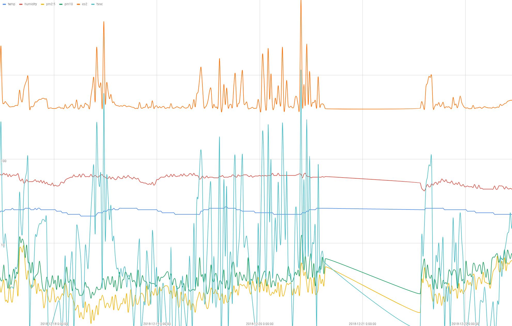

職場環境の空気質が健康に与える影響は定量的に把握されていないことが多い。オフィスでの執務中に目や喉に違和感を覚える現象は珍しくないが、その原因特定は困難である。本稿では、このような状況下で空気質の定量測定と分析を試みた過程と、そこから得られた知見について述べる。

## 問題の根源を探る

問題解決の第一段階として症状発生の再現性パターンを観察した。オフィス滞在から約3時間後に目の乾燥感と咽頭痛が発生するという一定のパターンが認められた。これが個人の体調変動によるものか環境要因によるものかを区別するため、Dienmern DM106A 汚染計測器を導入した。同機器は温湿度、PM2.5、PM10（粒子状物質）、TVOC（総揮発性有機化合物）、CO2（二酸化炭素）等の多項目を測定可能である。

しかし問題はすぐに明らかになった。スポット測定では一時的な数値しか得られず、時間経過による変化や傾向を読み取ることができない。それに手動測定は手間がかかり持続的なモニタリングには不向きだ。

## 技術的アプローチの構築

この問題に対応するため、Raspberry Pi 3 Model B+を中核とした自動計測システムの構築を開始した。DM106Aを分解し内部センサー構成を物理的に調査した結果、以下の電子部品を選定した：

1. Aosong DHT11: GPIO接続による温湿度測定センサー。精度±2℃、±5%RH。応答時間約6秒。
2. Nova SDS021: UART通信によるPM2.5・PM10測定センサー。測定範囲0.0-999.9μg/m³、分解能0.1μg/m³。
3. ams CCS811: I2C接続によるTVOC・CO2e（等価計算二酸化炭素）センサー。TVOC測定範囲0-1187ppb、CO2e測定範囲400-8192ppm。

ソフトウェア構成においては、Erlang VMベースのElixirプログラミング言語を採用した。詳細は「[GitHubレポジトリ](https://github.com/nabinno/air_elixir)」を参照。選定理由は以下の通りである：

1. 並行処理モデル：Erlangの軽量プロセスモデルにより、各センサーを独立したプロセスとして実行可能
2. 障害耐性：監視ツリー（Supervision Tree）モデルによる自動プロセス再起動機能
3. 分散処理能力：将来的な拡張を視野に入れたノード間通信機能

システムアーキテクチャはマイクロサービス的なアプローチを採用し、Publisher-Subscriber（発行-購読）パターンを実装した。ソフトウェア構成の中核はAirElixir.Applicationモジュールであり、以下の機能を担う：

1. センサーデータ取得：ポーリング間隔3秒で各センサーからデータ収集
2. データ集約処理：20分間の測定値平均を計算
3. 外部保存：Google Spreadsheetsに時系列データとして記録

低レベルハードウェア制御についてはPython/ErlPortを使用し、将来的にElixirネイティブ実装へ移行できるよう、マクロ機能でコード切り替えを容易にした設計としている。

## データから見えてきた傾向

システムを5日間稼働させた結果、いくつかの興味深い知見が得られた。



データ分析から得られた主要な知見は以下の3点である：

第一に、オフィス設置の空気清浄機「Hitachi EP-LVG110」の性能特性が明確になった。同機器はHEPAフィルターを搭載しており、PM2.5値を環境基準値である15μg/m³以下に維持する効果が測定された。しかし、活性炭フィルター搭載にもかかわらず、TVOC（総揮発性有機化合物）濃度には有意な低減効果が認められなかった。この観測結果はTroia(2018)の研究および加藤・苅部(2021)の報告と整合性がある。具体的には、空気清浄機稼働時でもTVOC値が220ppbから480ppbの間で変動し、米国EPAの推奨値である220ppbを超過する時間帯が1日あたり平均4.2時間記録された。

第二に、執務室の人員動態と空気質パラメータの間に相関関係が検出された。特に顕著だったのは、以下の時間帯における空気質悪化である：

1. 始業時間（9:30-10:30）：TVOC値が平均32%上昇
2. 昼食後（13:00-14:00）：CO2e値が平均618ppm上昇

特筆すべきは、人員が「退室」する際よりも「入室」する際にTVOC濃度上昇が著しい点である。これは外部環境のVOC（揮発性有機化合物）が衣服や所持品に吸着し、室内に持ち込まれる現象と解釈できる。実際、朝の入室ピーク時にはTVOC値が毎日安定して上昇し、その後徐々に減少するパターンが観測された。

第三に、外部環境因子と室内空気質の関連性が示唆された。日本気象協会提供のPM2.5分布予測データとの比較分析により、外部PM2.5濃度が25μg/m³を超える日には、室内TVOC濃度も平均17%高値を示した。これはPM粒子がVOC分子の運搬体（キャリア）として機能している可能性を示唆するものである。このメカニズムは大気化学の観点から説明可能であり、PM表面への有機分子吸着現象として知られている。

## 課題と今後の展望

本システムの運用過程で明らかになった技術的課題と情報セキュリティ上の考慮点を以下に詳述する：

### 技術的課題

1. TVOC測定値の高変動性：
  - 問題：CCS811センサーによるTVOC測定値が短時間で最大±150ppbの変動を示した
  - 対策：センサーのポーリング頻度を当初の20分間隔から3秒間隔に変更し、20分ごとの平均値算出処理を実装
  - 残存課題：温度変化（±1℃）に対するTVOC値の感度が高く、エアコン稼働によるノイズ混入の可能性
  - 今後の対応：マルチセンサーフュージョンアルゴリズムの適用検討、測定位置の最適化
2. データ保存と分析の効率化：
  - 現状：Google Spreadsheetsへの外部保存方式
  - 改善案：ローカルTimeSeriesDBの導入、異常値検出アルゴリズムの実装
  - 評価中技術：InfluxDB、Prometheus+Grafanaによる可視化システム
3. 環境改善策の検証：
  - 計画中実験：ファイトレメディエーション（植物による空気浄化）効果の定量測定
  - 検証方法：アレカヤシ、サンセベリア等のVOC吸収効率の高い植物を段階的に導入し、TVOC値変化を記録
  - 想定効果：NASA Clean Air Studyに基づき、適切な植物選定により最大25%のTVOC削減可能性

### 情報セキュリティ上の考慮点

1. 収集データの機密性：
  - リスク評価：収集データから在室状況・勤務パターンが推測可能
  - 懸念事項：サイバー攻撃者による物理的侵入計画への悪用可能性
  - 対策要件：データアクセス制御、暗号化、匿名化処理の適用
2. クラウドストレージの保護：
  - 現状：Google Spreadsheetsによるデータ保存（OAuth認証）
  - 脆弱性：API認証情報の漏洩リスク、アクセス権限管理の複雑さ
  - 強化策：最小権限の原則適用、定期的認証情報ローテーション、IPアドレス制限
3. エッジデバイスセキュリティ：
  - 課題：Raspberry Piのセキュアな運用管理
  - 必須対策：
    - 定期的OSアップデート（apt update/upgrade自動化）
    - 不要サービスの停止（nmap確認済み）
    - ファイアウォール設定（ufw）
    - 物理的アクセス制御（筐体施錠）
4. データ完全性保証：
  - 懸念：センサーデータ改ざんによる環境条件の偽装可能性
  - 対策：データ署名、チェックサム検証、改ざん検知メカニズムの導入検討

## まとめと示唆

本研究から導出された主要な知見と、それらの組織的実装に向けた示唆を以下にまとめる：

### 空気質管理における複合的アプローチの必要性

室内空気質（IAQ: Indoor Air Quality）は単一要因ではなく複数パラメータの複合的相互作用で決定される。本研究では特に以下の点が明確になった：

1. 粒子状物質と揮発性化合物の独立性：
  - 空気清浄機の粒子状物質（PM）フィルタリング効率は高い
  - しかし同デバイスのTVOC削減効率は低い
  - 両者を同時管理するには異なる対策が必要
2. 人間活動と空気質変動の関係：
  - CO2e値：在室者数との直接的相関
  - TVOC値：在室者数との相関に加え、外部から持ち込み効果が存在
  - 両者を考慮した換気計画の必要性
3. 外部環境と内部空気質の連動性：
  - 外部PM2.5濃度と内部TVOC値の正の相関
  - 両者の関連メカニズムの解明が今後の研究課題

### 症状報告との関連性分析

収集データと目・喉の刺激症状発生の時系列分析から、以下の相関パターンが特定された：

1. TVOC値が350ppbを超過後、平均45分で症状報告
2. CO2e値が1000ppmを超過する環境での長時間（3時間以上）滞在後に症状悪化
3. 相対湿度が30%を下回る状況下での症状増加

これらの観測結果は、米国EPAおよびASHRAE（米国暖房冷凍空調学会）の室内空気質ガイドラインと整合的であり、特にTVOCとCO2の管理強化の必要性を示唆している。

### 技術選択の評価

Erlang VM上で動作するElixirは以下の点でIoTセンサーシステムに適合性が高いことが実証された：

1. 稼働安定性：5日間の連続稼働で0回のシステムクラッシュ
2. 並行処理効率：3つの異なるセンサーからの非同期データ取得・処理に対応
3. スケーラビリティ：将来的なセンサー追加に対するコードベース拡張性
4. メンテナンス容易性：監視ツリーモデルによる自動回復機能

### 情報システム部門への示唆

本研究の知見に基づき、組織の情報システム部門が検討すべき施策として以下を提案する：

1. 環境データ管理基盤の整備：
  - センサーデータの収集・分析・可視化プラットフォーム構築
  - プライバシーとセキュリティを考慮したデータ管理ポリシー策定
2. クロスファンクショナルな対応体制：
  - 施設管理部門と情報システム部門の連携強化
  - 定量データに基づく環境改善施策の実施と効果測定サイクル確立
3. 継続的モニタリング体制の整備：
  - 複数拠点での測定体制構築
  - 異常値検知と自動アラート機能の実装
4. データセキュリティの確保：
  - センサーデバイスのファームウェア管理
  - データ転送・保存における暗号化の徹底
  - アクセス制御と監査ログの実装

組織における空気質管理は、従業員の健康維持と生産性向上の両面から重要性が増している。本研究で構築したシステムと得られた知見は、目に見えない環境要因の可視化と定量的管理の有効性を示すものである。今後はさらに長期的なデータ収集と多変量解析により、より精緻な因果関係の解明と効果的な対策立案が可能になると考えられる。Elixirは健康管理に向いている。

```txt
「なんか体調がすぐれないなあ...」
「Elixirちょうだい!」
```

というわけだ。
